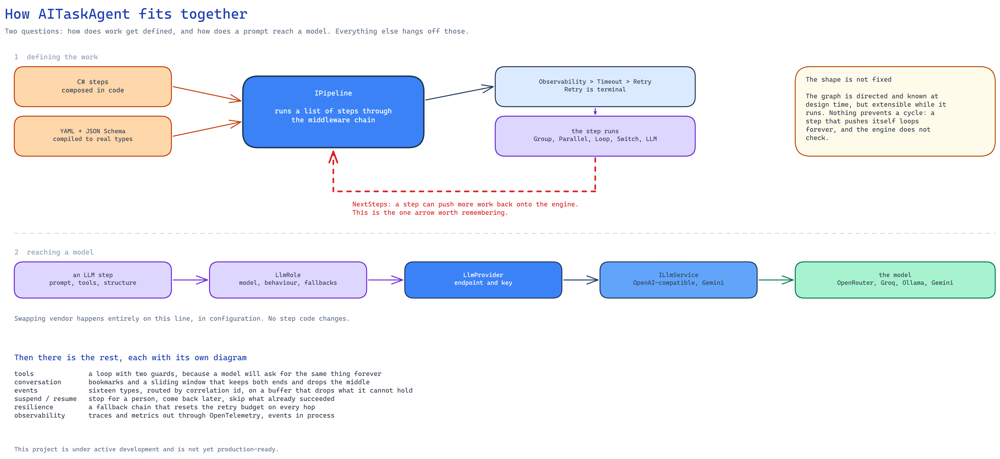
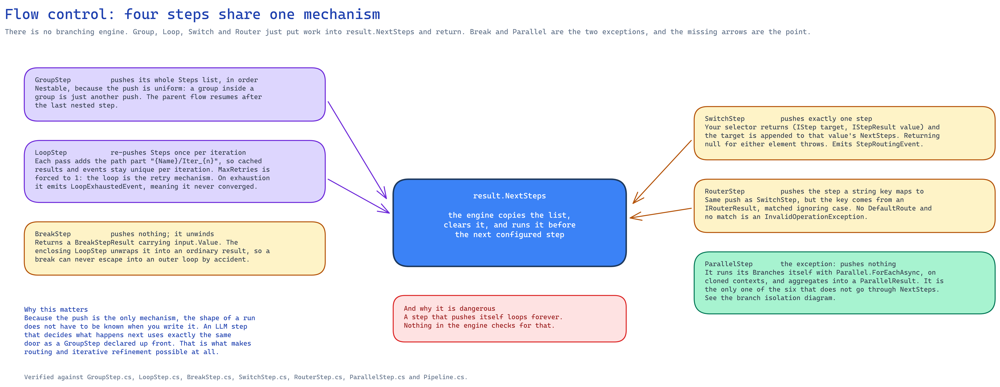

# AITaskAgent Framework

> [!NOTE]
> This project is under active development and is not yet production-ready. APIs and behavior may change without notice.

A powerful .NET framework for building AI agent pipelines with LLM integration, tools, observability, and resilience.

## How it fits together

A pipeline is a list of steps. The engine runs them through a middleware chain, and steps can inject
more steps as they go, so the graph takes shape while it executes. LLM steps reach a model through a
**role**, which names a model on a **provider** — swapping GPT for Gemini is configuration, not code.



<!-- Source: docs/assets/diagrams/framework-map.excalidraw -->

The dotted arrow back to the engine is the part worth noticing: a step can return more steps, which
is how routing and iterative refinement work without the shape being known up front.

## Features

- **Pipeline Architecture** - Compose steps into complex workflows
- **Dynamic Execution Graph** - Branching (groups), parallelism, loops, and dynamic routing
- **Declarative Pipelines** - Define a whole pipeline in YAML, with JSON Schemas compiled to real C# types at startup
- **LLM Integration** - Provider-agnostic LLM service, with OpenAI-compatible and Gemini providers
- **Provider × Role Configuration** - Connection targets and per-step behaviour configured separately, with fallback chains
- **Open-Weight Model Support** - Recovers tool calls from models that ignore the `tool_calls` protocol and emit them in the message text
- **Human-in-the-Loop** - Suspend a pipeline for human input and resume it, skipping the work already done
- **Intention Routing** - LLM-based intent classification and routing, with self-correction when the model invents a route
- **Tool System** - Define tools that LLMs can invoke
- **Conversation Management** - Context with bookmarks and sliding window
- **Observability** - Built-in events, OpenTelemetry traces, and metrics
- **Resilience** - Retry, timeout, circuit breaker, rate limiting
- **Extensible** - Custom steps, tools, middlewares, and providers

## Pipeline Flow Control

Pipelines are not just linear sequences. They support complex flows:



<!-- Source: docs/assets/diagrams/flow-control-nextsteps.excalidraw -->

Each branch of a `ParallelStep` runs with its own conversation and step path, so branches cannot
disturb one another. After a `GroupStep` finishes its nested steps, execution continues with the
next step in the parent flow.

### Flow Control Steps

| Step Type | Behavior | Use Case |
|-----------|----------|----------|
| `GroupStep` | Sequential branch (nestable) | Logical grouping, sub-workflows |
| `ParallelStep` | Concurrent execution, one isolated conversation per branch | Fetch multiple APIs simultaneously |
| `LoopStep` | Repeat a body until it breaks or exhausts its iterations | Refine a draft until a critic accepts it |
| `BreakStep` | Leave the enclosing loop, carrying a value out | Early exit once a condition holds |
| `SwitchStep` | Dynamic routing | Intent-based routing |
| `RouterStep` | LLM-based routing over named options | AI-classified routing |

### Key Concept: NextSteps

Steps can dynamically inject more steps via `NextSteps`:

```csharp
result.NextSteps.Add(new AdditionalStep());
// Pipeline will execute AdditionalStep after current step
```

## Quick Start

```csharp
using AITaskAgent.Configuration;
using AITaskAgent.Core.Execution;
using AITaskAgent.Core.Steps;

// Register services, then initialise the framework's static factories
services.AddAITaskAgent();
var provider = services.BuildServiceProvider();
provider.UseAITaskAgent();

// The pipeline is a service, not a static entry point
var pipeline = provider.GetRequiredService<IPipeline>();

var result = await pipeline.ExecuteAsync(
    name: "GreetingPipeline",
    steps: [new GreetStep()],
    input: new StepResult<string>(new EmptyStep("Seed"), "world")
);

// Parallel execution: each branch runs with its own conversation and step path
var parallel = new ParallelStep("FetchAll",
    new FetchUsersStep(),
    new FetchOrdersStep()
);
```

Or declare the same pipeline in YAML and let the engine compile the schemas:

```yaml
name: DocumentPipeline
steps:
  - !LlmStep
    stepId: Classify
    inputSchema: DocumentInput
    outputSchema: ClassificationOutput
    profileName: default
    userPrompt: "@classifier"
```

## Documentation

### Getting Started
- [Installation](docs/getting-started/installation.md)
- [Starting a New Project](docs/getting-started/new-project.md) - From an empty folder to a running pipeline
- [Quick Start](docs/getting-started/quick-start.md)
- [Architecture](docs/getting-started/architecture.md)

### Guides
- [Core Concepts](docs/guides/core-concepts.md)
- [Steps](docs/guides/steps.md) - Including flow control steps
- [LLM Steps](docs/guides/llm-steps.md)
- [YAML Pipelines](docs/guides/yaml-pipelines.md) - Declarative pipelines with compiled schemas
- [Human-in-the-Loop](docs/guides/human-in-the-loop.md) - Suspending and resuming a run
- [Open-Weight Models](docs/guides/open-weight-models.md) - Tool calls and reasoning from models that ignore the protocol
- [Tools](docs/guides/tools.md)
- [Conversation](docs/guides/conversation.md)
- [Conversation Storage](docs/guides/conversation-storage.md)
- [Middlewares](docs/guides/middlewares.md)
- [Event System](docs/guides/event-system.md)
- [OpenTelemetry](docs/guides/opentelemetry.md)
- [Resilience](docs/guides/resilience.md)
- [Intention Routing](docs/guides/intention-routing.md)
- [Configuration](docs/guides/configuration.md)

### Extensibility
- [Custom Steps](docs/extensibility/custom-steps.md)
- [Custom Tools](docs/extensibility/custom-tools.md)
- [Custom Middlewares](docs/extensibility/custom-middlewares.md)
- [Custom Events](docs/extensibility/custom-events.md)
- [Custom LLM Providers](docs/extensibility/custom-llm-providers.md)

### API Reference
- [Interfaces](docs/api-reference/interfaces.md)
- [Core Namespace](docs/api-reference/core-namespace.md)
- [LLM Namespace](docs/api-reference/llm-namespace.md)
- [Observability Namespace](docs/api-reference/observability-namespace.md)
- [Extensions](docs/api-reference/extensions.md)

### Examples
- [Basic Pipeline](docs/examples/basic-pipeline.md) - Linear and parallel
- [LLM with Tools](docs/examples/llm-with-tools.md)
- [Custom Middleware](docs/examples/custom-middleware.md)

## Requirements

- .NET 10.0+
- C# 14

## Dependencies

| Package | Version | Purpose |
|---------|---------|---------|
| Microsoft.Extensions.* | 10.0.0 | DI, Logging, Options |
| Newtonsoft.Json | 13.0.4 | JSON serialization |
| NJsonSchema | 11.6.1 | JSON Schema for tools, and code generation for YAML schemas |
| YamlDotNet | 13.0.1 | Parsing declarative pipelines |
| Microsoft.CodeAnalysis.CSharp | 5.0.0 | Compiling YAML schemas into real types at startup |
| Microsoft.ClearScript.V8 | 7.5.0 | Running JavaScript validation embedded in schemas |
| Google.GenAI | 0.10.0 | Gemini provider |

The OpenAI provider talks HTTP directly rather than through the official SDK, which is what lets it
work against any OpenAI-compatible endpoint (OpenRouter, Groq, Ollama, …) and pass vendor-specific
parameters straight through.

## License

MIT License
