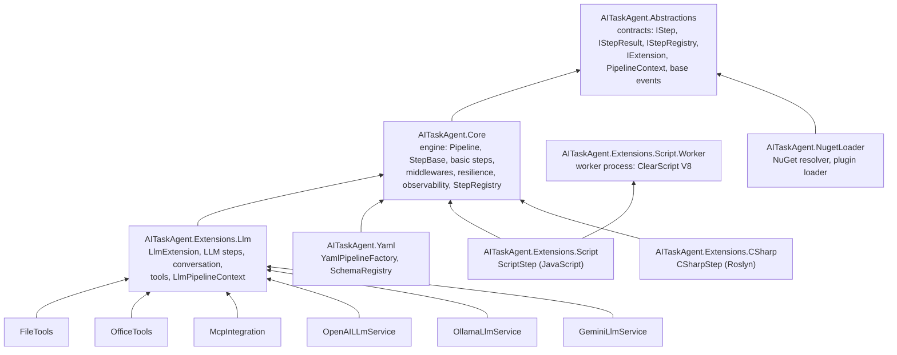

# Architecture v2 and Migration Notes

Version 2 splits the former single project `Framework/AITaskAgent.csproj` into five assemblies with dependencies flowing in one direction (the script worker, the C# extension and the NuGet loader came later and complete the framework layer), turns everything that is not engine (LLM, JavaScript, file tools, Office and MCP) into extensions, and replaces YAML with compiled types by YAML that is interpreted at runtime. This document describes the result and lists, as a migration note, what used to be one thing and is now another. Namespaces have been kept and only the assembly containing them changes, so almost all consumer code still compiles once the project references are changed.

## Projects and Dependencies

`AITaskAgent.Abstractions` holds the contracts and the data types that cross assemblies: `IStep`, `IStepResult` and the concrete results, `IStepRegistry`, `IExtension` and `IExtensionBuilder`, `IJsonSchemaStep` and the base class `PipelineContext`, `[StepTag]`, the `IEventChannel` interface and the base events. `AITaskAgent.Core` is the engine: `Pipeline`, `StepBase`, the basic steps (`ActionStep`, `DelegatedStep`, `GroupStep`, `ParallelStep`, `LoopStep`, `BreakStep`, `SwitchStep`, `DeclarativeSwitchStep`), the middlewares, resilience, observability, `StepRegistry` and `PipelineContextFactory`, with no dependency on any LLM. `AITaskAgent.Extensions.Llm` provides `LlmExtension` and everything that used to live in `Framework/LLM`; the three providers (`OpenAILLmService`, `OllamaLlmService`, `GeminiLlmService`) and the three tool collections hang off it. `AITaskAgent.Extensions.CSharp` (`CSharpStep`, Roslyn) references Core, and `AITaskAgent.NugetLoader` (NuGet resolver and plugin loader) references only Abstractions. `AITaskAgent.Yaml` only knows about Core and creates steps through the registry, so it does not know what an LLM is, and `AITaskAgent.Extensions.Script` encapsulates ClearScript V8, which is no longer in any other project.

The engine internals that the other assemblies need (the context path, `StepResult.Value` or the internal state of the LLM steps) are resolved with `InternalsVisibleTo` declared in the `csproj` files and not by making them public, so as not to widen the contract, which means third-party extensions cannot access them.

### Packages per Project

| Project | Own packages |
|---|---|
| Abstractions | `Microsoft.Extensions.{Logging,DependencyInjection}.Abstractions`, `Options`, `Newtonsoft.Json`, `NJsonSchema` |
| Core | the above, `Microsoft.Extensions.Http`, `Caching.Memory`, `YamlDotNet` (used by the template engine) |
| Extensions.Llm | as Core plus `System.Memory.Data` |
| Yaml | base plus `YamlDotNet` |
| Extensions.Script | only Core; references the worker so that its files ship with the application |
| Extensions.Script.Worker | executable; `Newtonsoft.Json` and `Microsoft.ClearScript.V8` (7.5.0, with ICU and the `win-x64` and `linux-x64` native binaries) |
| Extensions.CSharp | only Core; `Microsoft.CodeAnalysis.CSharp` 5.0.0 and `NJsonSchema.CodeGeneration.CSharp` |
| NugetLoader | only Abstractions; `NuGet.Protocol`, `NuGet.Packaging`, `NuGet.Frameworks`, `NuGet.Versioning` (7.3.1) |
| FileTools | `Microsoft.CodeAnalysis.CSharp` 5.0.0 (for `view_code_item` over C#), `FileSystemGlobbing` |

The engine (Core and the YAML engine) loses `Microsoft.CodeAnalysis.CSharp` and `NJsonSchema.CodeGeneration.CSharp` (which `SchemaCompiler` used; they now live only in `AITaskAgent.Extensions.CSharp`, and `Microsoft.CodeAnalysis.CSharp` also in `FileTools`), `Microsoft.ClearScript.V8` outside the scripting extension, and the `OpenAI` package, which no code used.

## Pipeline Context

`PipelineContext` no longer carries the conversation: the base class lives in Abstractions, is not `sealed`, and its `CloneForBranch()` is virtual, so a parallel branch keeps the derived type. `LlmPipelineContext : PipelineContext` (in `AITaskAgent.Extensions.Llm`) adds `Conversation` and clones it in each branch. Steps that need a specific context declare it with `IStep.RequiredContext` (the LLM steps return `typeof(LlmPipelineContext)`), and `Pipeline.ExecuteAsync` checks it for the whole step tree before running anything, with a message that names the step. Cases and the `default` of the declarative switch take part in that up-front check, and what is only known at execution time (the `NextSteps` of a step, the target chosen by the selector of a `SwitchStep<TIn>`) is checked just before it runs and ends with an error result if it does not match. `AddAITaskAgent()` registers `LlmPipelineContextFactory`, so the default context is already the LLM one and typical code does not change; whoever builds contexts by hand uses `LlmPipelineContextFactory.Create(conversation)` or `new LlmPipelineContext(...)`.

The engine signatures (`IStep.ExecuteAsync`, `IPipelineMiddleware`, `IPipeline`) receive the base class `PipelineContext`. There is no context interface: it was evaluated and deleted (decision of 2026-10-17) because no signature consumed it, and switching to it would have forced changes to every sample and test step, with casts to the base class inside the engine. Extensions inherit from the record and override `CloneForBranch`.

## Step Registry and Extensions

There is a single `IStepRegistry` per service collection, registered as an instance by `AddAITaskAgentCore()`, and a single `[StepTag]` attribute. Each extension implements `IExtension.Register(IExtensionBuilder)` to add services and steps, and `services.AddExtension(...)` runs it idempotently by name, and the framework itself loads no assemblies: the application references the extensions and adds them (the workflow designer's Core can load them from folders, see `docs/designer/architecture.md` §17). The guide for writing one is in [Custom extensions](extensibility/custom-extensions.md).

## ScriptStep: One Process per Run

`ScriptStep` does not run V8 in the application process. When a pipeline run starts (`IPipeline.ExecuteAsync` calls the run hooks the steps name, `IPipelineRunHook`, before any step), the scripts of all the run's known ScriptSteps and the libraries they use are joined in one bundle and compiled once in one `AITaskAgent.Extensions.Script.Worker` process (an executable that carries ClearScript); a compile error fails the run before any step runs. Each execution of a step sends that worker the name of its function and the input and reads the result, all as JSON lines over its standard input and output; the call runs in a fresh V8 context (no globals shared between steps), and `context.get/set` and `log` make the round trip over the same channel. The worker is killed when the run ends; the bundle is never cached between runs. The host limits the worker from the outside (process memory with a *job object* on Windows and a watchdog on other platforms, termination on timeout or cancellation) and the worker limits itself from the inside (V8 interruption, heap and stack caps with hard ceilings). A worker that dies or exceeds its memory is an error result for the step, and if the host dies it takes the worker with it. `AITaskAgent.Extensions.Script` references the worker only so that its files ship with the application; no line of the host calls ClearScript. Details of limits, cost and deployment are in the [YAML guide](guides/yaml-pipelines.md#scriptstep-javascript-declarable).

## ExecStep: One Process per Execution, No Shell

`ExecStep` is a core step (`AITaskAgent.Core/Steps/ExecStep.cs`, registered by the assembly scan like `SuspendStep`) that runs an external executable or batch file and returns the text of its stdout. It builds a `ProcessStartInfo` with `UseShellExecute = false` and `ArgumentList` (one rendered template per argument, no quoting to get wrong), starts from a minimal environment unless `inheritEnvironment: all`, reads stdout and stderr concurrently with a character cap, and enforces its own `timeoutMs` besides the step timeout of the pipeline. On Windows the process is put in a job object with only `KILL_ON_JOB_CLOSE` (`Support/Exec/ProcessJob.cs`; the one in the Script extension is `internal` and limits memory and children, so it is not reused), which kills grandchildren, orphans included, on timeout, cancellation, output limit and normal end; elsewhere only `Process.Kill(entireProcessTree: true)` is available, so orphaned grandchildren survive. `.bat`/`.cmd` go through `cmd.exe /d /s /c` with every argument double-quoted, and an argument with `"`, `%`, a line break or NUL is refused instead of escaped.

Failures are typed: `ExecStepException` (with `Kind`, `ExitCode` and the tail of stderr) for non-zero exit, denial, start failure, invalid configuration and output limit; `TimeoutException` and `OperationCanceledException` for timeout and cancellation, so a host that classifies errors by exception type distinguishes them. Because every error carries an exception, `RetryMiddleware` never re-runs the command. A host can register an `IExecStepPolicy` in DI to deny a command or confine its working directory (it sees the rendered executable, arguments, working directory and the names, never the values, of the environment); without one everything is allowed. The step is not a sandbox: the command has the privileges of the host process.

## YAML v2

YAML is parsed to `JToken`, each step is created with `IStepRegistry.Create(type, config, services)` and validated against `IStepRegistry.Describe(type)`; containers (`GroupStep`, `ParallelStep`, `LoopStep`, `SwitchStep`) declare their children in a nested way. Inputs and outputs are JSON validated at runtime against a JSON Schema (`JsonStepResult`, and `LlmJsonStepResult` in the LLM case), with no types generated or compiled. `IStepRegistry.Create` without an `IServiceProvider` walks the same constructors as with one, using only default values, and throws `InvalidOperationException` if none of them is invocable (it no longer returns an unbuilt object). Reading the YAML has a fixed budget (64 levels of depth, 200,000 expanded nodes, cyclic aliases rejected), and `ScriptStep` runs in the run's worker process (see [ScriptStep: One Process per Run](#scriptstep-one-process-per-run)), with heap, `ArrayBuffer`, stack and time limits, so the host never loads V8 or holds the script's memory. The full grammar and the typical errors are in [YAML pipelines](guides/yaml-pipelines.md).

## What Changed from v1

| Before (v1) | Now (v2) |
|---|---|
| One project `Framework/AITaskAgent.csproj` | `AITaskAgent.Abstractions`, `AITaskAgent.Core`, `AITaskAgent.Extensions.Llm`, `AITaskAgent.Yaml` and `AITaskAgent.Extensions.Script`; consumers' project references must change (a project with LLM steps references `Extensions.Llm`, one that only uses the engine references `Core`) |
| `Framework/` folder | Removed; each project sits at the root of the repository. Comments and links with `Framework/...` paths are obsolete |
| Static `StepManager` (`CreateStep`, `GetStepDescription`, `RegisterStepsFromAssembly`, `TryGetStepType`, ambient service provider) | Injectable `IStepRegistry` (`Add`, `AddFromAssembly`, `TryGetType`, `GetRegisteredTypes`, `Create`, `Describe`), with no global state or ambient provider: `Create` only uses DI if an `IServiceProvider` is passed |
| `[YamlStepTag]` plus `IYamlStep` to register a step in YAML | Only `[StepTag]`; the step is registered with `builder.AddStep<T>()` in an extension. `IYamlStep` and `[YamlStepTag]` no longer exist |
| `PipelineContext` `sealed` with `Conversation` | `PipelineContext` base without conversation and `LlmPipelineContext` with it; `CloneForBranch()` virtual |
| `PipelineContextFactory.Create(conversation)` | `LlmPipelineContextFactory.Create(conversation)`; `PipelineContextFactory.Create(subscribers)` returns a `PipelineContext` that, with `AddAITaskAgent()`, is a `LlmPipelineContext` at runtime |
| `new PipelineContext(...)` for a pipeline with LLM steps | `new LlmPipelineContext(...)`; with a base context the pipeline fails before running anything |
| `context.Conversation` | `context.AsLlmContext(Name).Conversation` inside a step (or a cast to `LlmPipelineContext`) |
| Single `AddAITaskAgent()` | `AddAITaskAgent()` is still core plus LLM; new `AddAITaskAgentCore()` / `UseAITaskAgentCore()`, `AddAITaskAgentLlm()`, `AddAITaskAgentYaml()`, `AddScriptExtension()` and `AddExtension(...)` |
| `AddFileTools()`, `AddOfficeTools()`, `AddMcpToolProvider()` | Still exist as sugar over `FileToolsExtension`, `OfficeToolsExtension` and `McpExtension`; they are now idempotent by name |
| `SchemaCompiler` (NJsonSchema plus Roslyn: one C# type per schema) | `SchemaRegistry` (`LoadFromFolderAsync`, `AddAsync`, `Add`, `Get`, `TryGet`) and runtime validation; no code is generated |
| JS validation schemas in `SchemaCompiler` (`jsValidateFunction`, ClearScript in the core) | Removed; JavaScript only exists as a step, `ScriptStep` in `AITaskAgent.Extensions.Script`. JS schema validation was not reimplemented |
| YAML with tags (`- !LlmStep` with `stepId`, `dependsOn`, `inputSchema`, `outputSchema` mandatory) | YAML with maps: `id`, `type: LlmStep`, `dependsOn`, `inputSchema` and `outputSchema` optional; the remaining keys are flat configuration. No v1 compatibility and no migrator |
| YAML steps with compiled types (`{Name} : LlmStepResult<{Name}Data>`) | `JsonStepResult` (core) and `LlmJsonStepResult` (LLM), with the `JsonSchema` per instance |
| `StepBase.InputSchema` / `OutputSchema` (strings, "YAML only") | Removed; they are structural keys of the YAML that the factory delivers through `IJsonSchemaStep` |
| `StepBase.Name { get; protected set; }`, `Schema` not virtual | `Name { get; protected internal set; }` (the factory sets the `id`), `Schema` `protected virtual` |
| No declarable flow control beyond sequence | `SwitchStep` with `cases`/`default`, `LoopStep` with `BreakStep.when`, `ParallelStep.branches` and nestable `GroupStep` (`DeclarativeSwitchStep` is new; `BreakStep.When` is new); `ParallelStep.failFast` (default `true`) lets a fan-out survive a failed branch, each one keeping its own error in the `ParallelResult` |
| `YamlPipelineFactory(...)` with `SchemaCompiler` | `YamlPipelineFactory(IServiceProvider, IStepRegistry, SchemaRegistry, IPipeline)`; `YamlPipeline.ExecuteAsync(input, context, ct)` |
| `YamlLlmStep` in `Framework/YAML`, `[YamlStepTag]` | `YamlLlmStep` in `AITaskAgent.Extensions.Llm`, `[StepTag("LlmStep")]`, namespace `AITaskAgent.YAML.Steps` kept; it resolves its role once the registry is populated (a non-existent role fails when the pipeline is built) |
| LLM events (`LlmResponseEvent`, `Tool*Event`, `Tag*Event`) in the core | In `AITaskAgent.Extensions.Llm` with the same namespace `AITaskAgent.Observability.Events` |
| `ParallelStep` shared the input object between branches | Each branch receives a shallow copy (`StepResult.CopyForBranch`), because two branches whose first step schedules children over the input were writing to the same `NextSteps` |
| No extensions | `IExtension` / `IExtensionBuilder` and optional `ConfigurationModel()` (consumed by the workflow designer's plugin wiring and implemented by the CodebaseAnalysis designer extension) |

### Migrating a Consumer

A consumer that only used `AddAITaskAgent()`, plus steps and pipelines in C#, usually only changes its project reference to `AITaskAgent.Extensions.Llm` (or to `AITaskAgent.Core` if it does not use LLMs, with `AddAITaskAgentCore()`). Four points must be reviewed by hand: the places that built contexts with a conversation (`PipelineContextFactory.Create(conversation)` and `new PipelineContext(...)`), any use of `StepManager`, `[YamlStepTag]` or `IYamlStep`, the YAML pipelines (which must be rewritten to the v2 format; there is no migrator) and the references to `SchemaCompiler`.

### Known Limits

`inputSchema` is only validated at the pipeline input and in the `dependsOn` check, not in every step at execution time. `LoopStep`, when it breaks, returns a `StepResult<object>` with the value and does not keep the `JsonStepResult` or its schema. Wrapper steps that call an LLM step internally without declaring `RequiredContext` are not detected by the up-front validation (they fail with a clear message, but at execution time). `ScriptStep` costs one process per run (.NET and V8 startup and the compile, about 0.4 s on the development machine, then about 1-1.5 ms per call) and depends on the platform's native V8; the Linux memory watchdog has not been run. `yaml-schema-compilation` was redrawn for the v2 flow (without Roslyn). The other images in `docs/assets/images` have not been regenerated: `framework-map` keeps the previous drawing, with its note text updated only in the `.excalidraw`.
