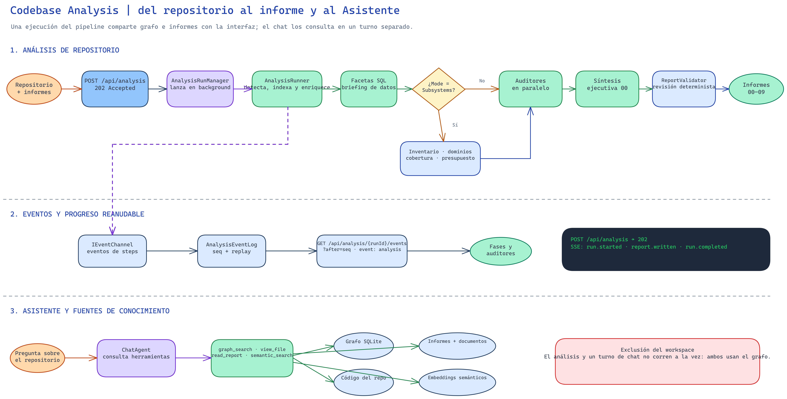

# Síntesis de revisión de AITaskAgent

Fecha: 2026-10-14  
Alcance: Framework, proveedor OpenAI-compatible y demo Codebase Analysis (Core, host web, API y SPA).

## Conclusión

AITaskAgent separa el motor reutilizable de pipelines de la aplicación Codebase Analysis, que añade análisis de repositorios, informes y una interfaz web local con chat y herramientas de conocimiento. La estructura general está clara y las suites disponibles pasan, aunque encontré riesgos de concurrencia y contratos incompletos que conviene cerrar antes de tratar la demo como un servicio multiusuario o de larga exposición. Los hallazgos se concentran en las fronteras entre workspace, transporte de eventos y proveedor LLM, no en la lógica central de análisis.

No encontré un defecto crítico reproducido en esta revisión. Los cuatro hallazgos siguientes son de prioridad P2: tres afectan a concurrencia o consistencia y uno deja sin aplicar un límite de petición prometido por la documentación. La prioridad refleja que las carreras requieren intercalación concurrente, mientras que el límite incompleto contradice el contrato publicado aunque las pruebas no lo hayan ejercitado con Kestrel.

## Hallazgos

### P2: Cambio de workspace no es atómico con todas las operaciones

Al crear una sesión, el endpoint lee `workspace.Current` y `workspace.ChatStore` fuera del cerrojo común, y luego guarda la sesión con ambos valores ([ChatEndpoints.cs](../../Samples/CodebaseAnalysisWeb/Api/ChatEndpoints.cs#L99)). Mientras tanto, `PUT /api/workspace` cambia ambos bajo `workspace.Gate` ([WorkspaceEndpoints.cs](../../Samples/CodebaseAnalysisWeb/Api/WorkspaceEndpoints.cs#L40), de modo que una intercalación puede combinar la ruta del repositorio anterior con el almacén del nuevo. También puede guardarse una operación de conocimiento en el repositorio que dejó de estar activo, porque documentos y conocimiento capturan el workspace antes de reservar la operación ([DocumentsEndpoints.cs](../../Samples/CodebaseAnalysisWeb/Api/DocumentsEndpoints.cs#L45), [KnowledgeEndpoints.cs](../../Samples/CodebaseAnalysisWeb/Api/KnowledgeEndpoints.cs#L21), [KnowledgeService.cs](../../Samples/CodebaseAnalysisWeb/Knowledge/KnowledgeService.cs#L56)). En una instancia local suele ser una carrera poco frecuente, pero el resultado es persistente y puede confundir qué repositorio recibió el cambio.

**Mejora:** adquirir el workspace activo y reservar la operación en una única sección crítica, para que la referencia al repositorio y el permiso para escribir correspondan al mismo estado. Si el workspace cambió antes de reservarla, responder con conflicto en vez de operar sobre una referencia obsoleta. Así, la interfaz puede reintentar sobre el repositorio que el usuario realmente tiene abierto.

### P2: El límite de 1 MiB no está aplicado a todas las rutas JSON

El README afirma que el resto de rutas nuevas con cuerpo admiten 1 MiB ([README.md](../../Samples/CodebaseAnalysisWeb/README.md#L251)), aunque el tamaño solo se fija explícitamente en algunas rutas de documentos y conocimiento. `POST /api/analysis`, `PUT /api/workspace` y los endpoints de chat no tienen esa metadata ([DocumentsEndpoints.cs](../../Samples/CodebaseAnalysisWeb/Api/DocumentsEndpoints.cs#L20), [KnowledgeEndpoints.cs](../../Samples/CodebaseAnalysisWeb/Api/KnowledgeEndpoints.cs#L39), [AnalysisEndpoints.cs](../../Samples/CodebaseAnalysisWeb/Api/AnalysisEndpoints.cs#L15), [WorkspaceEndpoints.cs](../../Samples/CodebaseAnalysisWeb/Api/WorkspaceEndpoints.cs#L30), [ChatEndpoints.cs](../../Samples/CodebaseAnalysisWeb/Api/ChatEndpoints.cs#L145)), por lo que el comportamiento observable no cumple el contrato documentado. El riesgo principal es que una petición grande llegue a rutas que el README da por limitadas, y las pruebas con `TestServer` no cubren ese límite.

**Mejora:** aplicar un límite JSON común y reservar límites mayores para la subida de documentos, para que la implementación y la documentación describan el mismo contrato. Añadir una prueba con Kestrel real, porque `TestServer` no puede aplicar `IHttpMaxRequestBodySizeFeature` y no verifica ese límite de transporte. De ese modo, el test cubre tanto el límite de bytes como el formato de error 413 esperado.

### P2: El límite LLM por deployment depende del primer rol que crea el gate

El servicio obtiene `MaxConcurrentRequests` de las opciones de cada petición ([OpenAILLmService.cs](../../OpenAILLmService/OpenAILLmService.cs#L96)), aunque todos los roles con el mismo `BaseUrl` y modelo comparten un gate. La implementación documenta que prevalece el límite con el que se creó primero ([LlmCallGate.cs](../../OpenAILLmService/LlmCallGate.cs#L133)); como la configuración admite un límite por proveedor y una sobrescritura por rol ([LlmRoleFactoryTests.cs](../../Samples/CodebaseAnalysis.Core.Tests/LlmRoleFactoryTests.cs#L380)), dos valores distintos para el mismo deployment no tienen un resultado contractual estable. Así, una diferencia inocua entre roles puede cambiar el throughput según cuál haga la primera llamada, de modo que la concurrencia deja de ser una propiedad determinista de la configuración.

**Mejora:** validar al arrancar que los roles que comparten deployment declaren el mismo límite, o definir una agregación determinista. Esa validación convierte un conflicto de configuración en un error visible en el arranque, en vez de dejar que el orden de inicialización elija la concurrencia efectiva. La configuración resultante sería reproducible entre ejecuciones y entornos.

### P2: El canal de eventos permite pérdida bajo concurrencia o saturación

Los informes se ejecutan en paralelo ([TolerantReportsParallelStep.cs](../../Samples/CodebaseAnalysis.Core/Steps/TolerantReportsParallelStep.cs#L17), [AnalysisPipelineFactory.cs](../../Samples/CodebaseAnalysis.Core/AnalysisPipelineFactory.cs#L433)), mientras que los canales de `EventChannel` declaran `SingleWriter = true` y `DropOldest` ([EventChannel.cs](../../Framework/Observability/EventChannel.cs#L125), [EventChannelOptions.cs](../../Framework/Observability/EventChannel.cs#L21)). La web usa ese canal para alimentar el `EventLog` de la ejecución, como muestra [AnalysisRunManager.cs](../../Samples/CodebaseAnalysisWeb/Analysis/AnalysisRunManager.cs#L474). Si la cola se llena, los eventos antiguos se descartan, de modo que perder un `report.written` puede dejar la interfaz desfasada respecto a los informes en disco. La producción paralela también contradice la declaración de escritor único, por lo que el contrato merece una prueba concurrente además de la prueba de saturación.

**Mejora:** declarar correctamente el uso multiwriter, preservar los eventos de ciclo de vida y exponer cualquier descarte. Las pruebas deben cubrir productores concurrentes y una cola deliberadamente lenta o pequeña, porque cada caso puede perder eventos de una manera distinta. La interfaz debería poder reconstruir el estado final desde eventos de ciclo de vida aunque se hayan perdido mensajes informativos.

## Propósito y workflow

El Framework aporta steps, ejecución dinámica, servicios LLM y herramientas, mientras que Codebase Analysis compone esos bloques en una aplicación. Esta indexa y enriquece el grafo, extrae facetas SQL, prepara inventario y cobertura por subsistemas, y ejecuta auditores en paralelo antes de producir informes y síntesis ([AnalysisPipelineFactory.cs](../../Samples/CodebaseAnalysis.Core/AnalysisPipelineFactory.cs#L165), [configuración de preparación](../../Samples/CodebaseAnalysis.Core/appsettings.analysis.json#L38)). La web aloja el pipeline de Core y emite progreso por SSE; además, añade el Asistente, que consulta el grafo, el código, los informes y los documentos aportados.

Diagrama editable: [workflow-codebase-analysis.excalidraw](workflow-codebase-analysis.excalidraw).

## Recomendaciones

1. Corregir primero la reserva atómica de workspace y operaciones, porque es el riesgo que puede mezclar datos entre repositorios.
2. Alinear los límites de cuerpo implementados y documentados, y verificarlos detrás de Kestrel.
3. Hacer determinista la configuración de concurrencia para roles que comparten deployment.
4. Corregir y probar el contrato multiwriter del canal, incluida la política de pérdida de eventos.
5. Mantener una evaluación con LLM real y un tope de coste antes de afirmar que la preparación por subsistemas mejora la calidad/coste en repositorios grandes; esta revisión no hizo llamadas a proveedores reales.

## Verificación y límites

Pasaron `dotnet test AITaskAgent.slnx` (`1822/1822`), `npm run typecheck` y Vitest (`258/258`). El primer intento de .NET terminó interrumpido al reutilizar el terminal antes de que acabara, lo que produjo un error SQLite; al ejecutar ese test de forma aislada pasó, y la repetición de la suite completa también terminó correctamente. No se hicieron llamadas LLM reales, por lo que la revisión no juzga la calidad ni el coste de los informes generados.

Archify no falló por una regresión del renderer. Mi primera especificación no alcanzó el umbral showcase de legibilidad a 1440 px: el diagnóstico midió el texto mínimo en 5,92 px frente al mínimo exigido de 6 px. Retiré ese candidato, generé el workflow en Excalidraw y revisé su PNG antes de enlazar ambos artefactos.

La revisión cubrió los caminos críticos de Framework, proveedor, Core, host web y SPA; no es una lectura línea por línea de todos los archivos. El worktree ya contenía cambios extensos antes de empezar, y no se modificó código de producto.