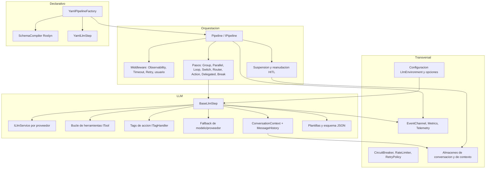
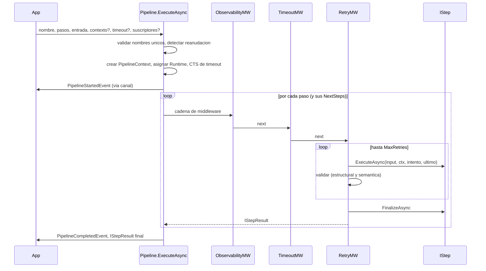
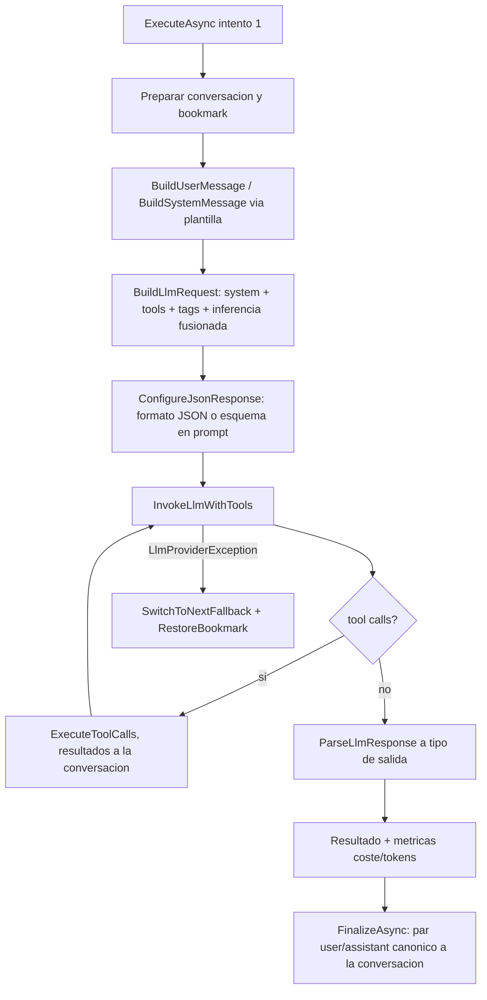

# Informe de Análisis Funcional: ¿Qué hace la aplicación?

Fuente única: el documento de contratos del repositorio. Las citas `ruta:línea` usan la ruta del fichero del tipo más el rango del miembro que da el documento. Lo que el documento no permite concluir se indica como tal.

## 1. Propósito y misión

El repositorio no es una aplicación final de usuario. Por sus contratos es un **framework (biblioteca) para construir agentes de IA como pipelines de pasos**, con el LLM como un tipo de paso más. Los indicios son el registro `AddAITaskAgent` (`Configuration/ServiceCollectionExtensions.cs:31-94`), la sección de configuración raíz `AITaskAgent` (`Configuration/AITaskAgentConfigurationKeys.cs:9-9`) y la superficie `IPipeline.ExecuteAsync<T>` "que usan las aplicaciones" (`Core/Execution/IPipeline.cs:40-47`).

La misión que se deduce:

- Componer flujos de pasos deterministas y de LLM.
- Ejecutarlos con reintentos, timeouts, validación y observabilidad uniformes.
- Soportar herramientas invocables por el modelo, conversación con historial, etiquetas de acción en el texto del LLM, fallback entre modelos/proveedores y suspensión/reanudación con intervención humana (HITL).

Quién lo usa realmente (qué aplicaciones lo consumen) no se puede concluir del documento; solo se ven referencias a "CodeGui" como origen de un formato de sesión legacy (`LLM/Conversation/Storage/YamlFileConversationStorage.cs:13-283`).

## 2. A quién sirve y casos de uso

Usuario directo: desarrolladores .NET que construyen agentes. Los casos de uso que sostienen los contratos:

| Caso de uso | Soporte en contratos |
|---|---|
| Encadenar pasos secuenciales, paralelos, en bucle y con enrutado | `GroupStep`, `ParallelStep`, `LoopStep`, `SwitchStep`, `RouterStep` |
| Llamar a un LLM con prompts de plantilla y salida estructurada | `TemplateLlmStep`, `BaseLlmStep`, `ResponseFormatOptions` |
| Dar herramientas al modelo (tool calling) | `ITool`, `LlmTool`, `AvailableTools` |
| Clasificar la intención del usuario y enrutar | `IntentionAnalyzerStep`, `RouterStep` |
| Declarar pipelines en YAML con esquemas JSON de entrada/salida | `YamlPipelineFactory`, `SchemaCompiler`, `YamlLlmStep` |
| Pausar un flujo para revisión humana y reanudarlo | `SuspendStepResult`, `IResume`, `ResumeRequest`, `IPipelineContextStorage` |
| Observar la ejecución en tiempo real (UI, logs, métricas) | `IEventChannel`, eventos `*Event`, `Metrics`, `Telemetry` |
| Persistir conversaciones | `IConversationStorage` y tres implementaciones |

Esta tabla es una lectura de capacidades, no una confirmación de que cada caso esté usado en producción.

## 3. Capacidades funcionales

### 3.1 Modelo de pasos y resultados

- Contrato base `IStep`: nombre, `MaxRetries` (1 por defecto), 100 ms entre reintentos, `Timeout` opcional, `ExecuteAsync`, `FinalizeAsync`, `ValidateAsync`, tipos de entrada/salida (`Core/Abstractions/IStep.cs:8-52`). La variante tipada `IStep<TIn,TOut>` comprueba tipos y delega (`Core/Abstractions/IStep.cs:54-73`).
- `StepBase` aporta plantilla de hooks, `MaxRetries` en 3, validadores, creación de resultados, enriquecimiento y estado guardable (`Core/Steps/StepBase.cs:18-245`). `TypedStep<TIn,TOut>` convierte la entrada si no coincide (`Core/Steps/TypedStep.cs:10-57`).
- Resultados: `StepResult`/`StepResult<T>` (valor, error, `SuspendInfo`, `NextSteps`) (`Core/StepResults/StepResult.cs:10-91`); `ErrorStepResult` (`Core/StepResults/StepErrorResult.cs:11-31`); `SuccessStepResult`; `ActionResult`; `ParallelResult`; `SuspendStepResult` (`Core/StepResults/SuspendStepResult.cs:14-22`).
- Los errores se comunican como valor (`StepError`, `Core/Models/StepError.cs:9-16`) en lugar de lanzarse.
- `StepResultFactory` crea resultados por reflexión con constructores compilados y calcula el JSON Schema del tipo de `Value` (`Core/Execution/StepResultFactory.cs:13-631`); `[ExcludeFromLlmSchema]` oculta campos del esquema (`Core/Execution/ExcludeFromLlmSchemaAttribute.cs:14-15`).

### 3.2 Pasos de control de flujo

- **Grupo secuencial**: `GroupStep` vuelca sus pasos en `input.NextSteps` y deja que el `Pipeline` los ejecute (`Core/Steps/GroupStep.cs:43-50`).
- **Bucle**: `LoopStep` itera hasta `MaxIterations` (50), sale por error, suspensión o `BreakStepResult`, y emite `LoopExhaustedEvent` al agotar (`Core/Steps/LoopStep.cs:51-96`). `BreakStep` devuelve la marca de salida (`Core/Steps/BreakStep.cs:22-37`).
- **Paralelo**: `ParallelStep` usa `Parallel.ForEachAsync`, un contexto clonado por rama (`CloneForBranch`) y emite `BranchStarted/CompletedEvent` (`Core/Steps/ParallelStep.cs:64-151`).
- **Enrutado**: `SwitchStep` añade el destino elegido a `NextSteps` y emite `StepRoutingEvent` (`Core/Steps/SwitchStep.cs:43-84`). `RouterStep` elige por `SelectedOption` con ruta por defecto (`LLM/Steps/RouterStep.cs:48-61`).
- **Acciones deterministas**: `ActionStep` (con modo fire-and-forget) (`Core/Steps/ActionStep.cs:17-47`), `DelegatedStep` (`Core/Steps/DelegatedStep.cs:17-32`), `EmptyStep` (`Core/Steps/EmptyStep.cs:9-42`).
- **Unicidad de nombres**: `StepValidation.ValidateUniqueStepNames` rechaza duplicados en pasos anidados (`Core/Execution/StepValidation.cs:8-33`).

### 3.3 Pasos LLM

- `BaseLlmStep` es el motor: gestiona rol y fallbacks, estado por invocación en `PipelineContext.StepState`, conversación con bookmark, reintento con feedback de error, compactación al finalizar, construcción de `LlmRequest` y parseo de respuesta (`LLM/Steps/BaseLlmStep.cs:38-684`). La variante `BaseLlmStep<TIn,TOut>` tipa entrada y salida (`LLM/Steps/BaseLlmStep.cs:690-753`).
- Bucle de herramientas recursivo con tope `MaxToolIterations` (5), detección de llamadas repetidas y deduplicación (`LLM/Steps/BaseLlmStep.LlmInvocation.cs:18-220`, `252-293`, `320-343`; propiedad en `LLM/Steps/BaseLlmStep.cs:106-158`).
- Invocación en batch o streaming con procesado de tags, cálculo de coste y emisión de `LlmResponseEvent` (`LLM/Steps/BaseLlmStep.LlmInvocation.cs:457-862`).
- `TemplateLlmStep` resuelve prompt y system prompt desde plantillas (nombres derivados del nombre del paso) con variables (`LLM/Steps/TemplateLlmStep.cs:25-75`). `StatelessTemplateLlmStep` usa una conversación nueva por ejecución (`LLM/Steps/StatelessTemplateLlmStep.cs:55-69`).
- `IntentionAnalyzerStep` clasifica la intención sobre un catálogo de `IntentionOption`, y en `FinalizeAsync` emite feedback y ajusta el historial (`LLM/Steps/IntentionAnalyzerStep.cs:33-99`). El resultado `LlmIntentionResult` valida que la opción pertenezca al catálogo (`LLM/Results/LlmIntentionResult.cs:12-33`).
- Resultados LLM: `LlmStepResult` (coste, motivo de fin, modelo, tokens, razonamiento) (`LLM/Results/LlmStepResult.cs:8-22`) y `LlmStringStepResult`, válido solo con contenido o tool calls (`LLM/Results/LlmStringStepResult.cs:16-28`).
- Salida estructurada: `ConfigureJsonResponse` fija formato JSON o inyecta el esquema en el system prompt según `JsonSupport` del proveedor (`LLM/Steps/BaseLlmStep.cs:579-621`). `JsonResponseParser` extrae JSON tolerante con cuatro estrategias en cascada (`Support/JSON/JsonResponseParser.cs:32-64`).
- Herramientas embebidas en texto: `ToolCallXmlParser` recupera tool calls en formatos GLM, wrapper, XML y JSON (`LLM/Support/ToolCallXmlParser.cs:46-106`).

### 3.4 Herramientas

- `ITool` (nombre, descripción, `UsageGuidelines`, `IsReadOnly`, `GetDefinition`, `ExecuteAsync`) (`LLM/Tools/Abstractions/ITool.cs:10-56`). `IsReadOnly` sirve para tolerar repeticiones: umbral 3 si todas son de solo lectura, si no 1 (`LLM/Steps/BaseLlmStep.LlmInvocation.cs:252-293`).
- `LlmTool` es la base con observabilidad (Activity, métricas, `ToolStartedEvent`/`ToolCompletedEvent`) y `InternalExecuteAsync` abstracto (`LLM/Tools/Base/LlmTool.cs:53-144`, `150-154`).
- `AvailableTools` es el registro por nombre, con instancia estática `Instance` (`LLM/Tools/Implementation/AvailableTools.cs:8-71`). `UseAITaskAgent` registra en él los `ITool` del contenedor (`Configuration/ServiceCollectionExtensions.cs:100-114`).

### 3.5 Etiquetas de acción en streaming

`ITagHandler` define una etiqueta, sus instrucciones para el LLM y la acción al cerrarse (`LLM/Streaming/ITagHandler.cs:13-41`). `StreamingTagParser` es una máquina de estados que oculta el cuerpo, ejecuta el handler al cierre y sustituye la etiqueta por un placeholder (`LLM/Streaming/StreamingTagParser.cs:77-211`). `TagHandlerBase` mide, registra y emite siempre `TagCompletedEvent` (`LLM/Streaming/TagHandlerBase.cs:32-75`). `BaseLlmStep` añade las instrucciones de las etiquetas al system prompt (`LLM/Steps/BaseLlmStep.cs:655-683`).

### 3.6 Conversación y persistencia

- `ConversationContext`: mensajes por rol, bookmarks con rollback, selección de mensajes para la petición (ventana deslizante o desde marcador) y clonado (`LLM/Conversation/Context/ConversationContext.cs:13-229`).
- `MessageHistory`: estimación de tokens (longitud/4) y recortes que preservan la pareja assistant(tool_calls)/tool (`LLM/Conversation/MessageHistory.cs:101-244`, `331-335`).
- Almacenes de conversación (`IConversationStorage`, `LLM/Conversation/Storage/IConversationStorage.cs:8-19`): en memoria con clones, JSON en ficheros con protección de path traversal, y YAML en formato legacy de sesión (`.../InMemoryConversationStorage.cs:9-29`, `.../FileConversationStorage.cs:14-138`, `.../YamlFileConversationStorage.cs:13-283`).

### 3.7 Suspensión y reanudación (HITL)

- Un paso devuelve `SuspendStepResult`; el `Pipeline` guarda su estado vía `IResume.SaveStateAsync`, emite `PipelineSuspendedEvent` y cachea el resultado por ruta (`Core/Execution/Pipeline.cs:243-351`; `Core/Abstractions/IResume.cs:6-22`).
- La reanudación usa `ResumeRequest` (ruta del paso, entrada de usuario, metadatos) (`Core/Models/ResumeRequest.cs:6-22`) y restaura con `RestoreStateAsync` (`Core/Execution/Pipeline.cs:357-411`).
- `IPipelineContextStorage` persiste el `PipelineContext` suspendido por `correlationId`; la única implementación del lote guarda la referencia viva, sin serializar ni caducar (`Core/Execution/IPipelineContextStorage.cs:9-30`, `Core/Execution/InMemoryPipelineContextStorage.cs:9-40`).

### 3.8 Plantillas

`TinyTemplateRendered` interpola `{{ a.b | filtro ?? default }}` con filtros (json, yaml, csv, upcase, date, etc.), includes y comentarios (`Support/Template/TinyTemplateRendered.cs:59-118`, `194-229`). `FileTemplateProvider` lee `.md` de una carpeta con caché LRU+TTL (`Support/Template/FileTemplateProvider.cs:40-77`). `PromptTemplateResolver` combina metadatos y variables (las variables ganan) (`LLM/Support/PromptTemplateResolver.cs:30-61`).

### 3.9 Pipelines declarativos en YAML

`YamlPipelineFactory` une ficheros `*.yaml`, deserializa con tags `!nombre` de las clases `[YamlStepTag]`, resuelve roles LLM, inyecta tipos compilados de entrada/salida, valida el DAG (dependencias, compatibilidad de esquemas, ciclos) y ordena con Kahn (`YAML/Execution/YamlPipelineFactory.cs:59-127`, `179-230`). `SchemaCompiler` convierte JSON Schemas en tipos C# (NJsonSchema + Roslyn) con validación JS opcional en V8 (`YAML/Compilation/SchemaCompiler.cs:43-67`, `79-97`). `YamlLlmStep` es el paso `!LlmStep` con `UserPrompt`, `ProfileName`, `DependsOn` y política de historial (`YAML/Steps/YamlLlmStep.cs:29-96`).

### 3.10 Observabilidad

- Eventos de progreso (`IProgressEvent`, `Observability/IProgressEvent.cs:7-26`): pipeline, paso, rama, bucle, herramienta, tag, validación, timeout, routing, caché y `LlmResponseEvent` con tokens y coste (`Observability/Events/*.cs`).
- `EventChannel`: bus en proceso con canales acotados `DropOldest`, enrutado por `CorrelationId`, suscripción por handler o por `ChannelReader` (`Observability/EventChannel.cs:42-208`).
- `ObservabilityMiddleware` abre una Activity por paso, emite inicio/fin y métricas (`Core/Execution/Middlewares/ObservabilityMiddleware.cs:17-137`); `Metrics` y `Telemetry` declaran los instrumentos y el `ActivitySource` (`Core/Base/Metrics.cs:9-86`, `Core/Base/Telemetry.cs:10-18`).
- `IStepTracer` con `ConsoleStepTracer` y `NullStepTracer` (`Observability/ConsoleStepTracer.cs:9-33`, `Observability/NullStepTracer.cs:9-13`).

### 3.11 Resiliencia

Existen `CircuitBreaker` (`Resilience/CircuitBreaker.cs:8-115`), `RateLimiter` token bucket (`Resilience/RateLimiter.cs:10-183`) y `RetryPolicy` con backoff y jitter (`Resilience/RetryPolicy.cs:40-83`). Ver en la sección 7 la duda sobre su conexión con el resto.

## 4. Flujos principales de extremo a extremo

### 4.1 Ejecución de un pipeline

Pasos concretos:

1. `Pipeline.ExecuteAsync<T>` valida argumentos y unicidad de nombres, detecta reanudación, crea el contexto si falta y le asigna `Runtime`, construye la cadena de middleware, crea un CTS de timeout enlazado y abre la Activity (`Core/Execution/Pipeline.cs:83-222`).
2. La cadena se compone en el orden usuario, Observability, Timeout, Retry, con un delegado terminal que llama a `step.ExecuteAsync` (`Core/Execution/Pipeline.cs:416-431`, `440-445`).
3. `ExecuteStepsWithNextStepsAsync` recorre los pasos: se detiene en error, gestiona la suspensión, ejecuta recursivamente los `NextSteps` con ruta anidada y cachea el resultado por ruta solo tras éxito completo (`Core/Execution/Pipeline.cs:243-351`).
4. `RetryMiddleware` es terminal (no llama a `next`). Reintenta errores sin excepción y fallos de validación estructural (`IStepResult.ValidateAsync`) o semántica (`IStep.ValidateAsync`). Las excepciones y los errores con `OriginalException` no se reintentan y activan `SwitchToNextFallback` si el paso es `IFallbackable` (`Core/Execution/Middlewares/RetryMiddleware.cs:18-166`).
5. `TimeoutMiddleware` impone el timeout del paso (o el defecto) a todo lo que cuelga de él, de forma global y no por intento (`Core/Execution/Middlewares/TimeoutMiddleware.cs:23-64`).
6. Los pasos compuestos ejecutan hijos mediante `PipelineContext.ExecuteStepsWithNextStepsAsync`, que delega en `IPipelineRuntime` y reutiliza la misma cadena de middleware (`Core/Models/PipelineContext.cs:219-237`, `Core/Execution/IPipelineRuntime.cs:21-49`).

### 4.2 Ejecución de un paso LLM

1. En el intento 1 prepara conversación, bookmark, mensaje y request; en intentos posteriores añade feedback del error previo (`LLM/Steps/BaseLlmStep.cs:267-385`).
2. `BuildLlmRequestAsync` compone system prompt (con guías de herramientas y tags), definiciones de herramientas y la inferencia fusionada rol/proveedor (`LLM/Steps/BaseLlmStep.cs:396-455`).
3. `InvokeLlmAsync` llama al `ILlmService` en batch o streaming; en streaming pasa los fragmentos por `StreamingTagParser`, calcula coste con `LlmProvider.CalculateCost` y emite `LlmResponseEvent` (`LLM/Steps/BaseLlmStep.LlmInvocation.cs:457-862`, `LLM/Configuration/LlmProvider.cs:33-56`).
4. El bucle de herramientas repite hasta respuesta final o límite; los fallos de proveedor se convierten en `LlmResult.Failure` (`LLM/Steps/BaseLlmStep.LlmInvocation.cs:18-220`).
5. Si el error es `LlmProviderException` y hay otro fallback válido, se avanza `FallbackIndex` y se restaura el bookmark inicial (`LLM/Steps/BaseLlmStep.cs:160-209`).
6. `ParseLlmResponseAsync` convierte el contenido al tipo de valor y `FinalizeAsync` escribe el par canónico en la conversación y limpia el estado (`LLM/Steps/BaseLlmStep.cs:478-536`, `217-265`).

### 4.3 Arranque y configuración

`AddAITaskAgent` registra opciones, `Pipeline`, plantillas, `EventChannel`, almacenes en memoria, caché, herramientas y la fábrica transitoria de `ConversationContext`; `UseAITaskAgent` fuerza singletons y puebla `AvailableTools` (`Configuration/ServiceCollectionExtensions.cs:31-94`, `100-114`). `PipelineContextFactory.Create` produce contextos con el canal global, o con un canal local si hay suscriptores por ejecución (`Core/Models/PipelineContext.cs:259-294`).

### 4.4 Carga de un pipeline YAML

`CreateFromFolderAsync` concatena los `.yaml`, `CreateFromYaml` deserializa, aplica roles a los `YamlLlmStep` mediante `ApplyRole`, inyecta tipos de entrada/salida compilados por `SchemaCompiler`, valida y ordena, y devuelve un `YamlPipeline` que delega en `IPipeline.ExecuteAsync` (`YAML/Execution/YamlPipelineFactory.cs:59-98`, `YamlPipeline` en `:34-38`). `YamlPipeline.ExecuteAsync` no reenvía timeout ni suscriptores.

## 5. Modelo de datos y conceptos clave

| Concepto | Qué es | Cita |
|---|---|---|
| `PipelineContext` | Estado de una ejecución: canal de eventos, service provider, runtime, conversación, `CorrelationId`, `Metadata` y `StepResults` concurrentes compartidos entre ramas, `StepState` por paso, ruta actual | `Core/Models/PipelineContext.cs:26-238` |
| `IStepResult` | Resultado: valor, error, `SuspendInfo`, `NextSteps` (pasos dinámicos a ejecutar a continuación) | `Core/Abstractions/IStepResult.cs:8-33` |
| `NextSteps` | Mecanismo por el que Group, Router y Switch indican qué ejecutar después | `Core/Steps/GroupStep.cs:43-50`, `LLM/Steps/RouterStep.cs:48-61` |
| `LlmEnvironment` | Proveedores, roles, rol por defecto y fallbacks globales | `LLM/Configuration/LlmEnvironment.cs:7-33` |
| `LlmProvider` | URL, clave, versión, inferencia, catálogo de modelos con precio por millón de tokens, `ILlmService` | `LLM/Configuration/LlmProvider.cs:5-57` |
| `LlmRole` | Proveedor + modelo + system prompt + inferencia + fallbacks + herramientas | `LLM/Configuration/LlmRole.cs:5-13` |
| `LlmInferenceSettings` | Parámetros de inferencia como fachada sobre un `JObject` | `LLM/Configuration/LlmInferenceSettings.cs:10-172` |
| `LlmRequest` / `LlmResult` / `LlmResponse` | Petición agnóstica del proveedor, resultado (patrón Result) y candidato | `LLM/Models/LlmRequest.cs:10-34`, `LLM/Models/LlmResult.cs:9-88`, `LLM/Models/LlmResponse.cs:7-26` |
| `Message`, `ToolCall`, `ToolDefinition`, `NativeObject` | Mensaje independiente del proveedor, llamada a herramienta, definición de herramienta y envoltorio del objeto nativo | `LLM/Models/Message.cs:7-32`, `LLM/Models/ToolCall.cs:8-22`, `LLM/Models/ToolDefinition.cs:6-19`, `LLM/Models/NativeObject.cs:7-20` |
| `FinishReason` | Streaming, Stop, Length, ToolCalls, ContentFilter, Other | `LLM/Constants/FinishReason.cs:6-25` |
| Roles de mensaje | system, user, assistant, tool | `LLM/Constants/LlmConstants.cs:8-21` |
| Eventos | Familia de records sobre `ProgressEventBase` (`SchemaVersion` "1.0", `SuppressFromUser`) | `Observability/Events/ProgressEventBase.cs:8-27` |

Los datos viajan en memoria: no hay base de datos en el lote, solo almacenes de ficheros para conversaciones.

## 6. Puntos de extensión y configuración

Extensión por contrato:

| Punto | Contrato | Notas |
|---|---|---|
| Nuevo tipo de paso | `IStep`, `StepBase`, `TypedStep<,>` | Descubrimiento por `[StepTag]` (`Core/Steps/StepManager.cs:72-84`) o `[YamlStepTag]` (`YAML/Attributes/YamlStepTagAttribute.cs:7-10`) |
| Middleware propio | `IPipelineMiddleware` | Registro estático global `PipelineMiddlewareRegistry` (`Core/Execution/PipelineMiddlewareRegistry.cs:19-29`) y `RegisterPipelineMiddleware<T>` (`Core/Execution/ServiceProviderPipelineMiddlewareExtensions.cs:18-29`) |
| Proveedor LLM | `ILlmService` (`InvokeAsync`, `InvokeStreamingAsync`, estimación de tokens, contexto máximo) | `LLM/Abstractions/ILlmService.cs:8-38` |
| Herramienta | `ITool` / `LlmTool` | Registro en `AvailableTools` |
| Etiqueta de acción | `ITagHandler` / `TagHandlerBase` | Pasadas a `BaseLlmStep.TagHandlers` |
| Fallback de paso | `IFallbackable` / `SwitchToNextFallback` | `Core/Abstractions/IFallbackable.cs:5-8` |
| Validación semántica | `IStepValidator` | Iterados en orden en `StepBase.Validate` (`Core/Steps/StepBase.cs:182-193`) |
| Enriquecimiento de observabilidad | `IEnrichable` | Invocado por `ObservabilityMiddleware` (`Core/Abstractions/IEnrichable.cs:12-51`) |
| Almacenes | `IConversationStorage`, `IPipelineContextStorage`, `ICacheService` | |
| Plantillas | `ITemplateProvider`, `ITemplateRendered` | |
| Activación de pasos | `IStepActivator` (`DefaultStepActivator` degrada hasta `GetUninitializedObject`) | `Core/Steps/DefaultStepActivator.cs:10-67` |
| Trazado | `IStepTracer` | |

Configuración:

- Sección raíz `AITaskAgent` con subsecciones LlmProviders, Observability, Timeouts, Resilience y Conversation (`Configuration/AITaskAgentConfigurationKeys.cs:9-24`).
- Los valores se enlazan con `BindEx`/`ConfigureEx` (Newtonsoft, expansión `${VAR}` de variables de entorno, opcionalmente con `DiContractResolver`) en lugar del binder estándar (`Configuration/ConfigurationPatchExtensions.cs:13-71`, `124-170`, `181-245`).
- `ConfigureLlmEnvironmentOptions` valida en arranque proveedores, roles y fallbacks, y falla con `InvalidOperationException` ante referencias inexistentes (`Configuration/ServiceCollectionExtensions.cs:142-265`).
- Valores por defecto declarados:
  - Conversación: `MaxTokens` 8192, ventana deslizante activa, 2 mensajes iniciales conservados (`Configuration/ConversationOptions.cs:9-21`).
  - Timeouts en `TimeoutOptions`: pipeline 10 min, paso 1 min, herramienta 30 s (`Configuration/TimeoutOptions.cs:9-15`).
  - `PipelineOptions`: pipeline 60 min, paso 30 min (`Core/Execution/PipelineOptions.cs:14-20`).
  - Circuit breaker: 5 fallos, 60 s (`Configuration/CircuitBreakerOptions.cs:9-12`).
  - Rate limit: 100/1000 ms/10 (`Configuration/RateLimitOptions.cs:9-15`).
  - Observabilidad: nivel Debug, capacidad 100 (`Configuration/ObservabilityOptions.cs:11-20`).
- Inferencia por rol/proveedor/modelo: temperatura, `MaxTokens`, `UseStreaming`, `JsonSupport`, `ToolSupport`, `Stop`, `RequestTimeoutSeconds`, `StreamingInactivityTimeoutSeconds` (`LLM/Configuration/LlmInferenceSettings.cs:46-126`).

## 7. Límites y lo que el documento no permite concluir

Inconsistencias o desconexiones que muestran los propios contratos:

- **Dos conjuntos de timeouts por defecto**: `TimeoutOptions` (10 min/1 min) y `PipelineOptions` (60 min/30 min). El comentario de `PipelineOptions` habla de `IOptions`, pero `Pipeline` crea su propia instancia (`Core/Execution/PipelineOptions.cs:7-21`, `Core/Execution/Pipeline.cs:42-54`). Cuál rige en la práctica no se deduce.
- **`CircuitBreaker`, `RateLimiter` y `RetryPolicy`** existen, y `CircuitBreakerOptions` "no tiene conexión visible en el lote" con `CircuitBreaker` (`Configuration/CircuitBreakerOptions.cs:6-13`). El documento menciona un "circuito abierto" como causa de `LlmProviderException` (`LLM/Models/LlmProviderException.cs:8-18`), pero no muestra quién las usa.
- **Estado estático global**: `StepManager`, `PipelineMiddlewareRegistry`, `AvailableTools.Instance` y `PipelineContextFactory._instance` son estado de proceso (`Core/Steps/StepManager.cs:18-309`, `Core/Execution/PipelineMiddlewareRegistry.cs:9-74`, `Core/Models/PipelineContext.cs:246-252`). Implica límites para varios contenedores en un mismo proceso.
- **Persistencia de suspensión volátil**: la única implementación de `IPipelineContextStorage` del lote no serializa ni caduca (`Core/Execution/InMemoryPipelineContextStorage.cs:9-40`). Lo que sobrevive a un reinicio de proceso no se puede afirmar.
- **Concurrencia**: `StreamingTagParser` no es thread-safe (`LLM/Streaming/StreamingTagParser.cs:26-414`). `BaseLlmStep` guarda estado de repetición en campos de instancia (`LLM/Steps/BaseLlmStep.LlmInvocation.cs:227-233`). `AddPathPart/RemovePathPart` no son thread-safe (`Core/Models/PipelineContext.cs:128-136`).
- **Nombres engañosos**: `JsonSchemaValidator` no valida esquemas reales (`Support/JSON/JsonSchemaValidator.cs:8-55`). `ValidatorTagAttribute` no lo lee ningún código del lote (`Core/Attributes/ValidatorTagAttribute.cs:8-13`). `LlmOptions` no tiene consumidores visibles (`LLM/Models/LlmOptions.cs:9-77`).
- **Contenido sensible en logs**: `EventChannel.LogEvent` registra el contenido completo de las respuestas LLM si el nivel no es None (`Observability/EventChannel.cs:210-227`). `ApiKey` se almacena en texto plano (`LLM/Configuration/LlmProvider.cs:7-11`).
- **Fuera del lote** (no descrito): las implementaciones concretas de `ILlmService`, las herramientas concretas, los `ITagHandler` concretos, cualquier aplicación o UI, las plantillas y YAML reales. Por tanto, qué agentes concretos se construyen sobre el framework no se puede afirmar.

## 8. Lecturas de código que habría necesitado

Los contratos bastan para describir la arquitectura y los flujos del framework. No bastan para afirmar con certeza lo siguiente:

1. `Core/Execution/Pipeline.cs`, `ExecuteAsync<T>` (83-222) y `ExecuteStepAsync` (357-411): ¿cómo se identifica exactamente una reanudación (qué lleva la entrada y qué claves de `Metadata` se consultan) y cuándo se emite `PipelineResumingEvent`/`PipelineResumedEvent`? El contrato lista los eventos pero no quién los emite.
2. `Core/Execution/Pipeline.cs`, construcción (42-54) y `ServiceCollectionExtensions.AddAITaskAgent` (31-94): ¿qué timeouts por defecto rigen realmente, los de `PipelineOptions` (60/30 min) o los de `TimeoutOptions` (10/1 min)? Y ¿cómo se construye el `Pipeline` en DI?
3. Todo uso de `CircuitBreaker`, `RateLimiter`, `RetryPolicy` y `CircuitBreakerOptions` (búsqueda de referencias): ¿algún servicio LLM los aplica? Sin esto no puedo afirmar que la resiliencia esté activa.
4. `LLM/Steps/BaseLlmStep.LlmInvocation.cs`, `InvokeLlmAsync` (457-862): detalle de cómo se combinan streaming, tags y `ToolCallXmlParser` (¿cuándo se invoca el parser XML?), y cómo se aplican `RequestTimeoutSeconds`/`StreamingInactivityTimeoutSeconds`.
5. Implementaciones concretas de `ILlmService` (por ejemplo, las que coincidan con las claves de `ServiceType`): ¿qué proveedores soporta realmente el framework? El documento solo muestra el contrato y `ConfigureLlmEnvironmentOptions`, que empareja servicios por nombre o subcadena (`Configuration/ServiceCollectionExtensions.cs:142-265`).
6. `Configuration/ServiceCollectionExtensions.cs`, `AddAITaskAgent` (31-94): qué registra exactamente para `IPipelineContextStorage`, `IConversationStorage`, `ITemplateProvider` y `ITool`. El contrato dice "almacenes en memoria", pero no si `FileConversationStorage`/`YamlFileConversationStorage` se activan por configuración.
7. `Core/Steps/StepManager.cs`, `CreateStep` (100-128): relación entre `StepManager` (tags `[StepTag]`) y `YamlPipelineFactory` (tags `[YamlStepTag]`). No queda claro si son dos mecanismos paralelos o uno alimenta al otro.
8. Código que construye `ConversationContext` desde `ConversationOptions`/`AITaskAgentOptions.Conversation` (fábrica transitoria): ¿se aplican `MaxTokens` y `SlidingWindowMaxTokens` por igual? `BaseLlmStep.BuildLlmRequestAsync` lee `AITaskAgentOptions`, pero el contrato no detalla qué campos.
9. Cualquier clase que implemente `ITagHandler` (p. ej. el ejemplo `write_file` citado en el contrato): qué acciones reales ejecutan las etiquetas. El contrato solo da el mecanismo.
10. Directorio de ejemplos/aplicaciones y ficheros YAML y plantillas reales: para responder "a quién sirve" y "qué agentes concretos se construyen" con evidencia en lugar de inferencia.
11. `Core/Steps/ParallelStep.cs` (64-151) y `Pipeline.ExecuteStepsWithNextStepsAsync` (243-351) con `isBranchScope`: cómo se gestiona la suspensión de una rama paralela (`PipelineSuspendedEvent.IsBranchSuspension`) y su reanudación.
12. `LLM/Steps/BaseLlmStep.cs` `FinalizeAsync` (217-265) y `IntentionAnalyzerStep.FinalizeAsync` (74-99): el "par user/assistant canónico" y la "compactación" se describen en una línea; no puedo precisar qué queda finalmente en el historial.
