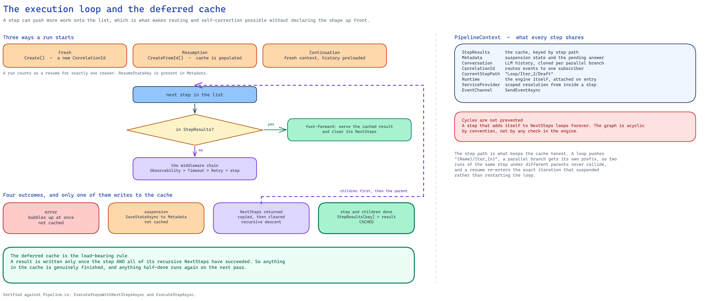
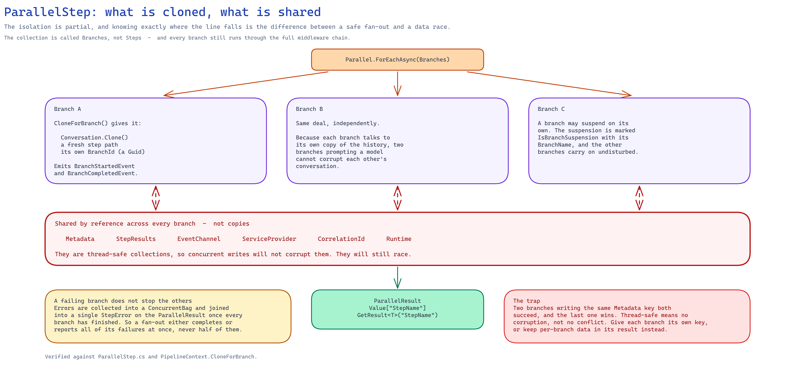

# Architecture

## Overview

AITaskAgent uses a **pipeline architecture** with middleware composition, similar to ASP.NET Core.

## Projects

The framework is split into assemblies with one-way dependencies
(`Abstractions ← Core ← Extensions.Llm`, with `Yaml` and `Extensions.Script` depending only on Core). This page
summarises them; the dependency diagram, the packages per project and the v1 → v2 migration table live in
[ARCHITECTURE-v2](../ARCHITECTURE-v2.md) and are not repeated here.

`AITaskAgent.Abstractions` holds the contracts (`IStep`, `IStepResult`, `IStepRegistry`, `IExtension`, the base
`PipelineContext`); `AITaskAgent.Core` is the engine (`Pipeline`, `StepBase`, the basic steps, middlewares,
resilience, observability, `StepRegistry`) and knows nothing about LLMs; `AITaskAgent.Extensions.Llm` adds the LLM
steps, conversation, tools and `LlmPipelineContext`; `AITaskAgent.Yaml` builds pipelines from YAML and depends only
on Core, so it creates every step through the registry without knowing what an LLM is; `AITaskAgent.Extensions.Script`
adds the JavaScript `ScriptStep`, which runs in a worker process of its own (`AITaskAgent.Extensions.Script.Worker`, the only project that references ClearScript). FileTools, OfficeTools and
McpIntegration depend on the LLM extension, because what they contribute are tools.

Three more projects complete the set. `AITaskAgent.Extensions.CSharp` references Core and adds `CSharpStep` (C# written in the pipeline,
compiled with Roslyn by the host; `CSharpExtension`, `AddCSharpExtension()` / `AddCSharpUnit()`). `AITaskAgent.NugetLoader`
references `AITaskAgent.Abstractions` only: the NuGet resolver and plugin loader (`NugetResolver`, `PluginLoader`). `OllamaLlmService`
references the LLM extension and is one more `ILlmService` provider (`ollama`), next to `OpenAILLmService` and `GeminiLlmService`.

The LLM, Script, FileTools, OfficeTools and MCP projects each ship an [extension](../extensibility/custom-extensions.md)
(`IExtension`) that registers its services and, when it has any, its steps in the single `IStepRegistry`: the LLM one
adds `LlmStep`, the Script one `ScriptStep` (and the C# extension `CSharpStep`), while the three tool extensions only register services. YAML is not an
extension: `AddAITaskAgentYaml()` registers `SchemaRegistry` and `YamlPipelineFactory`, which read the registry that
the other extensions have filled.

## Core Components

### Pipeline

`Pipeline` is a **sealed class implementing `IPipeline`**, registered as a singleton by
`AddAITaskAgentCore()` (which `AddAITaskAgent()` calls). Resolve it from DI — it is no longer a static executor.

```csharp
var pipeline = serviceProvider.GetRequiredService<IPipeline>();

await pipeline.ExecuteAsync(
    name: "MyPipeline",
    steps: [step1, step2],
    input: initialInput,
    context: pipelineContext,
    pipelineTimeout: TimeSpan.FromMinutes(5),
    cancellationToken: ct,
    subscribers: [async (evt, ct) => Console.WriteLine(evt.EventType)]
);
```

There is a single `ExecuteAsync` overload. Its defaults come from `PipelineOptions`, which
`AddAITaskAgentCore()` fills from `AITaskAgent:Timeouts` (no section is bound to `PipelineOptions`
itself), exposed as `DefaultPipelineTimeout` and `DefaultStepTimeout`.

Global middlewares are **not** passed per call: register them once with
`PipelineMiddlewareRegistry.Register(...)` or
`serviceProvider.RegisterPipelineMiddleware<TMiddleware>()`.

### PipelineContext

Shared state passed through all steps:

- `CorrelationId` - For distributed tracing
- `Metadata` - Custom data (thread-safe)
- `StepResults` - Cached results (thread-safe), keyed by step path
- `CurrentStepPath` - Current position in the execution tree
- `ServiceProvider` - The provider the context was created with, for service access from inside a step
- `Runtime` - The engine running the context, attached by the pipeline when the run starts
- `EventChannel` / `SendEventAsync()` - Emit events to observers

The base context is a `record` in `AITaskAgent.Abstractions` and has no conversation. LLM steps need
`LlmPipelineContext` (`AITaskAgent.Extensions.Llm`), which adds `Conversation` (LLM conversation with history); they
declare it with `IStep.RequiredContext`. Before running anything the pipeline checks that property for every step it
can see up front, children of `GroupStep`, `ParallelStep`, `LoopStep` and every case of the declarative switch
included, and throws with the step's name; steps that only appear at run time (`NextSteps`, the target of a
`SwitchStep<TIn>` selector) are checked again right before they run, and a mismatch there ends the run with an error
result. `AddAITaskAgent()` makes the default context an `LlmPipelineContext`.

The engine signatures (`IStep.ExecuteAsync`, `IPipelineMiddleware`, `IPipeline`) take the `PipelineContext` class;
there is no context interface. See [ARCHITECTURE-v2](../ARCHITECTURE-v2.md#pipeline-context).

Contexts are built by `PipelineContextFactory`, a DI singleton whose static `Create(...)` and `CreateFromId(...)`
use the instance the container built (`UseAITaskAgent()` forces its creation);
`LlmPipelineContextFactory.Create(conversation)` builds an LLM context around an existing conversation.

### Steps

Units of work implementing `IStep`:

| Step Type | Assembly | Purpose |
|-----------|----------|---------|
| `ActionStep<TIn>` | Core | Side-effecting action, returns `ActionResult` |
| `DelegatedStep<TIn, TOut>` | Core | Inline transformation via a delegate |
| `TypedStep<TIn, TOut>` | Core | Strongly-typed base class |
| `GroupStep` / `GroupStep<TIn>` | Core | Sequential sub-steps |
| `ParallelStep` / `ParallelStep<TIn>` | Core | Concurrent execution of `Branches` |
| `LoopStep` | Core | Repeats its `Steps` up to `MaxIterations` |
| `BreakStep` | Core | Early exit out of the enclosing `LoopStep`; with `When`, only when the condition is truthy |
| `SwitchStep<TIn>` | Core | Dynamic routing through a selector delegate |
| `DeclarativeSwitchStep` | Core | Declarative switch (`On`, `Cases`, `Default`), declared in YAML as `type: SwitchStep` |
| `ExecStep` | Core | Runs an external executable or batch file (no shell) and returns its stdout; `IExecStepPolicy` lets a host deny commands |
| `SuspendStep` | Core | Suspends the pipeline to ask for input and returns the response when resumed (see [Human in the loop](../guides/human-in-the-loop.md)) |
| `RouterStep` | Extensions.Llm | String-keyed routing over an `IRouterResult` |
| `BaseLlmStep` | Extensions.Llm | LLM interaction with tools; requires `LlmPipelineContext` |
| `YamlLlmStep` | Extensions.Llm | The LLM step of YAML pipelines (`type: LlmStep`) |
| `ScriptStep` | Extensions.Script | JavaScript run with ClearScript V8 in an isolated worker process, declared in YAML as `type: ScriptStep` |
| `CSharpStep` | Extensions.CSharp | C# written in the pipeline, compiled by the host and run in the host process, declared in YAML as `type: CSharpStep` |

### Middleware Chain

Execution order (outer to inner):

```
User Middlewares → Observability → Timeout → Retry → Step
```

Each middleware wraps `next()`:

```csharp
public async Task<IStepResult> InvokeAsync(
    IStep step, IStepResult input, PipelineContext context,
    Func<CancellationToken, Task<IStepResult>> next,
    CancellationToken cancellationToken)
{
    // Before step
    var result = await next(cancellationToken);
    // After step
    return result;
}
```

## Execution Flow

See [Middlewares](../guides/middlewares.md) for the chain, what each layer emits, and why
Retry behaves differently from the rest.

Retry sits at the end of the chain and calls the step directly rather than `next()`, so its attempts
happen *inside* Observability's single call — which is why retries emit their own start event.

## The Dynamic Execution Loop

The engine walks a list of steps around a shared context, and any step can add work to that list at run time through
`NextSteps`. This is what makes runtime-extensible flows, self-correcting agents and resumable execution possible
without declaring the shape in advance.



<!-- Source: docs/assets/diagrams/engine-stack-loop.excalidraw -->

> [!NOTE]
> The image predates the v2 split: its `PipelineContext` box lists `Conversation`, which now lives only in
> `LlmPipelineContext`, and its `Pipeline.cs` line numbers are stale. The loop it draws is still the one the engine runs.

### 1. Context Activation & Setup
Before execution, the `PipelineContextFactory` (the `LlmPipelineContextFactory` when the LLM extension is registered) initializes the **Operational Memory (Context)**:
- **Fresh Mode** (`PipelineContextFactory.Create()`): Initializes a clean context with a new `CorrelationId`.
- **Resumption Mode** (`CreateFromId(id)`): Recovers a stored context. The engine uses `StepResults` to skip previously completed steps and resume where it stopped.
- **Continuation Mode** (`LlmPipelineContextFactory.Create(conversation)`): New context, but with a `ConversationContext` whose history is already loaded.

### 2. The Execution Cycle
The engine iterates the step list, and for each step:

1. **Check the context**: a step whose `RequiredContext` the context does not satisfy becomes an error result without running.
2. **Look up the cache**: a step already in `StepResults` (by its path) is served from there; a suspended one with a pending answer is restored with `RestoreStateAsync` and runs again.
3. **Wrap (Middleware Chain)**: The step is executed through a chain of "shields":
    - **User middlewares**: Whatever was registered in `PipelineMiddlewareRegistry`, outermost.
    - **Observability**: Emits traces and events.
    - **Safety**: Enforces execution timeouts (`TimeoutMiddleware`), covering all retry attempts.
    - **Resilience**: Manages retries via `RetryMiddleware`, which calls the step itself.
4. **Branch on the outcome**:
    - **Error?** → Execution stops and the error result bubbles up, without being cached.
    - **Suspended?** → The step's state is saved in `Metadata`, the result is stored with its `SuspendInfo` and the run returns. When the run ends suspended, `Pipeline` also saves the context in the registered `IPipelineContextStorage` (by `CorrelationId`, before `PipelineCompletedEvent`; without a storage it only logs a warning, and a failing `SaveAsync` propagates); when a resumed run completes without error that saved context is deleted, and a failed run keeps it. See [Human in the loop](../guides/human-in-the-loop.md).
    - **NextSteps Injected?** → The list is copied and cleared, and those steps run recursively (under the step's path) before the next step of the current list; an error or a suspension among them bubbles up.
    - **Done** → Only now, once the step and all its `NextSteps` have succeeded, is the result written to `StepResults` (deferred cache).

### 3. Peripheral Observability (Projections)
As the loop iterates, it emits data to the **EventChannel**. This is a projection of the internal state, not part of the context itself:
- **Events (Milestones)**: `PipelineStartedEvent`, `StepCompletedEvent`, `StepRoutingEvent`, `ToolStartedEvent` / `ToolCompletedEvent` (LLM extension), among others.
- **Metrics (Health)**: counters such as `aitaskagent.step.errors` and `aitaskagent.llm.tokens`, histograms such as `aitaskagent.step.duration`.
- **Traces (Call Graph)**: Distributed traces showing the hierarchy of dynamic calls.

---

## Non-Linear Flows

### Execution Model

The pipeline is a **Dynamic Execution Graph**:

- **Directed Graph** defined at design time
- **Extensible at runtime** via `NextSteps`
- **Branchable** (GroupStep, SwitchStep)
- **Parallelizable** (ParallelStep)
- **Acyclic by convention** (not enforced technically)

> [!WARNING]
> The framework does **not prevent cycles**. If a step adds itself (or creates a circular reference) to `NextSteps`, it will cause an infinite loop. Always ensure your pipeline design is acyclic.

---

### NextSteps Mechanism

Any step can inject additional steps via `IStepResult.NextSteps`:

```csharp
protected override Task<MyResult> ExecuteAsync(...)
{
    var result = new MyResult(value);
    result.NextSteps.Add(new AdditionalStep());  // Will execute next
    return Task.FromResult(result);
}
```

The Pipeline processes `NextSteps` before moving to the next configured step.

---

### GroupStep (Sequential Branching)

Creates a **branch** in the flow by injecting sequential sub-steps. After the branch completes, execution continues with the parent flow. Groups can be **nested**.

`GroupStep`, `SwitchStep<TIn>` (and the declarative switch, which hands its chosen case to one as a `GroupStep`) and
`RouterStep` are uses of the same `NextSteps` mechanism. `LoopStep` and `ParallelStep` are not: they run their
children themselves through the engine (`ExecuteStepsWithNextStepsAsync`) and return a single result. See
[the flow-control diagram](../assets/images/flow-control-nextsteps.png), whose `LoopStep` box ("re-pushes Steps")
predates that change.

**Key behaviors:**
- Replaces `input.NextSteps` with `[NestedStep1, NestedStep2, ...]` and returns immediately
- Nested steps execute **before** the next step in the parent pipeline
- **Nestable**: A GroupStep can contain another GroupStep
- After all nested steps complete, flow resumes at the next step in the parent

---

### ParallelStep (Concurrent Execution)

Executes multiple steps **concurrently** (not branching, but parallelism):



<!-- Source: docs/assets/diagrams/parallel-branch-isolation.excalidraw -->

> [!NOTE]
> Two boxes of the image are out of date: a branch no longer gets "a fresh step path" but keeps the parent's prefix,
> and a branch that suspends is **not** handled (see the last bullet below). `Conversation.Clone()` happens only in an
> `LlmPipelineContext`.

**Key behaviors:**
- Branches live in `ParallelStep.Branches` (not `Steps`)
- Each branch runs on a `CloneForBranch()` context: (in an `LlmPipelineContext`) **cloned** `ConversationContext`, and
  a step path that keeps the parent's prefix plus `{ParallelName}/{BranchName}`, so results never collide
- Each branch receives its own shallow copy of the input (`StepResult.CopyForBranch`)
- `Metadata` and `StepResults` are **shared** (thread-safe)
- All branches execute simultaneously (at most `MaxDegreeOfParallelism`, one per processor by default) and emit
  `BranchStartedEvent` / `BranchCompletedEvent`
- Results are aggregated into a `ParallelResult`, read via `Value["StepName"]` or
  `GetResult<T>("StepName")`
- A failing branch does not stop the others; once all finish, their errors are joined into the `ParallelResult`'s
  error, which stops the pipeline. Without errors, flow continues with the aggregated result
- `FailFast` (default `true`) decides that last part: with `FailFast = false` the step does not fail even if branches did, and each failed branch keeps its own error in its entry of the `ParallelResult`
- A branch suspension is not propagated: do not suspend inside a branch

---


### SwitchStep (Dynamic Routing)

Routes to different steps based on runtime logic:

See [the flow-control diagram](../assets/images/flow-control-nextsteps.png) for how SwitchStep
relates to the other flow-control steps.

**Usage pattern:**
```csharp
var router = new SwitchStep<MyInput>("Router", (input, ctx) =>
{
    var target = input.Value.Type switch
    {
        "A" => stepA,
        "B" => stepB,
        _ => defaultStep
    };
    return (target, input);
});
```

In YAML the switch is declarative: `type: SwitchStep` (the `DeclarativeSwitchStep` class) evaluates its `on`
template expression and runs the steps of the matching entry of `cases`, compared ignoring case and surrounding
spaces, or those of `default`; no match and no `default` is an error. The chosen steps are wrapped in a `GroupStep`
and handed to a `SwitchStep<TIn>`, so routing and the `StepRoutingEvent` are the same. See
[YAML pipelines](../guides/yaml-pipelines.md) for the grammar.

---

### RouterStep (LLM-Based Routing)

Combines LLM intent analysis with `SwitchStep`. Options are **strings**, described at runtime by
an `IntentionOption` catalogue — there is no enum type parameter.

See [Intention Routing](../guides/intention-routing.md) for the full contract, including what
happens when the model invents a route.

```csharp
var options = new List<IntentionOption>
{
    new() { Id = "Sales",   Description = "User wants to buy something" },
    new() { Id = "Support", Description = "User needs help with an issue" },
    new() { Id = "FAQ",     Description = "User is asking a general question" }
};

var analyzer = new IntentionAnalyzerStep<LlmStringStepResult>("Analyze", role, options);

var router = new RouterStep("Route", new Dictionary<string, IStep>
{
    ["Sales"]   = salesPipeline,
    ["Support"] = supportPipeline,
    ["FAQ"]     = faqPipeline
});
```

## Design Patterns

| Pattern | Usage |
|---------|-------|
| **Middleware** | Pipeline execution chain |
| **Template Method** | `StepBase` hooks for observability |
| **Strategy** | `ILlmService` implementations |
| **Factory** | `PipelineContextFactory`, `StepResultFactory` |
| **Registry** | `IStepRegistry`, filled by extensions and read by the YAML factory |
| **Observer** | `IEventChannel` pub/sub |

## Key Interfaces

```csharp
// Step execution
public interface IStep { ... }   // includes RequiredContext
public interface IStep<TIn, TOut> : IStep { ... }

// Step results
public interface IStepResult { ... }

// LLM service (Extensions.Llm)
public interface ILlmService { ... }

// Tools (Extensions.Llm)
public interface ITool { ... }

// Registry and extensions
public interface IStepRegistry { ... }
public interface IExtension { ... }

// Middleware
public interface IPipelineMiddleware { ... }

// Observability
public interface IEventChannel { ... }
public interface IProgressEvent { ... }
```

## Next Steps

- [Core Concepts](../guides/core-concepts.md) - Terminology and lifecycle
- [YAML pipelines](../guides/yaml-pipelines.md) - Declarative pipelines
- [Custom extensions](../extensibility/custom-extensions.md) - Adding services and steps
- [Middlewares](../guides/middlewares.md) - Deep dive into middleware
- [Event System](../guides/event-system.md) - Observability events
- [ARCHITECTURE-v2](../ARCHITECTURE-v2.md) - Assemblies, packages and v1 → v2 migration
