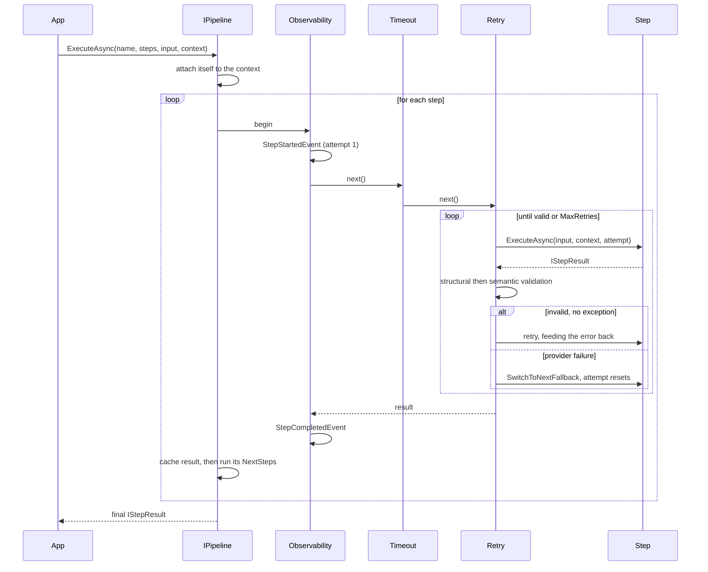
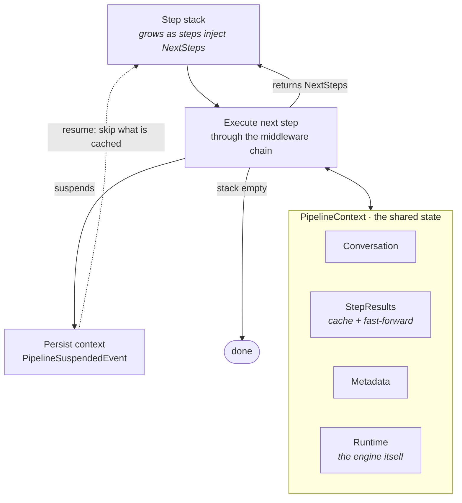
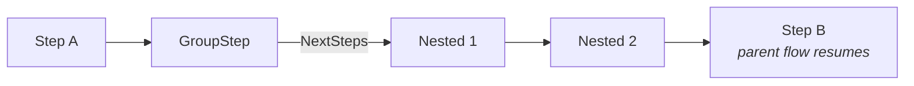
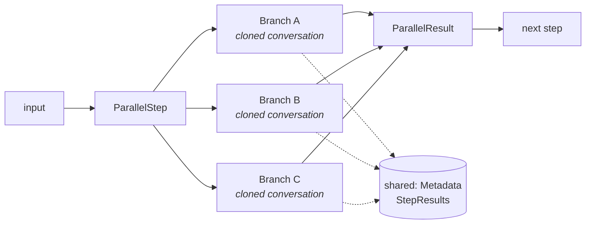
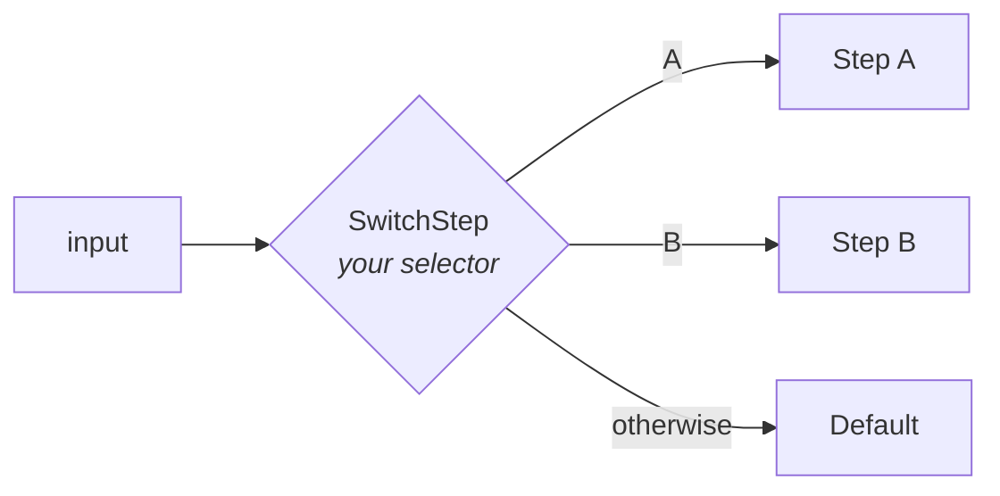
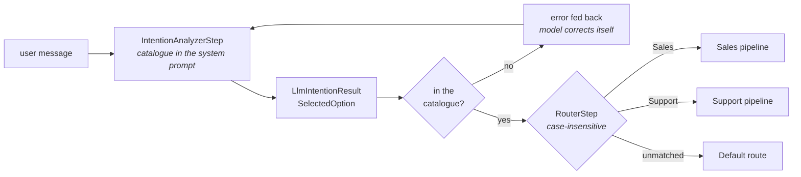

# Architecture

## Overview

AITaskAgent uses a **pipeline architecture** with middleware composition, similar to ASP.NET Core.

## Core Components

### Pipeline

`Pipeline` is a **sealed class implementing `IPipeline`**, registered as a singleton by
`AddAITaskAgent()`. Resolve it from DI — it is no longer a static executor.

```csharp
var pipeline = serviceProvider.GetRequiredService<IPipeline>();

await pipeline.ExecuteAsync(
    name: "MyPipeline",
    steps: [step1, step2],
    input: initialInput,
    context: pipelineContext,
    pipelineTimeout: TimeSpan.FromMinutes(5),
    cancellationToken: ct,
    subscribers: [async (evt, ct) => Console.WriteLine(evt.EventType)]
);
```

There is a single `ExecuteAsync` overload. Its defaults come from `PipelineOptions`
(configuration section `"Pipeline"`, itself seeded from `AITaskAgent:Timeouts`), exposed as
`DefaultPipelineTimeout` and `DefaultStepTimeout`.

Global middlewares are **not** passed per call: register them once with
`PipelineMiddlewareRegistry.Register(...)` or
`serviceProvider.RegisterPipelineMiddleware<TMiddleware>()`.

### PipelineContext

Shared state passed through all steps:

- `Conversation` - LLM conversation with history
- `CorrelationId` - For distributed tracing
- `Metadata` - Custom data (thread-safe)
- `StepResults` - Cached results (thread-safe), keyed by step path
- `CurrentStepPath` - Current position in the execution tree
- `ServiceProvider` - Scoped service access from inside a step
- `EventChannel` / `SendEventAsync()` - Emit events to observers

Contexts are built by `PipelineContextFactory` (`Create(...)`, `CreateFromId(...)`), which is
resolved from DI and also exposes a static entry point initialized by `UseAITaskAgent()`.

### Steps

Units of work implementing `IStep`:

| Step Type | Purpose |
|-----------|---------|
| `ActionStep<TIn>` | Side-effecting action, returns `ActionResult` |
| `DelegatedStep<TIn, TOut>` | Inline transformation via a delegate |
| `TypedStep<TIn, TOut>` | Strongly-typed base class |
| `GroupStep` / `GroupStep<TIn>` | Sequential sub-steps |
| `ParallelStep` / `ParallelStep<TIn>` | Concurrent execution of `Branches` |
| `LoopStep` | Repeats its `Steps` up to `MaxIterations` |
| `BreakStep` | Early exit out of the enclosing `LoopStep` |
| `SwitchStep<TIn>` | Dynamic routing |
| `RouterStep` | String-keyed routing over an `IRouterResult` |
| `BaseLlmStep` | LLM interaction with tools |

### Middleware Chain

Execution order (outer to inner):

```
User Middlewares → Observability → Timeout → Retry → Step
```

Each middleware wraps `next()`:

```csharp
public async Task<IStepResult> InvokeAsync(
    IStep step, IStepResult input, PipelineContext context,
    Func<CancellationToken, Task<IStepResult>> next,
    CancellationToken cancellationToken)
{
    // Before step
    var result = await next(cancellationToken);
    // After step
    return result;
}
```

## Execution Flow



Retry sits at the end of the chain and calls the step directly rather than `next()`, so its attempts
happen *inside* Observability's single call — which is why retries emit their own start event.

## The Dynamic Execution Loop

The AITaskAgent engine operates as a **Dynamic Stack Consumer** centered around a shared state. This architecture allows for runtime-extensible flows, self-correcting agents, and resilient execution.



The stack is consumed, not walked: a step can push more work onto it, which is what makes routing,
iterative refinement and self-correction possible without declaring the shape in advance.

### 1. Context Activation & Setup
Before execution, the `PipelineContextFactory` initializes the **Operational Memory (Context)**:
- **Fresh Mode**: No IDs provided. Initializes a clean context with a new `CorrelationId`.
- **Resumption Mode (`ContextId`)**: Recovers existing context. The engine uses `StepResults` to skip previously completed steps and resume exactly where it failed.
- **Continuation Mode (`ConversationId`)**: New context but pre-loads the long-term history of a specific conversation.

### 2. The Execution Cycle
The engine processes a dynamic **Step Stack** instead of a rigid list:

1. **Fetch**: Pops the next step from the stack.
2. **Wrap (Middleware Chain)**: The step is executed through a chain of "shields":
    - **Observability**: Emits traces and events.
    - **Resilience**: Manages retries via `RetryMiddleware`.
    - **Safety**: Enforces execution timeouts.
3. **Execute & Persist**: The step logic runs. The result is stored in the **Context (StepResults)** cache to prevent re-execution and enable bookmarks.
4. **Dynamic Branching**:
    - **Error?** → Execution stops; Error results are emitted.
    - **NextSteps Injected?** → If the step produced `NextSteps` (e.g., via a `SwitchStep` or LLM decision), these are pushed onto the **Stack**. The engine processes them in the next iteration.

### 3. Peripheral Observability (Projections)
As the loop iterates, it emits data to the **EventChannel**. This is a projection of the internal state, not part of the context itself:
- **Events (Milestones)**: `PipelineStarted`, `StepCompleted`, `RouterDecision`, `ToolExecution`.
- **Metrics (Health)**: `StepErrors` counters, `StepDuration` histograms, `TokenUsage` metrics.
- **Traces (Call Graph)**: Distributed traces showing the hierarchy of dynamic calls.

---

## Non-Linear Flows

### Execution Model

The pipeline is a **Dynamic Execution Graph**:

- **Directed Graph** defined at design time
- **Extensible at runtime** via `NextSteps`
- **Branchable** (GroupStep, SwitchStep)
- **Parallelizable** (ParallelStep)
- **Acyclic by convention** (not enforced technically)

> [!WARNING]
> The framework does **not prevent cycles**. If a step adds itself (or creates a circular reference) to `NextSteps`, it will cause an infinite loop. Always ensure your pipeline design is acyclic.

---

### NextSteps Mechanism

Any step can inject additional steps via `IStepResult.NextSteps`:

```csharp
protected override Task<MyResult> ExecuteAsync(...)
{
    var result = new MyResult(value);
    result.NextSteps.Add(new AdditionalStep());  // Will execute next
    return Task.FromResult(result);
}
```

The Pipeline processes `NextSteps` before moving to the next configured step.

---

### GroupStep (Sequential Branching)

Creates a **branch** in the flow by injecting sequential sub-steps. After the branch completes, execution continues with the parent flow. Groups can be **nested**.



**Key behaviors:**
- Sets `input.NextSteps = [NestedStep1, NestedStep2, ...]` and returns immediately
- Nested steps execute **before** the next step in the parent pipeline
- **Nestable**: A GroupStep can contain another GroupStep
- After all nested steps complete, flow resumes at the next step in the parent

---

### ParallelStep (Concurrent Execution)

Executes multiple steps **concurrently** (not branching, but parallelism):



**Key behaviors:**
- Branches live in `ParallelStep.Branches` (not `Steps`)
- Each branch runs on a `CloneForBranch()` context: **cloned** `ConversationContext` and its own
  step path, so results never collide
- `Metadata` and `StepResults` are **shared** (thread-safe)
- All branches execute simultaneously and emit `BranchStartedEvent` / `BranchCompletedEvent`
- Results are aggregated into a `ParallelResult`, read via `Value["StepName"]` or
  `GetResult<T>("StepName")`
- After all branches complete, flow continues with the aggregated result

---


### SwitchStep (Dynamic Routing)

Routes to different steps based on runtime logic:



**Usage pattern:**
```csharp
var router = new SwitchStep<MyInput>("Router", (input, ctx) =>
{
    var target = input.Value.Type switch
    {
        "A" => stepA,
        "B" => stepB,
        _ => defaultStep
    };
    return (target, input);
});
```

---

### RouterStep (LLM-Based Routing)

Combines LLM intent analysis with `SwitchStep`. Options are **strings**, described at runtime by
an `IntentionOption` catalogue — there is no enum type parameter.



```csharp
var options = new List<IntentionOption>
{
    new() { Id = "Sales",   Description = "User wants to buy something" },
    new() { Id = "Support", Description = "User needs help with an issue" },
    new() { Id = "FAQ",     Description = "User is asking a general question" }
};

var analyzer = new IntentionAnalyzerStep<LlmStringStepResult>("Analyze", role, options);

var router = new RouterStep("Route", new Dictionary<string, IStep>
{
    ["Sales"]   = salesPipeline,
    ["Support"] = supportPipeline,
    ["FAQ"]     = faqPipeline
});
```

See [Intention Routing](../guides/intention-routing.md) for the full contract.

## Design Patterns

| Pattern | Usage |
|---------|-------|
| **Middleware** | Pipeline execution chain |
| **Template Method** | `StepBase` hooks for observability |
| **Strategy** | `ILlmService` implementations |
| **Factory** | `PipelineContextFactory`, `StepResultFactory` |
| **Observer** | `IEventChannel` pub/sub |

## Key Interfaces

```csharp
// Step execution
public interface IStep { ... }
public interface IStep<TIn, TOut> : IStep { ... }

// Step results
public interface IStepResult { ... }

// LLM service
public interface ILlmService { ... }

// Tools
public interface ITool { ... }

// Middleware
public interface IPipelineMiddleware { ... }

// Observability
public interface IEventChannel { ... }
public interface IProgressEvent { ... }
```

## Next Steps

- [Core Concepts](../guides/core-concepts.md) - Terminology and lifecycle
- [Middlewares](../guides/middlewares.md) - Deep dive into middleware
- [Event System](../guides/event-system.md) - Observability events
