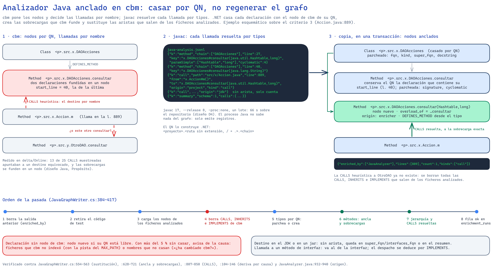
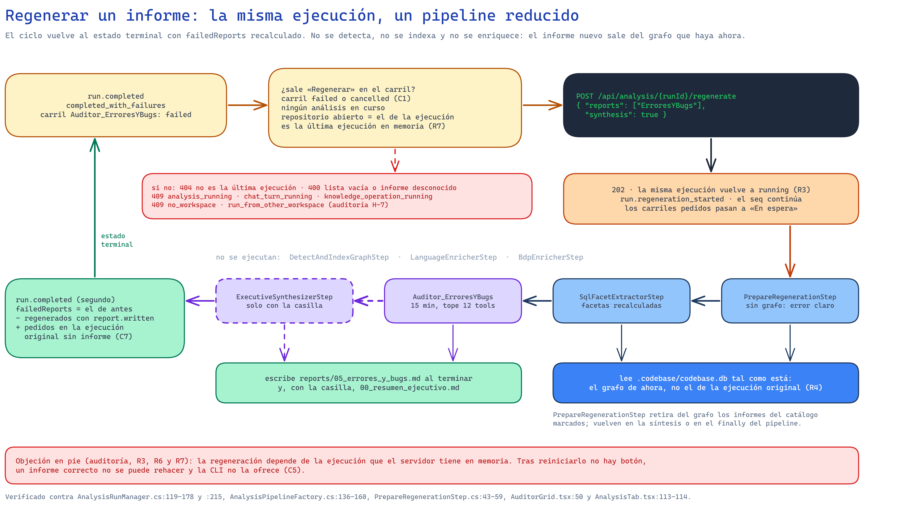
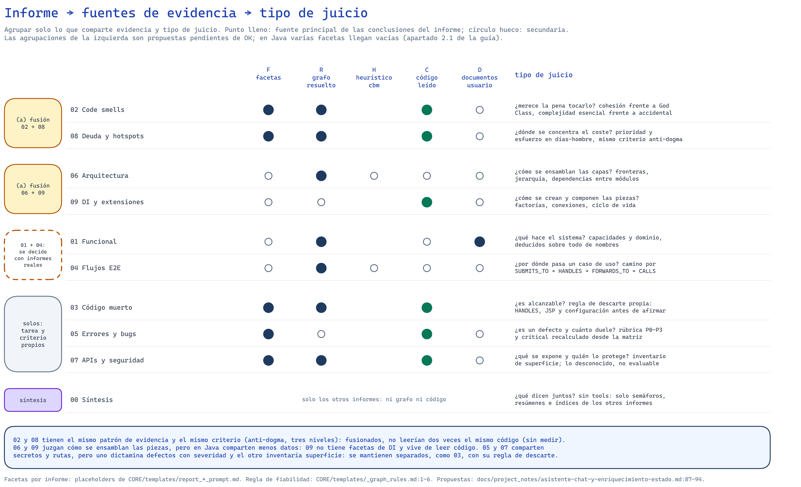

# Análisis de código: flujo de extremo a extremo y política de cada informe

Estado del código a 2026-09-29, rama `consolidation`, con las correcciones de la prueba M. La fuente de verdad es el código; los documentos de
diseño se citan para las cifras medidas y las decisiones. `CORE` abrevia `Samples/CodebaseAnalysis.Core`, `WEB`
abrevia `Samples/CodebaseAnalysisWeb` y las rutas sin prefijo son relativas a la raíz del repositorio. Lo que no se ha
podido verificar en el código se dice en su sitio.

## Resumen

La app analiza un repositorio en seis pasos del framework agrupados en cinco fases (`CORE/AnalysisPipelineFactory.cs:113-123`).
`codebase-memory-mcp` (cbm) indexa el repositorio en su caché y el pipeline copia esa BD a `.codebase/codebase.db`, que
es la única que se escribe a partir de ahí. Sobre la copia escriben la ingesta de Office y de Markdown, la
reincorporación de documentos del usuario, el analizador Java nativo (`javac` en un proceso aparte), el plugin
Struts/JSP y, si no hay enriquecedor nativo, BdpGraphEnricher o un fallback LLM. Un paso SQL determinista calcula una
vez unas cuarenta facetas en memoria, y nueve auditores LLM las reciben en paralelo, cada uno con su par de plantillas y
seis tools de solo lectura sobre el grafo, el código y los documentos. Cada auditor escribe su informe en `reports/` al
terminar, y una síntesis sin tools escribe `00_resumen_ejecutivo.md` a partir de los semáforos, los resúmenes y los
índices de secciones. La web aloja ese mismo pipeline, enseña el progreso por fases, permite regenerar un informe
fallido sobre el grafo existente y ofrece un chat que consulta el mismo grafo y los mismos informes y audita sus marcas
`[V]`/`[D]`/`[I]` contra lo que leyeron sus tools en el turno.

La política de análisis es común a los nueve auditores y está en `CORE/templates/_graph_rules.md:1-6`: el grafo sirve
para la estructura, una arista resuelta por un enriquecedor es un dato y una heurística de cbm es una pista; en code
smells, errores, seguridad y deuda el grafo y las facetas dicen dónde mirar y el veredicto exige leer el código; y
«nadie lo llama» no prueba código muerto sin cruzar antes con `HANDLES`, las JSP y la configuración. La parte 2
documenta, informe a informe, qué evidencia recibe cada auditor, de dónde sale cada tipo de conclusión y qué no puede
ver, y termina con la agrupación que se propone y que sigue pendiente de aprobación.

---

# Parte 1. El flujo de un análisis

<!-- Source: docs/assets/diagrams/analisis-flujo-extremo-a-extremo.excalidraw -->

## 1.1 Mapa de etapas

La tabla resume cada etapa; los apartados siguientes desarrollan solo lo que no cabe en ella. Los tiempos son los
medidos en los documentos de diseño sobre el repositorio Java objetivo (`delta/Online`, 8420 ficheros); donde no hay
medición se dice.

| Etapa | Entra | Lee | Escribe | Tiempo medido | Si falla |
|---|---|---|---|---|---|
| `DetectAndIndexGraphStep` | `AnalysisPipelineInput` | repositorio entero (cbm), `~/.cache/codebase-memory-mcp/<proyecto>.db` | `.codebase/codebase.db`, `backups/` con `ForceReindex` | cbm, 59-67 s en indexación completa y el paso entero 24,5 s sin reindexar (prueba M, apartado 1.14); el plan daba 157 s (`docs/plans/2026-09-28-enriquecimiento-nativo-java-plan.md:62`) | excepción que corta el pipeline (`:54-60`, `:86-91`, `:310-326`) |
| Ingesta Office, Markdown y conocimiento | dentro del paso anterior | `.accdb`/`.mdb`/`.docx`, `*.md`, `.codebase/knowledge/graph-sources.json` | nodos y aristas en la copia | sin medir | Office y Markdown avisan por fichero; el resto propaga |
| `LanguageEnricherStep` | `GraphStatusResult` | disco (`RepositoryScan`), JDK, jars | copia del grafo, `enrichment_runs`, `.codebase/enrichment/java/` | 181,7 s con el plugin en la prueba M, con 1364 ficheros más de los que tenía cbm; en el diseño, unos 109 s y `javac` solo 66 s (`docs/plans/2026-09-28-enriquecimiento-nativo-java-design.md:47`) | aviso y fila `skipped`/`failed`; sigue con el grafo de cbm |
| `BdpEnricherStep` | `GraphStatusResult` | solución .NET o 15 ficheros clave (LLM) | copia del grafo, `enrichment_runs` (solo el fallback) | sin medir | CLI con código ≠ 0 o `Required` → corta; fallback → aviso |
| `SqlFacetExtractorStep` | `GraphStatusResult` | copia del grafo, ficheros para fragmentos y secretos, documentos | `ReportFacetInput` en memoria y en el contexto | 51,5 s en la prueba M, antes del índice por label del apartado 1.6 | cada consulta fallida llega como nota «no es un conjunto vacío» |
| `ParallelReportsExecution` | `ReportFacetInput` | LLM, grafo, código, documentos | `reports/01…09_*.md` | sin medir para Java: en la prueba M Azure respondió `404 DeploymentNotFound` | una rama fallida no para la síntesis salvo que fallen todas |
| `ExecutiveSynthesizerStep` | `ParallelResult` | LLM, informes en disco | `reports/00_resumen_ejecutivo.md` | sin medir | respuesta vacía → resumen de respaldo sin LLM |

El plan da 157 s para cbm y la prueba M midió entre 59 y 67 s de indexación completa sobre el mismo repositorio; no
consta a qué se debe la diferencia.

## 1.2 Detección e indexación con cbm

El paso deja en el contexto la entrada, la ruta de la BD y las rutas de conocimiento (`CORE/Steps/DetectAndIndexGraphStep.cs:37-39`),
y con `ForceReindex` mueve antes a `<carpeta de la BD>/backups/<yyyyMMdd_HHmmss>/` la BD con sus `-wal`/`-shm`, las
exportaciones de Access y los diez informes del catálogo por nombre (`:162-224`). Indexa solo si no hay BD, si se fuerza
o si la BD no tiene nodos estructurales (tipos, funciones, métodos, `CsProject`, `AccessTable` o `AccessQuery`,
`:406-426`). La indexación ejecuta `codebase-memory-mcp cli index_repository`, toma el nombre de proyecto que el propio
indexador informa por su salida (`:282-290`) y copia `~/.cache/codebase-memory-mcp/<proyecto>.db` sobre la ruta de
trabajo (`:317-334`). Nada del pipeline vuelve a abrir la BD de la caché: los enriquecedores lo comprueban antes de
escribir (`CORE/Enrichment/EnrichmentMarks.cs:38-41`).

Tras indexar se retiran los nodos bajo la carpeta de la BD, la de informes y `<repositorio>/.codebase`, porque cbm
recorre también la salida del propio pipeline (`:343-386`). `GraphSchema.EnsureAsync` añade las columnas duplicadas
`file`/`file_path` y `line_start`/`start_line` que leen las facetas (`CORE/Support/GraphSchema.cs:61-68`). Si el grafo
no tiene código ni hay artefactos Office, el paso lanza y el pipeline se para (`DetectAndIndexGraphStep.cs:86-91`). `CheckIfEnrichedAsync` decide
si el código ya está enriquecido (nodos `CsProject` o propiedades `afferent_coupling`, `cyclomatic` o `in_cycle`), sin
contar los nodos de Office, los del fallback LLM ni los marcados por el analizador Java (`DetectAndIndexGraphStep.cs:446-469`); esa marca solo la
usa `BdpEnricherStep`.

**Límite MAX_PATH.** cbm no indexa los ficheros cuya ruta absoluta llega a 260 caracteres, el MAX_PATH de Windows: no
deja ningún nodo en ese `file_path` y el paso no lo avisa. En la prueba M, con la copia del repositorio en una carpeta
temporal de ruta larga, el analizador Java encontró 1364 ficheros más de los que tenía cbm y creó sus declaraciones como
nodos nuevos. `JavaGraphWriter` cuenta esos ficheros y los de ruta larga en `details.cbm_match`, y el aviso del paso
da la pista (apartado 1.4); para evitarlo, el repositorio tiene que estar en una ruta corta.

## 1.3 Ingesta de Office, Markdown y conocimiento

Las tres escriben dentro de `DetectAndIndexGraphStep` y con el mismo `project` que cbm:

- **Office:** con algún `.accdb`, `.mdb` o `.docx` en el repositorio corre `IngestOfficeArtifactsStep` (`DetectAndIndexGraphStep.cs:93-103`), que
  crea `Table`/`AccessTable`, `Query`/`AccessQuery`, `Module`, `Form`, `Report`, `Sub`/`Function`, `Flow` y `DocSection`,
  con aristas `READS_TABLE`, `WRITES_TABLE`, `EXECUTES_QUERY`, `CALLS`, `HANDLES_EVENT`, `FLOW_ENTRY`, `FLOW_NEXT` y
  `DOC_DESCRIBES` (`OfficeTools/Steps/IngestOfficeArtifactsStep.cs:436-713`). Es el único escritor del repositorio de
  `dead_code_candidate`, `hotspot`, `anti_pattern` y `detected_issues`, y calcula `fan_in` contando todas las aristas
  entrantes (`:431`, `:720-740`, `:777-806`). Sus `CALLS` no llevan `enriched_by`.
- **Markdown:** `WorkflowAndMarkdownEnricher` registra cada `.md` como `PromptTemplate` si la ruta contiene `template` o
  el nombre termina en `_prompt.md`/`_system.md`, y como `DocSection` en otro caso, con título, encabezados y 800
  caracteres de extracto (`CORE/Support/WorkflowAndMarkdownEnricher.cs:57-100`).
- **Conocimiento del usuario:** si la web marcó fuentes para el grafo en `.codebase/knowledge/graph-sources.json`, se
  reincorporan los documentos aportados y los informes propios, y se retiran los informes del catálogo, que vuelven tras
  la síntesis con el contenido nuevo (`DetectAndIndexGraphStep.cs:128-154`). Cada fuente es un `UserDocument` con sus
  `UserDocSection` (`HAS_SECTION`) y aristas `DOC_DESCRIBES` hacia el código que menciona
  (`CORE/Knowledge/Graph/KnowledgeGraphIngestor.cs:13-29`). Si el run no llega a la síntesis, los informes retirados
  vuelven en el `finally` de `CodebaseAnalysisPipeline` (`CORE/AnalysisPipelineFactory.cs:335-368`).

Nadie en el repositorio escribe nodos `WorkflowStep`, así que `WorkflowStepsCatalog` llega siempre vacía; lo que
escribe BdpGraphEnricher, que es externo, no se ha podido comprobar.

## 1.4 `LanguageEnricherStep`: analizador Java y plugin Struts/JSP

El paso recorre el disco una vez (`RepositoryScan`), sin `.git`, `bin`, `obj`, `node_modules`, `.codebase`, `.gradle`,
`.idea`, las salidas `target`/`build`/`out` en la raíz o junto a un fichero de build, ni las raíces de test, y deja
`DetectedLanguages` en el contexto (`CORE/Steps/LanguageEnricherStep.cs:75-78`). La presencia de `.java` activa el
analizador Java y la de algún `struts-config*.xml` el plugin, por ese orden (`:80-98`). Su límite es
`JavaAnalyzer:StepTimeoutSeconds` (3600 s) y no `CodebaseAnalysis:Timeouts:EnrichMinutes`, que es el de
`BdpEnricherStep` (`CORE/Enrichment/JavaAnalyzerOptions.cs:41-57`).

### Analizador Java

`JavaAnalyzer.java` es un único fuente ejecutado con el *source launcher* del JDK configurado, sin paso de compilación
ni binarios (`CORE/Enrichment/Java/JavaAnalyzer.java:1-33`). Compila en memoria con `--release 8 -proc:none
-implicit:none -Xmaxerrs 1000000 -nowarn` (`:551-552`), recorre los árboles con `TreePathScanner` y emite por fichero
tipos, métodos con su `key` (`owner#nombre(FQN borrados)`), llamadas y creaciones con su destino y diagnósticos. El
origen de cada destino se clasifica como `project` si sale de un fuente, `jdk` si viene de `ct.sym` o `jrt:`, `jar` en
otro caso y `unresolved` con su motivo (`:932-940`). La complejidad ciclomática es 1 más cada `if`, bucle, `case` no
`default`, `catch`, ternario, `&&` y `||`, sin entrar en clases anidadas (`:944-963`).

`JavaAnalyzerRunner` compone el classpath con todos los `.jar` del repositorio más `JavaAnalyzer:ProvidedClasspath`
(`CORE/Enrichment/Java/JavaAnalyzerRunner.cs:167-196`), deja `request.txt`, `java-analysis.jsonl` y
`java-analyzer.log` en `<carpeta de la BD>/enrichment/java/` (`:93-95`) y mata el proceso al superar
`JavaAnalyzer:TimeoutSeconds`, 900 s por defecto (`:329-338`). Sin JDK válido el paso avisa, retira igualmente el
código de test y deja una fila `skipped` (`LanguageEnricherStep.cs:145-157`); cualquier otro fallo deja una fila
`failed` y el grafo de cbm (`:198-205`).

### `JavaGraphWriter`: anclado en cbm

<!-- Source: docs/assets/diagrams/java-anclado-en-cbm.excalidraw -->

La escritura es .NET, en una transacción sobre la copia, y valida el resultado entero antes de tocar la BD: un JSONL
sin `summary` final o de otra versión de contrato no escribe nada (`CORE/Enrichment/Java/JavaGraphWriter.cs:201-203`,
`:341-345`). El orden es este (`:384-417`):

1. **Salida anterior:** borra lo que escribió la pasada anterior de `JavaAnalyzer`, identificado por `enriched_by`.
2. **Tests:** retira los nodos bajo las raíces de test (`testSourceDirectory` del `pom.xml`, `src/test/java`,
   `JavaAnalyzer:TestRoots`) con sus aristas y vectores.
3. **Carga:** lee los nodos de cbm de los ficheros analizados y los indexa por QN (`:525-552`).
4. **Sustitución:** borra todas las `CALLS`, `INHERITS` e `IMPLEMENTS` cuyo origen es un nodo de esos ficheros
   (`:189`, `:554-563`).
5. **Tipos:** el QN se construye en .NET como `<proyecto>.<ruta sin extensión con / → .>.<cadena de tipos>`
   (`:578-579`, `:1001-1009`); si existe se parchea y si no se crea (`:567-605`).
6. **Métodos:** agrupa las declaraciones por tipo y nombre; el ancla es el `Method` de cbm con ese QN o, en interfaces y
   enums, el `Function` que cbm crea en `<prefijo>.<nombre>` (`:713-721`). Conserva el QN la declaración que contiene el
   `start_line` del ancla, o la más cercana, y las demás se crean con sufijo de tipos simples (`…consultar(Hashtable,long)`),
   o completos si colisionan, con `overload_of` y `DEFINES_METHOD` desde su tipo (`:628-706`).
7. **Jerarquía y llamadas:** `INHERITS`/`IMPLEMENTS` solo con destino de proyecto (los del JDK o de jars quedan en
   `super_fqn`/`interfaces_fqn`) y una `CALLS` por par de nodos con `lines`, `count` y `kinds`
   (`:776-850`). Una llamada a un método de interfaz apunta al método de la interfaz; el despacho se deduce por
   `IMPLEMENTS`. Los constructores implícitos y los destinos en clases anónimas o locales no tienen nodo y solo cuentan
   en `unresolved` (`:807-874`).
8. **Registro:** deja la fila `ok` de `enrichment_runs` con recuentos, tiempos por fase y `details.cbm_match`, que separa
   lo que no casa con cbm por causa: ficheros que cbm no indexó (`unindexed_files`, sin ningún nodo suyo en ese
   `file_path`, y `unindexed_files_long_path`, los que llegan a 260 caracteres de ruta absoluta) y nombres que no casan
   en los ficheros que sí indexó (`types_created_name_mismatch`, `methods_created_name_mismatch`). Solo estos últimos
   marcan deriva (`drift_suspected`), con más del 5 % de tipos o de métodos sin sobrecargas (`:104-146`, `:169-175`,
   `:467-505`). El paso avisa si lo que no casa en total pasa del 5 % y dice cuál de las dos causas es; solo la segunda
   apunta a un cambio de versión de cbm, y la primera lleva la pista del MAX_PATH si algún fichero la cumple
   (`CORE/Steps/LanguageEnricherStep.cs:280-323`).

Todo lo escrito lleva `enriched_by: ["JavaAnalyzer"]`, y eso es lo que `graph_neighbors` y las facetas leen como arista
resuelta. Sobre el repositorio objetivo el resultado aceptado fue un 99,996 % de llamadas resueltas, ninguna `CALLS` de
cbm en los ficheros analizados y 5488 sobrecargas creadas en `src/`
(`docs/project_notes/asistente-chat-y-enriquecimiento-estado.md:45-50`).

### Plugin Struts/JSP

`StrutsJspWriter` lee con .NET los `struts-config*.xml`, las definiciones de Tiles y las JSP, sin compilar nada, y crea
nodos `Route` (QN `__route__ANY__<path>`), `Jsp` y `TilesDefinition` con aristas `HANDLES`, `FORWARDS_TO`, `SUBMITS_TO`,
`INCLUDES`, `RENDERS` y `EXTENDS_DEFINITION` (`CORE/Enrichment/Web/StrutsJspWriter.cs:72-76`, `:481-482`). La clase de
cada acción se busca entre los `Class` del grafo por nombre y ruta del fichero, y si no aparece no hay `HANDLES`
(`:494-505`). Una JSP es sospechosa si importa algo que casa con `SuspiciousImportPatterns` (DAO, `java.sql`,
`javax.sql`), si un scriptlet o una declaración usa un import de negocio o si su Java contiene SQL; el acceso a sesión
se registra en `session_access` pero no la marca (`CORE/Enrichment/Web/JspScanner.cs:327-354`). Medido: 1736 JSP, 1484
acciones y 26 JSP sospechosas con la regla afinada (`docs/project_notes/asistente-chat-y-enriquecimiento-estado.md:48`).

### `enrichment_runs` y repetición

Cada enriquecedor se salta, con un mensaje, si ya hay una fila `ok` con su versión, la misma huella de indexación
(`projects.name|indexed_at`) y la misma huella de configuración (`LanguageEnricherStep.cs:133-143`,
`CORE/Enrichment/EnrichmentRuns.cs:78`, `:114-126`). En Java la configuración que cuenta es la codificación, el
classpath y las raíces de test; en Struts, además, la última pasada `ok` de Java, de modo que una pasada Java nueva
repite el plugin (`LanguageEnricherStep.cs:341-345`). Una reindexación de cbm cambia `indexed_at` y obliga a repetir
todo. La versión del analizador es una constante manual (`JavaGraphWriter.cs:163`): editar `JavaAnalyzer.java` sin
subirla hace que la pasada se omita.

## 1.5 `BdpEnricherStep` y el fallback LLM

Si `LanguageEnricherStep` encontró Java y no C#, el paso lo dice y devuelve la entrada sin CLI ni LLM
(`CORE/Steps/BdpEnricherStep.cs:40-50`). En otro caso, deshabilitado va al fallback (`:54-63`), con el grafo ya
enriquecido no hace nada (`:65-69`), sin CLI o sin `.sln`/`.slnx` va al fallback salvo `BdpEnricher:Required`
(`:71-103`), y con ambos ejecuta `BdpGraphEnricher.CLI enrich`. El fallback, `SemanticEnrichmentStep`, envía al rol
`Enricher` hasta 15 ficheros de rutas, controladores o DI y vuelca el JSON que devuelve; el código impone las marcas
(`origin: ai_enricher`, `enriched_by: SemanticEnricherAgent`) y solo deja pasar propiedades semánticas de una lista
blanca, nunca métricas (`CORE/Steps/SemanticEnrichmentStep.cs:36-47`). Sin ficheros de entrada no llama al modelo
(`:76-86`) y con una fila `ok` sobre la misma indexación y los mismos ficheros tampoco (`:88-100`). Sus aristas salen en
`graph_neighbors` como «estimada por LLM» y no cuentan como resueltas en las facetas
(`CORE/Steps/SqlFacetExtractorStep.cs:628-629`).

## 1.6 Facetas SQL (`SqlFacetExtractorStep`)

El paso abre la copia, detecta el ecosistema por las extensiones de los ficheros del grafo y por algunas etiquetas
(`CORE/Steps/SqlFacetExtractorStep.cs:934-1050`) y ejecuta unas cuarenta consultas, cada una con `LIMIT` y un `ORDER BY` determinista. El resultado es un
único `ReportFacetInput` que vive en memoria y en el contexto (`:556`) y que reciben todos los auditores; cada
plantilla de prompt elige qué placeholders incluye, y esa elección es la que fija qué faceta va a qué informe (la
matriz está en el apartado 2.1). Tres propiedades de diseño afectan a todos los informes:

- **Lo desconocido no es cero:** `ZeroFaninClasses` solo lista tipos con `fan_in` conocido e igual a 0 (`:186-204`),
  `UnvalidatedRoutes` solo `auth_required = false` (`:271-281`) y las rutas sin dato dicen `desconocido`
  (`:93-102`, `:378-385`). Una consulta que falla llega como `[] /* Faceta no disponible por un error SQL …: no es un
  conjunto vacío */` (`:796-797`).
- **Métricas calculadas con procedencia:** si falta la propiedad, `fan_in`/`fan_out` salen de `CALLS` resueltas (con
  `enriched_by` distinto del fallback LLM y solo en nodos marcados por el mismo enriquecedor), `method_count` de
  `DEFINES_METHOD`, `cyclomatic_total` como suma si todos los métodos la tienen y la LOC del rango de líneas, en tablas
  temporales de la conexión; cada valor dice su origen en `*_source` (`:657-737`). En un tipo no cuentan sus llamadas
  internas (`:719-722`).
- **Código adjunto:** `HighCyclomaticMethods`, `CriticalHotspotsExceptions` y `HotspotsRanking` adjuntan el fragmento
  del disco de sus diez primeros elementos, con 70 líneas como máximo (`:132`, `:269`, `:406`, `:902-931`).

Dos facetas no salen del SQL: `HardcodedSecrets` recorre en disco los ficheros que referencia el grafo y enmascara el
valor (`:492-502`), y `ProvidedDocumentation` es el índice de hasta 30 documentos subidos con `useInAnalysis`
(`CORE/Steps/ProvidedDocumentationFacet.cs:19-21`). El paso tiene 5 minutos fijos (`SqlFacetExtractorStep.cs:25`).

En la prueba M tardó 51,5 s sobre una copia de 1 676 672 KB (el tamaño que da el log al copiarla de cbm). Una causa se ha comprobado en el esquema: cbm trae su propio
`idx_nodes_label` sobre `(project, label)`, y el `CREATE INDEX IF NOT EXISTS idx_nodes_label ON nodes(label)` de
`GraphSchema` no hacía nada en la copia, así que cada consulta por label sin `project`, que son casi todas las facetas,
recorría la tabla de nodos entera. El índice tiene ahora nombre propio, `idx_graph_nodes_label`
(`CORE/Support/GraphSchema.cs:47`, `:51-55`). En una BD sintética de 289 200 nodos y 328 MB, una consulta por label bajó de
1 s a menos de 40 ms, las de métodos de 1,2 a 0,65 s, y crear el índice costó 1,1 s; sobre la BD real no está medido.
Siguen sin índice las doce consultas que filtran solo por propiedades JSON (código muerto, hotspots, patrones, Martin,
ciclos, comunidades, cobertura documental, obsoletos y puntos de extensión), cada una un recorrido completo de nodos con
`json_extract`, que son la siguiente candidata, y las de aristas por tipo, porque un índice más en `edges` encarecería
la escritura del analizador Java.

## 1.7 Los nueve auditores en paralelo

Cada informe pedido es un `CustomStatelessTemplateLlmStep<ReportFacetInput, SingleReportResult>` con su rol, sus
plantillas `report_<prefijo>_system.md` y `_prompt.md`, un límite de `AuditorMinutes` (15) y un tope de iteraciones de
tools de 12, o 16 para `FlowsAuditor` (`CORE/AnalysisPipelineFactory.cs:175-203`, `:245-268`,
`CORE/appsettings.analysis.json:19-21`). Todos van en `TolerantReportsParallelStep`, con `ReportsMinutes` (60) para el
conjunto y `CodebaseAnalysis:Reports:MaxParallelAuditors` como tope de concurrencia; con 0, el valor por defecto, corre
una rama por procesador (`Framework/Core/Steps/ParallelStep.cs:60`). Las seis tools son las mismas para los nueve
(`CORE/AnalysisPipelineFactory.cs:240-243`):

| Tool | Qué da | Qué no da |
|---|---|---|
| `view_file` | hasta 800 líneas del fichero, decodificadas con la regla del repositorio (`FileTools/Tools/ViewFileTool.cs:19`, `:90`) | nada del grafo |
| `view_code_item` | nodos por nombre con su `Location` | solo entiende C#: parsea con Roslyn (`FileTools/Tools/ViewCodeItemTool.cs:93-94`), así que en Java no sirve |
| `graph_search` | nodos por etiqueta, nombre o QN con sus propiedades útiles y, con `include_code`, su código leído del disco (`CORE/Tools/GraphSearchTool.cs:20-21`, `:305`) | vecinos |
| `graph_neighbors` | vecinos por `CALLS`, `INHERITS`, `IMPLEMENTS`, `DEFINES_METHOD`, `HANDLES` y las aristas Struts/JSP, con la procedencia de cada arista (`CORE/Tools/GraphNeighborsTool.cs:33-37`, `:356-409`) | código |
| `graph_domain` | rutas con su clase (`HANDLES`), registros DI y atributos (`CORE/Tools/GraphDomainTool.cs:86-146`); sin `auth_required`, la autenticación sale «❔ Desconocida» (`:115-121`) | anotaciones Java: `attributes` es de C# |
| `read_document` | un documento subido, entero o por sección | nada del código |

Al agotar el tope de tools el auditor no falla: repite sobre la misma conversación, sin tools, con un mensaje que le
pide redactar el informe con lo reunido y señalar lo no verificado (`CORE/Steps/CustomStatelessTemplateLlmStep.cs:69-75`,
`:143-155`, `CORE/AnalysisPipelineFactory.cs:229-232`). Un fallo del proveedor pasa al fallback del rol; un resultado
con error no se escribe como informe (`CustomStatelessTemplateLlmStep.cs:79-83`). Antes de escribir, el paso quita un H1 que sea solo el nombre del
fichero, lee la línea `analysis-meta` y, si el informe declara `critical` o es el de errores, lo recalcula desde la
matriz de severidad y corrige la línea (`:104-110`, `:185-198`). El informe se escribe en disco en cuanto termina su
auditor y se emite `report.written` (`:114-130`).

## 1.8 Síntesis ejecutiva

`ExecutiveSynthesizerStep` no tiene tools. Toma los informes de esta ejecución, los de tipos no ejecutados que estén en
disco (marcados como de una ejecución anterior) y los fallidos con su motivo (`CORE/Steps/ExecutiveSynthesizerStep.cs:96-171`).
De cada informe manda al rol `ExecutiveSynthesizer` el semáforo, el recuento `critical` si lo hay, un fragmento de
resumen y hasta 30 encabezados `##`/`###` (`:305-362`), junto con las métricas globales de las facetas (`:177-202`). Los
defectos críticos son los del informe de errores, o «no disponible» si no hay dato (`:217-224`). Si el modelo no
devuelve texto, escribe un resumen de respaldo sin LLM (`:246-249`). Después reincorpora al grafo los informes del
catálogo que estaban marcados (`:262-270`).

## 1.9 Informes y demás ficheros en disco

| Ruta | Quién escribe | Contenido |
|---|---|---|
| `reports/01…09_*.md` | cada auditor al terminar | informe con la línea `<!-- analysis-meta: health=…; critical=… -->` al final |
| `reports/00_resumen_ejecutivo.md` | síntesis | resumen y dashboard |
| `reports/custom/*.md` | chat (`create_report`) | informes propios; el pipeline no los toca ni los lee |
| `.codebase/codebase.db` | detección, ingestas, enriquecedores | copia del grafo con `enrichment_runs` |
| `.codebase/enrichment/java/` | analizador Java | `request.txt`, `java-analysis.jsonl` (744 MB en el repositorio objetivo según la auditoría, no se borra) y `java-analyzer.log` |
| `.codebase/backups/<fecha>/` | `ForceReindex` | BD, exportación de Access e informes anteriores |
| `.codebase/report-history/` | web y chat | versiones; el pipeline escribe el informe y la web guarda la versión `baseline` al modificarlo después |
| `logs/analysis-pipeline-<fecha>.log` | anfitrión | log del análisis, con `--debug` los cuerpos de las peticiones |

## 1.10 Límites de tiempo

Todos los límites del análisis están en `CodebaseAnalysis:Timeouts`, en minutos, y 0 los quita
(`CORE/Hosting/AnalysisTimeouts.cs:25-54`). `PipelineMinutes` (240) lo aplica `CodebaseAnalysisPipeline` con su propio
token y al motor le llega `Timeout.InfiniteTimeSpan`, de modo que un corte por tiempo termina con un error que nombra la
clave y no con «A task was canceled.» (`CORE/AnalysisPipelineFactory.cs:308-334`). Los de paso son `DetectMinutes` (15),
`EnrichMinutes` (20, solo `BdpEnricherStep`), `ReportsMinutes` (60), `AuditorMinutes` (15) y `SynthesisMinutes` (15);
el analizador Java usa `JavaAnalyzer:TimeoutSeconds` (900) y `StepTimeoutSeconds` (3600), y las facetas y la
preparación de una regeneración, 5 minutos fijos. Por debajo, el proveedor OpenAI corta cada intento sin respuesta a los
600 s y cada silencio de streaming a los 120 s, configurables por proveedor o rol
(`OpenAILLmService/OpenAILlmService.cs:145-158`); con los valores por defecto un intento colgado consume 10 de los 15
minutos del auditor.

## 1.11 La web

La web ejecuta el mismo pipeline a través de `AnalysisRunner` y no reimplementa nada. El progreso se agrupa en cinco
fases por el nombre del paso (`CORE/Progress/AnalysisEventMapper.cs:32-53`): `detect`, `enrich` (los dos
enriquecedores y el sub-step LLM del fallback), `facets` (también `PrepareRegenerationStep`), `reports` (el paralelo y
cada `Auditor_<tipo>`) y `synthesis`. La fase `enrich` se abre con el primer paso y solo la cierra el `step.completed`
de `BdpEnricherStep`. Los timeouts son los del apartado 1.10, leídos de la misma configuración.

<!-- Source: docs/assets/diagrams/regeneracion-informe-ciclo.excalidraw -->

La regeneración continúa la misma ejecución (R3). El botón «Regenerar» sale en los carriles `failed` o `cancelled`
cuando no hay ejecución en curso y el repositorio abierto es el de la ejecución
(`WEB/ClientApp/src/components/AuditorGrid.tsx:50`, `WEB/ClientApp/src/components/AnalysisTab.tsx:113-114`). Llama a
`POST /api/analysis/{runId}/regenerate` (`WEB/Api/AnalysisEndpoints.cs:42`), que devuelve 404 si la ejecución no es la
última en memoria, 400 con una lista vacía o un informe desconocido y 409 si hay ejecución, turno de chat u operación de
conocimiento en curso, si no hay repositorio o si es de otro (`WEB/Analysis/AnalysisRunManager.cs:119-178`). La
ejecución vuelve a `running`, emite `run.regeneration_started` y sigue con el mismo log y el mismo `seq`. El pipeline
reducido es `PrepareRegenerationStep` → `SqlFacetExtractorStep` → los auditores pedidos → la síntesis si se marca
(`CORE/AnalysisPipelineFactory.cs:136-160`); no detecta, no indexa y no enriquece, así que el informe se basa en el grafo
de ahora. `PrepareRegenerationStep` falla si no hay BD o no tiene grafo estructural y retira del grafo los informes del
catálogo marcados (`CORE/Steps/PrepareRegenerationStep.cs:43-59`). Al terminar, `failedReports` es el de antes, menos
los regenerados con `report.written`, más los pedidos en la ejecución original que no tienen informe en ninguna de sus
partes (C7, `AnalysisRunManager.cs:215`). Sigue en pie la objeción de la auditoría a R3, R6 y R7: la regeneración
depende de la ejecución en memoria y no permite rehacer un informe correcto.

## 1.12 El chat

Un turno es un paso LLM con prompt literal y dieciséis tools: las seis del auditor más `list_dir`, `find_by_name`,
`grep_search`, `list_reports`, `read_report`, `create_report`, `update_report`, `list_documents`, `describe_image` y
`semantic_search` (`CORE/Chat/ChatAgent.cs:91-97`). Consulta la misma copia del grafo y los mismos informes que el
análisis, y la web impide que convivan un turno y un análisis, porque este sobrescribe la BD y mueve los informes. El
límite del turno es `CodebaseAnalysis:Chat:TurnTimeoutMinutes` (5), aplicado con su propio token (`:217`).

La plantilla `CORE/templates/chat_system.md` obliga a marcar cada hecho sobre el sistema: `[V]` si se leyó en el código
en ese turno, con `ruta:línea`; `[D]` si sale de un informe o documento, con `nombre › sección`; `[I]` si se infiere.
El grafo no es código leído: para marcar `[V]` algo que dice `graph_neighbors` hay que abrir la línea con `view_file`.
Al cerrar el turno `ClaimAuditor` recorre las marcas y las contrasta con la evidencia que dejaron los resultados de las
tools (`CORE/Chat/ClaimAuditor.cs:390-446`):

- `view_file` aporta el tramo que enseñó; `view_code_item`, solo el tramo `Location` de cada nodo devuelto;
  `grep_search`, las líneas con coincidencia; `graph_search`, solo los tramos de `include_code`.
- `read_report` y `read_document` aportan el informe o documento leído, que es lo que respalda un `[D]`.
- `graph_neighbors`, `graph_domain` y la tabla de `graph_search` no aportan evidencia aunque citen `ruta:línea`.
- Un resultado que empieza por `Error`, `TOOL_ERROR` o `TOOL_CALL_ERROR` no cuenta (`:455-462`).

Una marca sin respaldo queda `unchecked` con el motivo (no se leyó, se leyó en parte, esas líneas no existen, el
fichero no existe o falta la referencia) y nunca se rechaza la respuesta (`:86-135`). La comprobación es de cobertura:
«verificado» significa que las líneas citadas se leyeron en el turno, no que lo afirmado coincida con ellas.

## 1.13 Quién lee las fuentes y cuántas veces

El repositorio se lee en disco varias veces y cada lectura paga su coste por separado. cbm lo recorre entero una vez;
`RepositoryScan`, la ingesta Markdown, la búsqueda de artefactos Office y, con `ForceReindex`, la copia de seguridad lo vuelven a recorrer;
`javac` vuelve a leer y compilar todos los `.java` (66 s en el repositorio objetivo). Las facetas se calculan una sola
vez y las comparten los nueve auditores, pero cada auditor abre ficheros bajo demanda con sus tools, sin caché
compartida, y paga en tokens el código que lee, aunque otro auditor ya lo haya leído. Hasta la prueba M, además, la
plantilla de sistema y la de prompt de cada auditor incluían las dos `_common_rules.md`, y cada uno recibía esas reglas
dos veces; ahora solo las incluye el prompt (corregido, apartado 2.13). La única medición de tokens es de la ejecución del 27/09 sobre TestAgenteAnalisis (262 nodos): unos 545 000 tokens entre
los nueve auditores y la síntesis, 231 535 de ellos en el de arquitectura, y el volumen lo explica el reenvío del
historial en cada iteración de tools (`docs/auditoria/2026-09-29-auditoria-app-analisis-codigo.md:289-296`).

## 1.14 Mediciones del análisis completo (prueba M, 2026-09-29)

La prueba M ejecutó el análisis completo sobre una copia de `delta/Online` (8420 ficheros `.java`, 265 343 nodos y
1 093 434 aristas de cbm, copia de trabajo de 1 676 672 KB según el log) desde la CLI y desde la web, sin escribir en `C:\BBVA`. Llegó hasta
los auditores: Azure respondió `404 DeploymentNotFound` a los nueve en unos 5 s, porque el recurso no tenía los
deployments del modelo, así que todo lo que exige el LLM sigue pendiente. La copia estaba en una carpeta temporal de
ruta larga, y cbm no indexó los ficheros que pasaban del MAX_PATH (apartado 1.2); la prueba se repetirá con la copia
en `C:\Users\juan.rozano\m\Online`.

| Medida | De dónde sale | Valor |
|---|---|---|
| Tiempo de `DetectAndIndexGraphStep` (cbm, copia, ingestas) | eventos `step.completed` o log | cbm, 59-67 s en indexación completa; el paso entero, 24,5 s sin reindexar |
| Tiempo de `LanguageEnricherStep` (proceso Java, escritura, plugin) | `enrichment_runs.duration_ms`, `details.write_timings_ms` | 181,7 s: el proceso Java 94,6 s, la escritura en el grafo 1 min 8 s y el plugin Struts/JSP 14,9 s; el analizador leyó 1364 ficheros más de los que tenía cbm |
| Tiempo de `SqlFacetExtractorStep` sobre la BD completa | log | 51,5 s, antes del índice por label (apartado 1.6) |
| Facetas vacías o con error en el caso Java | prompts del log `--debug` | ninguna con error SQL; vacías al menos `flows_catalog`, `flow_steps_graph`, `workflow_steps_catalog`, `prompt_templates_catalog`, `dead_code_candidates`, `dependency_cycles`, `layer_violations`, `architectural_communities`, `hotspots_ranking`, `critical_hotspots_exceptions`, `unvalidated_routes` y `obsolete_elements` (esta, antes de leer `annotations`) |
| Tamaño del primer prompt de cada auditor | log `--debug` | entre 18 000 y 38 000 tokens, unos 234 000 entre los nueve |
| Tiempo por auditor y del paralelo | eventos de `Auditor_<tipo>` | pendiente: exige LLM |
| Tiempo de la síntesis | log | pendiente: exige LLM |
| Tokens de prompt y de respuesta por auditor, con las iteraciones de tools | eventos `tokens`/`costUsd` o log `--debug` | pendiente: exige LLM; el coste, además, sale null porque no hay precios configurados |
| Iteraciones de tools por auditor y auditores que agotaron el tope | log («agotó su tope de herramientas») | pendiente: exige LLM |
| Ficheros y líneas leídos por más de un auditor | argumentos de `view_file` y `graph_search` con `include_code` | pendiente: exige LLM |
| Calidad por informe: hallazgos confirmados, falsos positivos y ausencias | revisión manual contra el código | pendiente: exige LLM |

---

# Parte 2. Política de análisis de cada informe

## 2.1 Reglas comunes y fuentes de evidencia

Cada auditor recibe tres bloques comunes. `_common_rules.md`, incluida solo en la plantilla de prompt, fija el formato de entrega, la adaptación al ecosistema
detectado, que un conjunto vacío no prueba una ausencia (`CORE/templates/_common_rules.md:22-24`), el estilo, los
identificadores `PREFIJO-NNN` y la línea `analysis-meta`. `_graph_rules.md` es la regla de fiabilidad, incluida en las
nueve plantillas de sistema y no en la de la síntesis. `_provided_documentation.md` inserta el índice de documentos del
usuario y dice que son contexto y no prueba nada sobre el código (`CORE/templates/_provided_documentation.md:3`).

Para describir de dónde sale cada conclusión se usan cinco fuentes, con la fiabilidad que les da la regla:

- **F, facetas deterministas:** propiedades y cálculos SQL del apartado 1.6. Son datos si su propiedad la escribió un
  enriquecedor nativo o un cálculo sobre aristas resueltas; indican dónde mirar, no un veredicto.
- **R, grafo resuelto:** aristas con `enriched_by` de `JavaAnalyzer` o `StrutsJspPlugin` (y de BdpGraphEnricher en C#).
  Son datos sobre la estructura.
- **H, grafo heurístico:** aristas sin marca, que `graph_neighbors` etiqueta «heurística cbm», o «ingesta Office» si su
  nodo de origen lo escribió OfficeTools (`CORE/Tools/GraphNeighborsTool.cs:54-63`, `:402-404`). En Java quedan pocas,
  porque el analizador sustituye las `CALLS`, `INHERITS` e `IMPLEMENTS` de los ficheros analizados; son pistas.
- **C, lectura de código:** `view_file`, `graph_search` con `include_code` o el `code_snippet` de una faceta. Es la
  única fuente que sostiene un veredicto sobre un defecto.
- **D, documentos del usuario:** índice y `read_document`. Orientan sobre la intención; si discrepan del código, manda
  el código.

La tabla siguiente es la matriz de facetas por informe, sacada de los placeholders de cada plantilla de prompt, con la
disponibilidad de cada faceta en un repositorio Java deducida de qué código escribe la propiedad que lee. BdpGraphEnricher
es un CLI externo que no se ha leído, y el esquema de propiedades de cbm sale del plan (`signature`, `param_types`,
`return_type`, `docstring`, `parent_class`, `docs/plans/2026-09-28-enriquecimiento-nativo-java-plan.md:47-48`), así que
«vacía en Java» es una inferencia sobre el código disponible, no una medición.

| Faceta | Consulta (`SqlFacetExtractorStep.cs`) | Informes | En Java |
|---|---|---|---|
| `metrics_summary` | `:68-76` | 01 | con datos |
| `routes_summary` / `routes_catalog` | `:93-102`, `:377` | 01, 07 | 50 de 1484 acciones, `auth_required` desconocido |
| `flows_summary`, `flows_catalog`, `flow_steps_graph` | `:104-110`, `:226-236` | 01, 04 | vacías: solo Office escribe `Flow` |
| `domain_entities_summary` | `:113-121` | 01 | 50 tipos por `fan_in` calculado |
| `workflow_steps_catalog` | `:505-512` | 01, 04 | vacía siempre |
| `prompt_templates_catalog`, `documentation_and_prompts` | `:514-530` | 01, 04 | los `.md` del repositorio |
| `high_cyclomatic_methods` | `:124-133` | 02 | 30 métodos por `cyclomatic` de `javac`, 10 con código |
| `bloated_classes`, `complex_classes` | `:135-143`, `:427-436` | 02, 08 | LOC por rango de líneas, `method_count` y `cyclomatic_total` calculados |
| `coupling_metrics` | `:145-153` | 02 | `fan_in`/`fan_out` calculados de `CALLS` resueltas |
| `dead_code_candidates` | `:156-164` | 03 | vacía: solo Office escribe `dead_code_candidate` |
| `unused_di_registrations` | `:166-173` | 03 | vacía: sin `DiRegistration` |
| `orphan_routes` / `orphan_routes_list` | `:175-184`, `:394` | 03, 07 | acciones Struts sin `HANDLES`, 20 |
| `struts_actions_without_handler` | `:208-223` | 03, 07 | 30, con el motivo |
| `zero_fanin_classes` | `:190-204` | 03 | 20, con `fan_in` calculado y constructor declarado |
| `route_handlers_mapping` | `:238-244` | 04 | 50 `HANDLES` del plugin |
| `unresolved_forwards` | `:751-783` | 04, 05 | 30 de `enrichment_runs.details` |
| `di_resolutions` | `:248-254` | 04 | `IMPLEMENTS` resueltas, 50 |
| `critical_hotspots_exceptions` | `:257-269` | 05 | vacía: nadie escribe `hotspot`, `throws` ni `detected_issues` en Java |
| `unvalidated_routes` | `:273-281` | 05 | vacía: el plugin no escribe `auth_required` |
| `suspicious_jsps` | `:286-300` | 05, 06, 08 | 25 de las JSP sospechosas |
| `suspect_patterns` | `:302-312` | 05 | vacía: propiedades de Office |
| `hardcoded_secrets` | `:492-502` | 05, 07 | escaneo de disco |
| `project_components` | `:315-322` | 06 | sin verificar: depende de si cbm crea `Package` o `Module` |
| `martin_instability_metrics`, `dependency_cycles`, `layer_violations` | `:324-350` | 06 | vacías: nadie en el repositorio escribe `instability`, `in_cycle` ni `layer_violation` |
| `architectural_communities` | `:367-374` | 06 | sin verificar: `community_id` no lo escribe nadie en el repositorio |
| `type_hierarchy` | `:354-365` | 06 | 30 supertipos con resueltas y heurísticas |
| `routes_security_matrix`, `routes_contracts` | `:378-392` | 07 | filas con `auth_required` desconocido y contratos nulos |
| `hotspots_ranking` | `:397-407` | 08 | vacía: nadie escribe `hotspot` en Java |
| `doc_coverage_metrics` | `:409-412` | 08 | con datos: Javadoc decodificado por el analizador |
| `obsolete_elements` | `:416-424` | 08 | los `@Deprecated` del analizador (`annotations`), además de `is_obsolete` y el `[Obsolete]` de C#; en la prueba M llegó vacía porque aún no leía `annotations` |
| `di_registrations_catalog`, `di_lifetimes_mapping`, `extension_points_catalog`, `config_adapters_mapping` | `:439-468` | 09 | vacías: `DiRegistration` solo sale de BdpGraphEnricher o del fallback LLM, que en Java no corren |
| `creational_candidates` | `:474-488` | 09 | 60 por nombre, ordenados por `fan_in` |
| `provided_documentation` | `ProvidedDocumentationFacet` | 01-09 | la que haya subido el usuario |

La consecuencia práctica es que, en el caso Java, 02, 03, 06 (solo jerarquía) y 08 (solo métricas agregadas) reciben
datos propios; 01, 04 y 07 reciben rutas y forwards del plugin; y 05 y 09 dependen casi por completo de lo que el
modelo decida leer, porque sus facetas de defectos y de DI son de Office o de .NET.

## 2.2 01 Análisis funcional (`FunctionalAuditor`, `report_funcional`)

| Aspecto | Contenido |
|---|---|
| Facetas | `metrics_summary`, `routes_summary`, `flows_summary`, `domain_entities_summary`, `workflow_steps_catalog`, `prompt_templates_catalog` |
| Tools | las seis del auditor; el prompt pide `graph_domain` (`view: routes`) y `graph_neighbors` sobre la ruta y su clase (`report_funcional_prompt.md:42`) |
| Sistema | reconstruir el negocio a partir de nombres de tablas, campos, consultas y módulos, agrupar capacidades y dibujar uno o dos Mermaid (mapa de capacidades, ER o flujo de datos) |
| Prompt | misión funcional, casos de uso y procesos, qué hace cada componente y a quién sirve |
| Fuente por conclusión | dominio y capacidades: nombres del grafo estructural (cbm) y documentos (D), es decir, inferencia; puntos de entrada: rutas del plugin (R); casos de uso concretos: `graph_neighbors` sobre `HANDLES` y `FORWARDS_TO` (R) y lectura de código (C) si el modelo la hace |
| Regla de fiabilidad | la general: el grafo para la estructura; no se le pide leer código para cada afirmación |
| Puntos ciegos | sin `Flow` ni `WorkflowStep` en Java; 50 rutas y 50 entidades de miles; sus facetas no incluyen JSP, que solo ve con tools; el dominio deducido de nombres es una inferencia que el informe no distingue de un hecho |

## 2.3 02 Code smells (`CodeSmellsAuditor`, `report_codesmells`)

| Aspecto | Contenido |
|---|---|
| Facetas | `high_cyclomatic_methods` (con código), `bloated_classes`, `coupling_metrics` |
| Tools | las seis; el prompt no nombra `graph_neighbors` |
| Sistema | criterio anti-dogma: tamaño no es mala calidad, distinguir motor cohesivo de God Class real y complejidad esencial de accidental, prohibido proponer micro-interfaces 1:1, matriz de riesgo operativo, evolutivo y ROI, soluciones en tres niveles |
| Prompt | juzgar cada componente pre-extraído leyendo su código, agrupar en «motores especializados» y «smells confirmados», radar Mermaid y plan de remediación priorizado |
| Fuente por conclusión | dónde mirar: métricas de `javac` y cálculos sobre aristas resueltas (F, R); veredicto de smell, cohesión o esencialidad: código (C), del `code_snippet` o de `view_file` |
| Regla de fiabilidad | el veredicto exige leer el código y citar las líneas (`_graph_rules.md:5`) |
| Puntos ciegos | solo ve los 30 métodos más complejos, 25 clases más grandes y 30 más acopladas; smells sin métrica asociada (duplicación, `catch` vacío, SQL concatenado) dependen de lo que lea; el fragmento corta a 70 líneas; la LOC por rango de líneas cuenta comentarios y blancos; `fan_in` no cuenta referencias de tipo ni llamadas desde JSP |

## 2.4 03 Código muerto (`DeadCodeAuditor`, `report_codigomuerto`)

| Aspecto | Contenido |
|---|---|
| Facetas | `dead_code_candidates`, `unused_di_registrations`, `orphan_routes`, `struts_actions_without_handler`, `zero_fanin_classes` |
| Tools | las seis; el prompt exige `graph_neighbors` con `direction: in`, comprobar `HANDLES`, los `page_imports` de las JSP y la configuración antes de declarar muerto un candidato (`report_codigomuerto_prompt.md:38`) |
| Sistema | huérfanos, residuales (`_tmp`, `_bak`, `_old`…) y duplicados, por nivel de confianza |
| Prompt | clasificar por confianza; lo que no se pueda descartar queda como candidato sin confirmar |
| Fuente por conclusión | candidato: `fan_in` calculado de `CALLS` resueltas (F sobre R) y acciones sin `HANDLES` (R); descarte: `graph_neighbors` entrante (R), `graph_search` sobre `Jsp` (R) y lectura de configuración (C) |
| Regla de fiabilidad | «nadie lo llama» no prueba nada sin cruzar con `HANDLES`, JSP y configuración (`_graph_rules.md:6`) |
| Puntos ciegos | reflexión (`Class.forName`, factorías por configuración), XML de Struts más allá del atributo `type`, llamadas desde scriptlets (fuera del grafo, D9), DWR, EJB y `web.xml`; una clase usada solo a través de su interfaz no recibe `CALLS` en sus métodos, porque la llamada apunta al método de la interfaz, y solo el `new` explícito le da `fan_in`; los tipos sin constructor declarado no entran; `dead_code_candidates` y `unused_di_registrations` están vacías en Java |

## 2.5 04 Flujos end-to-end (`FlowsAuditor`, `report_flujos`)

| Aspecto | Contenido |
|---|---|
| Facetas | `flows_catalog`, `flow_steps_graph`, `route_handlers_mapping`, `unresolved_forwards`, `di_resolutions`, `workflow_steps_catalog`, `documentation_and_prompts` |
| Tools | las seis, con tope de 16 iteraciones; el prompt da el recorrido: `SUBMITS_TO` desde la pantalla, `HANDLES` a la clase, `FORWARDS_TO` a las pantallas y `CALLS` desde el método de entrada, usando las resueltas como camino y confirmando las heurísticas en el código (`report_flujos_prompt.md:49`) |
| Sistema | mapear flujos desde el punto de entrada hasta la persistencia o la salida |
| Prompt | camino crítico, datos en cada paso y decisiones, `sequenceDiagram` y `flowchart` |
| Fuente por conclusión | camino: grafo resuelto (R); qué hace cada paso y qué datos viajan: código (C); forwards rotos: `enrichment_runs` (F) |
| Regla de fiabilidad | aristas resueltas como camino, heurísticas confirmadas en el código |
| Puntos ciegos | no hay nodos `Flow` para Java (es trabajo pendiente); las llamadas desde scriptlets no están; los forwards globales no son aristas; los includes y formularios dinámicos no se resuelven; el acceso a BD de los DAO no es un nodo; 16 iteraciones limitan la profundidad de cada flujo |

## 2.6 05 Errores y bugs (`SecurityBugAuditor`, `report_errores`)

| Aspecto | Contenido |
|---|---|
| Facetas | `critical_hotspots_exceptions` (con código), `unvalidated_routes`, `suspicious_jsps`, `unresolved_forwards`, `suspect_patterns`, `hardcoded_secrets` |
| Tools | las seis; el prompt no nombra `graph_neighbors` |
| Sistema | defectos lógicos, de seguridad y de estabilidad con criticidad P0-P3 |
| Prompt | riesgos por lenguaje (en Java: asincronía, carreras, `catch` genéricos, fugas de conexiones), evaluar cada secreto leyendo la línea, rúbrica P0-P3 literal, matriz `ID \| Severidad \| Tipo \| Evidencia` y `critical=<n>` que el pipeline recalcula |
| Fuente por conclusión | localización: facetas (F) y JSP sospechosas (R, plugin); defecto y severidad: código (C); secreto: escaneo de disco (F) confirmado leyendo la línea (C) |
| Regla de fiabilidad | el veredicto exige leer el código; la severidad sigue la rúbrica, y ante la duda baja salvo que la evidencia muestre la vía de explotación |
| Puntos ciegos | en Java llegan vacías `critical_hotspots_exceptions`, `unvalidated_routes` y `suspect_patterns`, así que casi todo depende de lo que el modelo lea; ninguna faceta señala SQL concatenado, recursos JDBC sin cerrar ni `catch` vacíos (propuesta b); los secretos solo se reconocen por nombre de identificador y solo en ficheros que el grafo referencia; una JSP marcada por SQL o DAO no dice si el SQL es vulnerable |

## 2.7 06 Arquitectura y acoplamiento (`ArchitectureAuditor`, `report_arquitectura`)

| Aspecto | Contenido |
|---|---|
| Facetas | `project_components`, `martin_instability_metrics`, `dependency_cycles`, `layer_violations`, `architectural_communities`, `type_hierarchy`, `suspicious_jsps` |
| Tools | las seis; el prompt pide reconstruir las capas con la jerarquía y `graph_neighbors` sobre clases base, puntos de entrada y pantallas, y dice que una JSP sospechosa es violación de capas solo si su código lo confirma (`report_arquitectura_prompt.md:50`) |
| Sistema | fronteras modulares, núcleo desacoplado de la infraestructura, métricas de Martin, ciclos y violaciones, soluciones en tres niveles |
| Prompt | topología actual y recomendada en Mermaid, hoja de ruta en tres niveles |
| Fuente por conclusión | jerarquía: grafo resuelto (R), con su recuento de heurísticas; dependencias entre capas: `graph_neighbors` (R); violación de capas: código (C); Martin, ciclos y comunidades: facetas (F), vacías en Java |
| Regla de fiabilidad | la general; la violación de capas en JSP exige código |
| Puntos ciegos | en Java no hay inestabilidad, ciclos ni violaciones precalculadas; no hay agregación de dependencias por paquete, así que la topología se reconstruye muestreando vecinos; las dependencias desde scriptlets no están |

## 2.8 07 Inventario de APIs y seguridad (`ApiSecurityAuditor`, `report_apis`)

| Aspecto | Contenido |
|---|---|
| Facetas | `routes_catalog`, `routes_security_matrix`, `routes_contracts`, `orphan_routes_list`, `struts_actions_without_handler`, `hardcoded_secrets` |
| Tools | las seis; el prompt pide comprobar una autenticación `desconocido` en la clase que atiende la ruta o en la configuración del framework y, si no se puede, declararla no evaluable (`report_apis_prompt.md:46`) |
| Sistema | inventario de la superficie expuesta, riesgos de transporte y acceso a datos, contratos futuros bajo Zero Trust |
| Prompt | adaptar la superficie al tipo de aplicación, secretos reales a la matriz de seguridad, Mermaid de superficie |
| Fuente por conclusión | superficie: rutas del plugin (R); autenticación y autorización: código y configuración (C); secretos: escaneo (F) y línea (C) |
| Regla de fiabilidad | lo desconocido se declara no evaluable, nunca «sin protección» |
| Puntos ciegos | `web.xml`, filtros de servlet, DWR y EJB remotos no están en el grafo; ve 50 rutas de 1484; `graph_domain` da «❔ Desconocida» en toda ruta Struts, porque el plugin no escribe `auth_required` (`CORE/Tools/GraphDomainTool.cs:115-121`); los contratos de las acciones Struts llegan nulos |

## 2.9 08 Deuda técnica y hotspots (`TechnicalDebtAuditor`, `report_deuda`)

| Aspecto | Contenido |
|---|---|
| Facetas | `hotspots_ranking` (con código), `doc_coverage_metrics`, `obsolete_elements`, `complex_classes`, `suspicious_jsps` |
| Tools | las seis; el prompt pide medir el radio de impacto de cada hotspot con `graph_neighbors` antes de estimar esfuerzo (`report_deuda_prompt.md:42`) |
| Sistema | índice de salud, deuda esencial frente a accidental, ponderación pragmática de hotspots (`hotspot = CC * fan_in`), tres niveles y matriz esfuerzo/impacto en días-hombre |
| Prompt | clasificar cada hotspot como núcleo cohesivo o deuda accidental, plan por sprints, dos Mermaid `flowchart` (matriz esfuerzo/impacto con un `subgraph` por cuadrante y hoja de ruta por sprints) |
| Fuente por conclusión | concentración: métricas agregadas (F sobre R); radio de impacto: `graph_neighbors` (R); naturaleza de la deuda: código (C); esfuerzo en d/h: juicio del modelo sin dato de soporte |
| Regla de fiabilidad | el veredicto exige leer el código; una JSP sospechosa es deuda solo si su código confirma el motivo |
| Puntos ciegos | en Java no hay `hotspot` y el ranking llega vacío, así que el informe arranca de `complex_classes`; no hay historial de cambios (churn) en ninguna faceta |

## 2.10 09 Inyección de dependencias y extensiones (`DiAuditor`, `report_di`)

| Aspecto | Contenido |
|---|---|
| Facetas | `di_registrations_catalog`, `di_lifetimes_mapping`, `extension_points_catalog`, `config_adapters_mapping`, `creational_candidates` |
| Tools | las seis; el prompt no nombra `graph_neighbors` |
| Sistema | con contenedor formal, registros, ciclos de vida y dependencias cautivas; sin él, factorías, gestión de conexiones, acoplamiento en la UI y liberación de recursos, sin penalizar la ausencia de contenedor |
| Prompt | ajuste al lenguaje, tabla semáforo y plan de acción |
| Fuente por conclusión | candidatos: coincidencia por nombre (F); veredicto sobre el patrón creacional o el ciclo de vida: código (C) |
| Regla de fiabilidad | la general; la plantilla pide confirmar cada candidato, porque el nombre no garantiza la función |
| Puntos ciegos | en Java/Struts las cuatro facetas de DI llegan vacías y no se leen descriptores de Spring, EJB ni `web.xml`; las factorías por reflexión no dejan rastro en el grafo; la búsqueda por nombre (`Create*`, `*Connection*`, `*Client*`…) mete ruido y ordena por `fan_in` |

## 2.11 Síntesis ejecutiva (`ExecutiveSynthesizer`, `report_sintesis`)

| Aspecto | Contenido |
|---|---|
| Entradas | por informe: semáforo, `critical`, fragmento de resumen y hasta 30 encabezados; métricas globales; informes de ejecuciones anteriores marcados como tales |
| Tools | ninguna |
| Sistema | resumen ejecutivo contextualizado al ecosistema, sin confundir tamaño con mala calidad, sin copiar los informes, radar por área y top 5 de acciones en tres niveles |
| Prompt | fidelidad a los informes de origen: no recalificar un semáforo sin justificarlo, incluir los de ejecuciones anteriores y tomar los P0/P1 del informe de errores |
| Fuente por conclusión | solo los informes (lo que digan de sí mismos); ni grafo ni código |
| Regla de fiabilidad | fidelidad a los informes; no incluye `_graph_rules.md` |
| Puntos ciegos | no ve el detalle de los hallazgos, solo títulos y resumen, así que sus correlaciones son entre índices; mezcla informes de ejecuciones distintas cuando la actual es parcial; no puede comprobar nada |

## 2.12 Agrupación: evidencia compartida y tipo de juicio

<!-- Source: docs/assets/diagrams/informes-evidencia-y-juicio.excalidraw -->

El criterio fijado por el usuario es agrupar solo lo que comparte evidencia y tipo de juicio, porque con tareas
distintas el LLM pierde el foco. Aplicado a la parte 2, los nueve informes se ordenan en cinco tipos de juicio:

| Tipo de juicio | Informes | Evidencia que comparten |
|---|---|---|
| Mantenibilidad: dónde duele y si merece la pena tocarlo | 02, 08 | métricas de complejidad, tamaño y acoplamiento (F sobre R) y lectura del código señalado (C); los dos aplican el mismo criterio anti-dogma y los mismos tres niveles |
| Estructura y composición | 06, 09 | los dos juzgan cómo se ensamblan las piezas sobre la jerarquía y los vecinos (R); en Java comparten menos datos de lo que parece, porque 09 no tiene facetas de DI y vive de leer código |
| Reconstrucción descriptiva del comportamiento | 01, 04 | rutas, `HANDLES`, forwards (R) y documentos (D); los dos describen, no dictaminan defectos |
| Alcanzabilidad | 03 | `fan_in` calculado, `HANDLES` y JSP (F, R), con una regla de descarte propia |
| Defecto y exposición | 05, 07 | comparten secretos y rutas, pero 05 dictamina defectos con rúbrica de severidad sobre código y 07 inventaría superficie y control de acceso |

De ahí salen las tres propuestas del 2026-09-29, que siguen **pendientes del OK del usuario** y no están implementadas:

- **(a) Fusión de informes:** 02 Code smells con 08 Deuda técnica, y 06 Arquitectura con 09 DI, de 9 a 7 auditores. La
  fusión 01+04 se decide después de ver informes reales. Se mantienen solos 03, 05 y 07, porque cada uno tiene tarea y
  criterio propios: la regla de descarte de 03, la rúbrica P0-P3 y el recálculo de `critical` de 05 y el inventario de
  superficie de 07. Cambia el contrato de `ReportType`, los nombres de fichero y la UI.
- **(b) Detectores deterministas en `JavaAnalyzer`:** unas diez reglas tipo PMD (`catch` vacío o genérico, SQL
  concatenado, recursos JDBC sin cerrar, `==` entre `String`, métodos largos, muchos parámetros, anidamiento) que lleguen
  como facetas y que el LLM tríe leyendo el código. Es lo que cubriría el hueco de 05 en Java y daría a 02+08 hallazgos
  que hoy dependen de que el modelo abra el fichero.
- **(c) Medir antes de compartir exploración:** tokens por auditor y cuánto código repiten entre ellos, antes de plantear
  una exploración compartida por grupo con redacciones separadas, caché de prompts o un tope de concurrencia
  (`CodebaseAnalysis:Reports:MaxParallelAuditors` ya existe, con 0 por defecto). Los huecos del apartado 1.14 son
  justo esa medición.

## 2.13 Contradicciones entre documentos y código

Sigue abierta una:

- El diseño Java dice que el analizador emite el QN estilo cbm; lo emite .NET a partir de `chain` y la ruta
  (`JavaGraphWriter.cs:578-579`), como fija el plan.

Corregidas el 2026-09-29, tras la prueba M:

- **`view_code_item` en el `ClaimAuditor`:** `WEB/README.md` §4 decía que aportaba «el fichero entero»; ahora dice que
  solo aporta el tramo `Location` de cada nodo, que es lo que hace el código (`CORE/Chat/ClaimAuditor.cs:405-412`).
- **Inactividad del chat:** `WEB/README.md` §3 daba 120 s a `StreamingInactivityTimeoutSeconds` del chat; ahora da los
  300 que fija el JSON del sample para `ChatAssistant` (`CORE/appsettings.analysis.json:208`) y los 120 sin la clave.
- **`graph_domain` y H-2:** pintaba «🔓 No» sin `auth_required`; ahora lo desconocido sale «❔ Desconocida»
  (`CORE/Tools/GraphDomainTool.cs:115-121`).
- **`suspicious_jsps`:** las tres plantillas que la reciben la titulaban «con Código de Negocio, SQL o Sesión»; ahora
  nombran el acceso a datos y el código de negocio en scriptlets y dicen que `session_access` no marca la pantalla, como
  `JspScanner.cs:336-354`.
- **`graph_neighbors` y Office:** etiquetaba «heurística cbm» toda arista sin `enriched_by`, también las `CALLS` de la
  ingesta de Office (`OfficeTools/Steps/IngestOfficeArtifactsStep.cs:581`, sin propiedades); ahora las reconoce por el
  `origin` de su nodo de origen y las etiqueta «ingesta Office», con su propio recuento en la cabecera
  (`CORE/Tools/GraphNeighborsTool.cs:54-63`, `:402-404`).
- **`obsolete_elements`:** buscaba `is_obsolete` o `attributes`, y el analizador escribe `annotations`; ahora lee también
  `annotations`, y un `@Deprecated` llega al informe 08 (`CORE/Steps/SqlFacetExtractorStep.cs:414-424`).
- **Diagrama de cuadrante:** `report_deuda_prompt.md` pedía una «Matriz Cuadrante» que `_mermaid_guidelines.md` prohíbe
  como `quadrantChart`; ahora la pide como `flowchart` con un `subgraph` por cuadrante.
- **`_common_rules.md` dos veces:** lo incluían la plantilla de sistema y la de prompt de cada auditor y de la síntesis;
  ahora solo la de prompt, y un test comprueba que el texto renderizado lo trae una vez
  (`Samples/CodebaseAnalysis.Core.Tests/DocumentTests.cs`, `Each_auditor_receives_the_common_rules_once`).
- **Aviso de deriva de cbm (H-9):** atribuía a un cambio de versión de cbm los tipos sin casar de ficheros que cbm no
  había indexado; ahora separa las dos causas (apartado 1.4).

## TL;DR

El análisis indexa con cbm, corrige el grafo con `javac` y el plugin Struts, calcula facetas por SQL y lanza nueve
auditores que deben usar el grafo para la estructura y leer el código para cada veredicto. En Java, varios informes
(sobre todo 05 y 09) arrancan casi sin datos propios. La prueba M midió todo lo que no exige LLM (cbm, Java, facetas y
el tamaño de los prompts); los auditores no llegaron a correr porque Azure no tenía deployments, y la fusión 02+08 y
06+09, los detectores deterministas y la medición de tokens siguen esperando tu OK y esa repetición.
