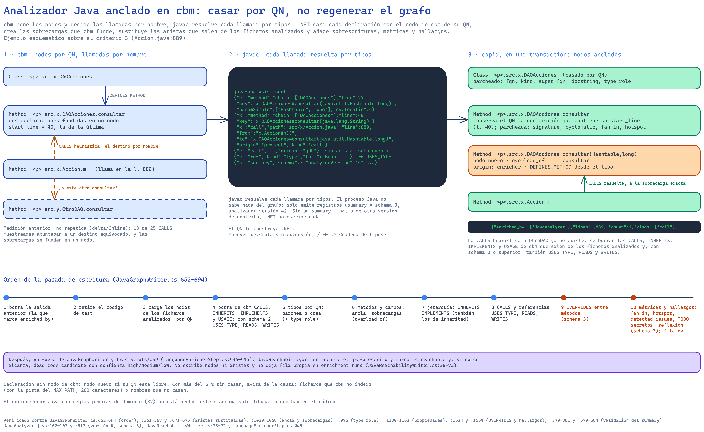
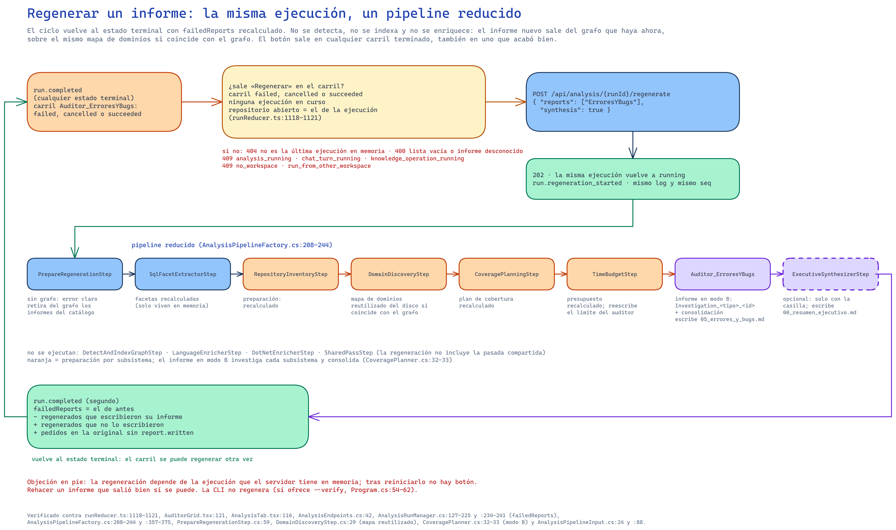
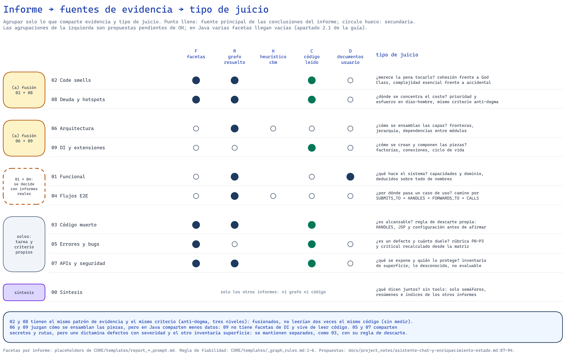

# Code analysis: end-to-end flow and report policy for each report

Code state reviewed as of 2026-10-17, branch `consolidation`, including the fixes from test M and the type and
field references of the Java analyzer. On 2026-11-01 only these were re-verified against the code (working tree with uncommitted
changes and the later chat, wiki, graph and knowledge-unit work): the citations to `AnalysisPipelineFactory.cs`, `ClaimAuditor.cs` and `ChatAgent.cs`, the pipeline
steps of the summary, sections 1.6.2, 1.7 (tool list), 1.10 (pipeline limit), 1.11 (regeneration and the endpoint list) and 1.12 (the
chat's tools and evidence). The rest is as of 2026-10-17 and has not been re-verified; the measured figures of section 1.14 and the templates of the
appendix are not verifiable in the code. The source of truth is the code; the measured figures are those for the dates indicated in their place.
`CORE` abbreviates `Samples/CodebaseAnalysis.Core`, `WEB`
abbreviates `Samples/CodebaseAnalysisWeb`, and paths without a prefix are relative to the repository root. What could not be
verified in the code is stated in place. The per-subsystem preparation (section 1.6.1) reflects the code as of
2026-10-04; what is measured in this document predates it and describes the pipeline with `Mode = Off`.

## Summary

The app analyzes a repository in six framework steps grouped into five phases (`CORE/AnalysisPipelineFactory.cs:199-217`);
with the per-subsystem preparation, enabled by default, there are ten, because four deterministic steps (inventory, domain map,
coverage plan and time budget) are added to the facets phase (section 1.6.1). An eleventh step, the
shared pass, only exists with `CodebaseAnalysis:SharedPass:Enabled = true`, which is disabled by default (section 1.6.2); with it the
factory adds a twelfth, `KnowledgeUnitsStep` (without LLM, section 1.6.2). With `CodebaseAnalysis:Run:SkipReports = true` there are no
reports or synthesis: the preparation keeps only the inventory and the domain map and a final step closes the pipeline
(`CORE/AnalysisPipelineFactory.cs:209-212`, `:388-392`, `CORE/Hosting/AnalysisRunOptions.cs:84-93`).
`codebase-memory-mcp` (cbm) indexes the repository in its cache and the pipeline copies that DB to `.codebase/codebase.db`, which
is the only one written from that point on. Writing to the copy are the Office and Markdown ingestion, the
re-incorporation of user documents, the native Java analyzer (`javac` in a separate process), the plugin
Struts/JSP and, if there is no native enricher, DotNetEnricher (Roslyn, in a separate process) or an LLM fallback. A deterministic SQL step computes
once roughly sixty facets in memory, and nine LLM auditors receive them in parallel, each with its pair of templates and
seven read-only tools over the graph, the code and the documents. Each auditor writes its report to `reports/` when
it finishes, and a synthesis without tools writes `00_resumen_ejecutivo.md` from the traffic lights, the summaries and the
section indexes. The web hosts that same pipeline, shows progress by phase, allows regenerating a failed report
over the existing graph, and offers a chat that queries the same graph and the same reports and audits its
`[V]`/`[D]`/`[I]` marks against what its tools read in the turn.

The analysis policy is common to the nine auditors and is in `CORE/templates/_graph_rules.md:1-6`: the graph serves
for structure, an edge resolved by an enricher is a data point and a cbm heuristic is a lead; in code
smells, errors, security and debt the graph and the facets say where to look and the verdict requires reading the code; and
"nobody calls it" does not prove dead code without first cross-checking with `HANDLES`, the JSPs and the configuration. Part 2
documents, report by report, what evidence each auditor receives, where each type of conclusion comes from and what it cannot
see, and ends with the proposed grouping, which is still pending approval.

---

# Part 1. The flow of an analysis

<!-- Source: docs/assets/diagrams/analisis-flujo-extremo-a-extremo.excalidraw -->

## 1.1 Stage map

The table summarizes each stage; the following sections expand only what does not fit in it. The times are the
ones measured in the design documents on the target Java repository (`delta/Online`, 8420 files); where there is no
measurement, it says so.

| Stage | Input | Reads | Writes | Measured time | On failure |
|---|---|---|---|---|---|
| `DetectAndIndexGraphStep` | `AnalysisPipelineInput` | whole repository (cbm), `~/.cache/codebase-memory-mcp/<proyecto>.db` | `.codebase/codebase.db`, `backups/` with `ForceReindex` | cbm, 59-67 s on full indexing and the whole step 24,5 s without reindexing (test M, section 1.14); the Java enrichment plan gave 157 s | exception that aborts the pipeline (`CORE/Steps/DetectAndIndexGraphStep.cs:49-55`, `:104-109`, `:428-444`) |
| Office, Markdown and knowledge ingestion | inside the previous step | `.accdb`/`.mdb`/`.docx`, `*.md`, `.codebase/knowledge/graph-sources.json` | nodes and edges in the copy | not measured | Office and Markdown warn per file; the rest propagates |
| `LanguageEnricherStep` | `GraphStatusResult` | disk (`RepositoryScan`), JDK, jars | copy of the graph, `enrichment_runs`, `.codebase/enrichment/java/` | with type and field references, median of 166,6 s versus 119,4 s without them in the same session (1,39 times, section 1.14); 181,7 s with the plugin in test M, with 1364 more files than cbm had; in the design, about 109 s and `javac` only 66 s | warning and a `skipped`/`failed` row; continues with the cbm graph |
| `DotNetEnricherStep` | `GraphStatusResult` | .NET solution or 15 key files (LLM) | copy of the graph, `enrichment_runs` | not measured on a large repository; about 7 s for the CLI on csharp-simple | CLI missing → warning and fallback, no row; code ≠ 0/2 or timeout → warning, `failed` row and fallback; with `Required` → aborts |
| `SqlFacetExtractorStep` | `GraphStatusResult` | copy of the graph, files for fragments and secrets, documents | `ReportFacetInput` in memory and in the context | 45,9 s on the graph with references (46,7 s in a copy without the per-label index, section 1.6); 51,5 s in test M | each failed query arrives as a note "not an empty set" |
| `RepositoryInventoryStep` | `ReportFacetInput` | disk, copy of the graph, `enrichment_runs` | `reports/_repository_inventory.json` | not measured | warning; the input comes out intact (only `Mode = Subsystems`) |
| `DomainDiscoveryStep` | `ReportFacetInput` | inventory, copy of the graph, LLM (names only) | `reports/_domain_map.json` | not measured | warning; without LLM, names derived from the code |
| `CoveragePlanningStep` | `ReportFacetInput` | domain map, question templates | `reports/_coverage_plan.json` | not measured | warning; empty plan and mode-B reports degrade to a normal auditor |
| `TimeBudgetStep` | `ReportFacetInput` | plan, inventory, map, `AuditorStepRegistry` | `Timeout` of each report and `reports/_time_budget.json` | not measured | warning; the steps keep the limit from the configuration |
| `SharedPassStep` (only with `SharedPass:Enabled = true`) | `ReportFacetInput` | domain map, graph, code, LLM (roles `SharedPassReader` and `SharedPassJudge`) | findings registry in the graph and in `reports/_shared_pass_registry.json` | not measured in this guide | warning; the analysis continues without a registry |
| `ParallelReportsExecution` | `ReportFacetInput` | LLM, graph, code, documents | `reports/01…09_*.md` | not measured for Java: in test M Azure responded `404 DeploymentNotFound` | a failed branch does not stop the synthesis unless all of them fail |
| `ExecutiveSynthesizerStep` | `ParallelResult` | LLM, reports on disk | `reports/00_resumen_ejecutivo.md` | not measured | empty response → fallback summary without LLM |

The plan gives 157 s for cbm and test M measured between 59 and 67 s of full indexing on the same repository; it is not
recorded what causes the difference.

## 1.2 Detection and indexing with cbm

The step leaves in the context the input, the DB path and the knowledge paths (`CORE/Steps/DetectAndIndexGraphStep.cs:37-39`),
and with `ForceReindex` it first saves to `<carpeta de la BD>/backups/<yyyyMMdd_HHmmss>/` a copy of the DB with its
`-wal`/`-shm`/`-journal` files and of the ten catalog reports by name, which stay in place until indexing
finishes successfully (if it fails they are restored), moves the Access exports there and rotates the copies until only
`CodebaseAnalysis:Backups:Keep` remain (`:61-79`, `:190-278`). It indexes only if there is no DB, if it is forced
or if the DB has no structural nodes (types, functions, methods, `CsProject`, `AccessTable` or `AccessQuery`,
`:570-590`). Indexing runs `codebase-memory-mcp cli index_repository`, takes the project name that the indexer itself
reports in its output (`:397-407`), copies `~/.cache/codebase-memory-mcp/<proyecto>.db` over the working path
(`:435-456`) and records the cbm version (`--version`) in the copy, which enters the enrichers' fingerprint
(`:57-59`, `:536-550`). Nothing in the pipeline reopens the cache DB: the enrichers check it before
writing (`CORE/Enrichment/EnrichmentMarks.cs:38-48`).

After indexing, the nodes under the DB folder, the reports folder and `<repositorio>/.codebase` are removed, because cbm
also walks the output of the pipeline itself (`:465-508`), and, with a new or inherited graph, those of `bin/`, `obj/` and the
generated files (`:95-96`, `:516-530`). `GraphSchema.EnsureAsync` adds the duplicate columns
`file`/`file_path` and `line_start`/`start_line` that the facets read (`CORE/Support/GraphSchema.cs:61-68`). If the graph
has no code and there are no Office artifacts, the step throws and the pipeline stops (`DetectAndIndexGraphStep.cs:104-109`). `CheckIfEnrichedAsync` decides
whether the code is already enriched (`CsProject` nodes or properties `afferent_coupling`, `cyclomatic` or `in_cycle`), without
counting the Office nodes, those from the LLM fallback or those marked by the Java analyzer (`DetectAndIndexGraphStep.cs:602-633`); that mark is used only by
`DotNetEnricherStep`, and only when `enrichment_runs` has no pass of its own.

**MAX_PATH limit.** cbm does not index files whose absolute path reaches 260 characters, the Windows MAX_PATH: it
leaves no node for that `file_path` and the step does not warn about it. In test M, with the copy of the repository in a long-path temporary folder,
the Java analyzer found 1364 more files than cbm had and created their declarations as
new nodes. `JavaGraphWriter` counts those files and the long-path ones in `details.cbm_match`, and the step's warning
gives the lead (section 1.4); to avoid it, the repository must be in a short path.

## 1.3 Office, Markdown and knowledge ingestion

All three write inside `DetectAndIndexGraphStep` and with the same `project` as cbm:

- **Office:** if there is any `.accdb`, `.mdb` or `.docx` in the repository, `IngestOfficeArtifactsStep` runs (`DetectAndIndexGraphStep.cs:111-121`), which
  creates `Table`/`AccessTable`, `Query`/`AccessQuery`, `Module`, `Form`, `Report`, `Sub`/`Function`, `Flow` and `DocSection`,
  with edges `READS_TABLE`, `WRITES_TABLE`, `EXECUTES_QUERY`, `CALLS`, `HANDLES_EVENT`, `FLOW_ENTRY`, `FLOW_NEXT` and
  `DOC_DESCRIBES` (`OfficeTools/Steps/IngestOfficeArtifactsStep.cs:436-713`). It writes `dead_code_candidate`, `hotspot`,
  `anti_pattern` and `detected_issues` on its nodes (in code, `dead_code_candidate` is also written by DotNetEnricher and, in
  Java, `JavaReachabilityWriter`, section 1.4; `hotspot` and `detected_issues`, DotNetEnricher), and computes `fan_in` counting
  all incoming edges (`:431`, `:720-740`, `:777-806`). Its `CALLS` do not carry `enriched_by`.
- **Markdown:** `WorkflowAndMarkdownEnricher` registers each `.md` as `PromptTemplate` if the path contains `template` or
  the name ends in `_prompt.md`/`_system.md`, and as `DocSection` otherwise, with title, headings and an 800
  character excerpt (`CORE/Support/WorkflowAndMarkdownEnricher.cs:57-100`).
- **User knowledge:** if the web flagged sources for the graph in `.codebase/knowledge/graph-sources.json`, the
  provided documents and own reports are re-incorporated, and the catalog reports are removed and return after
  the synthesis with the new content (`DetectAndIndexGraphStep.cs:128-172`). Each source is a `UserDocument` with its
  `UserDocSection` (`HAS_SECTION`) and `DOC_DESCRIBES` edges to the code it mentions
  (`CORE/Knowledge/Graph/KnowledgeGraphIngestor.cs:13-29`). If the run does not reach the synthesis, the removed reports
  return in the `finally` of `CodebaseAnalysisPipeline` (`CORE/AnalysisPipelineFactory.cs:661-664`, `:672-694`).

Nobody in the repository writes `WorkflowStep` nodes, so `WorkflowStepsCatalog` is always empty; nor
does DotNetEnricher (`Samples/DotNetEnricher`).

## 1.4 `LanguageEnricherStep`: Java analyzer and Struts/JSP plugin

The step walks the disk once (`RepositoryScan`), skipping `.git`, `bin`, `obj`, `node_modules`, `.codebase`, `.gradle`,
`.idea`, the `target`/`build`/`out` outputs at the root or next to a build file, nor the test roots, and leaves
`DetectedLanguages` in the context (`CORE/Steps/LanguageEnricherStep.cs:75-78`). The presence of `.java` enables the
Java analyzer and that of any `struts-config*.xml` the plugin, in that order, and if Java is active and either of them wrote, Java reachability
(`JavaReachabilityWriter`, at the end of this section) runs afterwards (`:80-102`). Its limit is
`JavaAnalyzer:StepTimeoutSeconds` (3600 s) and not `CodebaseAnalysis:Timeouts:EnrichMinutes`, which is the one of
`DotNetEnricherStep` (`CORE/Enrichment/JavaAnalyzerOptions.cs:41-57`).

### Java analyzer

`JavaAnalyzer.java` is a single source file run with the *source launcher* of the configured JDK, with no compilation step
nor binaries (`CORE/Enrichment/Java/JavaAnalyzer.java:1-17`). It compiles in memory with `--release 8 -proc:none
-implicit:none -Xmaxerrs 1000000 -nowarn` (`:645-646`), walks the trees with `TreePathScanner` and emits per file
types, methods with their `key` (`owner#nombre(FQN borrados)`), calls and creations with their target, fields, references to
types and fields and diagnostics (`:21-50`). It is version 4 of the analyzer with schema 3 (`:102-104`): schema 3 adds to
each method those it overrides or implements (`overrides`), error patterns (`issue`: `empty-catch`, `string-identity`,
`undisposed-resource`, `null-return-deref` and `obsolete-api`) and comments (TODO and commented-out code), and version 4, the
resolved constants: credentials with the masked value and the class name passed to `Class.forName` or `loadClass`
(`:52-67`). Since schema 2 references are not one per use: they are aggregated by file and
by source, target, class (`type` or `field`) and access (`read`, `write`, `readwrite`), with unique lines and, for
types, the usage contexts (parameter, return, field, local, `cast`, `instanceof`, generic, static access, `X.class`,
annotation, `throws`, `catch`, `new` with implicit constructor and array `new`). The `import`s are not emitted, nor the types of
`extends`/`implements`, which are already hierarchy, nor references of a type to itself (`:31-50`, `:2160`, `:2235-2236`). The
source of each target is classified as `project` if it comes from a source file, `jdk` if it comes from `ct.sym` or `jrt:`, `jar` in
any other case and `unresolved` with its reason (`:2460-2473`); only those of `project` are recorded, and the rest is counted in the
summary. Cyclomatic complexity is 1 plus each `if`, loop, non-`default` `case`, `catch`, ternary, `&&` and `||`, without
descending into nested classes (`:2475-2495`).

`JavaAnalyzerRunner` builds the classpath with all the `.jar` files in the repository plus `JavaAnalyzer:ProvidedClasspath`
(`CORE/Enrichment/Java/JavaAnalyzerRunner.cs:167-196`), leaves `request.txt`, `java-analysis.jsonl` and
`java-analyzer.log` in `<carpeta de la BD>/enrichment/java/` (`:93-95`) and kills the process when it exceeds
`JavaAnalyzer:TimeoutSeconds`, 900 s by default (`:329-338`). Once the result is applied, the step deletes `java-analysis.jsonl`
unless `JavaAnalyzer:KeepIntermediate` is set (`LanguageEnricherStep.cs:216-237`). Without a valid JDK the step warns, still removes the
test code and leaves a `skipped` row (`LanguageEnricherStep.cs:150-162`); any other failure leaves a
`failed` row and the cbm graph (`:205-213`). With `JavaAnalyzer:Enabled = false` there is no pass or row, but the test code
is still removed (`:83-88`).

### `JavaGraphWriter`: anchored in cbm

<!-- Source: docs/assets/diagrams/java-anclado-en-cbm.excalidraw -->

The writing is .NET, in a transaction on the copy, and validates the whole result before touching the DB: a JSONL
without a final `summary` or from another contract version writes nothing (`CORE/Enrichment/Java/JavaGraphWriter.cs:379-381`,
`:579-584`); the reader accepts schemas 1 to 3 (`CORE/Enrichment/Java/JavaAnalysisRecords.cs:572-578`). The order is this (`JavaGraphWriter.cs:649-705`):

1. **Previous output:** deletes what the previous `JavaAnalyzer` pass wrote, identified by `enriched_by`.
2. **Tests:** removes the nodes under the test roots (`testSourceDirectory` of the `pom.xml`, `src/test/java`,
   `JavaAnalyzer:TestRoots`) with their edges and vectors.
3. **Load:** reads the cbm nodes of the analyzed files and indexes them by QN (`:857-898`).
4. **Replacement:** deletes all `CALLS`, `INHERITS` and `IMPLEMENTS` whose source is a node from those files and, with a
   schema 2 or later result, also cbm's `USAGE` and any `USES_TYPE`, `READS` and `WRITES` present (`:361-367`,
   `:672`, `:899-919`). cbm's `USAGE` match the target by name, like its `CALLS`.
5. **Types:** the QN is built in .NET as `<proyecto>.<ruta sin extensión con / → .>.<cadena de tipos>`
   (`:924-932`, `:1926`); if it exists it is patched and if not it is created (`:920-959`). From version 5 of the writing, each type
   also receives `type_role` and `is_public` (`:279-301`).
6. **Methods:** groups the declarations by type and name; the anchor is the cbm `Method` with that QN or, in interfaces and
   enums, the `Function` that cbm creates at `<prefijo>.<nombre>` (`:1082`, `:1105`). The QN is kept by the declaration that contains the
   anchor's `start_line`, or the nearest one, and the others are created with a simple-type suffix (`…consultar(Hashtable,long)`),
   or fully qualified if they collide, with `overload_of` and `DEFINES_METHOD` from their type (`:992-1169`).
7. **Fields:** cbm stores each field as `Field` with the initializer inside the name (`nombreConexion = null`). Each
   analyzer field matches the `Field` of the same type whose `name` is the field name or starts with it followed by
   a space, `=` or `[`; the node keeps its QN and receives `field_name`, `type_fqn`, `accessibility`, `is_static`,
   `is_final` and `docstring`. If it does not match, `<type QN>.<field>` is created with `DEFINES` from the type, and enum constants
   are anchored on cbm's `Variable`, because cbm does not create a `Field` for them (`:1170-1278`). cbm's twin `Variable`s are not
   touched.
8. **Hierarchy and calls:** `INHERITS`/`IMPLEMENTS` only with a project target (those of the JDK or of jars stay in
   `super_fqn`/`interfaces_fqn`), with `IMPLEMENTS` marked `is_inherited` toward the project interfaces that a class
   receives from its superclass, and one `CALLS` per node pair with `lines`, `count` and `kinds` (`:1279-1411`). A call to an interface method points to the interface method; dispatch is inferred via
   `IMPLEMENTS`. Implicit constructors and targets in anonymous or local classes have no node and are counted in
   `unresolved` (`:1355-1411`); the `new` of an implicit constructor also leaves a `USES_TYPE` to the type.
9. **References:** one `USES_TYPE` per source and type, with `lines`, `count` and `contexts`, and one `READS` or `WRITES` per
   source and field, with `lines` and `count`; a `++`, a `--` or an `op=` yields both. The source is the method, the field (its
   declared type or its initializer) or the type (initializers and annotations), and a reference whose source has no
   node is counted in `refs.unmatched`, with no edge (`:1412-1524`).
10. **Overrides, metrics and findings (schema 3):** an `OVERRIDES` from the method it overrides or implements,
   when both have a node; `fan_in`, `fan_out` and `hotspot` on methods with the semantics of C#'s `MetricsEnricher`;
   `detected_issues` and `issue_rules`, `todo_markers` and `commented_code`, and, with version 4 of the analyzer,
   `hardcoded_secrets` (masked) and `reflection_targets` (`:1531-1800`).
11. **Record:** leaves the `ok` row in `enrichment_runs` with counts, times per phase and `details.cbm_match`, which separates
   what does not match cbm by cause: files cbm did not index (`unindexed_files`, with no node of its own at that
   `file_path`, and `unindexed_files_long_path`, those reaching 260 characters of absolute path) and names that do not match
   in the files it did index (`types_created_name_mismatch`, `methods_created_name_mismatch`,
   `fields_created_name_mismatch`). Only these last ones flag drift (`drift_suspected`), with more than 5 % of types, of
   methods without overloads or of class fields (`:1-260`, `:808-830`). The step warns if what does not match in total exceeds
   5 % and says which of the two causes it is; only the second points to a cbm version change, and the first carries the
   MAX_PATH lead if any file meets it (`CORE/Steps/LanguageEnricherStep.cs:309-310`, `:330-380`).

Everything written carries `enriched_by: ["JavaAnalyzer"]`, and that is what `graph_neighbors` and the facets read as a
resolved edge. On the target repository the accepted result was 99,996 % of calls resolved, no `CALLS` from
cbm in the analyzed files and 5488 overloads created in `src/` (measurement prior to test M). With the references, on the
copy of `C:\Users\juan.rozano\m\Online` (measured on 2026-09-29, with version 2 of the writing): 99,996 % of the references to project types and fields
resolved (23 unresolved out of 587 267), 253 753 `USES_TYPE`, 121 659 `READS` and 56 250 `WRITES`, no `USAGE`
from cbm in the `.java` files (172 517 were replaced) and 52 962 of 55 257 fields matched with a cbm `Field` (95,85 %); the
remaining 2295 are created. Two passes leave the same counts and the DB in `~/.cache` does not change.

### Struts/JSP plugin

`StrutsJspWriter` reads with .NET the `struts-config*.xml` files, the Tiles definitions and the JSPs, without compiling anything, and creates
`Route` nodes (QN `__route__ANY__<path>`), `Jsp` and `TilesDefinition` with edges `HANDLES`, `FORWARDS_TO`, `SUBMITS_TO`,
`INCLUDES`, `RENDERS` and `EXTENDS_DEFINITION` (`CORE/Enrichment/Web/StrutsJspWriter.cs:72-76`, `:489`). The class of
each action is searched among the graph's `Class` nodes by name and file path, and if it does not appear there is no `HANDLES`
(`:509-510`, `:779`). A JSP is suspicious if it imports something that matches `SuspiciousImportPatterns` (DAO, `java.sql`,
`javax.sql`), if a scriptlet or a declaration uses a business import or if its Java contains SQL; session access
is recorded in `session_access` but does not flag it (`CORE/Enrichment/Web/JspScanner.cs:327-354`). Measured before test M: 1736
JSPs, 1484 actions and 26 suspicious JSPs with the refined rule.

### `enrichment_runs` and repetition

Each enricher is skipped, with a message, if there is already an `ok` row with its version, the same indexing fingerprint
(`projects.name|indexed_at`, plus `|cbm=<versión>` if the pipeline did the indexing) and the same configuration fingerprint
(`LanguageEnricherStep.cs:132-148`, `CORE/Enrichment/EnrichmentRuns.cs:117-140`, `:178-190`). For Java the configuration that counts is the encoding, the
classpath and the test roots; for Struts, also the last `ok` Java pass, so that a new Java pass
repeats the plugin (`LanguageEnricherStep.cs:401-405`). A cbm reindexing changes `indexed_at` and forces everything to be repeated.
The Java writing version is a manual constant, now 5 (`JavaGraphWriter.cs:285`), and the plugin's is 2
(`StrutsJspWriter.cs:86`): editing `JavaAnalyzer.java` or the writer without bumping it makes the pass be skipped.

Java reachability (`JavaReachabilityWriter`) runs at the end of the step, over what the analyzer and the
plugin have written: it writes `is_reachable` and, on what is not reachable, `dead_code_candidate`, `dead_code_confidence` and `dead_code_reason`, with the
same semantics as C#'s `ReachabilityEnricher`; the roots are the `main` methods, whatever a framework annotates, the classes of the
Struts routes, those named by a configuration XML, a `Class.forName` literal or a JSP, and what can be instantiated
by reflection is left as doubtful (`low`). It writes no edges and leaves no row in `enrichment_runs`: each pass recalculates its
marks (`CORE/Enrichment/Java/JavaReachabilityWriter.cs:38-64`, `LanguageEnricherStep.cs:436-462`).

## 1.5 `DotNetEnricherStep` and the LLM fallback

If `LanguageEnricherStep` found Java and not C#, the step says so and returns the input without CLI or LLM
(`CORE/Steps/DotNetEnricherStep.cs:54-64`). Otherwise, if disabled, it goes to the fallback (`:69-73`); with an `ok`
`DotNetEnricher` pass in `enrichment_runs` over the same indexing and configuration it does nothing (`:94-101`), nor does it
when the graph is already enriched and no pass is recorded (`:102-106`); without `.sln`/`.slnx` it goes to the fallback (`:108-113`).
Otherwise, it launches as a process the repository's CLI (`Samples/DotNetEnricher`, which the build places in `dotnet-enricher/`
next to the app; `:220-245`) with the repository root, the package restore from `DotNetEnricher:Restore` and
`RestoreTimeoutSeconds` and, only if `DotNetEnricher:ProjectName` is set, the project; without it the CLI itself resolves it
by majority in `nodes` (`:193-209`). The CLI writes in a single transaction and records its pass. If it is not found, the step
warns and moves to the fallback without leaving a row; if it exits with a code other than 0 and 2 or exceeds `DotNetEnricher:TimeoutSeconds`,
the step kills it, warns, leaves a `failed` row and moves to the fallback; with `DotNetEnricher:Required` any of the three cases
stops the analysis (`:115-186`). The fallback, `SemanticEnrichmentStep`, sends to the role
`Enricher` up to 15 files of routes, controllers or DI and dumps the JSON it returns; the code enforces the marks
(`origin: ai_enricher`, `enriched_by: SemanticEnricherAgent`) and only lets through semantic properties from an
allowlist, never metrics (`CORE/Steps/SemanticEnrichmentStep.cs:36-47`). Without input files it does not call the model
(`:82-91`) and neither does it with an `ok` row over the same indexing and the same files (`:101-106`). Its edges appear in
`graph_neighbors` as «estimated by LLM» and do not count as resolved in the facets
(`CORE/Tools/GraphNeighborsTool.cs:464`, `CORE/Steps/SqlFacetExtractorStep.cs:752-753`).

## 1.6 SQL facets (`SqlFacetExtractorStep`)

The step opens the copy, detects the ecosystem by the extensions of the graph's files and by some labels
(`CORE/Steps/SqlFacetExtractorStep.cs:1258-1375`) and computes about sixty facets, each query with `LIMIT` and an `ORDER BY`
deterministic; those that consume what the compilers write (`detected_issues`, dead code, fields, DI, authentication
of routes, TODO, commented-out code, duplicates, secrets and reflection targets) are in `CORE/Support/CompilerFactsFacets.cs`
and give totals plus the most relevant items. The result is a
single `ReportFacetInput` that lives in memory and in the context (`:674`) and that all auditors receive; each
prompt template chooses which placeholders it includes, and that choice is what fixes which facet goes to which report (the
matrix is in section 2.1). Three design properties affect all reports:

- **Unknown is not zero:** `ZeroFaninClasses` only lists types with a known `fan_in` equal to 0 (`:221-256`),
  `UnvalidatedRoutes` only `auth_required = false` (`:346-360`) and routes without data show `desconocido`
  (`:106-117`, `:467-476`). A failing query arrives as `[] /* Faceta no disponible por un error SQL …: no es un
  conjunto vacío */` (`:946-947`).
- **Metrics computed with provenance:** if the property is missing, `fan_in`/`fan_out` come from resolved `CALLS` (with
  `enriched_by` other than the LLM fallback and only on nodes marked by the same enricher), `method_count` from
  `DEFINES_METHOD`, `cyclomatic_total` as a sum if all methods have it, and the LOC of the line range, in temporary tables
  of the connection; each value states its origin in `*_source` (`:719-886`). For a type, its internal calls do not count, and its
  `fan_in` adds the sources of its resolved `USES_TYPE` from other types, excluding the type itself, its
  methods or its fields (`:781`, `:820`).
- **Java references in dead code:** with `USES_TYPE` in the graph, `ZeroFaninClasses` no longer requires that the type
  declare a constructor, because the `new` with the implicit one leaves an edge; without them it still requires it. Also excluded
  are the types Struts instantiates by reflection: the `form_type` and the `action_type` of its `Route`s, compared by FQN with
  the type's `fqn` (`:246-249`). `UnreadFields` gives up to 30 `private` fields that are not `static final` and have no
  incoming `READS`, with how many sources write them (`:258-273`, `CORE/Support/CompilerFactsFacets.cs:320-328`), and
  separately their count and those that are only written (`UnreadFieldsSummary`, `WriteOnlyFields`). With reachability
  (`JavaReachabilityWriter` in Java, `ReachabilityEnricher` in C#), `DeadCodeCandidates`, `DeadCodeSummary` and
  `DeadPrivateMethods` read `dead_code_candidate` without repeating the members of a candidate type or what overrides a
  contract (`CompilerFactsFacets.cs:247-317`).
- **Attached code:** `HighCyclomaticMethods`, `CriticalHotspotsExceptions` and `HotspotsRanking` attach the fragment
  from disk of their first items (ten in the two rankings and six or four in the critical hotspots), with 70 lines as
  maximum (`:148`, `:496`, `CompilerFactsFacets.cs:201`, `:208`, `SqlFacetExtractorStep.cs:1056-1070`).
- **Candidates grouped by pattern (batch C):** the queries of `ZeroFaninClasses` and `UnreadFields` read all the
  candidates, up to 20 000 (`:234-256`, `:263-273`, `:1085`), and `GroupedFacetAsync` groups them (`:1096-1134`): CamelCase tokens of the
  name (for a field, that of the type declaring it), the prefix or suffix of tokens with the most members while it reaches 10,
  extended by one token while it keeps 80 % (`CORE/Support/DeadCodeGrouping.cs:54-57`, `:81-120`) and, with those left over,
  the directories with 10 or more. The groups go in `ZeroFaninGroups` and `UnreadFieldGroups` with pattern, count, prefix,
  suffix, common directory and package, and three examples; their members no longer appear in the lists, which show the first 20 and 30
  of the ungrouped ones.
- **Dynamic instantiation (batch C):** `DynamicInstantiationSites` comes from walking the `.java` and `.cs` files of the
  `RepositoryScan` on disk (without test roots or the reports folder, `:1188-1215`) with regular expressions over the text without
  comments: `Class.forName`, `newInstance`, `getDeclaredConstructor` and `ServiceLoader.load` in Java and
  `Activator.CreateInstance`, `GetType` and `Assembly.Load*` in C#, with a non-literal argument and not on `X.class`
  (`CORE/Support/DynamicInstantiationScanner.cs:63-104`, `:302-306`). It adds the classes from `class="…"`, `type="…"` and
  `<…-class>` of the XML files that are not build files (`:176-188`). The cross-check flags `likely_dynamic` a group whose suffix, prefix
  or package appears on the line of a site, in the five preceding ones or in a literal of the site's file, if a literal
  next to the site is the fixed part of the compound name (a token ending of the suffix, such as `+ "Impl"`), or if the
  configuration names any member (`DeadCodeGrouping.cs:218-298`); a named loose candidate carries
  `named_in_configuration`. It is a heuristic, and both facets say so in their `note`. In the copy of the repository
  target it finds 52 sites, among them the `Class.forName` of the DAO factory
  (`src/geo/DAO/utilidades/UtilidadesDAO.java:206`, `:481`), and 2409 named classes, in 5,5 s with cache and 44 s cold.

Two facets do not come from SQL: `HardcodedSecrets` walks on disk the files the graph references and masks the
value (`:609`), and `ProvidedDocumentation` is the index of up to 30 uploaded documents with `useInAnalysis`
(`CORE/Steps/ProvidedDocumentationFacet.cs:19-21`). The step has a fixed 5-minute limit (`SqlFacetExtractorStep.cs:25`).

In test M it took 51,5 s on a copy of 1 676 672 KB (the size the log reports when copying it from cbm). One cause has been checked in the schema: cbm brings its own
`idx_nodes_label` on `(project, label)`, and the `CREATE INDEX IF NOT EXISTS idx_nodes_label ON nodes(label)` from
`GraphSchema` did nothing on the copy, so every query by label without `project`, which is almost all the facets,
scanned the whole nodes table. The index now has its own name, `idx_graph_nodes_label`
(`CORE/Support/GraphSchema.cs:47`, `:51-55`). On a synthetic DB of 289 200 nodes and 328 MB, a query by label dropped from
1 s to under 40 ms, the method queries from 1,2 to 0,65 s, and creating the index cost 1,1 s. On the real DB, already with the
references (305 895 nodes and 1 484 566 edges), the step took 45,9 s with the index and 46,7 s on a copy without it, with
the same facets: there the index changes nothing noticeable. Of those 46 s, about 24 belong to `PrepareDerivedMetricsAsync`,
the metrics computed in temporary tables.
Still without an index are the twelve queries that filter only by JSON properties (dead code, hotspots, patterns, Martin,
cycles, communities, documentary coverage, obsolete and extension points), each a full scan of nodes with
`json_extract`, which is the next candidate, and the edges-by-type ones, because one more index on `edges` would make
the Java analyzer's writing more expensive.

## 1.6.1 Per-subsystem preparation and modes A and B

The domain reports received a large universe of candidates and a single context with a cap on tool iterations: in
a large repository they covered few functional parts and summarized a well-cited local sample as if it were the
whole set (the working hypothesis of the preparation design, not yet checked against a real measurement). With `CodebaseAnalysis:Preparation:Mode = Subsystems` (the default value; the
other is `Off`, which leaves the pipeline as in the previous sections, without new steps or artifacts) four
`IStep<ReportFacetInput, ReportFacetInput>` steps run after `SqlFacetExtractorStep` and before the reports, in the `facets` phase
(`CORE/AnalysisPipelineFactory.cs:379-400`, `CreatePreparationSteps`). Each one returns the same input with text fields
filled in, writes its artifact to `reports/`, never fails hard (an internal problem is a warning and the following
work without that data; only cancellation propagates) and has a fixed limit: 10, 20, 5 and 5 minutes.

| Step | LLM | Writes | What it does |
|---|---|---|---|
| `RepositoryInventoryStep` | no | `_repository_inventory.json` | modules per build file, files and lines per *source set* (`production`, `test`, `qa`, `debug`, `generated`, `samples`, `unknown`), entry points, tables, configuration files, status per language, graph coverage (files on disk versus files with nodes, with the cbm drift the Java analyzer measures) and production lines counted on disk |
| `DomainDiscoveryStep` | names only | `_domain_map.json` | subsystems by structure (folders, packages, Struts), communities it computes itself over the graph aggregated at type level and merging by name vocabulary (without the `StopTokens`); each production file in a subsystem or in `unassigned` |
| `CoveragePlanningStep` | no | `_coverage_plan.json` | scores the subsystems with `Preparation:Weights` by each report's profile (`Preparation:ReportProfiles`: each report chooses its K), excludes test, qa and generated, and chooses K per report in mode B plus a long tail, with the excluded ones and their reason, the investigation questions and the minimum evidence |
| `TimeBudgetStep` | no | `_time_budget.json` | computes the time of each report with `CodebaseAnalysis:TimeBudget` and writes it to its `Timeout` |

The LLM that names the subsystems (sub-step `DomainNaming`, role `FunctionalAuditor`, no tools) receives a summary of each
one and returns name, description and priority; its output is validated in code: it cannot discard or invent
subsystems, and whatever it does not answer coherently keeps a name derived from the code (`name_origin`: `llm` or
`derived`). It was decided that the map be deterministic and the LLM only name, because an LLM that discovers the domains from
scratch reintroduces the variability one wants to measure; the cost is that a repository without resolved references in the
graph yields a structure-based map (`basis` `structure_only`). The step computes the communities and they are not read from cbm, and the
vocabulary serves to gather a capability spread across distant branches of the package tree, which grouping by package alone
would split into fragments. The budget is not a constant: the time of an investigation is
`clamp(base + k · thousands of lines of the subsystem)`, that of the consolidation of a report in mode B
`clamp(base + k · chosen subsystems)` and that of an auditor in mode A `clamp(base + k · thousands of production lines)`,
with the code's default coefficients (`CORE/Preparation/TimeBudgetOptions.cs:45-51`), which are **provisional**. The JSON of the
sample (`CORE/appsettings.analysis.json:71-75`) sets them all to 0, and a piece of 0 minutes is unlimited
(`CORE/Preparation/TimeBudgetCalculator.cs:150-152`), as do the `Timeouts` in the same JSON (section 1.10). `TimeBudgetStep`
writes `Timeout` directly into the steps that the factory registers in an `AuditorStepRegistry` per pipeline, without
statics. If the sum divided by the effective concurrency exceeds `PipelineMinutes`, it trims subsystems from the
mode-B reports (lowest-scored first) and warns; if the `ReportsMinutes` limit of the set does not fit in what
was budgeted, it raises it with a warning and never lowers it.

**Mode B** (`CoveragePlanner.ModeBReports`): `AnalisisFuncional`, `FlujosEndToEnd`, `ErroresYBugs` and
`ArquitecturaAcoplamiento`. From the outside it is the same `Auditor_<tipo>` step with the same contract (a `.md`, the same
name and its `analysis-meta`); internally it is a `SubsystemInvestigationReportStep`, which follows the pattern of
`VerifyReportStep` (invokes its sub-steps with `ExecuteStepAsync` and its own token, no middleware). For each subsystem
chosen it launches an investigation `Investigation_<tipo>_<id>` with the same system prompt and the same tools as the
auditor and its template `report_<informe>_investigacion_prompt.md`, up to `MaxParallelInvestigations` at a time, and each one
returns **plain text with citations** without writing files; its note is stored in the graph copy as `InvestigationNote`
(detailed in section 3.3.1 of the CLI README). Then it consolidates with the usual auditor step, which remains
the only write point of the report (file name, `analysis-meta`, provenance, `report.written`), with two
new properties of `ReportFacetInput` in its prompt, `investigation_notes` and `coverage_summary`, and the report ends with a
`## Cobertura` section (covered, excluded with their reason, and not covered). An investigation that fails or exceeds its time
is a warning and leaves that subsystem as «no cubierto»; if all of them fail, the report fails with the error of the step. Without subsystems
chosen, the report is written as a normal auditor. **Mode A**: the other five reports (02, 03, 07, 08 and 09) still
are a single auditor, which receives `repository_inventory`, `domain_map` and `coverage_plan` in the prompt and a per-subsystem coverage protocol
with the same «Cobertura» section, only when the plan includes chosen subsystems. The template engine
has no conditionals (it only interpolates `{{ x }}` and includes files), so the templates are written so that an
empty block does no harm.

Artifacts start with `_`: they are not catalog reports, and therefore they are neither listed, nor served by the web API, nor
copied to `backups/`. They are serialized in `snake_case` with `schema_version`, `generated_at` and `graph_fingerprint`, and the same graph
and the same disk yield the same bytes except the timestamp and what the LLM names. `ReportValidator` adds the
`coverage` check (a mode-B report for which the disk plan chose subsystems carries the «Cobertura» section and
names each one; it only warns) and the executive synthesis receives a coverage summary per report, built without LLM from the plan
and the «Cobertura» sections of the reports (`CORE/Preparation/SynthesisCoverage.cs`), so as not to present as complete an
analysis with uncovered subsystems. Regeneration (section 1.11) includes these steps: it recalculates the inventory, the plan and
the budget, and reuses the map in `reports/_domain_map.json` if its fingerprint matches the graph's, without calling the LLM again to name
them. What this section cannot claim: that mode-B reports come out better (there is no measurement with a real LLM; the
tests use a fake LLM), nor that the time coefficients, the vocabulary merge threshold (`VocabularyMergeThreshold`)
or the minimum size of a subsystem (`MinSubsystemFiles`) are the right ones: they are calibrated with a measurement on a
large repository that is still pending.

## 1.6.2 Shared pass (`SharedPassStep`, disabled by default)

With `CodebaseAnalysis:SharedPass:Enabled = true` (the sample JSON sets `false`, `CORE/appsettings.analysis.json:76-94`) the
factory adds a step after the preparation and before the reports (`CORE/AnalysisPipelineFactory.cs:203-208`), in the
`facets` phase (`CORE/Progress/AnalysisEventMapper.cs:51-53`). It splits the code into batches per subsystem of the domain map, reads
each batch with one call to the `SharedPassReader` role, consolidates the findings without LLM with a severity per rubric, reviews them
with the `SharedPassJudge` role and saves the registry in the graph copy and in `reports/_shared_pass_registry.json`
(`CORE/Steps/SharedPassStep.cs:15-30`, `CORE/SharedPass/SharedPassRegistry.cs:11-24`). It returns the same `ReportFacetInput`: the
nine reports do not yet consume that registry. It does not fail hard: without a domain map, with a role that has no price (without a price there is no
cost cap) or with an internal error it warns and the analysis continues without a registry; its caps on cost, calls, tokens and the
`MaxMinutes` deadline are one for the entire run, and the step has no engine `Timeout` so as not to lose what was spent. When disabled, it does not
exist: no step, and its roles are not requested. Right after it the factory adds `KnowledgeUnitsStep` (`CORE/AnalysisPipelineFactory.cs:207`),
without LLM: for each subsystem with batches read it merges the saved batches and writes `<unidades>/<unitId>/unit.json` and `unit.md`; it does not fail
hard and does nothing with the pass disabled (`CORE/SharedPass/KnowledgeUnitsStep.cs:27-38`, `:66`). The chat reads those units with `list_units`
and `read_unit` (section 1.12) and the web serves them (section 1.11); the design is in `docs/knowledge-layer/ANALISIS-Y-SPEC.md`.

## 1.7 The nine auditors in parallel

With `Mode = Off`, and with `Mode = Subsystems` for the five reports in mode A, each requested report is a `CustomStatelessTemplateLlmStep<ReportFacetInput, SingleReportResult>` with its role, its
templates `report_<prefijo>_system.md` and `_prompt.md`, a limit of `AuditorMinutes` (15 in the code; 0, unlimited, in the
sample JSON) and a cap on tool iterations of `CodebaseAnalysis:Auditors:MaxToolIterations`, 12 in the code and 100
in the sample JSON, also for `FlowsAuditor` via `MaxToolIterationsByRole` (`CORE/AnalysisPipelineFactory.cs:431-474`,
`:565-594`, `CORE/Models/AnalysisPipelineInput.cs:43`, `:82-83`, `CORE/appsettings.analysis.json:22-27`). All go into
`TolerantReportsParallelStep`, with `ReportsMinutes` (60 in the code, 0 in the JSON) for the
set and `CodebaseAnalysis:Reports:MaxParallelAuditors` as the concurrency cap; with 0, the default value, one branch runs per
processor (`AITaskAgent.Core/Steps/ParallelStep.cs:61`). The seven tools are the same for all nine, plus the ones the analysis profile adds in `ExtraAuditorToolNames`
(`CORE/AnalysisPipelineFactory.cs:556-559`, `:562-563`); with `Mode = Subsystems`, the four mode-B reports (section 1.6.1) are a
wrapper with the same name `Auditor_<tipo>` and their investigations use those same tools:

| Tool | What it provides | What it does not provide |
|---|---|---|
| `view_file` | up to 800 lines of the file, decoded with the repository's rule (`FileTools/Tools/ViewFileTool.cs:19`, `:90`) | nothing from the graph |
| `view_code_item` | the code of a type, method or field by its name, with its `Location`; in C# with Roslyn and outside C# with the `ICodeItemLocator`s the app registers: the range of the graph node and, without a graph or node, the braces of the `.java` (`FileTools/Tools/ViewCodeItemTool.cs:34`, `:116-122`, `CORE/Hosting/AnalysisToolRegistration.cs:41-42`) | an ambiguous overload: the list with the path each one chooses (`Clase.metodo(int,String)`), without code (`ViewCodeItemTool.cs:154-158`); in Java it does not see fields without a graph nor methods of anonymous classes |
| `grep_search` | up to 50 lines with file and number, in ordinal path order, with a last element `Truncated` if it reaches the cap; without `.git`, `bin`, `obj`, `node_modules`, the DB folder or the reports folder, binaries or files over 1 MB, and lines cut at 300 characters (`FileTools/Tools/GrepSearchTool.cs:37-50`, `:177`, `:233-241`) | structure: it is text |
| `graph_search` | nodes by label, name or QN with their useful properties and, with `include_code`, their code read from disk (`CORE/Tools/GraphSearchTool.cs:20-21`, `:305`) | neighbors |
| `graph_neighbors` | neighbors via `CALLS`, `INHERITS`, `IMPLEMENTS`, `OVERRIDES`, `DEFINES_METHOD`, `HANDLES`, the Struts/JSP edges and, in Java, `USES_TYPE`, `READS` and `WRITES`, and, from the analysis, `QUERIES`, `MODIFIES`, `CITES`, `CONTAINS`, `DEPENDS_ON` and `ABOUT`, with the provenance of each edge and a `line` filter that keeps the edges with that line (`CORE/Tools/GraphNeighborsTool.cs:35-42`, `:134`, `:455-470`) | code; `OVERRIDES` and `THROWS` only if requested |
| `graph_domain` | routes with their class (`HANDLES`), DI registrations and attributes and, in addition, the views `projects`, `contracts`, `subsystems`, `tables`, `findings` and `llm_contracts` (`CORE/Tools/GraphDomainTool.cs:30`, `:107-117`); without `auth_required`, authentication comes out as «❔ Desconocida» (`:150-156`) | Java annotations: `attributes` is C# |
| `read_document` | an uploaded document, whole or by section | nothing from the code |

When the tool cap is exhausted the auditor does not fail: it repeats over the same conversation, without tools, with a message that asks it to
write the report with what it has gathered and flag what is unverified; the same happens if the tool loop is cut
(`CORE/Steps/CustomStatelessTemplateLlmStep.cs:99-112`, `:205-225`, `CORE/AnalysisPipelineFactory.cs:542-545`). A failure of the
provider goes to the role's fallback; a result with an error is not written as a report (`CustomStatelessTemplateLlmStep.cs:114-120`).
With the notes protocol (`CodebaseAnalysis:NoteProtocol`, enabled by default in the auditors, the consolidation and the
investigations, `CORE/Notes/NoteProtocolOptions.cs:14-35`), each tool result arrives marked `[Rn]` and the model
replaces it in the conversation with its note `<nota r="Rn">`; with 12 unannotated results the tool stops returning new data and,
after 5 turns like that, the step cuts the loop and writes without tools (`CORE/Notes/NoteTagHandler.cs:9-17`, `NoteProtocolTool.cs:8-12`,
`CORE/AnalysisPipelineFactory.cs:590-591`). Before writing, the step removes the note markers, the text before
the title and an H1 that is only the name of the
file, reads the `analysis-meta` line and, if the report declares `critical` or is the errors report, recalculates it from the
severity matrix and corrects the line (`:141-144`, `:296-312`). Then it adds the report's provenance to that line
(`:150-151`): `generated_at`, the role's `model` and `provider`, `response_model` if the
service says another one responded, `system_sha` and `prompt_sha` (short SHA-256 of each rendered template without data,
with the inclusions resolved), `graph` (the cbm indexing fingerprint), `enrichment` (the `ok` rows of
`enrichment_runs` with that fingerprint) and `app` (`CORE/Support/ReportProvenance.cs:51-120`). The fingerprint and the rows are left
in the context by the facets step (`CORE/Steps/SqlFacetExtractorStep.cs:65`). The readers of the line split on `;` and
on the first `=` and ignore the keys they do not know, so the traffic light and `critical` do not change
(`ReportProvenanceTests.cs`). The report is written to disk as soon as its auditor finishes and `report.written` is emitted
(`CustomStatelessTemplateLlmStep.cs:154-172`).

## 1.8 Executive synthesis

`ExecutiveSynthesizerStep` has no tools. It takes the reports of this run, those of types not run that are on
disk (marked as from a previous run) and the failed ones with their reason (`CORE/Steps/ExecutiveSynthesizerStep.cs:107-184`).
For each report it sends the `ExecutiveSynthesizer` role the traffic light, the `critical` count if there is one, a summary excerpt
and up to 30 `##`/`###` headings (`:66`, `:337-405`), together with the global metrics of the facets (`:190-231`) and
the serious findings that another report rates less serious on the same code (`SeverityContrast`, `:186-188`). The
critical defects are those of the errors report, or «no disponible» if there is no data (`:233-240`). If the model does not
return text, it writes a fallback summary without LLM (`:271-275`). Before writing the `00` it adds the same
provenance as the reports, with `fallback=true` if the summary is the fallback one (`:278-282`). With the per-subsystem preparation, it also receives a coverage summary per report (section 1.6.1, `:242-248`). Then
it re-incorporates into the graph the catalog reports that were marked (`:293-302`).

## 1.8.1 On-demand verification (`VerifyReportStep`, role `ReportVerifier`)

Verifying is not a stage of the analysis: it is a button per report, next to «Regenerar», which checks a report already written
against the code and rewrites what the code contradicts. `POST /api/analysis/{runId}/verify` (`{ reports[], synthesis }`)
reuses the regenerate path: the same in-memory run returns to `running` with the same `runId` and the same log, emits
`run.verification_started` and closes with another `run.completed`; the exclusions are those of regenerate (404, 409
`analysis_running`, `chat_turn_running`, `knowledge_operation_running`, `run_from_other_workspace`). Its pipeline
(`AnalysisPipelineFactory.CreateVerificationPipeline`) is `PrepareRegenerationStep` (checks the graph and removes from the graph the
reports, which return in the pipeline's `finally`), one `Verify_<Tipo>` per report in parallel under `MaxParallelAuditors` and,
if requested, the synthesis. It does not compute facets.

Each `Verify_<Tipo>` does three things. It prepares: it validates the report with `ReportValidator.CreateContentValidator` and builds **a single
text** for `{{ input }}` with four blocks (`<borrador>`, `<fallos_validacion>`, `<recuentos>` with the figures the
draft asserts, and `<evidencias>` with the code surrounding each citation that resolves); the `@[` sequences are neutralized because
the template engine also expands `@[ruta]` in interpolated text. It calls the `ReportVerifier` role (`gpt-6-sol`,
`reasoning_effort: none`) with `view_file`, `view_code_item`, `grep_search` and `graph_neighbors`, in a new conversation and with
`CodebaseAnalysis:Timeouts:VerifierMinutes` (10 in the code, `CORE/Hosting/AnalysisTimeouts.cs:43`; 0, unlimited, in the JSON of the
sample) as the limit. It closes: it interprets the response (`SIN CAMBIOS`, or the report
complete with the final «Cambios de la verificación» section), restores the `analysis-meta` line of the original, validates the
result and writes with `ReportWriter.Update`, which saves the original as `baseline`; «Deshacer verificación» calls the
usual `restore` with the `previousVersionId` of `report.verified`. The `analysis-meta` line gains
`verification=ok|corrected(n)|warnings(m)`.

Closing rules: if the verifier fails, does not respond in time, is cut off by length or returns something unusable (without a title,
without the section, or less than half of the original), the file is not touched and the lane says so with the reason. If it declares
changes but the text does not change, it is taken as no changes. The «Cambios de la verificación» section is outside the
deterministic validation: it deliberately names erroneous citations and identifiers of findings that already exist. Verifying does not change
`failedReports`, and the synthesis is not redone automatically (optional checkbox; the SPA warns that it may be out of date).

## 1.9 Reports and other files on disk

| Path | Who writes it | Content |
|---|---|---|
| `reports/01…09_*.md` | each auditor when it finishes | report with the `<!-- analysis-meta: health=…; critical=…; generated_at=…; model=…; … -->` line at the end, with the provenance of section 1.7 |
| `reports/00_resumen_ejecutivo.md` | synthesis | summary and dashboard, with the same provenance line |
| `reports/_repository_inventory.json`, `_domain_map.json`, `_coverage_plan.json`, `_time_budget.json` | the four preparation steps (only with `Mode = Subsystems`) | repository inventory, subsystems and file assignment, coverage plan per report in mode B and assigned times (section 1.6.1); they are not catalog reports and are not copied to `backups/` |
| `reports/_shared_pass_registry.json` | shared pass (only with `SharedPass:Enabled = true`) | findings registry of the pass (section 1.6.2); it is not a catalog report |
| `reports/_run_meta.json` | host (CLI or web) when finished | LLM usage of the run: calls, input and output tokens and cost, in total and per step (section 1.13) |
| `reports/_validation.json` | host (CLI or web) when finished, and `--validate-reports` | deterministic validation of the reports: citations, identifiers, serious findings, graph names, provenance and Mermaid (section 1.15) |
| `reports/custom/*.md` | chat (`create_report`) | own reports; the pipeline neither touches nor reads them |
| `.codebase/codebase.db` | detection, ingestions, enrichers | copy of the graph with `enrichment_runs` |
| `.codebase/enrichment/java/` | Java analyzer | `request.txt`, `java-analysis.jsonl` (1003 MB on the target repository with references and 744 MB without them; deleted as soon as it is applied to the graph, unless `JavaAnalyzer:KeepIntermediate`) and `java-analyzer.log` |
| `.codebase/enrichment/dotnet-restore/` | DotNetEnricher | `project.assets.json` and package restore outputs, outside the analyzed repository |
| `.codebase/backups/<fecha>/` | `ForceReindex` | copy of the DB and previous reports and the Access export; the most recent `CodebaseAnalysis:Backups:Keep` (5) are kept |
| `.codebase/report-history/` | web and chat | versions; the pipeline writes the report and the web saves the `baseline` version when it is modified afterwards |
| `<LogsPath>/analysis-pipeline-<fecha>.log` (default `logs/`) | host | analysis log; with `--debug` the request bodies |

## 1.10 Time limits

All analysis limits are set in `CodebaseAnalysis:Timeouts`, in minutes, and 0 removes them
(`CORE/Hosting/AnalysisTimeouts.cs:25-58`). The figures in parentheses are the code's default values; the JSON of the
sample sets all of them to 0, that is, no limit (`CORE/appsettings.analysis.json:28-36`). `PipelineMinutes` (240) is applied by `CodebaseAnalysisPipeline` with its own
token, and the engine receives `Timeout.InfiniteTimeSpan`, so a time cutoff ends with an error that names the
key and not with «A task was canceled.» (`CORE/AnalysisPipelineFactory.cs:629-665`). The per-step ones are `DetectMinutes` (15),
`EnrichMinutes` (20, only `DotNetEnricherStep` with its fallback), `ReportsMinutes` (60), `AuditorMinutes` (15), `SynthesisMinutes` (15)
and `VerifierMinutes` (10, the verifier of a report);
the Java analyzer uses `JavaAnalyzer:TimeoutSeconds` (900) and `StepTimeoutSeconds` (3600), and the facets and the
preparation of a regeneration, 5 fixed minutes. With subsystem preparation, `AuditorMinutes` and `ReportsMinutes` are the
starting point: `TimeBudgetStep` writes the limit of each report according to the size of the code and can raise the one
for the whole set, and the four preparation steps have their own fixed ones (section 1.6.1). Below that, the OpenAI provider cuts each attempt without a response at
600 s and each streaming silence at 120 s, configurable per provider or role
(`OpenAILLmService/OpenAILlmService.cs:174-193`); the sample JSON lowers the `AzureOpenAI` provider's to 300 s
(`RequestTimeoutSeconds`) and gives the chat roles 300 s of inactivity. With the code's default values, a hung attempt
would consume 10 of the auditor's 15 minutes.

At the start of each analysis or regeneration the effective limits are dumped, one line per group:
`CodebaseAnalysis:Timeouts` with the two fixed ones, `JavaAnalyzer`, the LLM timeouts of the analysis roles grouped by
value and with their origin (`[rol]`, `[proveedor]` or `[servicio]`), and `AITaskAgent:Timeouts`, the framework's, which does not appear
in any JSON (`CORE/Hosting/EffectiveLimits.cs:23-41`, `CORE/Hosting/AnalysisRunner.cs:132-137`). They go through the reporter, so
the web stores them in the run log and in its event record; the CLI also writes them to its log file
log (`Samples/CodebaseAnalysisPipeline/Program.cs:202`). The web dumps the chat's at startup: the turn and the timeouts of its role
(`WEB/Hosting/AnalysisHost.cs:30-31`).

## 1.11 The web

The web runs the same pipeline through `AnalysisRunner` and reimplements nothing. Progress is grouped into five
phases by step name (`CORE/Progress/AnalysisEventMapper.cs:33-61`): `detect`, `enrich` (the two
enrichers and the LLM sub-step of the fallback), `facets` (also `PrepareRegenerationStep`, the four preparation steps of the
preparation with the `DomainNaming` sub-step and, if active, the shared pass with its reading and judge sub-steps), `reports` (the parallel one, each `Auditor_<tipo>` and each
`Investigation_<tipo>_<id>`) and `synthesis`. The `enrich` phase opens with the first step and is closed only by the `step.completed`
of `DotNetEnricherStep`. The SPA keeps one lane per report: investigations of a report in mode B do not emit
`step.started` or `step.completed` (they are invoked without middleware), and their LLM and tool events add to the report's lane through
its `report` field. The `facets` phase is closed by `SqlFacetExtractorStep`, as always, and reopened by the first
preparation step; only `TimeBudgetStep` ends it (with `Mode = Off` those steps do not exist and the facets step closes it), so
it keeps running during the naming of the subsystems (`WEB/ClientApp/src/state/runReducer.ts:35-43`,
`PREPARATION_STEPS`). `SharedPassStep` is not in that list, so with the shared pass active the SPA closes the phase at
`TimeBudgetStep` while the pass keeps running (inferred from the code, not reproduced). The timeouts are those of section 1.10, read from the same configuration.

Besides the analysis, reports and chat endpoints, the web registers (`WEB/Program.cs:170-181`) the chat, wiki, graph and knowledge-unit routes added later, only listed here:

| Endpoints | File | Detail |
|---|---|---|
| `/api/wiki/*`: `index`, `pages` (read, create, edit, `verify`, `archive`, `reject`), `drafts`, `search`, `sources`, `generate`, `memory` | `WEB/Api/WikiEndpoints.cs:25-172` | — |
| `/api/graph/*`: `capabilities`, `summary`, `gaps`, `flows`, `deps`, `di`, `metrics`, `neighborhood`, `impact`, `symbol`, `search`, `explore`, `webchain` (read-only) | `WEB/Api/GraphEndpoints.cs:24-83` | — |
| `GET /api/units`, `GET /api/units/{id}`, `POST /api/units/publish` (read-only except publish, which rebuilds the derived graph and embedding copies) | `WEB/Api/UnitsEndpoints.cs:60`, `:71`, `:87` | `docs/knowledge-layer/ANALISIS-Y-SPEC.md` |
| `chat-protocol/1` under `/api/chat/protocol/sessions/{id}`: `messages`, `cancel`, `turns/{turnId}/events` (additive to `/api/chat/*`) | `WEB/Api/ChatProtocolEndpoints.cs:40-97` | — |
| `/api/chat/roles`, `/api/chat/sessions/{id}/turns/{turnId}/trace`, `/api/chat/read-roots` | `WEB/Api/ChatEndpoints.cs:62-122` | — |

<!-- Source: docs/assets/diagrams/regeneracion-informe-ciclo.excalidraw -->

Regeneration continues the same run. The «Regenerar» button appears in the `failed`, `cancelled` or `succeeded` lanes
when there is no run in progress and the open repository is the one of the run
(`WEB/ClientApp/src/state/runReducer.ts:1118-1121`, `WEB/ClientApp/src/components/AuditorGrid.tsx:121`,
`WEB/ClientApp/src/components/AnalysisTab.tsx:116`). It calls
`POST /api/analysis/{runId}/regenerate` (`WEB/Api/AnalysisEndpoints.cs:42`), which returns 404 if the run is not the
last one in memory, 400 with an empty list or an unknown report, and 409 if there is a run, chat turn or knowledge operation in
progress, if there is no repository or if it belongs to another one (`WEB/Analysis/AnalysisRunManager.cs:127-225`). The
run goes back to `running`, emits `run.regeneration_started` and continues with the same log and the same `seq`. The pipeline
reduced is `PrepareRegenerationStep` → `SqlFacetExtractorStep` → the four preparation steps (with
`Mode = Subsystems`; the domain map is reused from disk if it matches the graph) → the requested auditors → the
synthesis if checked (`CORE/AnalysisPipelineFactory.cs:256-264`); it does not detect, index or enrich, so the report is based on the graph
as it is now. `PrepareRegenerationStep` fails if there is no DB or it has no structural graph, and removes from the graph the reports of the
catalog marked for it (`CORE/Steps/PrepareRegenerationStep.cs:43-59`). At the end, `failedReports` is the previous one, minus
those regenerated with `report.written`, plus those requested in the original run that have no report in any of their
parts (`AnalysisRunManager.cs:234-241`, `:340-398`). Regeneration still depends on the run in memory: after
restarting the server there is no run and no button. Redoing a correct report is possible, because the button also appears in
the lanes that finished successfully.

## 1.12 The chat

A turn is one LLM step with a literal prompt and nineteen fixed tools: the seven of the auditor plus `view_file_outline`, `list_dir`,
`find_by_name`, `list_reports`, `read_report`, `create_report`, `update_report`, `list_documents`, `describe_image`,
`semantic_search`, `list_units` and `read_unit` (`CORE/Chat/ChatAgent.cs:105-112`). It adds, only when they apply, the four wiki tools
(`wiki_search`, `wiki_get_page`, `wiki_list_pages`, `wiki_propose_page`) if the workspace has a wiki and they are registered
(`ChatAgent.cs:251-264`, `CORE/Wiki/ToolsForChat.cs:75-76`), `ask_user` if the host allows questions (`ChatAgent.cs:269-272`) and the
`ExtraTools` of the workspace (`ChatAgent.cs:276`). It queries the same copy of the graph and the same reports as the
analysis, and the web prevents a turn and an analysis from coexisting, because the latter overwrites the DB and moves the reports. The
turn limit is `CodebaseAnalysis:Chat:TurnTimeoutMinutes` (5), applied with its own token (`CORE/Chat/ChatAgent.cs:233-237`).

The model that answers is chosen in the interface, per session, from among those in `CodebaseAnalysis:Chat:Models`; each one is a role of
`AITaskAgent:LlmProviders:Roles` with its provider, its `Model` and its `Options` (`CORE/Chat/ChatModelCatalog.cs`).
`ChatSession.ModelId` stores the choice and it can be changed between turns; each turn stores `ModelId` and the deployment that
answered. Which models the sample includes, which `Options` each one needs and the startup warnings are in the web README
(«Modelos del chat»).

The template `CORE/templates/chat_system.md` requires marking every fact about the system: `[V]` if it was read in the code
in that turn, with `path:line`; `[D]` if it comes from a report or document, with `name › section`; `[I]` if it is inferred.
The graph is not code that was read: to mark `[V]` something that `graph_neighbors` says, the line must be opened with `view_file`.
For «where this class or this field is used» the template points to the incoming `USES_TYPE`, `READS` and `WRITES`, and for
«what is on line N» to `graph_neighbors` with `line: N` and `direction: out` on the method that contains it
(`CORE/templates/chat_system.md:13`).
When the turn closes, `ClaimAuditor` goes through the marks and checks them against the evidence left by the results of the
tools (`CORE/Chat/ClaimAuditor.cs:386-478`):

- `view_file` provides the span it showed; `view_code_item`, only the `Location` span of each returned node, and nothing
  from a list of overloads, which shows no code;
  `grep_search`, the lines with a match; `graph_search`, only the spans of `include_code`.
- `read_report`, `read_document` and `read_unit` provide the report, document or unit read, which is what backs a `[D]`
  (`:463-476`, source resolution in `:270-304`; a unit is cited by title or id, with or without the `unit:` prefix).
- `graph_neighbors`, `graph_domain` and the `graph_search` table provide no evidence even if they cite `path:line`; neither do the
  tools with no `case` in that `switch` (`:418-477`), such as `list_units` or the `wiki_*` ones.
- A result that starts with `Error`, `TOOL_ERROR` or `TOOL_CALL_ERROR` does not count (`:401-402`, `:484-491`).

A mark without support stays `unchecked` with the reason (not read, read in part, those lines do not exist, the
file does not exist or the reference is missing) and the answer is never rejected (`:87-135`). The check is one of coverage:
«verified» means that the cited lines were read in the turn, not that what is stated matches them.

## 1.13 Who reads the sources and how many times

The repository is read from disk several times, and each read pays its cost separately. cbm walks through it entirely once;
`RepositoryScan`, the Markdown ingestion, the Office artifact search and, with `ForceReindex`, the backup walk it again;
`javac` re-reads and compiles all the `.java` files (66 s in the target repository). The facets are computed once
and shared by the nine auditors, but each auditor opens files on demand with its tools, with no shared cache,
and pays in tokens for the code it reads, even if another auditor has already read it (the note protocol of section 1.7
limits what is forwarded from each result, and the shared pass, disabled, is the attempt to read once). Until test M, moreover, the
system template and each auditor's prompt template included both `_common_rules.md`, and each one received those rules
twice; now only the prompt includes them (corrected, section 2.13). The only token measurement is from the 27/09 run on TestAgenteAnalisis (262 nodes): about 545 000 tokens across
the nine auditors and the synthesis, 231 535 of them in the architecture one, and the volume is explained by the forwarding of the
history on each tool iteration (measured in the audit of 2026-09-29). The
facets have been in compact JSON since batch B: indentation was 21 % of their characters in the synthetic graph of the
tests (`CORE/Steps/SqlFacetExtractorStep.cs:939-941`).

Since batch B each run counts its consumption. The final event of each call carries the input and output tokens,
the input tokens served from the provider's cache and the cost (`AITaskAgent.Extensions.Llm/Observability/Events/LlmResponseEvent.cs:44-59`,
`AITaskAgent.Extensions.Llm/Steps/BaseLlmStep.LlmInvocation.cs:821-824`, `:897-900`, streaming path; the non-streaming one was not re-read), and `LlmUsageTracker` adds them up per step and in total
(`CORE/Progress/LlmUsageTracker.cs:84-135`). The web sends it in the `usage` of `run.completed` and the SPA shows it in the summary
(`WEB/Analysis/AnalysisRunManager.cs:478`, `:528`, `:580`), the CLI prints it when it finishes
(`Samples/CodebaseAnalysisPipeline/Program.cs:225`, `:364-369`), and both write it to `reports/_run_meta.json`
(`CORE/Reports/RunMetaFile.cs:48-57`). The cost comes from the prices in `AITaskAgent:LlmProviders:Providers:
:Models`,
which the framework binds (`CORE/Hosting/LlmRoleFactory.cs:76`, `:98-99` dump them to the log). The sample JSON carries the
prices of the models of the `AzureOpenAI` provider except `gpt-oss-120b`, which it sets to `null`
(`CORE/appsettings.analysis.json:191-249`); a model without a price leaves the cost at `null`, not 0.

## 1.14 Measurements of the full analysis (test M, 2026-09-29)

Test M ran the full analysis on a copy of `delta/Online` (8420 `.java` files, 265 343 cbm nodes and
1 093 434 cbm edges, working copy of 1 676 672 KB according to the log) from the CLI and from the web, without writing to `C:\BBVA`. It reached
the auditors: Azure answered `404 DeploymentNotFound` to all nine in about 5 s, because the resource did not have the
model's deployments, so everything that requires the LLM is still pending. The copy was in a temporary folder with a
long path, and cbm did not index the files that exceeded MAX_PATH (section 1.2); the test will be repeated with the copy
in `C:\Users\juan.rozano\m\Online`. The figures in this section are from version 2 of the Java writing and predate the
Java reachability, the `CompilerFactsFacets` facets and subsystem preparation: with the current code
`dead_code_candidates`, `hotspots_ranking` and `critical_hotspots_exceptions` no longer have to come back empty in Java
(sections 1.4 and 1.6), and the timings have not been measured again.

| Measure | Source | Value |
|---|---|---|
| Time of `DetectAndIndexGraphStep` (cbm, copy, ingestion) | `step.completed` events or log | cbm, 59-67 s on full indexing; the whole step, 24,5 s without reindexing |
| Time of `LanguageEnricherStep` (Java process, writing, plugin) | `enrichment_runs.duration_ms`, `details.write_timings_ms` | 181,7 s: the Java process 94,6 s, the graph write 1 min 8 s and the Struts/JSP plugin 14,9 s; the analyzer read 1364 more files than cbm had |
| Time of `SqlFacetExtractorStep` over the full DB | log | 51,5 s, before the per-label index (section 1.6) |
| Empty or error facets in the Java case | prompts in the `--debug` log | none with SQL error; empty at least `flows_catalog`, `flow_steps_graph`, `workflow_steps_catalog`, `prompt_templates_catalog`, `dead_code_candidates`, `dependency_cycles`, `layer_violations`, `architectural_communities`, `hotspots_ranking`, `critical_hotspots_exceptions`, `unvalidated_routes` and `obsolete_elements` (this one, before reading `annotations`) |
| Size of the first prompt of each auditor | `--debug` log | between 18 000 and 38 000 tokens, about 234 000 across the nine |
| Time per auditor and of the parallel run | events of `Auditor_<tipo>` | pending: requires LLM |
| Time of the synthesis | log | pending: requires LLM |
| Prompt and response tokens per auditor, with the tool iterations | `bySource` of `reports/_run_meta.json` or `usage` of `run.completed` (section 1.13) | pending: requires LLM; the cost, moreover, comes out null until the contract prices are configured |
| Tool iterations per auditor and auditors that exhausted the cap | log («agotó su tope de herramientas») | pending: requires LLM |
| Files and lines read by more than one auditor | arguments of `view_file` and `graph_search` with `include_code` | pending: requires LLM |
| Quality per report: confirmed findings, false positives and omissions | manual review against the code | pending: requires LLM |

**Type and field references (task 4 of the plan, 2026-09-29).** Without LLM, with the `LanguageEnricherStep` harness on new copies
of the cbm DB from `C:\Users\juan.rozano\m\Online` (short path: cbm indexed the 8420 files), and the facets with a
`SqlFacetExtractorStep` harness over the enriched DB. v1 is the code before the references
(schema 1) and v2 the current one; the passes were alternated to spread the load on the machine, which was not idle.

| Measure | Value |
|---|---|
| `LanguageEnricherStep` complete, median of 6 alternating pairs | v1 119,4 s, v2 166,6 s: 1,39 times (criterion 5, limit 1,5). The first three pairs gave 1,55 and the next three, in order v2 → v1, 1,41; the pair with the calmest machine, 129,3 against 121,4 s (1,07). The slow passes of both versions coincide with the 1 GB copy of the DB taking 8-10 s instead of 0,4, so the spread comes from the machine's disk load, not from the step |
| Where the difference lies (medians of the 6 pairs) | Java process 88 s in v2 against 66 s in v1 (in the calm pair, 64,6 against 67,4); writing 72 against 43 s, with `refs` from 6 to 13 s and `read` and `replace_cbm_edges` longer due to the JSONL and the `USAGE`. Turning the `READS` into `static final` constants would save 56 003 of the 431 662 new edges (13 %) at the cost of not knowing where each constant is used; this has not been done |
| Graph writing (v2, first pass) | 51,5 s: `read` 10,3, `replace_cbm_edges` 8,6, `calls` 8,0, `commit` 7,0, `refs` 6,9 and the rest under 3 s each |
| `java-analysis.jsonl` | 1003 MB, against 744 MB without references (1,35 times) |
| New edges | 253 753 `USES_TYPE`, 121 659 `READS` and 56 250 `WRITES`; replaced 522 487 `CALLS`, 172 517 `USAGE`, 2202 `WRITES` and 1 `INHERITS` from cbm |
| Project references resolved | 99,996 % (23 unresolved out of 587 267); 38 without an edge because their origin has no node |
| Fields matched to a cbm `Field` | 95,85 % (52 962 out of 55 257); 2295 created, 0 without a node |
| Repetition | two passes, same counts by edge and node type; the DB in `~/.cache` with the same SHA-256 fingerprint |
| `SqlFacetExtractorStep` | 45,9 s with the label index and 46,7 s without it; 24 s in `PrepareDerivedMetricsAsync` |
| `ZeroFaninClasses` | 817 types (20 leave); 851 without the Struts exclusion and 638 with the previous declared-constructor rule. Of 5 reviewed by reading the copy, 3 true (`DAOAgendaLiquidacionOracleImplOrig`, `GeneradorSaldosNaim`, `PaymentExcelExporter`), 1 false (`DAOAgendaRenovacionInteresOracleImpl`, instantiated by the DAO factory) and 1 undecided (`InformeResultados`, which the `pom.xml` packages in its own jar) |
| `UnreadFields` | 154 fields (30 leave); 5 of 5 reviewed are true: 2 with no read at all, 1 read only inside a block comment and 2 that are only written (no getter) |

## 1.15 Deterministic evaluation of the reports

`ReportValidator` (`CORE/Reports/ReportValidator.cs`) checks without an LLM that the catalog reports meet what the templates require:
that each cited `path:line` exists and is in range, that the `name › section` citations point to something that
exists, that the identifiers follow the `NN-CAT-nnn` format of `_common_rules.md` (or `CAT-nnn` in earlier reports) and are not
repeated, that each P0 or P1 finding cites at least one real location, that the qualified names cited are in the graph,
that the `analysis-meta` line carries a traffic light and provenance (model, SHA of the templates and graph fingerprint) and that the blocks
Mermaid use the types of `_mermaid_guidelines.md`; it also warns, without an error, about an audit report with no code citations
(`citations_required`), about a mode B report without the «Cobertura» section (`coverage`) and about paths that the configuration declares
and that do not exist (`declared_paths`) (`CORE/Reports/ReportValidation.cs:14-50`). The table of checks, which are errors and which are warnings, and the format of
`_validation.json` are in section 3.9 of the CLI README. It runs at the end of the analysis and of the regeneration, without
blocking, and on demand with `--validate-reports` in the CLI or `GET /api/reports/validation` in the web.

It measures the shape of the report, not whether its findings are true: a valid citation says that the line exists, not that it says what the
report claims. For the latter there is the list of expected findings per repository (`expected-findings.json`, template in
`CORE/evaluation/expected-findings.template.json`), which gives coverage and the unexpected findings, to be reviewed by hand as
possible false positives. The list is written by whoever evaluates; none is filled in. Two design limitations: the P0-P3 scale
is defined only by the errors template, so in the other reports the check for serious findings applies
only if the report uses that scale on its own (08 does, as the plan's priority); and citations are resolved by suffix
when the path is incomplete, which is what the Access reports do (`CGAR.bas:12`), with an ambiguous citation if the
name matches several files.

**First measurement (2026-09-30), TestAgenteAnalisis reports of 28 and 29/09.** The nine reports there are, without 02,
predate the provenance of batch B, so all nine fail `metadata` for that reason alone.

| Report | Valid citations | Findings (P0/P1) | Graph names found | Problems |
|---|---|---|---|---|
| 00 Executive summary | 0 of 0 | 0 | 0 of 0 | `flowchart TB` |
| 01 Functional analysis | 0 of 0 | 10 (0) | 43 of 43 | `flowchart TB` |
| 03 Dead code | 29 of 29 | 6 (0) | 9 of 9 | — |
| 04 End-to-end flows | 0 of 0 | 0 | 77 of 77 | — |
| 05 Errors and bugs | 34 of 34 | 8 (4) | 0 of 0 | — |
| 06 Architecture | 27 of 27 | 8 (0) | 3 of 3 | — |
| 07 APIs and security | 9 of 9 | 3 (0) | 0 of 0 | `SEC-002` in three rows of one table |
| 08 Technical debt | 40 of 40 | 10 (4) | 4 of 4 | — |
| 09 Dependency injection | 25 of 25 | 6 (0) | 1 of 1 | — |

The 164 citations exist and are in range, and in the three checked by hand the line says what the report claims: the `Const
Password` literal of `SEC-001` in `MMapNetWorkDrive.bas:6`, the `set nocout on` of `BUG-003` in `CConnectionSQL.bas:22` and the
full `MontarFiltro` of `CGAR.bas:155-255`. The more serious issue lies elsewhere. 01 and 04 do not cite a single line of
code, so their flows and use cases can only be checked against graph names, all of which exist. And the
identifiers clash between reports: `SEC-001` to `SEC-003` are different findings in 05 and in 07 (`SEC-002` is a
P0 SQL injection in one and three queries without declared authentication in the other), the same as `ARC-001` and `ARC-002` in 06 and
08, and 00 cites them without saying which report they belong to. So `_common_rules.md` required identifiers unique only within the
report; now the format carries the report number in front (`05-SEC-002`), which makes them unique across the whole analysis
(`CORE/templates/_common_rules.md:42`).

---

# Part 2. Analysis policy for each report

## 2.1 Common rules and sources of evidence

Each auditor receives three common blocks. `_common_rules.md`, included only in the prompt template, sets the delivery format, the adaptation to the ecosystem
detected, that an empty set does not prove an absence (`CORE/templates/_common_rules.md:22-24`), the style, the
`PREFIJO-NNN` identifiers and the `analysis-meta` line. `_graph_rules.md` is the reliability rule, included in the
nine system templates and not in the synthesis one. `_provided_documentation.md` inserts the index of the user's
documents and states that they are context and prove nothing about the code (`CORE/templates/_provided_documentation.md:3`).

To describe where each conclusion comes from, five sources are used, with the reliability the rule gives them:

- **F, deterministic facets:** SQL properties and calculations from section 1.6. They are data if their property was written by a
  native enricher or a calculation over resolved edges; they indicate where to look, not a verdict.
- **R, resolved graph:** edges with `enriched_by` from `JavaAnalyzer` or `StrutsJspPlugin` (and from the DotNetEnricher enrichers in C#).
  They are data about the structure.
- **H, heuristic graph:** unmarked edges, which `graph_neighbors` labels «heurística cbm», or «ingesta Office» if their
  source node was written by OfficeTools (`CORE/Tools/GraphNeighborsTool.cs:71-73`, `:466-470`). In Java there are few,
  because the analyzer replaces the `CALLS`, `INHERITS`, `IMPLEMENTS` and `USAGE` of the analyzed files; they are leads.
- **C, code reading:** `view_file`, `graph_search` with `include_code` or a facet's `code_snippet`. It is the
  only source that supports a verdict on a defect.
- **D, user documents:** index and `read_document`. They guide on intent; if they disagree with the code, the
  code prevails.

The following table is the facet matrix per report, taken from the placeholders of each prompt template, with the
availability of each facet in a Java repository inferred from which code writes the property it reads. DotNetEnricher
does not run in Java; in Java the analyzer writes properties (`cyclomatic`, `fan_in`/`fan_out`/`hotspot` of the methods,
`detected_issues` with five rules, `todo_markers`, `commented_code`, Javadoc, `annotations`, `hardcoded_secrets`,
`reflection_targets`, `type_role` and `OVERRIDES` edges; `CORE/Enrichment/Java/JavaGraphWriter.cs:278-285`, `:320-328`) and
`JavaReachabilityWriter`, which runs at the end of `LanguageEnricherStep` and writes `is_reachable` and `dead_code_candidate` with
its confidence and its reason (`CORE/Enrichment/Java/JavaReachabilityWriter.cs:38-72`, `CORE/Steps/LanguageEnricherStep.cs:445`).
«empty in Java» is an inference about the available code, not a measurement. The figures («50 of 1484», «20 of 817»…) are
from test M or from reference task 4 (section 1.14), earlier than versions 3-5 of the analyzer. The five
reports in mode A also receive `repository_inventory`, `domain_map` and `coverage_plan`, and the four in mode B
`investigation_notes` and `coverage_summary` (section 1.6.1).

| Facet | Query (`SqlFacetExtractorStep.cs`) | Reports | In Java |
|---|---|---|---|
| `metrics_summary` | `:79-86` | 01 | with data |
| `routes_summary` / `routes_catalog` | `:108-117`, `:466` | 01, 07 | 50 of 1484 actions, `auth_required` unknown |
| `flows_summary`, `flows_catalog`, `flow_steps_graph` | `:119-125`, `:305-315` | 01, 04 | empty: only Office and, in C#, DotNetEnricher write `Flow` |
| `domain_entities_summary` | `:128-137` | 01 | 50 types by computed `fan_in` |
| `workflow_steps_catalog` | `:623-630` | 01, 04 | always empty |
| `prompt_templates_catalog`, `documentation_and_prompts` | `:632-648` | 01, 04 | the repository's `.md` files |
| `high_cyclomatic_methods` | `:140-149` | 02 | 30 methods by `javac`'s `cyclomatic`, 10 with code |
| `bloated_classes`, `complex_classes` | `:151-159`, `:525-534` | 02, 08 | LOC by line range, `method_count` and `cyclomatic_total` computed |
| `coupling_metrics` | `:161-169` | 02 | `fan_in`/`fan_out` of the methods written by the analyzer; for the types, computed from resolved `CALLS` and `fan_in` also from `USES_TYPE` |
| `duplicate_summary`, `duplicate_candidates` | `:172-179`, `CompilerFactsFacets.DuplicatesAsync` | 02 | `SIMILAR_TO` pairs that cbm computes, if it brings them; unverified in the target repository |
| `dead_code_candidates`, `dead_code_summary`, `dead_private_methods` | `:184-192`, `CompilerFactsFacets.DeadCodeAsync` | 03 | with data: `dead_code_candidate` from `JavaReachabilityWriter`, without repeating the members of a candidate type or those that override (`OVERRIDES`); not measured |
| `unused_di_registrations` | `:195-208` | 03, 09 | empty: no `DiRegistration` |
| `orphan_routes` / `orphan_routes_list` | `:210-219`, `:484` | 03, 07 | Struts actions without `HANDLES`, 20 |
| `struts_actions_without_handler` | `:287-302` | 03, 07 | 30, with the reason |
| `zero_fanin_classes` | `:234-256` | 03 | 20 of 817 in the target repository (the first 20 without a group since batch C), with `fan_in` computed from `CALLS` and `USES_TYPE`, without those Struts instantiates by reflection |
| `unread_fields` | `:263-273` | 02, 03 | 30 of 154 private fields without `READS` in the target repository (the first 30 without a group since batch C) |
| `unread_fields_summary`, `write_only_fields` | `:276-283`, `CompilerFactsFacets.UnreadFieldsAsync` | 02, 03 | count and private fields that are only written |
| `zero_fanin_groups`, `unread_field_groups` | `:234`, `:263`, `DeadCodeGrouping` | 03; 02 only the fields one | groups of candidates with a common pattern, with `likely_dynamic` and their evidence; not measured on the target repository's graph |
| `dynamic_instantiation_sites` | `:229-232`, `DynamicInstantiationScanner` | 03 | disk scan: 52 sites and 2409 named classes in the copy of the target repository |
| `reflection_targets` | `:612-620`, `CompilerFactsFacets.ReflectionTargetsAsync` | 03 | class names from `Class.forName`/`loadClass` that `javac` resolves as constants, with `*` for each non-constant segment |
| `route_handlers_mapping` | `:317-323` | 04 | 50 `HANDLES` from the plugin |
| `unresolved_forwards` | `:325`, `:899` | 04, 05 | 30 from `enrichment_runs.details` |
| `di_resolutions` | `:327-333` | 04 | resolved `IMPLEMENTS`, 50 |
| `critical_hotspots_exceptions` | `:337-344`, `CompilerFactsFacets.CriticalHotspotsAsync` | 05 | with data: `hotspot` and `detected_issues` from the analyzer; nobody writes `throws` in Java |
| `unvalidated_routes` | `:348-360` | 05 | empty: the plugin does not write `auth_required` |
| `route_auth_summary` | `:362-369`, `CompilerFactsFacets.RouteAuthSummaryAsync` | 05, 07 | count of routes by authentication; in Struts all in `unknown`, because the plugin does not write `auth_required` |
| `suspicious_jsps` | `:374-388` | 05, 06, 08 | 25 of the suspicious JSPs |
| `detected_issues_summary`, `suspect_patterns` | `:390-401`, `CompilerFactsFacets.IssuesAsync` | 05 | with data: the analyzer's `empty-catch`, `string-identity`, `undisposed-resource`, `null-return-deref` and `obsolete-api` rules, by quota according to their weight |
| `hardcoded_secrets` | `:597-609` | 05, 07 | disk scan |
| `resolved_secrets` | `:612-620`, `CompilerFactsFacets.ResolvedSecretsAsync` | 05, 07 | constant credentials that `javac` resolves, with the value masked |
| `project_components` | `:404-411` | 06 | unverified: depends on whether cbm creates `Package` or `Module` |
| `martin_instability_metrics`, `dependency_cycles`, `layer_violations` | `:413-439` | 06 | empty in Java: only DotNetEnricher writes `instability`, `in_cycle` and `layer_violation` |
| `architectural_communities` | `:456-463` | 06 | empty in Java: nobody writes `community_id` for Java in the repository (unverified whether cbm brings it) |
| `type_hierarchy` | `:443-454` | 06 | 30 supertypes with resolved and heuristic edges |
| `routes_security_matrix`, `routes_contracts` | `:467-482` | 07 | rows with `auth_required` unknown and null contracts |
| `hotspots_ranking` | `:487-497` | 08 | with data: `hotspot` of the methods, which the analyzer writes |
| `doc_coverage_metrics` | `:500`, `CompilerFactsFacets.DocCoverageSql` | 08 | with data: Javadoc recognized by the analyzer (`docstring_source`) |
| `todo_markers`, `commented_code` | `:502-510` | 08 | with data: the analyzer writes them |
| `obsolete_elements` | `:514-522` | 08 | the analyzer's `@Deprecated` (`annotations`), besides `is_obsolete` and C#'s `[Obsolete]`; in test M it came back empty because it did not yet read `annotations` |
| `di_registrations_catalog`, `di_lifetimes_mapping`, `di_summary`, `captive_dependencies`, `extension_points_catalog`, `config_adapters_mapping` | `:537-575`, `:390-401` | 09 | empty: `DiRegistration` and `captive-dependency` come only from DotNetEnricher or the LLM fallback, which do not run in Java |
| `creational_candidates` | `:581-595` | 09 | 60 by name, sorted by `fan_in` |
| `provided_documentation` | `ProvidedDocumentationFacet` | 01-09 | whatever the user has uploaded |

The practical consequence is that, in the Java case, 02, 03, 06 (hierarchy only) and 08 receive their own data; 01, 04 and 07
receive routes and forwards from the plugin; 05 receives the findings of the analyzer's five rules, the hotspots and the
resolved secrets, but no facet covers concatenated SQL; and 09 depends almost entirely on what the model
decides to read, because its DI facets are .NET ones.

## 2.2 01 Functional analysis (`FunctionalAuditor`, `report_funcional`)

| Aspect | Content |
|---|---|
| Facets | `metrics_summary`, `routes_summary`, `flows_summary`, `domain_entities_summary`, `workflow_steps_catalog`, `prompt_templates_catalog` |
| Tools | the seven of the auditor; the prompt asks for `graph_domain` (`view: routes`) and `graph_neighbors` on the route and its class (`report_funcional_prompt.md:52`); in mode B, each chosen subsystem is investigated in one step with those same tools (section 1.6.1) |
| System | reconstruct the business from table, field, query and module names, group capabilities and draw one or two Mermaid diagrams (capability map, ER or data flow) |
| Prompt | functional mission, use cases and processes, what each component does and whom it serves |
| Source per conclusion | domain and capabilities: names from the structural graph (cbm) and documents (D), that is, inference; entry points: plugin routes (R); concrete use cases: `graph_neighbors` over `HANDLES` and `FORWARDS_TO` (R) and code reading (C) if the model does it |
| Reliability rule | the general one: the graph for structure; it is not asked to read code for every claim |
| Blind spots | no `Flow` or `WorkflowStep` in Java; 50 routes and 50 entities out of thousands; its facets do not include JSPs, which it only sees with tools; the domain deduced from names is an inference that the report does not distinguish from a fact |

## 2.3 02 Code smells (`CodeSmellsAuditor`, `report_codesmells`)

| Aspect | Content |
|---|---|
| Facets | `high_cyclomatic_methods` (with code), `bloated_classes`, `coupling_metrics`, `duplicate_summary`, `duplicate_candidates`, `unread_fields`, `unread_fields_summary`, `write_only_fields`, `unread_field_groups` |
| Tools | the seven; the prompt only names `graph_neighbors` in the coverage protocol by subsystem (`report_codesmells_prompt.md:103`) |
| System | anti-dogma criterion: size is not poor quality, distinguish a cohesive engine from a real God Class and essential from accidental complexity, 1:1 micro-interfaces are forbidden, operational, evolutionary and ROI risk matrix, solutions at three levels |
| Prompt | judge each pre-extracted component by reading its code, group into «motores especializados» and «smells confirmados», Mermaid radar and prioritized remediation plan |
| Source per conclusion | where to look: `javac` metrics and calculations over resolved edges (F, R); verdict on smell, cohesion or essentiality: code (C), from the `code_snippet` or from `view_file` |
| Reliability rule | the verdict requires reading the code and citing the lines (`_graph_rules.md:5`); a large group of unread fields is usually fields that are written or read by reflection or serialization, and this must be checked before treating it as useless state (`report_codesmells_prompt.md:47`) |
| Blind spots | it only sees the 30 most complex methods, 25 largest classes and 30 most coupled ones; duplication only arrives if cbm left `SIMILAR_TO` edges, and smells without an associated metric (empty `catch`, concatenated SQL) do not reach it as a facet and depend on what it reads; the snippet is cut at 70 lines; LOC by line range counts comments and blank lines; `fan_in` does not count calls from JSPs, and a method's does not count its uses by type reference either, which only add up in its class's |

## 2.4 03 Dead code (`DeadCodeAuditor`, `report_codigomuerto`)

| Aspect | Content |
|---|---|
| Facets | `dead_code_summary`, `dead_code_candidates`, `dead_private_methods`, `unused_di_registrations`, `orphan_routes`, `struts_actions_without_handler`, `zero_fanin_classes`, `unread_fields`, `unread_fields_summary`, `write_only_fields`, `zero_fanin_groups`, `unread_field_groups`, `dynamic_instantiation_sites`, `reflection_targets` |
| Tools | the seven; the prompt requires `graph_neighbors` with `direction: in`, checking `HANDLES`, the JSPs' `page_imports` and the configuration before declaring a candidate dead (`report_codigomuerto_prompt.md:99`) |
| System | orphans, leftovers (`_tmp`, `_bak`, `_old`…) and duplicates, by confidence level |
| Prompt | classify by confidence; whatever cannot be ruled out stays as an unconfirmed candidate; a group with a common pattern is verified by searching for the factory with `grep_search` by its suffix, prefix or package and reading it, and if dynamic instantiation is plausible it goes as «dudoso por instanciación dinámica», with the evidence, and not as dead code; a candidate with `named_in_configuration` is not dead (`report_codigomuerto_prompt.md:100`, `report_codigomuerto_system.md:10`) |
| Source per conclusion | candidate: `dead_code_candidate` from `JavaReachabilityWriter`'s reachability (F over R), `fan_in` computed from resolved `CALLS` and `USES_TYPE` (F over R), actions without `HANDLES` (R) and private fields without `READS` (F over R); discard: incoming `graph_neighbors` (R), `graph_search` over `Jsp` (R) and configuration reading (C) |
| Reliability rule | «nobody calls it» proves nothing without cross-checking `HANDLES`, JSPs and configuration (`_graph_rules.md:6`), and a large group with a common pattern is a sign of dynamic use that must be verified (`_graph_rules.md:8`) |
| Blind spots | reflection (`Class.forName`, factories configured by configuration), Struts XML beyond the `type` attribute, calls from scriptlets (outside the graph, D9), DWR, EJB and `web.xml`; a class used only through its interface does not receive `CALLS` on its methods, because the call points to the interface's method, and only its `new` (with written or implicit constructor) or its use as a type gives it `fan_in`. In the target repository this leaves 400 of the 817 types with `fan_in` 0 in DAO `*Oracle*Impl` that a factory instantiates through `Class.forName` with the compound name (`src/geo/DAO/utilidades/UtilidadesDAO.java:202-206` of the copy): they are false positives. Since batch C the facet summarizes them in a group by their pattern, and `dynamic_instantiation_sites` finds the `Class.forName` calls of that factory, which composes the name as `nombrePaquete + "." + nombreModulo + nombreClases + "Impl"` (`:202`, `:481`): the whole suffix of the group does not appear, and what marks it `likely_dynamic` is the fixed-piece rule, because `"Impl"` is the end of the tokens of its suffix. It has not been checked on the enriched graph of the target repository which group exactly comes out, nor, without LLM, whether the auditor verifies the factory as the rule asks. A field that a framework, serialization or reflection reads by name has no `READS`; `unused_di_registrations` is empty in Java. `JavaReachabilityWriter` keeps as doubtful (`low`) the types that a dynamic instantiation site may name and does not read `META-INF/services` or `.properties` (`JavaReachabilityWriter.cs:59-62`); its result on the target repository has not been measured |

## 2.5 04 End-to-end flows (`FlowsAuditor`, `report_flujos`)

| Aspect | Content |
|---|---|
| Facets | `flows_catalog`, `flow_steps_graph`, `route_handlers_mapping`, `unresolved_forwards`, `di_resolutions`, `workflow_steps_catalog`, `documentation_and_prompts` |
| Tools | the seven, with its own cap in `CodebaseAnalysis:Auditors:MaxToolIterationsByRole:FlowsAuditor` (100 in the sample JSON, the same as the rest; without the key, the general one, 12 in the code: `CORE/appsettings.analysis.json:22-27`, `CORE/Models/AnalysisPipelineInput.cs:33`); the prompt gives the path: `SUBMITS_TO` from the screen, `HANDLES` to the class, `FORWARDS_TO` to the screens and `CALLS` from the entry method, using the resolved ones as the path and confirming the heuristics in the code (`report_flujos_prompt.md:59`); in mode B it does so per subsystem |
| System | map flows from the entry point to persistence or output |
| Prompt | critical path, data at each step and decisions, `sequenceDiagram` and `flowchart` |
| Source per conclusion | path: resolved graph (R); what each step does and which data travels: code (C); broken forwards: `enrichment_runs` (F) |
| Reliability rule | resolved edges as the path, heuristics confirmed in the code |
| Blind spots | there are no `Flow` nodes for Java (it is pending work); calls from scriptlets are not included; global forwards are not edges; includes and dynamic forms are not resolved; DAO database access is not a node in the cbm graph (with subsystem preparation, the inventory leaves `Table` nodes and `QUERIES`/`MODIFIES` edges for the SQL written in strings, which this template does not receive as a facet); the iteration cap limits the depth of each flow |

## 2.6 05 Errors and bugs (`SecurityBugAuditor`, `report_errores`)

| Aspect | Content |
|---|---|
| Facets | `critical_hotspots_exceptions` (with code), `detected_issues_summary`, `unvalidated_routes`, `route_auth_summary`, `suspicious_jsps`, `unresolved_forwards`, `suspect_patterns`, `hardcoded_secrets`, `resolved_secrets` |
| Tools | the seven; the prompt does not name `graph_neighbors`; in mode B it investigates per subsystem |
| System | logic, security and stability defects with P0-P3 criticality |
| Prompt | language-specific risks (in Java: asynchrony, races, generic `catch`, connection leaks), evaluate each secret by reading the line, literal P0-P3 rubric, matrix `ID \| Severidad \| Tipo \| Evidencia` and `critical=<n>` which the pipeline recalculates |
| Source per conclusion | location: facets (F), findings from the analyzer's rules (F) and suspicious JSPs (R, plugin); defect and severity: code (C); secret: disk scan or a constant resolved by `javac` (F) confirmed by reading the line (C) |
| Reliability rule | the verdict requires reading the code; severity follows the rubric, and in case of doubt it goes down unless the evidence shows the exploitation path |
| Blind spots | in Java `unvalidated_routes` comes back empty; `suspect_patterns` and `critical_hotspots_exceptions` carry only the analyzer's five rules (empty `catch`, `==` between `String`, unclosed `AutoCloseable`, dereference of a return that may be null, and obsolete API; `CORE/Enrichment/Java/JavaAnalyzer.java:56-57`), by quota; no facet flags concatenated SQL or generic `catch` blocks that are not empty; the disk scan recognizes secrets only by identifier name and only in files the graph references; a JSP flagged for SQL or DAO access does not say whether the SQL is vulnerable |

## 2.7 06 Architecture and coupling (`ArchitectureAuditor`, `report_arquitectura`)

| Aspect | Content |
|---|---|
| Facets | `project_components`, `martin_instability_metrics`, `dependency_cycles`, `layer_violations`, `architectural_communities`, `type_hierarchy`, `suspicious_jsps` |
| Tools | the seven; the prompt asks to reconstruct the layers with the hierarchy and `graph_neighbors` over base classes, entry points and screens, and states that a suspicious JSP is a layer violation only if its code confirms it (`report_arquitectura_prompt.md:60`); in mode B it investigates per subsystem |
| System | modular boundaries, core decoupled from infrastructure, Martin metrics, cycles and violations, solutions at three levels |
| Prompt | current and recommended topology in Mermaid, roadmap at three levels |
| Source per conclusion | hierarchy: resolved graph (R), with its heuristic count; dependencies between layers: `graph_neighbors` (R); layer violation: code (C); Martin, cycles and communities: facets (F), empty in Java |
| Reliability rule | the general one; a layer violation in a JSP requires code |
| Blind spots | in Java there is no precomputed instability, cycles or violations; there is no aggregation of dependencies by package among its facets, so the topology is reconstructed by sampling neighbors (with subsystem preparation, the graph also has `Subsystem` nodes with `DEPENDS_ON` between them, which are queried with `graph_domain`, `view: subsystems`); dependencies from scriptlets are not included |

## 2.8 07 API inventory and security (`ApiSecurityAuditor`, `report_apis`)

| Aspect | Content |
|---|---|
| Facets | `routes_catalog`, `routes_security_matrix`, `routes_contracts`, `route_auth_summary`, `orphan_routes_list`, `struts_actions_without_handler`, `hardcoded_secrets`, `resolved_secrets` |
| Tools | the seven; the prompt asks to check an authentication `desconocido` in the class that serves the route or in the framework configuration and, if that cannot be done, to declare it not evaluable (`report_apis_prompt.md:74`) |
| System | inventory of the exposed surface, transport and data access risks, future contracts under Zero Trust |
| Prompt | adapt the surface to the type of application, real secrets to the security matrix, surface Mermaid |
| Source per conclusion | surface: plugin routes (R); authentication and authorization: code and configuration (C); secrets: scan (F) and line (C) |
| Reliability rule | what is unknown is declared not evaluable, never «sin protección» |
| Blind spots | `web.xml`, servlet filters, DWR and remote EJBs are not in the graph; it sees 50 of 1484 routes; `graph_domain` gives «❔ Desconocida» on every Struts route, because the plugin does not write `auth_required` (`CORE/Tools/GraphDomainTool.cs:150-156`); the contracts of the Struts actions come back null |

## 2.9 08 Technical debt and hotspots (`TechnicalDebtAuditor`, `report_deuda`)

| Aspect | Content |
|---|---|
| Facets | `hotspots_ranking` (with code), `doc_coverage_metrics`, `todo_markers`, `commented_code`, `obsolete_elements`, `complex_classes`, `suspicious_jsps` |
| Tools | the seven; the prompt asks to measure the impact radius of each hotspot with `graph_neighbors` before estimating effort (`report_deuda_prompt.md:70`) |
| System | health index, essential versus accidental debt, pragmatic weighting of hotspots (the template says `hotspot = round(CC·ln(1+fan_in), 2)`, `report_deuda_system.md:15`, as the enrichers compute it, `JavaGraphWriter.cs:1627`; in Office the ingestion uses its own indicator, `IngestOfficeArtifactsStep.cs:804`), three levels and an effort/impact matrix in person-days |
| Prompt | classify each hotspot as a cohesive core or accidental debt, sprint-based plan, two Mermaid `flowchart` diagrams (effort/impact matrix with one `subgraph` per quadrant and sprint roadmap) |
| Source per conclusion | concentration: aggregated metrics (F over R); impact radius: `graph_neighbors` (R); nature of the debt: code (C); effort in d/h: model judgement with no supporting data |
| Reliability rule | the verdict requires reading the code; a suspicious JSP is debt only if its code confirms the reason |
| Blind spots | in Java `hotspot` is only for methods (the analyzer does not write it on types), so classes come from `complex_classes`; there is no change history (churn) in any facet |

## 2.10 09 Dependency injection and extensions (`DiAuditor`, `report_di`)

| Aspect | Content |
|---|---|
| Facets | `di_summary`, `di_registrations_catalog`, `di_lifetimes_mapping`, `unused_di_registrations`, `captive_dependencies`, `extension_points_catalog`, `config_adapters_mapping`, `creational_candidates` |
| Tools | the seven; the prompt does not name `graph_neighbors` |
| System | with a formal container, registrations, lifecycles and captive dependencies; without one, factories, connection management, UI coupling and resource release, without penalizing the absence of a container |
| Prompt | adjustment to the language, traffic-light table and action plan |
| Source per conclusion | candidates: name matching (F); verdict on the creational pattern or the lifecycle: code (C) |
| Reliability rule | the general one; the template asks to confirm each candidate, because the name does not guarantee the function |
| Blind spots | in Java/Struts the DI facets come back empty and Spring, EJB or `web.xml` descriptors are not read; reflection-based factories leave no trace in the graph; the name search (`Create*`, `*Connection*`, `*Client*`…) adds noise and sorts by `fan_in` |

## 2.11 Executive synthesis (`ExecutiveSynthesizer`, `report_sintesis`)

| Aspect | Content |
|---|---|
| Inputs | per report: traffic light, `critical`, summary excerpt and up to 30 headings; global metrics; with subsystem preparation, a coverage summary per report (`coverage_summary`); reports from earlier runs marked as such |
| Tools | none |
| System | executive summary contextualized to the ecosystem, without confusing size with poor quality, without copying the reports, radar by area and top 5 actions at three levels |
| Prompt | fidelity to the source reports: do not re-rate a traffic light without justification, include those from earlier runs, and take the P0/P1 items from the errors report |
| Source per conclusion | only the reports (what they say about themselves); neither graph nor code |
| Reliability rule | fidelity to the reports; does not include `_graph_rules.md` |
| Blind spots | it does not see the detail of the findings, only titles and summary, so its correlations are between indexes; it mixes reports from different runs when the current one is partial; it cannot check anything |

## 2.12 Grouping: shared evidence and type of judgement

<!-- Source: docs/assets/diagrams/informes-evidencia-y-juicio.excalidraw -->

The criterion set by the user is to group only what shares evidence and type of judgement, because with
different tasks the LLM loses focus. Applied to part 2, the nine reports are sorted into five types of judgement:

| Type of judgement | Reports | Shared evidence |
|---|---|---|
| Maintainability: where it hurts and whether it is worth touching | 02, 08 | complexity, size and coupling metrics (F over R) and reading of the flagged code (C); both apply the same anti-dogma criterion and the same three levels |
| Structure and composition | 06, 09 | both judge how the pieces are assembled over the hierarchy and the neighbors (R); in Java they share less data than it seems, because 09 has no DI facets and lives off reading code |
| Descriptive reconstruction of behaviour | 01, 04 | routes, `HANDLES`, forwards (R) and documents (D); both describe, they do not rule on defects |
| Reachability | 03 | computed `fan_in`, `HANDLES` and JSPs (F, R), with its own discard rule |
| Defect and exposure | 05, 07 | they share secrets and routes, but 05 rules on defects with a severity rubric over code and 07 inventories surface and access control |

Three proposals came out of this on 2026-09-29. (a) is still **pending the user's OK** and not implemented
(`ReportType` keeps the nine reports, `CORE/Models/AnalysisPipelineInput.cs:9-20`); part of (b) is already in the
code, and (c) has been addressed with other pieces:

- **(a) Merging reports:** 02 Code smells with 08 Technical debt, and 06 Architecture with 09 DI, from 9 to 7 auditors. The
  01+04 merge is to be decided after seeing real reports. 03, 05 and 07 stay on their own, because each has its own task and
  criteria: the discard rule of 03, the P0-P3 rubric and the recalculation of `critical` of 05, and the inventory of
  surface of 07. It changes the contract of `ReportType`, the file names and the UI.
- **(b) Deterministic detectors in `JavaAnalyzer`:** about ten PMD-style rules (empty or generic `catch`, SQL
  concatenated, unclosed JDBC resources, `==` between `String`, long methods, many parameters, nesting) that arrive
  as facets and that the LLM sifts by reading the code. Five rules are implemented (`empty-catch`, `string-identity`,
  `undisposed-resource`, `null-return-deref` and `obsolete-api`, `CORE/Enrichment/Java/JavaAnalyzer.java:56-57`), which reach
  05 through `detected_issues_summary`, `suspect_patterns` and `critical_hotspots_exceptions`; still missing are concatenated SQL, the
  long methods, many parameters and nesting.
- **(c) Measure before sharing exploration:** tokens per auditor and how much code they repeat among themselves, before proposing
  a shared exploration per group with separate write-ups, a prompt cache or a concurrency cap
  (`CodebaseAnalysis:Reports:MaxParallelAuditors` already exists, with 0 by default). The gaps in section 1.14 are
  exactly that measurement. Since then consumption per step is recorded in `reports/_run_meta.json` (section 1.13), the
  note protocol (`CodebaseAnalysis:NoteProtocol`, active by default) replaces each tool result with the model's note,
  and a shared pass exists that reads the code once per batch, disabled by default
  (`CodebaseAnalysis:SharedPass:Enabled = false`, `CORE/appsettings.analysis.json:76-77`), and whose record the reports
  do not yet consume (`CORE/Steps/SharedPassStep.cs:24`).

## 2.13 Contradictions between documents and code

None remains open. The one there was pitted the code against a design document for the Java analyzer that is no longer
in the repository: the QN of the types is not emitted by the analyzer, .NET builds it from `chain` and the path
(`CORE/Enrichment/Java/JavaGraphWriter.cs:924-932`).

Corrected on 2026-09-29, after test M:

- **`view_code_item` in the `ClaimAuditor`:** `WEB/README.md` §4 said it provided «el fichero entero»; it now says that
  it only provides the `Location` span of each node, which is what the code does (`CORE/Chat/ClaimAuditor.cs:429-436`).
- **Chat inactivity:** `WEB/README.md` §3 gave 120 s to the chat's `StreamingInactivityTimeoutSeconds`; it now gives the
  300 set by the sample JSON for `ChatAssistant` (`CORE/appsettings.analysis.json:445`) and the 120 without the key.
- **`graph_domain` and H-2:** it showed «🔓 No» without `auth_required`; now the unknown case shows «❔ Desconocida»
  (`CORE/Tools/GraphDomainTool.cs:150-156`).
- **`suspicious_jsps`:** the three templates that receive it titled it «con Código de Negocio, SQL o Sesión»; now
  they name data access and business code in scriptlets and state that `session_access` does not flag the screen, as
  `JspScanner.cs:340-351`.
- **`graph_neighbors` and Office:** it labelled every edge without `enriched_by` as «heurística cbm», including the `CALLS` from the
  Office ingestion (`OfficeTools/Steps/IngestOfficeArtifactsStep.cs:581`, no properties); it now recognizes them by the
  `origin` of their source node and labels them «ingesta Office», with its own count in the header
  (`CORE/Tools/GraphNeighborsTool.cs:71-73`, `:466-467`).
- **`obsolete_elements`:** it looked for `is_obsolete` or `attributes`, and the analyzer writes `annotations`; it now also reads
  `annotations`, and a `@Deprecated` reaches report 08 (`CORE/Steps/SqlFacetExtractorStep.cs:514-522`).
- **Quadrant diagram:** `report_deuda_prompt.md` asked for a «Matriz Cuadrante» that `_mermaid_guidelines.md` prohibits
  as `quadrantChart`; it now asks for a `flowchart` with one `subgraph` per quadrant.
- **`_common_rules.md` twice:** both the system template and the prompt template of each auditor and of the synthesis included it;
  now only the prompt template does, and a test checks that the rendered text carries it once
  (`Samples/CodebaseAnalysis.Core.Tests/DocumentTests.cs`, `Each_auditor_receives_the_common_rules_once`).
- **cbm drift warning (H-9):** it attributed to a cbm version change the unmatched types from files that cbm had not
  indexed; it now separates the two causes (section 1.4).

## TL;DR

The analysis indexes with cbm, corrects the graph with `javac` and the Struts plugin, computes facets by SQL and launches nine
auditors that must use the graph for structure and read the code for each verdict; subsystem preparation
is active by default and the shared pass is off. In Java, 09 still starts with almost no data of its own (the facets of
DI are .NET ones); 05 already receives the findings of the analyzer's five rules and the resolved secrets. Test M measured
everything that does not require an LLM (cbm, Java, facets and prompt sizes) with version 2 of the Java writing; the auditors
did not get to run because Azure had no deployments, and the 02+08 and 06+09 merges, the rest of the deterministic detectors and the
token measurement are still waiting for your OK and that repetition. Since the
type and field references, the Java graph also says where each class and each field is used, and that reaches the chat, the
auditors and the dead-code facets; its largest false positive is the DAOs instantiated by reflection, which since batch C reach 03 grouped, cross-referenced with the dynamic instantiation sites and with the rule of verifying the factory with `grep_search` before treating them as dead.
