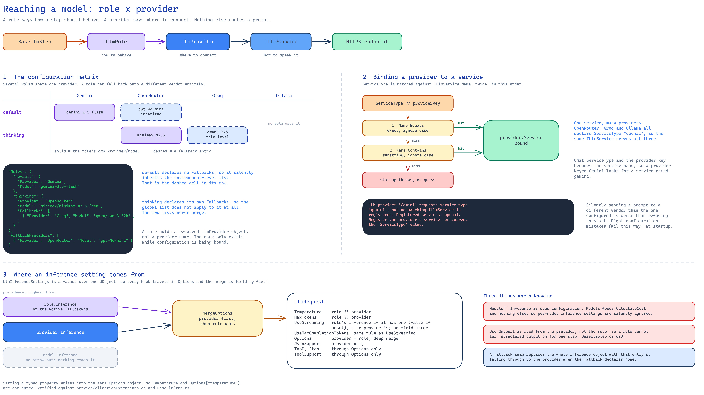

# Configuration

## Service Registration

Registration is a **two-phase** operation:

```csharp
using AITaskAgent.Configuration;

// Phase 1 - register services on the collection
services.AddSingleton<ILlmService, OpenAILlmService>();   // one or more providers
services.AddAITaskAgent();

// Phase 2 - initialize static factories on the built provider
var provider = services.BuildServiceProvider();
provider.UseAITaskAgent();
```

`AddAITaskAgent()` registers:

| Service | Implementation | Lifetime |
|---------|----------------|----------|
| `IPipeline` | `Pipeline` | Singleton |
| `PipelineContextFactory` | `PipelineContextFactory` | Singleton |
| `IPipelineContextStorage` | `InMemoryPipelineContextStorage` | Singleton |
| `IEventChannel` | `EventChannel` | Singleton |
| `ITemplateRendered` | `TinyTemplateRendered` | Singleton |
| `ITools` | `AvailableTools.Instance` | Singleton |
| `ICacheService` | `MemoryCacheService` | Singleton |
| `IConversationStorage` | `InMemoryConversationStorage` | Singleton |
| `ConversationContext` | factory using `Conversation.MaxTokens` | Transient |
| `IOptions<AITaskAgentOptions>` | bound from `AITaskAgent` | Singleton |
| `IOptions<LlmEnvironment>` | built from `AITaskAgent:LlmProviders` | Singleton |
| `IOptions<PipelineOptions>` | derived from `AITaskAgent:Timeouts` | Singleton |

`UseAITaskAgent()` resolves `IPipeline` and `PipelineContextFactory` (arming the static
`PipelineContextFactory.Create()` entry point) and registers every DI-registered `ITool` into
`AvailableTools.Instance`.

> [!WARNING]
> `CircuitBreaker` and `RateLimiter` are **not** registered by `AddAITaskAgent()`. They are plain
> classes you instantiate yourself — see [Resilience](resilience.md).

---

## The LLM configuration model

The old `LlmProviderConfig` / `LlmProvidersConfig` / `ILlmProviderResolver` "profiles" model is
gone. Configuration is now a **provider × role** matrix:

| Type | Answers | Key members |
|------|---------|-------------|
| `LlmProvider` | *where* do I connect? | `BaseUrl`, `ApiKey`, `ApiVersion`, `Inference`, `Models`, `Service`, `CalculateCost(...)` |
| `LlmRole` | *how* should this step behave? | `Provider`, `Model`, `SystemPrompt`, `Inference`, `Fallbacks`, `Tools` |
| `LlmEnvironment` | the root section | `Providers`, `Roles`, `DefaultRole`, `FallbackProviders` |
| `LlmInferenceSettings` | inference parameters | typed facades + free-form `Options` |

A provider is a connection target. A role is the behaviour of one step: which provider, which
model, which system prompt, which fallbacks. Several roles can share one provider, and a role can
fall back onto a different provider entirely.



<!-- Source: docs/assets/diagrams/llm-role-provider-matrix.excalidraw -->

Three things in that diagram are easy to get wrong from the tables alone:

- **A role holds a resolved `LlmProvider` object, not a provider name.** The name only exists while
  configuration is being bound.
- **`ServiceType` is matched twice**, first by case-insensitive equality against `ILlmService.Name`
  and then by `Contains`. A miss on both is a startup failure, never a silent pick.
- **`Models[].Inference` is never read.** `Models` feeds `CalculateCost` and nothing else.

---

## appsettings.json

Everything lives under the single `AITaskAgent` root section. `LlmProviders` is a **child** of it.

```json
{
  "AITaskAgent": {
    "Observability": {
      "EventLogLevel": "Trace",
      "EventChannelCapacity": 1000,
      "EnableTracing": true,
      "EnableMetrics": false
    },
    "Timeouts": {
      "DefaultPipelineTimeout": "03:00:00",
      "DefaultStepTimeout": "01:00:00"
    },
    "Conversation": {
      "MaxTokens": 8192,
      "UseSlidingWindow": true,
      "SlidingWindowMaxTokens": 8192,
      "KeepFirstNMessages": 2,
      "UseBookmarks": true
    },
    "LlmProviders": {
      "Providers": {
        "OpenRouter": {
          "ServiceType": "openai",
          "BaseUrl": "https://openrouter.ai/api/v1/",
          "ApiKey": "${OPENROUTER_API_KEY}"
        },
        "Groq": {
          "ServiceType": "openai",
          "BaseUrl": "https://api.groq.com/openai/v1",
          "ApiKey": "${GROQ_API_KEY}"
        },
        "Ollama": {
          "ServiceType": "openai",
          "BaseUrl": "http://localhost:11434/v1",
          "ApiKey": "ollama"
        },
        "Gemini": {
          "ServiceType": "gemini",
          "BaseUrl": "https://generativelanguage.googleapis.com/",
          "ApiKey": "${GEMINI_API_KEY}",
          "ApiVersion": "v1beta",
          "Models": [
            {
              "Name": "gemini-2.5-flash",
              "InputPricePerMillion": 0.30,
              "OutputPricePerMillion": 2.50,
              "Inference": { "Temperature": 0.7 }
            }
          ]
        }
      },
      "FallbackProviders": [
        { "Provider": "OpenRouter", "Model": "openai/gpt-4o-mini" }
      ],
      "DefaultRole": "default",
      "Roles": {
        "default": {
          "Provider": "Gemini",
          "Model": "gemini-2.5-flash",
          "SystemPrompt": "You are a helpful assistant.",
          "Inference": {
            "Temperature": 0.7,
            "UseStreaming": true,
            "Options": {
              "ThinkingConfig": {
                "IncludeThoughts": true,
                "ThinkingBudget": 2048
              }
            }
          }
        },
        "thinking": {
          "Provider": "OpenRouter",
          "Model": "minimax/minimax-m2.5:free",
          "Inference": {
            "Temperature": 0.7,
            "Options": { "enable_thinking": true }
          },
          "Fallbacks": [
            { "Provider": "Groq", "Model": "qwen/qwen3-32b" }
          ]
        }
      }
    }
  }
}
```

### Provider keys

| Key | Type | Notes |
|-----|------|-------|
| `BaseUrl` | `string` | **Required.** Startup fails if missing or blank. |
| `ApiKey` | `string?` | Supports `${VAR}` environment-variable expansion. |
| `ApiVersion` | `string?` | Passed through to the service (e.g. Gemini's `v1beta`). |
| `ServiceType` | `string?` | Which registered `ILlmService` to bind. Defaults to the provider key itself. |
| `Inference` | `LlmInferenceSettings?` | Provider-wide inference defaults. |
| `Models` | `LlmModelSettings[]` | `Name`, `InputPricePerMillion`, `OutputPricePerMillion`, `CachedInputPricePerMillion` (optional; falls back to the input price), `Inference`. Drives `CalculateCost` **only** — the per-model `Inference` is not read by anything. A `null` price means unknown: the cost comes out `null`, not 0. |

`ServiceType` is matched against `ILlmService.Name`, first by exact case-insensitive equality and
then by `Contains`. Several providers may share the same service (the three OpenAI-compatible
endpoints above use `"openai"`).

### Role keys

| Key | Type | Notes |
|-----|------|-------|
| `Provider` | `string` | **Required.** Must be a key under `Providers`. |
| `Model` | `string` | **Required.** |
| `SystemPrompt` | `string?` | Default system prompt for steps using this role. |
| `Inference` | `LlmInferenceSettings?` | Overrides the provider's inference settings. |
| `Fallbacks` | `[{ Provider, Model, Inference? }]` | When absent, the global `FallbackProviders` list is used instead. |

> [!NOTE]
> `LlmRole.Tools` exists on the object model but is **not** bound from configuration. Assign tools
> programmatically (`step.Tools = [...]`) or through the step's `tools` constructor argument.

### Environment variables in `ApiKey`

Any string value matching `${NAME}` is replaced with the value of the environment variable `NAME`
while the section is being reconstructed. When the variable is not set the literal `${NAME}` is
left in place — so a missing key surfaces as an authentication failure from the provider, not as a
silent empty string.

---

## Startup validation

Binding `LlmEnvironment` is strict and **fails fast** at startup with an explicit message. There is
no silent fallback to "whatever service happens to be registered".

| Mistake | Exception message (abridged) |
|---------|------------------------------|
| `ServiceType` with no matching `ILlmService` | `LLM provider 'X' requests service type 'Y', but no matching ILlmService is registered. Registered services: ...` |
| Provider without `BaseUrl` | `LLM provider 'X' has no BaseUrl configured.` |
| Role without `Provider` | `LLM role 'X' does not declare a Provider.` |
| Role pointing at an unknown provider | `LLM role 'X' references provider 'Y', which is not configured. Available providers: ...` |
| Role without `Model` | `LLM role 'X' does not declare a Model.` |
| Fallback naming an unknown provider | `Fallback in role 'X' references provider 'Y', which is not configured.` |
| Fallback without `Model` | `Fallback in FallbackProviders for provider 'Y' does not declare a Model.` |
| `DefaultRole` not present in `Roles` | `Default LLM role 'default' is not configured. Available roles: ...` |

The rationale is deliberate: a typo in a fallback provider only shows up as an outage when the
primary provider is already failing, and routing a prompt to a different vendor than the one
configured is worse than refusing to start.

---

## LlmInferenceSettings

`LlmInferenceSettings` is a **facade over a `JObject`**. The properties below are the ones the
framework itself understands; every other knob goes into `Options`.

| Property | Type | Default |
|----------|------|---------|
| `Temperature` | `float?` | – |
| `TopP` | `float?` | – |
| `MaxTokens` | `int?` | – |
| `UseStreaming` | `bool` | `false` |
| `JsonSupport` | `bool` | `false` |
| `ToolSupport` | `bool` | `true` |
| `Stop` | `IList<string>?` | – |
| `UseMaxCompletionTokens` | `bool` | `false` |
| `RequestTimeoutSeconds` | `int?` | – (OpenAI service: 10 min; `0` disables) |
| `StreamingInactivityTimeoutSeconds` | `int?` | – (OpenAI service: 2 min; `0` disables) |
| `Options` | `JObject` | `{}` — the single source of truth |

`ToolSupport` is declared but no framework code reads it: tools are sent whenever the step has
any. `RequestTimeoutSeconds` and `StreamingInactivityTimeoutSeconds` are only read by the OpenAI
service.

Vendor-specific parameters (Gemini's `ThinkingConfig`, a gateway's `enable_thinking`, routing
hints, `TopK`, penalties…) live in `Options` and are read by the `ILlmService` implementation:

```csharp
var thinking = request.GetOption<JObject>("ThinkingConfig");
var topK = request.GetOption<int?>("TopK");
```

`GetOption<T>(key)` resolves keys case-insensitively. Setting a typed property writes into the same
`Options` object, so `Temperature` and `Options["temperature"]` are the same entry. Assigning
`Options` merges its keys into the ones already there instead of replacing them, so facade keys
next to `Options` survive whatever order the binder reads them in.

`LlmRequest` derives from `LlmInferenceSettings`, so the same accessors are available inside a
service implementation.

---

## Cost calculation

Pricing is configuration, not protocol, so it lives on the provider:

```csharp
decimal? cost = provider.CalculateCost(model, promptTokens, completionTokens, cachedPromptTokens);
```

It looks the model up in `Provider.Models` (case-insensitive) and returns `null` when the model has
no pricing configured. Cached prompt tokens (optional argument) are billed at
`CachedInputPricePerMillion`, or at the input price when that is not set. `BaseLlmStep` calls it after each request and stores the value in
`LlmResult.CostUsd`, which surfaces on the step result as `CostUsd`.

---

## AITaskAgentOptions

| Property | Type | Default | Consumed by the framework |
|----------|------|---------|---------------------------|
| `Observability.EventLogLevel` | `LogLevel` | `Debug` | Yes — `EventChannel` |
| `Observability.EventChannelCapacity` | `int` | `100` | No |
| `Observability.EnableMetrics` | `bool` | `true` | No |
| `Observability.EnableTracing` | `bool` | `true` | No |
| `Timeouts.DefaultPipelineTimeout` | `TimeSpan` | `00:10:00` | Yes — `PipelineOptions` |
| `Timeouts.DefaultStepTimeout` | `TimeSpan` | `00:01:00` | Yes — `PipelineOptions` |
| `Timeouts.DefaultToolTimeout` | `TimeSpan` | `00:00:30` | No |
| `Timeouts.StreamingActivityTimeout` | `TimeSpan` | `00:00:30` | No — `[Obsolete]`; use `LlmInferenceSettings.StreamingInactivityTimeoutSeconds` |
| `Conversation.MaxTokens` | `int` | `8192` | Only by the transient `ConversationContext` registered in DI (`PipelineContextFactory.Create` builds its own with `new ConversationContext()`, 4000) |
| `Conversation.UseBookmarks` | `bool` | `true` | Only if you pass a `ConversationOptions` to the `ConversationContext` constructor (the DI factory does not) |
| `Conversation.UseSlidingWindow` | `bool` | `true` | Yes — copied into every `LlmRequest` by `BaseLlmStep` |
| `Conversation.KeepFirstNMessages` | `int` | `2` | Only if you pass a `ConversationOptions` to the `ConversationContext` constructor (the DI factory does not); otherwise 2 |
| `Conversation.SlidingWindowMaxTokens` | `int` | `8192` | Yes — copied into every `LlmRequest` by `BaseLlmStep` |
| `CircuitBreaker.FailureThreshold` | `int` | `5` | No |
| `CircuitBreaker.OpenDurationSeconds` | `int` | `60` | No |
| `RateLimit.MaxTokens` | `int` | `100` | No |
| `RateLimit.RefillIntervalMs` | `int` | `1000` | No |
| `RateLimit.TokensPerRefill` | `int` | `10` | No |

> [!WARNING]
> The options marked "No" are bound and readable through `IOptions<AITaskAgentOptions>`, but the
> framework does not act on them today. `CircuitBreaker` and `RateLimit` in particular exist so
> that *you* can construct the corresponding primitives (see [Resilience](resilience.md)); setting
> them alone changes nothing. The sliding window *is* applied: `BaseLlmStep` copies
> `Conversation.UseSlidingWindow` / `SlidingWindowMaxTokens` into each `LlmRequest` (when the step
> runs under DI; otherwise `LlmRequest`'s own defaults, `true` / `8192`, apply) and every bundled
> provider trims the history with them. The token count is an estimate (about 4 characters per
> token). The window keeps the first `KeepFirstNMessages` messages and the last group (the last
> message, plus the `assistant(tool_calls)` message it answers) even over budget, and never sends an
> orphaned `tool` message. Size it to the model's context: a long tool loop with the 8192 default
> silently drops the intermediate tool results of the turn. With `UseSlidingWindow: false` the whole
> history is sent and `SlidingWindowMaxTokens` is ignored; exceeding the context then fails with the
> provider's error instead of silently losing messages.

All of these are classes with `init`-only properties: they are bound from configuration, not mutated at runtime.
To change them programmatically, supply the values through a configuration source (for example
`AddInMemoryCollection`) rather than `services.Configure<AITaskAgentOptions>(o => ...)`.

### PipelineOptions

`PipelineOptions` (section name `"Pipeline"`) carries the two timeouts the `Pipeline` singleton is
built with. `AddAITaskAgent()` seeds it from `AITaskAgent:Timeouts`:

| Property | Type | Default |
|----------|------|---------|
| `DefaultPipelineTimeout` | `TimeSpan` | 60 min (overwritten by `Timeouts`) |
| `DefaultStepTimeout` | `TimeSpan` | 30 min (overwritten by `Timeouts`) |

---

## Configuration binding notes

The framework binds configuration through `BindEx` / `GetEx`, which rebuild the section as a
`JToken` before deserializing with Newtonsoft.Json. Consequences worth knowing:

- Numeric-only child keys are reconstructed as a **JSON array**, so array syntax works as expected.
- Scalars are parsed to their natural type: `bool`, `int`/`long`, `decimal`, `double`, and finally
  `string`. Dates and time spans stay strings, which Newtonsoft converts when the target property is
  a `TimeSpan` (`"03:00:00"`) or `DateTimeOffset`/`DateTime` (ISO 8601); a `string` property such as
  `ApiVersion: "2024-10-21"` gets the value untouched.
- Only values that end up as strings get `${VAR}` expansion.
- `JObject`-typed members such as `LlmInferenceSettings.Options` accept arbitrary nested JSON.
