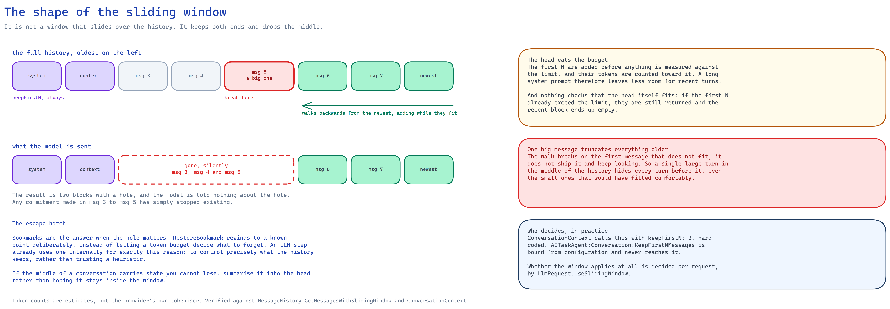

# Conversation

## Overview

`ConversationContext` manages message history for LLM interactions with features like bookmarks and sliding windows.

## Creating a Conversation

```csharp
// Via DI (recommended)
var conversation = services.GetRequiredService<ConversationContext>();

// Manual creation
var conversation = new ConversationContext(
    maxTokens: 4000,
    tokenCounter: text => text.Length / 4,   // Approximate
    logger: loggerFactory.CreateLogger<ConversationContext>()
);
```

The DI registration is **transient** and pre-configured with `Conversation.MaxTokens` from
configuration plus the registered `ILlmService.EstimateTokenCount` as the token counter (falling
back to `NullLlmService` when no provider is registered).

## Adding Messages

```csharp
// User message
conversation.AddUserMessage("What is the weather?");

// Assistant response
conversation.AddAssistantMessage("The weather is sunny.");

// System message
conversation.AddSystemMessage("You are a helpful assistant.");

// Tool response
conversation.AddToolMessage(toolCallId: "call_123", content: "25°C");

// With tool calls
conversation.AddAssistantMessageWithToolCalls(new[] {
    new ToolCall { Id = "call_123", Name = "weather", Arguments = "{}" }
});
```

## Bookmarks

Save and restore conversation state for retry scenarios:

```csharp
// Create bookmark before LLM call
var bookmark = conversation.CreateBookmark();

// ... LLM interaction ...

if (!validated)
{
    // Restore to bookmark (removes all messages after)
    conversation.RestoreBookmark(bookmark);
    
    // Add clean messages
    conversation.AddUserMessage(originalPrompt);
    conversation.AddAssistantMessage(correctedResponse);
}
```

## Sliding Window

Manage context size by keeping recent messages:



<!-- Source: docs/assets/diagrams/sliding-window-shape.excalidraw -->

The first N messages are charged against `maxTokens` too, and the backwards walk stops at the
first message that does not fit — it does not skip it and keep looking for a smaller one.

```csharp
// Get messages with sliding window
var messages = conversation.GetMessagesForRequest(
    maxTokens: 8192,
    fromBookmark: null,      // when set, returns only the messages after that bookmark
    useSlidingWindow: true
);

// Keeps first N messages (system context) + recent messages
var messages = conversation.History.GetMessagesWithSlidingWindow(
    keepFirstN: 2,
    maxTokens: 8192
);
```

## MessageHistory

Low-level access to message management:

```csharp
// Add message
conversation.History.AddMessage(new Message
{
    Role = "user",
    Content = "Hello"
});

// Get all messages
var all = conversation.History.Messages;

// Get recent messages
var recent = conversation.History.GetRecentMessages(maxTokens: 4000);

// Clone history
var clone = conversation.Clone();
```

## PipelineContext Integration

Conversation is part of `PipelineContext`:

```csharp
var context = PipelineContextFactory.Create(conversation);

// Access conversation
context.Conversation.AddUserMessage("Query");

// Clone for parallel branches
var branchContext = context.CloneForBranch();
// Each branch gets isolated conversation copy
```

## Token Counting

```csharp
// Custom token counter
var conversation = new ConversationContext(
    maxTokens: 4000,
    tokenCounter: llmService.EstimateTokenCount
);

// Check token usage
var totalTokens = conversation.History.GetTotalTokenCount();
```
