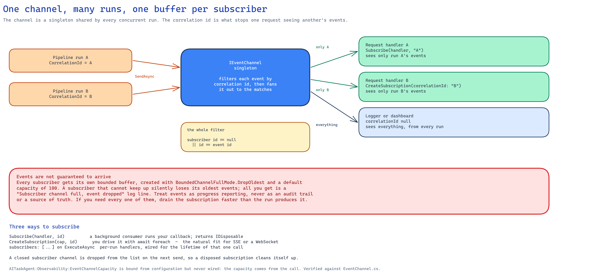
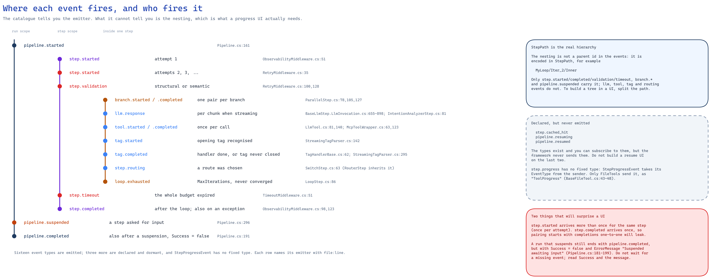

# Event System

## Overview

AITaskAgent includes a real-time event system for observability. Events flow through
`IEventChannel` to subscribers, and are **routed by `CorrelationId`** so concurrent pipeline
executions never bleed into each other.



<!-- Source: docs/assets/diagrams/event-correlation-routing.excalidraw -->

A subscriber with a `correlationId` sees only that execution; one with `null` is global and sees
every event. That is what makes a single channel safe for a server running many pipelines at once.

## Architecture

### IProgressEvent

Base interface for all events:

```csharp
public interface IProgressEvent
{
    string StepName { get; }          // Emitting step
    string EventType { get; }         // e.g., "step.completed"
    DateTimeOffset Timestamp { get; }
    string? CorrelationId { get; }
    bool SuppressFromUser { get; }    // true = logging/debugging only
    string SchemaVersion { get; }     // "1.0" — schema evolution marker

    // Default implementation: logs the common fields only
    void WriteLog(ILogger logger, LogLevel level) =>
        logger.Log(level, CommonLogFormat, EventType, StepName, CorrelationId);
}
```

`ProgressEventBase` is the abstract record every framework event derives from; it supplies all of
the above except `EventType`, and redeclares `WriteLog` as `virtual` so an event can log its own
fields (`LlmResponseEvent` overrides it to include `Content`).

### Automatic logging

`EventChannel.SendAsync` logs every event — including those with `SuppressFromUser = true` —
by calling `evt.WriteLog(logger, EventLogLevel)`, and only when `EventLogLevel != LogLevel.None`.
The channel knows nothing about concrete event types; each event decides what it writes.
`EventChannelOptions.EventLogLevel` defaults to `None`, but the singleton registered by
`AddAITaskAgent` takes its level from `AITaskAgent:Observability:EventLogLevel`
(`ObservabilityOptions`, default `Debug`). The `new EventChannel()` constructor used outside DI
defaults to `Information`.

### IEventChannel

```csharp
public interface IEventChannel
{
    Task SendAsync<TEvent>(TEvent progressEvent, CancellationToken ct = default)
        where TEvent : IProgressEvent;

    IDisposable Subscribe(
        Func<IProgressEvent, CancellationToken, Task> handler,
        string? correlationId = null);

    IEventSubscription CreateSubscription(
        int capacity = 100,
        string? correlationId = null);
}
```

> [!IMPORTANT]
> The old `Subscribe(int capacity)` overload and the generic `Subscribe<TEvent>(...)` form no
> longer exist. There is one handler-based `Subscribe` and one reader-based `CreateSubscription`.

### Correlation-based routing

`SendAsync` delivers an event to:

- every subscriber whose `correlationId` equals the event's `CorrelationId`, and
- every **global** subscriber (`correlationId` left null), which receives everything.

This is what makes a single singleton channel safe for a server handling many concurrent
executions: a request handler subscribes with its own correlation id and sees only its own events.

### Sending events

```csharp
await context.SendEventAsync(new MyEvent
{
    StepName = "MyStep",
    CorrelationId = context.CorrelationId,
    // ... custom properties
}, cancellationToken);
```

`PipelineContext.SendEventAsync` is a no-op returning `false` when the context has no channel, and
swallows delivery exceptions so event problems can never fail a pipeline.

---

## Subscribing

### Handler-based

```csharp
var eventChannel = provider.GetRequiredService<IEventChannel>();

using IDisposable subscription = eventChannel.Subscribe(async (evt, ct) =>
{
    switch (evt)
    {
        case StepCompletedEvent step:
            Console.WriteLine($"Step {step.StepName}: {(step.Success ? "OK" : "FAILED")} " +
                              $"in {step.Duration.TotalMilliseconds}ms");
            break;

        case LlmResponseEvent llm when llm.FinishReason == FinishReason.Streaming:
            Console.Write(llm.Content);        // streaming chunk
            break;

        case LlmResponseEvent llm:
            Console.WriteLine($"\n[{llm.TokensUsed} tokens]");
            break;
    }
}, correlationId: context.CorrelationId);
```

Events are written non-blocking into an internal bounded channel and the handler runs on a
background loop. Disposing unsubscribes and drains the handler.

### Reader-based (`await foreach`, SSE, WebSockets)

```csharp
await using IEventSubscription subscription =
    eventChannel.CreateSubscription(capacity: 500, correlationId: context.CorrelationId);

await foreach (IProgressEvent evt in subscription.Reader.ReadAllAsync(cancellationToken))
{
    await response.WriteAsync($"data: {JsonConvert.SerializeObject(evt)}\n\n");
}
```

`IEventSubscription` is `IAsyncDisposable` and exposes `ChannelReader<IProgressEvent> Reader`. The
channel is bounded with `BoundedChannelFullMode.DropOldest`: once a slow consumer fills
`capacity`, each new event evicts the **oldest** buffered one (with a warning log) rather than
blocking the pipeline. Handler-based `Subscribe` uses the same mode with a capacity of
`EventChannelOptions.ChannelCapacity` (1000).

### Per-execution subscribers

`IPipeline.ExecuteAsync` accepts a `subscribers` argument. When no `context` is passed, the
pipeline then creates a **local** `EventChannel` for that run (with an explicit `context` the
argument is ignored), activates the handlers at start and completes them when execution
finishes, giving full isolation between concurrent runs:

```csharp
var result = await pipeline.ExecuteAsync(
    name: "MyPipeline",
    steps: steps,
    input: input,
    subscribers: [async (evt, ct) => Console.WriteLine(evt.EventType)]);
```

`PipelineContextFactory.Create(subscribers)` (or `LlmPipelineContextFactory.Create(conversation, subscribers)` for a context
around an existing conversation) does the same when you build the context yourself.

---

## Event Catalog

| Event | EventType | Emitted By | Description |
|-------|-----------|------------|-------------|
| `PipelineStartedEvent` | `pipeline.started` | Pipeline | Pipeline execution begins |
| `PipelineCompletedEvent` | `pipeline.completed` | Pipeline | Pipeline execution ends |
| `PipelineSuspendedEvent` | `pipeline.suspended` | `Pipeline` | Execution suspended awaiting external input |
| `StepStartedEvent` | `step.started` | `ObservabilityMiddleware` (first attempt), `RetryMiddleware` (retries) | Before each attempt |
| `StepCompletedEvent` | `step.completed` | `ObservabilityMiddleware` | After step execution |
| `StepRoutingEvent` | `step.routing` | `SwitchStep<T>` (and `RouterStep`, which derives from it) | Route selection; `DeclarativeSwitchStep` (YAML `switch`) does not emit it |
| `StepValidationEvent` | `step.validation` | `RetryMiddleware` | Structural or semantic validation result |
| `StepTimeoutEvent` | `step.timeout` | `TimeoutMiddleware` | Step exceeded its timeout |
| `BranchStartedEvent` | `branch.started` | `ParallelStep` | A parallel branch starts |
| `BranchCompletedEvent` | `branch.completed` | `ParallelStep` | A parallel branch finishes |
| `LoopExhaustedEvent` | `loop.exhausted` | `LoopStep` | `MaxIterations` reached without a break |
| `LlmResponseEvent` | `llm.response` | `BaseLlmStep` | LLM response (streaming chunk or final) |
| `ToolStartedEvent` | `tool.started` | `LlmTool`, `McpToolWrapper` | Tool execution begins |
| `ToolCompletedEvent` | `tool.completed` | `LlmTool`, `McpToolWrapper` | Tool execution ends |
| `TagStartedEvent` | `tag.started` | `StreamingTagParser` | An action tag's opening tag was recognised (its body may still be arriving) |
| `TagCompletedEvent` | `tag.completed` | `TagHandlerBase` / `StreamingTagParser` | The tag's handler finished (`Success`), or the tag was never closed (`Success = false`) |

Most string literals are available as constants on `AITaskAgentConstants.EventTypes`; the
exceptions are `branch.started` / `branch.completed` (`BranchStartedEvent.EventTypeName` /
`BranchCompletedEvent.EventTypeName`), `pipeline.resuming` / `pipeline.resumed`
(`PipelineResumingEvent.EventTypeName` / `PipelineResumedEvent.EventTypeName`), `step.cached_hit`
(a literal inside `StepCachedHitEvent`) and `step.timeout` (a literal inside `StepTimeoutEvent`).

The table gives you the emitter. What it cannot show is *when* each one fires and how they nest,
which is what a progress UI actually has to model:



<!-- Source: docs/assets/diagrams/event-lifecycle-map.excalidraw -->

Two consequences are worth stating outright, because they break the obvious implementation:
`StepStartedEvent` arrives **more than once** for the same step (once per attempt, from two
different middlewares), while `StepCompletedEvent` arrives **once** — so pairing them one-to-one
will leak. And a run that suspends still ends with `PipelineCompletedEvent`, but with `Success = false` and `ErrorMessage = "Suspended awaiting input"` (`Pipeline.cs:203-216`).

### Declared but not yet emitted

These event types exist and can be sent by your own code, but nothing in the framework currently
raises them. Do not build a UI that waits for one:

| Event | EventType |
|-------|-----------|
| `StepCachedHitEvent` | `step.cached_hit` |
| `PipelineResumingEvent` | `pipeline.resuming` |
| `PipelineResumedEvent` | `pipeline.resumed` |

`StepProgressEvent` is a separate case: it implements `IProgressEvent` directly (not
`ProgressEventBase`) and its `EventType` is a required property set by the sender, so there is no
fixed `step.progress` value. The core framework never sends it; the `FileTools` tools do, through
`BaseFileTool.NotifyProgressAsync`, with `EventType = "ToolProgress"` and a `Message`.

### StepPath

Several events carry a `StepPath` in addition to `StepName`: `StepStartedEvent`,
`StepCompletedEvent`, `StepValidationEvent`, `StepTimeoutEvent`, `StepCachedHitEvent`,
`BranchStartedEvent`, `BranchCompletedEvent`, `PipelineResumingEvent`, `PipelineResumedEvent`.
`PipelineSuspendedEvent` has no `StepPath`: it carries `TargetStepPath`, `IsBranchSuspension` and
`BranchName`.
The path mirrors `PipelineContext.CurrentStepPath` (`"MyLoop/Iter_2/Inner"`) and is what
lets a UI place an event inside a nested or parallel execution tree.

### Event Details

#### StepCompletedEvent
```csharp
public sealed record StepCompletedEvent : ProgressEventBase, IStepCompletedEvent
{
    public string? StepPath { get; init; }
    public bool Success { get; init; }
    public TimeSpan Duration { get; init; }
    public string? ErrorMessage { get; init; }
    public Dictionary<string, object?> AdditionalData { get; init; } = [];
    public IStepResult? StepResult { get; init; }
    public string? Display { get; init; }   // see "Display text" below
}
```

#### LlmResponseEvent
```csharp
public sealed record LlmResponseEvent : ProgressEventBase
{
    public required string Content { get; init; }
    public FinishReason FinishReason { get; init; } = FinishReason.Streaming;
    public int ChoiceIndex { get; init; }
    public string? RawFinishReason { get; init; }
    public bool IsThinking { get; init; }     // reasoning/thought chunk
    public int TokensUsed { get; init; }
    // Set only on the final event of the primary choice; null when not reported/priced
    public int? PromptTokens { get; init; }
    public int? CompletionTokens { get; init; }
    public int? CachedPromptTokens { get; init; }
    public decimal? CostUsd { get; init; }
    public string? Model { get; init; }
    public string? Provider { get; init; }
    public List<ToolCall>? ToolCalls { get; init; }

    // Overrides the default log line to add IsThinking, FinishReason, Content and TokensUsed
    public override void WriteLog(ILogger logger, LogLevel level) { ... }
}
```

#### ToolCompletedEvent
```csharp
public sealed record ToolCompletedEvent : ProgressEventBase
{
    public required string ToolName { get; init; }
    public bool Success { get; init; }
    public TimeSpan Duration { get; init; }
    public string? ErrorMessage { get; init; }
    public Dictionary<string, object>? AdditionalData { get; init; }
    public string? Display { get; init; }   // see "Display text" below
}
```

#### Branch events
```csharp
public sealed record BranchStartedEvent : ProgressEventBase
{
    public string? StepPath { get; init; }
    public string BranchName { get; init; } = string.Empty;
    public string BranchId { get; init; } = string.Empty;   // unique per branch execution
}
```

`BranchCompletedEvent` adds `Success`, `Duration` and `ErrorMessage`.

#### LoopExhaustedEvent
```csharp
public sealed record LoopExhaustedEvent : ProgressEventBase
{
    public string LoopName { get; init; } = string.Empty;
    public int IterationsCompleted { get; init; }
    public int MaxIterations { get; init; }
}
```

Emitted only when a `LoopStep` runs out of iterations without a `BreakStep` — that is, the loop
never converged. Treat it as a warning signal, not routine telemetry.

#### StepTimeoutEvent
```csharp
public sealed record StepTimeoutEvent : ProgressEventBase
{
    public string? StepPath { get; init; }
    public TimeSpan ConfiguredTimeout { get; init; }
}
```

> `pipeline.suspended` belongs to the human-in-the-loop flow, documented in
> [Human in the Loop](human-in-the-loop.md).

---

## Display text

`StepStartedEvent`, `StepCompletedEvent`, `ToolStartedEvent` and `ToolCompletedEvent` have a
`string? Display` property: the text that the step or tool **wants shown** to a person for that moment
(for example "Querying sales for Acme" and "42 rows read"). It is null unless a template was declared;
nothing changes for steps and tools that declare none. The other event types have no `Display`.

### Declaring the templates

| Where | How |
|-------|-----|
| A step (anything that derives from `StepBase`) | properties `DisplayStart` and `DisplayEnd`, settable per instance and `virtual` |
| A tool that derives from `LlmTool` (and `McpToolWrapper`) | properties `DisplayStart` and `DisplayEnd` |
| YAML, per step | `display: { start: "...", end: "..." }` (see [yaml-pipelines](yaml-pipelines.md)) |
| The host, by name | register an `IDisplayTextProvider` in DI; `GetTemplate(DisplayKind kind, string name, DisplayPhase phase)` returns the template of a step (`Step`, `IStep.Name`) or a tool (`Tool`, `ITool.Name`), or null. It is for what the host cannot subclass or declare, for example tools described in a JSON catalog |

The template declared by the step or tool wins over the provider's. A step added at run time through
`NextSteps` gets the same treatment, because the events come from the middlewares and from `LlmTool.ExecuteAsync`.

### Model of the template

Templates use the same engine as prompts and `when` (`{{ x.y }}`, pipes, `?? default`; see
`TemplateEngineExamples.md`) over the same `input` and `context`, so a path that works in a prompt works here.
Lookups ignore case.

| Event | Available |
|-------|-----------|
| Step start | `step` (`name`, `path`, `attempt`), `input` (the step input value, as in prompts), `context` (the `PipelineContext.Metadata`, keys lowercased), `data` (the event's `AdditionalData`) |
| Step end | the same without `step.attempt` (the event is emitted once, after the retries), plus `output` (the result value), `success`, `error`, `durationMs` |
| Tool start | `tool` (the name), `args` (the call arguments: a JSON object or array is parsed, anything else stays text), `context`, `data` |
| Tool end | the same plus `result` (parsed to JSON when it is an object or an array, otherwise text), `success`, `error`, `durationMs` |

`data` is the `AdditionalData` of the event **after** the step's or tool's own enrichment, so what an
enricher adds is visible. A step that fails with an exception renders its end text with `output` absent.
`RetryMiddleware` renders the start text of each retry with its own `step.attempt`.

### Examples

```csharp
// Deterministic step
step.DisplayStart = "Reading {{ input.fileName }} for {{ context.customer }}";
step.DisplayEnd   = "{{ output.rows }} rows read in {{ durationMs }} ms";

// LLM step: the same properties on BaseLlmStep and derived classes
llmStep.DisplayStart = "Analysing attempt {{ step.attempt }}";
llmStep.DisplayEnd   = "{{ success }}: {{ output.summary ?? no summary }}";

// Tool
tool.DisplayStart = "Querying {{ args.table }}";
tool.DisplayEnd   = "{{ tool }}: {{ result.rows }} rows";
```

```csharp
// Host catalog: templates by name, no subclassing
services.AddSingleton<IDisplayTextProvider>(new MyCatalogProvider());
```

```yaml
- id: extract
  type: LlmStep
  userPrompt: "..."
  display:
    start: "Extracting data from {{ input.fileName }}"
    end: "{{ success }}"
```

### Guarantees and limits

- Rendering **never throws and never delays the step**: on any error (a provider that throws, a model that
  cannot be serialized) `Display` is null and a warning is logged under the category `AITaskAgent.Display`
  with the step or tool name and the exception *type*, never the values.
- With no template there is no cost: no model is built. With one, only the parts of the model whose name the
  template mentions (`input`, `output`, `args`, `result`, `context`, `data`) are serialized.
- The text is cut at 500 characters (`DisplayTextRenderer.MaxLength`) and the cut text ends with an ellipsis
  character. A template that renders empty gives null.
- File includes (`{{ include ... }}`, `@[path]`) are refused (null and a warning): a display text must not read files.
- An event with `SuppressFromUser = true` is not rendered.
- A hand-written `ITool` that does not extend `LlmTool` raises no events and therefore has no `Display`; it can
  call `DisplayTextRenderer.ToolStart` and `ToolEnd` itself.
- Not covered: pipeline and model-call events carry no `Display`; an `IStepCompletedEvent` that is not a
  `StepCompletedEvent` is not rendered.

## Enriching Events in Custom Steps

Enrichment moved from inheritance to **composition**. The interface is now `IEnrichable` (not
`IEnrichableStep`, and it no longer extends `IStep`), and `StepBase` exposes an
`Enrichable` property:

```csharp
public interface IEnrichable
{
    void EnrichActivityBefore(Activity? activity, IStepResult input, PipelineContext context) { }
    void EnrichActivityAfter(Activity? activity, IStepResult result, PipelineContext context) { }
    StepStartedEvent EnrichStartedEvent(StepStartedEvent baseEvent, IStepResult input, PipelineContext context);
    IStepCompletedEvent EnrichCompletedEvent(IStepCompletedEvent baseEvent, IStepResult result, PipelineContext context);
}
```

`StepBase` itself implements `IEnrichable` and delegates to `Enrichable` when one is attached, so
you have two options.

### Option A — attach an enricher

```csharp
public sealed class LlmMetricsEnricher : IEnrichable
{
    public StepStartedEvent EnrichStartedEvent(
        StepStartedEvent baseEvent, IStepResult input, PipelineContext context) => baseEvent;

    public IStepCompletedEvent EnrichCompletedEvent(
        IStepCompletedEvent baseEvent, IStepResult result, PipelineContext context)
    {
        if (result is ILlmStepResult llm)
        {
            baseEvent.AdditionalData["tokensUsed"] = llm.TokensUsed;
            baseEvent.AdditionalData["model"] = llm.Model;
            baseEvent.AdditionalData["costUsd"] = llm.CostUsd;
        }
        return baseEvent;
    }

    public void EnrichActivityAfter(Activity? activity, IStepResult result, PipelineContext context)
    {
        if (result is ILlmStepResult llm)
        {
            activity?.SetTag("llm.tokens_used", llm.TokensUsed);
            activity?.SetTag("llm.model", llm.Model);
        }
    }
}

var step = new MyStep { Enrichable = new LlmMetricsEnricher() };
```

### Option B — override the protected hooks on `StepBase`

`StepBase` declares protected virtual `EnrichActivityBefore` / `EnrichActivityAfter` /
`EnrichStartedEvent` / `EnrichCompletedEvent` methods that call the attached `Enrichable` by
default. Override them in a derived step when the enrichment is intrinsic to that step.

### BaseLlmStep Enrichment

`BaseLlmStep` opens a child `LLM.Invoke` activity (`ActivityKind.Client`) for every LLM call and
tags it with:

- `llm.model` - Model used
- `llm.provider` - Provider name
- `llm.iteration` - Tool-loop iteration
- `llm.has_tools` - Whether tools were sent
- `llm.tokens_used` - Total tokens
- `llm.finish_reason` - Finish reason

---

## Creating Custom Events

Derive from `ProgressEventBase` and override `EventType` (and `WriteLog`, if the automatic log
line should carry more than the common fields):

```csharp
public sealed record ContextSnapshotEvent : ProgressEventBase
{
    public override string EventType => "context.snapshot";
    public string? StepPath { get; init; }
    public IReadOnlyDictionary<string, string>? StepResults { get; init; }
}
```

See [Custom Events](../extensibility/custom-events.md) for the full walkthrough.
