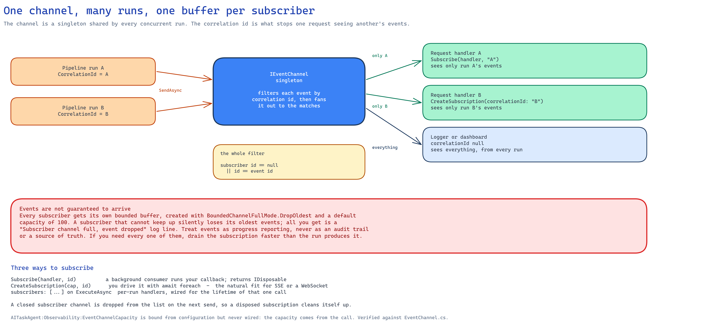
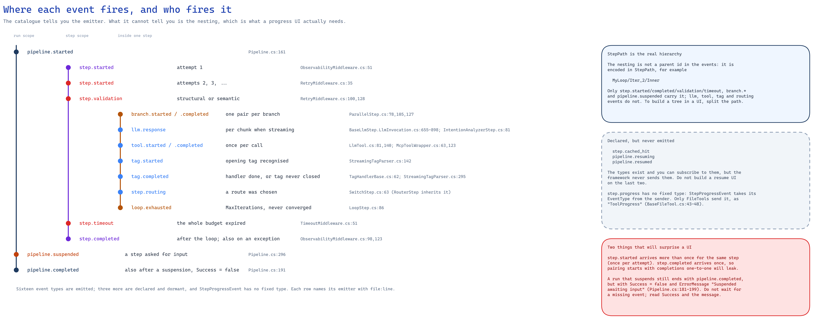

# Event System

## Overview

AITaskAgent includes a real-time event system for observability. Events flow through
`IEventChannel` to subscribers, and are **routed by `CorrelationId`** so concurrent pipeline
executions never bleed into each other.



<!-- Source: docs/assets/diagrams/event-correlation-routing.excalidraw -->

A subscriber with a `correlationId` sees only that execution; one with `null` is global and sees
every event. That is what makes a single channel safe for a server running many pipelines at once.

## Architecture

### IProgressEvent

Base interface for all events:

```csharp
public interface IProgressEvent
{
    string StepName { get; }          // Emitting step
    string EventType { get; }         // e.g., "step.completed"
    DateTimeOffset Timestamp { get; }
    string? CorrelationId { get; }
    bool SuppressFromUser { get; }    // true = logging/debugging only
    string SchemaVersion { get; }     // "1.0" — schema evolution marker
}
```

`ProgressEventBase` is the abstract record every framework event derives from; it supplies all of
the above except `EventType`.

### IEventChannel

```csharp
public interface IEventChannel
{
    Task SendAsync<TEvent>(TEvent progressEvent, CancellationToken ct = default)
        where TEvent : IProgressEvent;

    IDisposable Subscribe(
        Func<IProgressEvent, CancellationToken, Task> handler,
        string? correlationId = null);

    IEventSubscription CreateSubscription(
        int capacity = 100,
        string? correlationId = null);
}
```

> [!IMPORTANT]
> The old `Subscribe(int capacity)` overload and the generic `Subscribe<TEvent>(...)` form no
> longer exist. There is one handler-based `Subscribe` and one reader-based `CreateSubscription`.

### Correlation-based routing

`SendAsync` delivers an event to:

- every subscriber whose `correlationId` equals the event's `CorrelationId`, and
- every **global** subscriber (`correlationId` left null), which receives everything.

This is what makes a single singleton channel safe for a server handling many concurrent
executions: a request handler subscribes with its own correlation id and sees only its own events.

### Sending events

```csharp
await context.SendEventAsync(new MyEvent
{
    StepName = "MyStep",
    CorrelationId = context.CorrelationId,
    // ... custom properties
}, cancellationToken);
```

`PipelineContext.SendEventAsync` is a no-op returning `false` when the context has no channel, and
swallows delivery exceptions so event problems can never fail a pipeline.

---

## Subscribing

### Handler-based

```csharp
var eventChannel = provider.GetRequiredService<IEventChannel>();

using IDisposable subscription = eventChannel.Subscribe(async (evt, ct) =>
{
    switch (evt)
    {
        case StepCompletedEvent step:
            Console.WriteLine($"Step {step.StepName}: {(step.Success ? "OK" : "FAILED")} " +
                              $"in {step.Duration.TotalMilliseconds}ms");
            break;

        case LlmResponseEvent llm when llm.FinishReason == FinishReason.Streaming:
            Console.Write(llm.Content);        // streaming chunk
            break;

        case LlmResponseEvent llm:
            Console.WriteLine($"\n[{llm.TokensUsed} tokens]");
            break;
    }
}, correlationId: context.CorrelationId);
```

Events are written non-blocking into an internal bounded channel and the handler runs on a
background loop. Disposing unsubscribes and drains the handler.

### Reader-based (`await foreach`, SSE, WebSockets)

```csharp
await using IEventSubscription subscription =
    eventChannel.CreateSubscription(capacity: 500, correlationId: context.CorrelationId);

await foreach (IProgressEvent evt in subscription.Reader.ReadAllAsync(cancellationToken))
{
    await response.WriteAsync($"data: {JsonConvert.SerializeObject(evt)}\n\n");
}
```

`IEventSubscription` is `IAsyncDisposable` and exposes `ChannelReader<IProgressEvent> Reader`. The
channel is bounded: once a slow consumer fills `capacity`, further events for that subscriber are
dropped rather than blocking the pipeline.

### Per-execution subscribers

`IPipeline.ExecuteAsync` accepts a `subscribers` argument. The pipeline then creates a **local**
`EventChannel` for that run, activates the handlers at start and completes them when execution
finishes, giving full isolation between concurrent runs:

```csharp
var result = await pipeline.ExecuteAsync(
    name: "MyPipeline",
    steps: steps,
    input: input,
    subscribers: [async (evt, ct) => Console.WriteLine(evt.EventType)]);
```

`PipelineContextFactory.Create(conversation, subscribers)` does the same when you build the context
yourself.

---

## Event Catalog

| Event | EventType | Emitted By | Description |
|-------|-----------|------------|-------------|
| `PipelineStartedEvent` | `pipeline.started` | Pipeline | Pipeline execution begins |
| `PipelineCompletedEvent` | `pipeline.completed` | Pipeline | Pipeline execution ends |
| `PipelineSuspendedEvent` | `pipeline.suspended` | `Pipeline` | Execution suspended awaiting external input |
| `StepStartedEvent` | `step.started` | `ObservabilityMiddleware` (first attempt), `RetryMiddleware` (retries) | Before each attempt |
| `StepCompletedEvent` | `step.completed` | `ObservabilityMiddleware` | After step execution |
| `StepRoutingEvent` | `step.routing` | `SwitchStep` / `RouterStep` | Route selection |
| `StepValidationEvent` | `step.validation` | `RetryMiddleware` | Structural or semantic validation result |
| `StepTimeoutEvent` | `step.timeout` | `TimeoutMiddleware` | Step exceeded its timeout |
| `BranchStartedEvent` | `branch.started` | `ParallelStep` | A parallel branch starts |
| `BranchCompletedEvent` | `branch.completed` | `ParallelStep` | A parallel branch finishes |
| `LoopExhaustedEvent` | `loop.exhausted` | `LoopStep` | `MaxIterations` reached without a break |
| `LlmResponseEvent` | `llm.response` | `BaseLlmStep` | LLM response (streaming chunk or final) |
| `ToolStartedEvent` | `tool.started` | `LlmTool` | Tool execution begins |
| `ToolCompletedEvent` | `tool.completed` | `LlmTool` | Tool execution ends |
| `TagStartedEvent` | `tag.started` | `StreamingTagParser` | An action tag's opening tag was recognised (its body may still be arriving) |
| `TagCompletedEvent` | `tag.completed` | `TagHandlerBase` / `StreamingTagParser` | The tag's handler finished (`Success`), or the tag was never closed (`Success = false`) |

The string literals are available as constants on `AITaskAgentConstants.EventTypes`.

The table gives you the emitter. What it cannot show is *when* each one fires and how they nest,
which is what a progress UI actually has to model:



<!-- Source: docs/assets/diagrams/event-lifecycle-map.excalidraw -->

Two consequences are worth stating outright, because they break the obvious implementation:
`StepStartedEvent` arrives **more than once** for the same step (once per attempt, from two
different middlewares), while `StepCompletedEvent` arrives **once** — so pairing them one-to-one
will leak. And a run that suspends never emits `PipelineCompletedEvent` at all.

### Declared but not yet emitted

These event types exist and can be sent by your own code, but nothing in the framework currently
raises them. Do not build a UI that waits for one:

| Event | EventType |
|-------|-----------|
| `StepProgressEvent` | `step.progress` |
| `StepCachedHitEvent` | `step.cached_hit` |
| `PipelineResumingEvent` | `pipeline.resuming` |
| `PipelineResumedEvent` | `pipeline.resumed` |

### StepPath

Several events carry a `StepPath` in addition to `StepName`: `StepStartedEvent`,
`StepCompletedEvent`, `StepValidationEvent`, `StepTimeoutEvent`, `StepCachedHitEvent`,
`BranchStartedEvent`, `BranchCompletedEvent`, `PipelineResumingEvent`, `PipelineResumedEvent`.
The path mirrors `PipelineContext.CurrentStepPath` (`"MyLoop/Iter_2/Inner"`) and is what
lets a UI place an event inside a nested or parallel execution tree.

### Event Details

#### StepCompletedEvent
```csharp
public sealed record StepCompletedEvent : ProgressEventBase, IStepCompletedEvent
{
    public string? StepPath { get; init; }
    public bool Success { get; init; }
    public TimeSpan Duration { get; init; }
    public string? ErrorMessage { get; init; }
    public Dictionary<string, object?> AdditionalData { get; init; } = [];
    public IStepResult? StepResult { get; init; }
}
```

#### LlmResponseEvent
```csharp
public sealed record LlmResponseEvent : ProgressEventBase
{
    public required string Content { get; init; }
    public FinishReason FinishReason { get; init; } = FinishReason.Streaming;
    public int ChoiceIndex { get; init; }
    public string? RawFinishReason { get; init; }
    public bool IsThinking { get; init; }     // reasoning/thought chunk
    public int TokensUsed { get; init; }
    public string? Model { get; init; }
    public string? Provider { get; init; }
    public List<ToolCall>? ToolCalls { get; init; }
}
```

#### ToolCompletedEvent
```csharp
public sealed record ToolCompletedEvent : ProgressEventBase
{
    public required string ToolName { get; init; }
    public bool Success { get; init; }
    public TimeSpan Duration { get; init; }
    public string? ErrorMessage { get; init; }
    public Dictionary<string, object>? AdditionalData { get; init; }
}
```

#### Branch events
```csharp
public sealed record BranchStartedEvent : ProgressEventBase
{
    public string? StepPath { get; init; }
    public string BranchName { get; init; } = string.Empty;
    public string BranchId { get; init; } = string.Empty;   // unique per branch execution
}
```

`BranchCompletedEvent` adds `Success`, `Duration` and `ErrorMessage`.

#### LoopExhaustedEvent
```csharp
public sealed record LoopExhaustedEvent : ProgressEventBase
{
    public string LoopName { get; init; } = string.Empty;
    public int IterationsCompleted { get; init; }
    public int MaxIterations { get; init; }
}
```

Emitted only when a `LoopStep` runs out of iterations without a `BreakStep` — that is, the loop
never converged. Treat it as a warning signal, not routine telemetry.

#### StepTimeoutEvent
```csharp
public sealed record StepTimeoutEvent : ProgressEventBase
{
    public string? StepPath { get; init; }
    public TimeSpan ConfiguredTimeout { get; init; }
}
```

> `pipeline.suspended` belongs to the human-in-the-loop flow, documented in
> [Human in the Loop](human-in-the-loop.md).

---

## Enriching Events in Custom Steps

Enrichment moved from inheritance to **composition**. The interface is now `IEnrichable` (not
`IEnrichableStep`, and it no longer extends `IStep`), and `StepBase` exposes an
`Enrichable` property:

```csharp
public interface IEnrichable
{
    void EnrichActivityBefore(Activity? activity, IStepResult input, PipelineContext context) { }
    void EnrichActivityAfter(Activity? activity, IStepResult result, PipelineContext context) { }
    StepStartedEvent EnrichStartedEvent(StepStartedEvent baseEvent, IStepResult input, PipelineContext context);
    IStepCompletedEvent EnrichCompletedEvent(IStepCompletedEvent baseEvent, IStepResult result, PipelineContext context);
}
```

`StepBase` itself implements `IEnrichable` and delegates to `Enrichable` when one is attached, so
you have two options.

### Option A — attach an enricher

```csharp
public sealed class LlmMetricsEnricher : IEnrichable
{
    public StepStartedEvent EnrichStartedEvent(
        StepStartedEvent baseEvent, IStepResult input, PipelineContext context) => baseEvent;

    public IStepCompletedEvent EnrichCompletedEvent(
        IStepCompletedEvent baseEvent, IStepResult result, PipelineContext context)
    {
        if (result is ILlmStepResult llm)
        {
            baseEvent.AdditionalData["tokensUsed"] = llm.TokensUsed;
            baseEvent.AdditionalData["model"] = llm.Model;
            baseEvent.AdditionalData["costUsd"] = llm.CostUsd;
        }
        return baseEvent;
    }

    public void EnrichActivityAfter(Activity? activity, IStepResult result, PipelineContext context)
    {
        if (result is ILlmStepResult llm)
        {
            activity?.SetTag("llm.tokens_used", llm.TokensUsed);
            activity?.SetTag("llm.model", llm.Model);
        }
    }
}

var step = new MyStep { Enrichable = new LlmMetricsEnricher() };
```

### Option B — override the protected hooks on `StepBase`

`StepBase` declares protected virtual `EnrichActivityBefore` / `EnrichActivityAfter` /
`EnrichStartedEvent` / `EnrichCompletedEvent` methods that call the attached `Enrichable` by
default. Override them in a derived step when the enrichment is intrinsic to that step.

### BaseLlmStep Enrichment

`BaseLlmStep` already enriches its activities with:

- `llm.model` - Model used
- `llm.provider` - Provider name
- `llm.tokens_used` - Total tokens

---

## Creating Custom Events

Derive from `ProgressEventBase` and override `EventType`:

```csharp
public sealed record ContextSnapshotEvent : ProgressEventBase
{
    public override string EventType => "context.snapshot";
    public string? StepPath { get; init; }
    public IReadOnlyDictionary<string, string>? StepResults { get; init; }
}
```

See [Custom Events](../extensibility/custom-events.md) for the full walkthrough.
