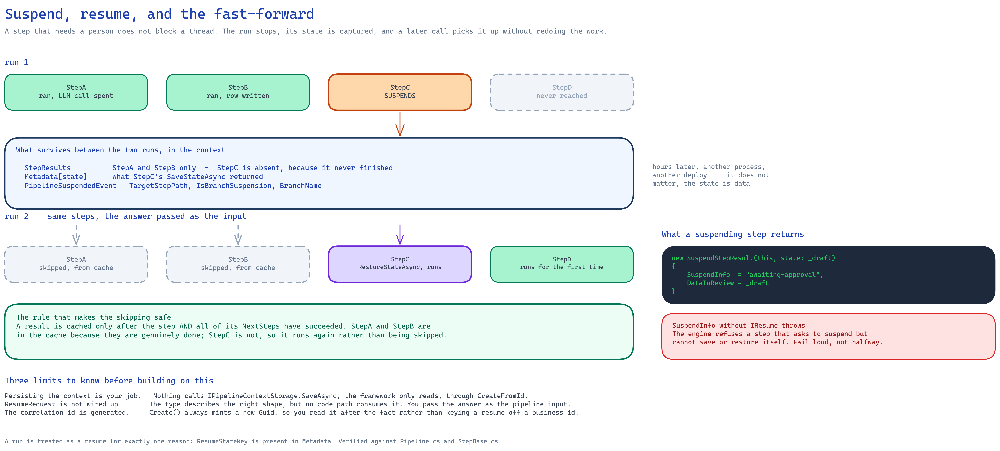

# Human-in-the-Loop: suspending and resuming a pipeline

Some steps cannot finish on their own. A step may need a person to approve a draft, choose between
options, or supply a value the model could not infer; or the flow is called by another system that
has to answer a question before it can go on. Rather than blocking a thread until that happens —
which does not survive a restart, a deploy, or a caller who answers tomorrow — a step can
**suspend** the pipeline. The run stops, its state is captured, and a later call resumes it,
skipping everything that already succeeded.

## The shape of it



<!-- Source: docs/assets/diagrams/suspend-resume-fastforward.excalidraw -->

The fast-forward is not an optimisation detail — it is the point. Steps that already called an LLM
or wrote to a database must not run twice because someone took an hour to click a button.

What makes it correct is the caching rule: a result is written **only after the step and all of its
`NextSteps` have succeeded**. `StepA` and `StepB` are genuinely finished and are served from the
cache. The one exception is the suspending step itself: `StepC`'s *suspended* result is stored under
its key, and finding it there with `SuspendInfo` set is what makes the resume restore `StepC`'s
state and run it again instead of serving it.

## In YAML: `SuspendStep`

A declarative pipeline asks for more information with `type: SuspendStep`. It does not care whether
a person or another system answers: it suspends, and when the run is resumed it returns the
response as its own result, so the next step reads it with `{{input...}}`.

```yaml
name: approval
steps:
  - id: draft
    type: LlmStep
    outputSchema: Draft
    userPrompt: "Draft the order {{input.orderId}}"
  - id: ask
    type: SuspendStep
    dependsOn: [draft]
    message: "Approve order {{input.orderId}}?"   # template text over { input, context }
    dataToReview: input                            # a path keeps its JSON value; default: the whole input
    marker: awaiting-approval                      # SuspendInfo; default awaiting-input
    outputSchema: Approval                         # optional: the response must match it
  - id: apply
    type: LlmStep
    dependsOn: [ask]
    userPrompt: "Approved: {{input.approved}}. Comment: {{input.comment}}"
```

| Key | Meaning |
|---|---|
| `message` | Question or reason shown to whoever resumes. Template text over `{ input, context }`; text without `{{` is literal |
| `dataToReview` | What to look at. A path (`input.order`, `context.draft`, also as `{{ input.order }}`) keeps the JSON value it reaches; any other template text is rendered to a string. Not set: the whole input value |
| `marker` | The result's `SuspendInfo`. Default `awaiting-input`; an empty value fails when the pipeline is built |
| `outputSchema` | Optional schema the response must match (`inputSchema` is accepted and ignored) |

The first run returns an `AwaitingInputResult` (a `SuspendStepResult`): `SuspendInfo` is the
marker, `Message` (also its `Value`) the rendered message, `DataToReview` the value to review.
Resuming takes the pipeline input as the response: a `JToken` or an object stays JSON, a string is
text (`{{input}}`). A response that does not match `outputSchema` does not fail the run: the step
suspends again with the validation errors in `RejectionReason`, and the caller can answer again.

```csharp
var context = provider.GetRequiredService<PipelineContextFactory>().NewContext();
var first = await pipeline.ExecuteAsync(new JObject { ["orderId"] = 7 }, context);

if (first is AwaitingInputResult waiting)                // or first.SuspendInfo != null
{
    // waiting.Message, waiting.DataToReview, PipelineResume.GetSuspendedStepPath(context) == "ask"
    var resumed = await pipeline.ExecuteAsync(
        new JObject { ["approved"] = true, ["comment"] = "ok" }, context);
}
```

`YamlPipeline.ExecuteAsync` recognises the resume (`PipelineResume.IsSuspended(context)`) and does
not check the response against the first step's `inputSchema`. The step keeps nothing in its fields
(the response reaches it through the context), so one pipeline instance can serve concurrent runs.

It works at the root and inside `GroupStep`, `LoopStep` and `SwitchStep`. The cache path of the
suspended step, which `PipelineResume.GetSuspendedStepPath(context)` returns and the
`PipelineSuspendedEvent` carries as `TargetStepPath`, is the step id prefixed by its containers:
`ask`, `grp/ask`, `loop/Iter_2/ask` (the iteration that suspended), `route/route[a]/ask` (switch
`route`, case `a`). Not inside a `ParallelStep` branch: see [Known limitations](#known-limitations).

## Suspending from code

A step suspends by returning a result whose `SuspendInfo` is set. `SuspendStepResult` is the
ready-made one:

```csharp
protected override Task<IStepResult> ExecuteAsync(
    IStepResult input, PipelineContext context, int attempt,
    IStepResult? lastStepResult, CancellationToken cancellationToken)
{
    if (!PipelineResume.TryGetResumeResponse(context, out var response))
    {
        return Task.FromResult<IStepResult>(new SuspendStepResult(this, state: _draft)
        {
            SuspendInfo = "awaiting-approval",   // any non-null marker
            DataToReview = _draft                // what the person should look at
        });
    }

    return Task.FromResult<IStepResult>(new StepResult<string>(this, response!.Value as string));
}
```

`DataToReview` is what you show the person. The `state` constructor argument is only the result's
`Value`; what the step gets back on resume is whatever its `IResume.SaveStateAsync` returns, which
the pipeline calls at suspension time. `PipelineResume.TryGetResumeResponse` is true only while the
pipeline re-runs the step it is resuming, and gives the input the resumed run was started with.

## Saving and restoring step state

`StepBase` implements `IResume` against itself, so a step overrides two hooks:

```csharp
protected override Task<object?> SaveStateAsync()
    => Task.FromResult<object?>(_draft);

protected override Task RestoreStateAsync(object? state, object? hitlResponse)
{
    _draft  = state as string;
    _answer = hitlResponse as string;   // what the human supplied
    return Task.CompletedTask;
}
```

These hooks get no `PipelineContext`, so whatever they keep lives in the step's fields; prefer
`PipelineResume.TryGetResumeResponse` for the response when one instance serves several runs. The
saved state is kept in `Metadata`, so with a persistent storage it must be data that survives JSON
(see [Persisting a suspended run](#persisting-a-suspended-run)).

`StatelessTemplateLlmStep` already saves its whole conversation this way, so an LLM step that
suspends mid-tool-call resumes with its history intact (with one caveat for shared instances, see
[Known limitations](#known-limitations)).

## What the pipeline does

On suspension it calls `step.Resume.SaveStateAsync`, stores the returned state and the step's cache
path in `Metadata` under keys scoped by `CorrelationId` (`PipelineResume` reads them), emits a
`PipelineSuspendedEvent` carrying `TargetStepPath`, `IsBranchSuspension` and `BranchName`, caches
the suspended result under the step's path, and returns it up the chain. A container that runs its
children itself (`LoopStep`) and hands back a suspension one of them already registered is not
registered again: it stays uncached and re-runs on resume, which takes it back to the child. A step
whose `Resume` is null (one that implements `IStep` directly) makes it throw
`InvalidOperationException`.

Crucially, results are cached **only after a step and all its `NextSteps` have succeeded**. That is
what makes the fast-forward correct: anything in the cache is genuinely finished, and anything
half-done runs again.

## Resuming

When a run ends suspended, the pipeline itself saves the context in the registered
`IPipelineContextStorage`, keyed by `CorrelationId`, before it returns (if the save fails the exception
propagates out of `ExecuteAsync`; with no storage registered it only logs a warning), and deletes it when a
resumed run completes without error (a failed resume keeps it). Resuming is then two calls:

```csharp
// 1. Later — in this process or another one — load it back by the same id.
var resumed = await storage.LoadAsync(correlationId, ct)      // or PipelineContextFactory.CreateFromId(correlationId)
              ?? throw new KeyNotFoundException(correlationId);

// 2. Run the same steps again, passing the answer as the input.
var result = await yamlPipeline.ExecuteAsync(new JObject { ["approved"] = true }, resumed);
// code pipelines: pipeline.ExecuteAsync("Approval", steps, new StepResult<string>(new EmptyStep("Human"), "approved"), resumed)
```

The pipeline recognises a resume by the saved state already present in the context; the input
must then be an `IStepResult` (`YamlPipeline` wraps any other value in a `JsonStepResult`). It
replays the completed steps from cache, reaches the suspended one, calls its `RestoreStateAsync`
with the saved state and your input's `Value`, runs it again (with the input visible through
`PipelineResume.TryGetResumeResponse`) and carries on.

## Persisting a suspended run

Which storage `IPipelineContextStorage` resolves to is configuration
(`AITaskAgent:Storage:Context`, see [Configuration](configuration.md#storage-aitaskagentstorage)):

| `Type` | Implementation | Survives a restart |
|---|---|---|
| `memory` (default) | `InMemoryPipelineContextStorage`: keeps the live object | No |
| `file` | `FilePipelineContextStorage`: one JSON file per `CorrelationId` in `Directory` | Yes |

`FilePipelineContextStorage` writes atomically (temporary file in the same folder, then replace),
names files `ctx-<id>.json` with every character outside `[a-z0-9_]` escaped (no `..`, separators,
reserved names or case collisions; long ids are hashed), and checks on load that the file holds the
requested id. Loading builds a fresh context with the process's `PipelineContextFactory` — so it
has that process's event channel and services — and writes the stored data onto it.

The format is `PipelineContextSerializer`'s, and a storage of your own (database, Redis) can reuse
it with `Serialize(context)` / `Deserialize(json, freshContext)`. What it keeps is what the
pipeline needs to resume with fast-forward:

- `CorrelationId` and the context's type (an `LlmPipelineContext` can only be restored into one).
- `Metadata`, including the saved step state and the suspended path.
- `StepResults`: the cached results and the suspended one. A result must derive from `StepResult`
  and have a constructor taking the step plus optional parameters; it is rebuilt with its value,
  `SuspendInfo`, error message, `StepName`, `StepType` and every property that has a setter. The
  framework's results qualify: `StepResult<T>`, `JsonStepResult`, `SuspendStepResult`,
  `AwaitingInputResult`, `BreakStepResult`, `ParallelResult` (with its branches),
  `LlmStringStepResult` and `LlmJsonStepResult`.
- For an `LlmPipelineContext`, the conversation: id, maximum tokens, messages, metadata and timestamps.

Every value is stored with its runtime type and read back as that type with Newtonsoft.Json
(no `TypeNameHandling`). JSON (`JToken`), strings, numbers, booleans, dates, enums and plain data
objects and collections work. **A value that cannot be stored fails the save** with
`NotSupportedException` naming the entry (`Metadata['x']`, `StepResults['a/b'].Value`), and the
previous file of that id is left untouched: the serializer reads each value back and refuses one
that comes back different (get-only or private-setter properties, a constructor that drops data, a
reference loop), as well as live objects (delegates, steps, services, streams, tasks, contexts).

Not kept, by design: the event channel, service provider and runtime (the resuming process supplies
them); the exception behind a result's error (only its message); properties of type `JsonSchema` (a
`JsonStepResult`'s schema: cached results are not validated again); the `NextSteps` of cached
results; conversation bookmarks and the LLM steps' per-invocation `StepState`. JSON dates come back
as ISO strings. The documents name .NET types, so only load what your application wrote.

## Starting from an existing conversation

A run can start on a context built beforehand, with metadata and the conversation of a previous
session:

```csharp
var context = await LlmPipelineContextFactory.CreateForConversationAsync(provider, conversationId);
context.Metadata["customer"] = "ACME";                    // {{context.customer}} in prompts
var result = await yamlPipeline.ExecuteAsync(input, context);
await provider.GetRequiredService<IConversationStorage>().SaveConversationAsync(context.Conversation);
```

It loads the conversation from the registered `IConversationStorage` (or starts an empty one with
that id) and the LLM steps see its messages as history. See [Conversation Storage](conversation-storage.md).

## Observing it

| Event | When |
|---|---|
| `PipelineSuspendedEvent` | a step asked for input; carries the step path and, for parallel work, the branch |

`PipelineResumingEvent`, `PipelineResumedEvent` and `StepCachedHitEvent` are defined in
`AITaskAgent.Observability.Events`, but the framework does not emit them today: a resume and a
cache hit only show up in the debug log.

Subscribing with the run's `CorrelationId` gives you just that run's events, which is usually what a
UI wants.

## Suspending inside branches and loops

`GroupStep` and `SwitchStep` schedule their children as `NextSteps`, so a suspension inside them
returns up the chain without caching the container, and the resume re-runs the container (cheap)
and fast-forwards to the suspended child. `LoopStep` keys its cache per iteration
(`loop/Iter_n/...`), so resuming replays the finished iterations from cache and re-enters the one
that suspended rather than restarting the loop; a later iteration can suspend again under its own path.

The pipeline marks a suspension raised inside a `ParallelStep` branch (`IsBranchSuspension`,
`BranchName`), and each branch runs with its own conversation and step path, so one branch waiting
for a person does not disturb the others. But `ParallelStep` does not carry the branch's
`SuspendInfo` into its `ParallelResult`, so the pipeline does **not** stop there: it continues after
the parallel step as if the branch had finished.

## Known limitations

Worth knowing before you build on this:

- **A suspended `ParallelStep` branch is lost.** `ParallelStep` only copies branch errors into its
  `ParallelResult` and never sets `SuspendInfo`, so the pipeline treats the parallel step as
  finished, runs the next step and caches it as completed. On resume the parallel step is served
  from that cache and the suspended branch never gets its `RestoreStateAsync`. The saved state key
  is per `CorrelationId`, not per step, so a second suspension in the same run would overwrite it
  anyway. Do not suspend (`SuspendStep` included) inside a `ParallelStep` branch until this is fixed.
- **`StatelessTemplateLlmStep` keeps its suspension state in instance fields.** The conversation a
  call uses is stored per invocation in the context, but the copy that `SaveStateAsync` returns and
  the one `RestoreStateAsync` receives live in fields of the step object, because those hooks get
  no `PipelineContext`. One instance shared by concurrent runs (for example a singleton step) can
  therefore save, or resume with, another run's conversation. Use one instance per run when the
  step can suspend. With a persistent storage, the state it saves must also pass the JSON check above.
- **Storage lifecycle belongs to the pipeline.** `Pipeline.ExecuteAsync`, after the step loop, saves a run that
  ends suspended and deletes the saved context when a resumed run completes without error. A run that fails
  keeps its saved context; deleting it then is up to the host.
- **`ResumeRequest` is not wired up.** The type exists and describes the right shape
  (`TargetStepPath`, `UserInput`, `Metadata`), but no code path consumes it. Resuming today means
  passing the answer as the pipeline input, as shown above.
- **The resumed step's input is the cached one, not the original.** If the suspending step is the
  very first step of the pipeline, there is nothing cached before it and on resume it receives the
  response as its input (`SuspendStep` then renders `message`/`dataToReview` from it if it suspends again).
- **The factory does not take a correlation id.** `PipelineContextFactory.Create` always mints a
  new `Guid`. `PipelineContext` is a record with an `init` `CorrelationId`, so to key a run off a
  business id use `PipelineContextFactory.Create() with { CorrelationId = orderId }` or build the
  context with `new PipelineContext(...) { CorrelationId = orderId }` (`new LlmPipelineContext(...)` if the
  pipeline has LLM steps).

## See also

- [Event System](event-system.md) — subscribing by correlation id
- [Steps](steps.md) — `LoopStep`, `BreakStep`, and the step lifecycle
- [YAML pipelines](yaml-pipelines.md) — `SuspendStep` among the declarative steps
- [Configuration](configuration.md#storage-aitaskagentstorage) — choosing the storages
