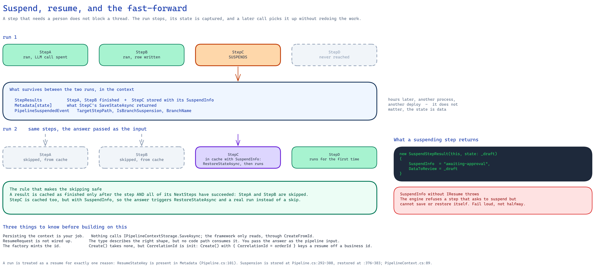

# Human-in-the-Loop: suspending and resuming a pipeline

Some steps cannot finish on their own. A step may need a person to approve a draft, choose between
options, or supply a value the model could not infer. Rather than blocking a thread until that
happens — which does not survive a restart, a deploy, or a user who answers tomorrow — a step can
**suspend** the pipeline. The run stops, its state is captured, and a later call resumes it,
skipping everything that already succeeded.

## The shape of it



<!-- Source: docs/assets/diagrams/suspend-resume-fastforward.excalidraw -->

The fast-forward is not an optimisation detail — it is the point. Steps that already called an LLM
or wrote to a database must not run twice because someone took an hour to click a button.

What makes it correct is the caching rule: a result is written **only after the step and all of its
`NextSteps` have succeeded**. `StepA` and `StepB` are genuinely finished and are served from the
cache. The one exception is the suspending step itself: `StepC`'s *suspended* result is stored under
its key, and finding it there with `SuspendInfo` set is what makes the resume restore `StepC`'s
state and run it again instead of serving it.

## Suspending

A step suspends by returning a result whose `SuspendInfo` is set. `SuspendStepResult` is the
ready-made one:

```csharp
protected override Task<IStepResult> ExecuteAsync(
    IStepResult input, PipelineContext context, int attempt,
    IStepResult? lastStepResult, CancellationToken cancellationToken)
{
    if (_answer is null)
    {
        return Task.FromResult<IStepResult>(new SuspendStepResult(this, state: _draft)
        {
            SuspendInfo = "awaiting-approval",   // any non-null marker
            DataToReview = _draft                // what the person should look at
        });
    }

    return Task.FromResult<IStepResult>(new StepResult<string>(this, _answer));
}
```

`DataToReview` is what you show the person. The `state` constructor argument is only the result's
`Value`; what the step gets back on resume is whatever its `IResume.SaveStateAsync` returns, which
the pipeline calls at suspension time.

## Saving and restoring step state

`StepBase` implements `IResume` against itself, so a step overrides two hooks:

```csharp
protected override Task<object?> SaveStateAsync()
    => Task.FromResult<object?>(_draft);

protected override Task RestoreStateAsync(object? state, object? hitlResponse)
{
    _draft  = state as string;
    _answer = hitlResponse as string;   // what the human supplied
    return Task.CompletedTask;
}
```

`StatelessTemplateLlmStep` already saves its whole conversation this way, so an LLM step that
suspends mid-tool-call resumes with its history intact (with one caveat for shared instances, see
[Known limitations](#known-limitations)).

## What the pipeline does

On suspension it calls `step.Resume.SaveStateAsync`, stores the returned state in `Metadata` under
a key scoped by `CorrelationId`, emits a `PipelineSuspendedEvent` carrying `TargetStepPath`,
`IsBranchSuspension` and `BranchName`, caches the suspended result under the step's path, and
returns it up the chain. A step whose `Resume` is null (one that implements `IStep` directly) makes
it throw `InvalidOperationException`.

Crucially, results are cached **only after a step and all its `NextSteps` have succeeded**. That is
what makes the fast-forward correct: anything in the cache is genuinely finished, and anything
half-done runs again.

## Resuming

Resuming is three calls, and the first one is yours:

```csharp
// 1. When the pipeline suspends, persist the context. The framework does NOT do this for you.
var storage = provider.GetRequiredService<IPipelineContextStorage>();
await storage.SaveAsync(context.CorrelationId, context, ct);

// 2. Later, load it back by the same id.
var resumed = await PipelineContextFactory.CreateFromId(correlationId);

// 3. Run the same steps again, passing the human's answer as the input.
var result = await pipeline.ExecuteAsync(
    name: "Approval",
    steps: steps,
    input: new StepResult<string>(new EmptyStep("Human"), "approved"),
    context: resumed);
```

The pipeline recognises a resume by the saved state already present in the context; the input
must then be an `IStepResult`. It replays the completed steps from cache, reaches the suspended
one, calls its `RestoreStateAsync` with the saved state and your input's `Value`, runs it again and
carries on.

`InMemoryPipelineContextStorage` ships with the framework and is fine for a single process. Anything
that must survive a restart needs a real `IPipelineContextStorage` — Redis, a database, a file.

## Observing it

| Event | When |
|---|---|
| `PipelineSuspendedEvent` | a step asked for input; carries the step path and, for parallel work, the branch |

`PipelineResumingEvent`, `PipelineResumedEvent` and `StepCachedHitEvent` are defined in
`AITaskAgent.Observability.Events`, but the framework does not emit them today: a resume and a
cache hit only show up in the debug log.

Subscribing with the run's `CorrelationId` gives you just that run's events, which is usually what a
UI wants.

## Suspending inside branches and loops

The pipeline marks a suspension raised inside a `ParallelStep` branch (`IsBranchSuspension`,
`BranchName`), and each branch runs with its own conversation and step path, so one branch waiting
for a person does not disturb the others. But `ParallelStep` does not carry the branch's
`SuspendInfo` into its `ParallelResult`, so the pipeline does **not** stop there: it continues after
the parallel step as if the branch had finished. `LoopStep` keys its cache per iteration, so resuming re-enters the iteration
that suspended rather than restarting the loop.

## Known limitations

Worth knowing before you build on this:

- **A suspended `ParallelStep` branch is lost.** `ParallelStep` only copies branch errors into its
  `ParallelResult` and never sets `SuspendInfo`, so the pipeline treats the parallel step as
  finished, runs the next step and caches it as completed. On resume the parallel step is served
  from that cache and the suspended branch never gets its `RestoreStateAsync`. The saved state key
  is per `CorrelationId`, not per step, so a second suspension in the same run would overwrite it
  anyway. Do not suspend inside a `ParallelStep` branch until this is fixed.
- **`StatelessTemplateLlmStep` keeps its suspension state in instance fields.** The conversation a
  call uses is stored per invocation in the context, but the copy that `SaveStateAsync` returns and
  the one `RestoreStateAsync` receives live in fields of the step object, because those hooks get
  no `PipelineContext`. One instance shared by concurrent runs (for example a singleton step) can
  therefore save, or resume with, another run's conversation. Use one instance per run when the
  step can suspend.

- **Persisting the context is your job.** Nothing in the framework calls
  `IPipelineContextStorage.SaveAsync`; it only reads through `PipelineContextFactory.CreateFromId`.
- **`ResumeRequest` is not wired up.** The type exists and describes the right shape
  (`TargetStepPath`, `UserInput`, `Metadata`), but no code path consumes it. Resuming today means
  passing the answer as the pipeline input, as shown above.
- **The factory does not take a correlation id.** `PipelineContextFactory.Create` always mints a
  new `Guid`. `PipelineContext` is a record with an `init` `CorrelationId`, so to key a run off a
  business id use `PipelineContextFactory.Create() with { CorrelationId = orderId }` or build the
  context with `new PipelineContext(...) { CorrelationId = orderId }`.

## See also

- [Event System](event-system.md) — subscribing by correlation id
- [Steps](steps.md) — `LoopStep`, `BreakStep`, and the step lifecycle
