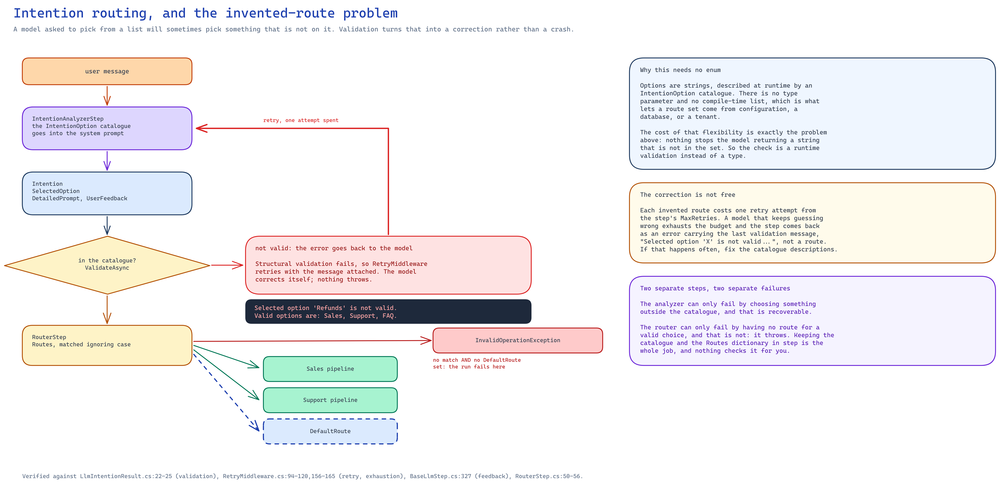

# Intention Routing

## Overview

AITaskAgent includes LLM-powered intent classification and routing, enabling intelligent workflows
based on what the user actually asked for.

The model is **string-based and runtime-defined**. There is no `IntentionRouterStep<TEnum>`, no
`IntentionStepResult<TEnum>` and no generic `Intention<TEnum>`: options are supplied as a list of
`IntentionOption` values, and routes are keyed by their `Id`.

## Components

| Component | Purpose |
|-----------|---------|
| `IntentionOption` | One selectable option: `Id` + `Description` |
| `IntentionAnalyzerStep<TIn>` | Classifies input into one of the options using the LLM |
| `LlmIntentionResult` | Result of the analyzer; implements `IRouterResult` and validates the choice |
| `Intention` | The payload the model produces |
| `RouterStep` | Routes to a step keyed by the selected option string |
| `IRouterOptions` | Contract exposing the valid option names (`IList<string> Options`) |
| `IRouterResult` | Contract exposing `string SelectedOption` |

---

## IntentionAnalyzerStep

```csharp
public class IntentionAnalyzerStep<TIn> : TemplateLlmStep<TIn, LlmIntentionResult>, IRouterOptions
    where TIn : IStepResult
```

### Constructor

```csharp
public IntentionAnalyzerStep(
    string name,
    LlmRole role,
    IList<IntentionOption> options,
    string? promptTemplateName = null,
    string? systemPromptTemplateName = null,
    ITemplateProvider? templateProvider = null,
    IList<string>? tools = null)
```

| Parameter | Notes |
|-----------|-------|
| `role` | The `LlmRole` that drives provider, model, inference and default system prompt |
| `options` | **Required and non-empty**; throws `ArgumentException` if empty |
| `promptTemplateName` | Template text, or a template name when `templateProvider` is supplied. Defaults to `{{ input }}` |
| `systemPromptTemplateName` | Appended after `role.SystemPrompt`. Defaults to `"Analyze and clarify the user's intention."` |
| `tools` | Tool names resolved through `AvailableTools.Instance` |

### The option catalogue is always injected

The step builds the catalogue itself and appends it to whatever system prompt is in force:

```
{role.SystemPrompt}

{systemPromptTemplateName ?? "Analyze and clarify the user's intention."}

Choose one of these options:
- **Sales**: User wants to buy something
- **Support**: User needs help with an issue
- **FAQ**: User is asking a general question
```

The catalogue lives in a separate template fragment (rendered from the step variable
`{{ context.options }}`) rather than inside the default system prompt. That matters: supplying your
own system prompt replaces the default text but **never** removes the catalogue, so the model is
never asked to pick from options it has not been shown.

### Usage

```csharp
using AITaskAgent.LLM.Results;
using AITaskAgent.LLM.Steps;

var options = new List<IntentionOption>
{
    new() { Id = "Sales",   Description = "User wants to buy something" },
    new() { Id = "Support", Description = "User needs help with an issue" },
    new() { Id = "FAQ",     Description = "User is asking a general question" }
};

var analyzer = new IntentionAnalyzerStep<LlmStringStepResult>(
    name: "AnalyzeIntent",
    role: env.Roles["router"],
    options: options,
    systemPromptTemplateName: "You are an expert at understanding user intentions.");

var result = await pipeline.ExecuteAsync(
    name: "IntentAnalysis",
    steps: [analyzer],
    input: "I want to return my order");

if (result is LlmIntentionResult { Value: Intention intention })
{
    Console.WriteLine(intention.SelectedOption);   // Support
    Console.WriteLine(intention.SelectionReason);
    Console.WriteLine(intention.DetailedPrompt);
}
```

---

## The `Intention` payload

```csharp
public sealed class Intention
{
    public string SelectedOption { get; init; }              // exactly one option Id
    public string SelectionReason { get; init; }             // why the model chose it
    public UserFeedbackInfo UserFeedback { get; init; }      // what to show the user
    public string DetailedPrompt { get; init; }              // expanded prompt for the next step
    public Dictionary<string, object> ExtraInformation { get; init; }
}

public sealed class UserFeedbackInfo
{
    public string Message { get; init; }
    public bool NeedMoreInfo { get; init; }
    public List<Question>? Questions { get; init; }
    public bool AllowFreeText { get; init; } = true;
}

public sealed class Question
{
    public string? ClarificationQuestion { get; init; }
    public bool Multiple { get; init; }
    public List<UserChoiceChip>? ChoiceChips { get; init; }
}

public sealed class UserChoiceChip
{
    public string Id { get; init; }
    public string Label { get; init; }
    public string? Description { get; init; }
}
```

`Question` and `UserChoiceChip` exist so a conversational UI can render a single closed
clarification question with selectable chips instead of a free-text prompt. When
`UserFeedback.NeedMoreInfo` is true the analyzer serializes the feedback into the conversation as
an assistant message, so the next turn continues from the clarification. In every successful case
it first removes the raw JSON assistant reply that `BaseLlmStep` recorded, so without
`NeedMoreInfo` the turn leaves only the user message in the conversation.

Every property carries a `[Description]` attribute; those descriptions are what the model sees in
the generated JSON schema, so they are part of the prompt contract, not just documentation.

---

## Self-correcting validation

`LlmIntentionResult` overrides `ValidateAsync` and checks the chosen option against the catalogue
exposed by the step through `IRouterOptions`:

```csharp
if (_step is IRouterOptions options &&
    !options.Options.Any(o => intention.SelectedOption.Equals(o, StringComparison.OrdinalIgnoreCase)))
{
    return (false, $"Selected option '{intention.SelectedOption}' is not valid. " +
                   $"Valid options are: {string.Join(", ", options.Options)}.");
}
```

This is a structural validation, so `RetryMiddleware` handles it: the error text is fed back into
the conversation and the step is retried (up to `MaxRetries`). The model sees exactly which option
names are legal and normally corrects itself on the next attempt — a hallucinated option never
reaches the router. If every attempt invents an option, the step ends with that last validation
message as its error and the pipeline stops.

A `StepValidationEvent` with `ValidationType = "structural"` is emitted for each failed attempt.

---

## RouterStep

```csharp
public sealed class RouterStep(
    string name,
    Dictionary<string, IStep> routes,
    IStep? defaultRoute = null)
    : SwitchStep<IRouterResult>, IRouterOptions
```

- Routes are keyed by **string**. The dictionary is re-wrapped with
  `StringComparer.OrdinalIgnoreCase`, because the key comes from a language model and casing cannot
  be relied on.
- `Routes` is the live dictionary the router reads, so mutating it changes the available routes.
- If no route matches and `DefaultRoute` is null, the step throws
  `InvalidOperationException: No route for intention X and no default route`.
- The selected step is appended to `input.NextSteps`, so the pipeline runs it next and then resumes
  the parent flow. The pipeline result is then the routed step's result, not the analyzer's.

### Usage

```csharp
var router = new RouterStep(
    name: "RouteIntent",
    routes: new Dictionary<string, IStep>
    {
        ["Sales"]   = new GroupStep("SalesFlow",   [salesStep1, salesStep2]),
        ["Support"] = new GroupStep("SupportFlow", [supportStep]),
        ["FAQ"]     = faqStep
    },
    defaultRoute: fallbackStep);
```

### Complete pipeline

```csharp
var result = await pipeline.ExecuteAsync(
    name: "IntentionBasedRouting",
    steps: [
        new IntentionAnalyzerStep<LlmStringStepResult>("AnalyzeIntent", role, options),
        router
    ],
    input: "How do I return an item?");
```



<!-- Source: docs/assets/diagrams/intention-routing-selfcorrection.excalidraw -->

Options are plain strings, not an enum: the catalog lives in `IntentionOption`, and an unknown
option is a *validation* failure, so the retry loop hands the error back to the model instead of
failing the step.

> [!TIP]
> Keep the `IntentionOption.Id` values and the `RouterStep` keys in sync. Deriving both from the
> same constant list is the simplest way to guarantee the analyzer can only produce names the
> router knows.

---

## Events

`RouterStep` inherits event emission from `SwitchStep`, producing a `StepRoutingEvent`:

```csharp
using var subscription = eventChannel.Subscribe(async (evt, ct) =>
{
    if (evt is StepRoutingEvent routing)
    {
        Console.WriteLine($"Routed to: {routing.SelectedRoute}");
        Console.WriteLine($"Reason: {routing.RoutingReason}");
        // "Selected options from router RouteIntent: Support"
    }
});
```

The analyzer additionally emits an `LlmResponseEvent` carrying `UserFeedback.Message`, so a UI can
show the acknowledgement text without waiting for the routed branch to finish.

---

## Customizing the prompt

`IntentionAnalyzerStep<TIn>` derives from `TemplateLlmStep`, so the prompt is a template. The model
exposed to it is:

- `{{ input }}` — the step input's `Value`
- `{{ context.<key> }}` — pipeline metadata merged with step variables (step variables win)

```csharp
var analyzer = new IntentionAnalyzerStep<LlmStringStepResult>(
    name: "AnalyzeIntent",
    role: role,
    options: options,
    promptTemplateName: "User said: {{ input }}\nCustomer tier: {{ context.customertype }}");

analyzer.SetVariable("customerType", "premium");
```

With an `ITemplateProvider`, `promptTemplateName` is treated as a template **name** resolved by the
provider instead of inline text (when it is omitted, the default `{{ input }}` is looked up as a
name, and not being found, is sent unrendered — pass a name explicitly). `systemPromptTemplateName`
is always inline text: the analyzer composes the system prompt itself and renders it without the
provider. See [LLM Steps](llm-steps.md) for the template syntax.
