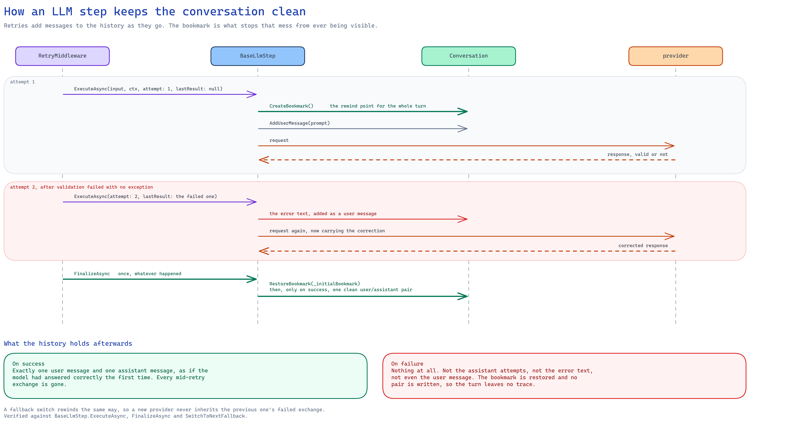

# LLM Steps

## Overview

LLM steps interact with Large Language Models. They support:
- Automatic retry with conversation bookmarks
- Tool execution
- JSON response parsing
- Streaming
- Provider fallback

Every LLM step is configured by an `LlmRole`, not by a service instance plus a profile. The role
carries the provider (and therefore the `ILlmService`), the model, the default system prompt, the
inference settings and the fallback chain. See [Configuration](configuration.md).

## BaseLlmStep

```csharp
public class BaseLlmStep<TIn, TOut>(
    string name,
    LlmRole role,
    string prompt,
    string? systemPrompt = null)
    where TIn : IStepResult
    where TOut : ILlmStepResult
```

```csharp
var role = env.Roles["default"];

var llmStep = new BaseLlmStep<LlmStringStepResult, LlmStringStepResult>(
    name: "AnalyzeText",
    role: role,
    prompt: "Analyze the sentiment of the last user message.",
    systemPrompt: "You are an analyst.")
{
    Tools = [new SearchTool(), new CalculatorTool()],
    MaxToolIterations = 5,
    MaxRetries = 3
};
```

### Constructor Parameters

| Parameter | Type | Description |
|-----------|------|-------------|
| `name` | `string` | Step identifier; also the key under which the result is cached |
| `role` | `LlmRole` | Provider, model, inference settings, fallbacks, default system prompt |
| `prompt` | `string` | User message, sent **verbatim**: `BaseLlmStep` renders no template, so `{{ input }}` would reach the model literally. Use `TemplateLlmStep` (or override `BuildUserMessageAsync`) to render one |
| `systemPrompt` | `string?` | Overrides `role.SystemPrompt` when supplied |

### Notable properties

| Property | Default | Description |
|----------|---------|-------------|
| `Tools` | `role.Tools ?? []` | Tools offered to the model |
| `MaxToolIterations` | `5` | Tool-calling round trips before aborting |
| `TagHandlers` | `[]` | `ITagHandler` instances for in-text action tags (e.g. `<write_file>`); scanned in every response, streamed or not, reasoning or content |
| `SystemPrompt` / `Prompt` | from ctor | Mutable after construction |
| `MaxRetries` | `3` | Inherited from `StepBase` |

## TemplateLlmStep

Renders prompts through a template engine, with step-scoped variables.

```csharp
public TemplateLlmStep(
    string name,
    LlmRole role,
    ITemplateProvider? templateProvider = null,
    IList<string>? tools = null,
    string? promtTemplateString = null,
    string? systemTemplateString = null)
```

```csharp
var step = new TemplateLlmStep<LlmStringStepResult, LlmStringStepResult>(
    name: "TemplatedAnalysis",
    role: role,
    tools: ["web_search"],
    promtTemplateString: "Analyze the following data: {{ input }}\nFocus on: {{ context.focus }}",
    systemTemplateString: "You are a data analyst.");

step.SetVariable("focus", "trends");
```

When `promtTemplateString` / `systemTemplateString` are omitted they default to the template
**names** `"{name}_prompt.md"` and `role.SystemPrompt ?? "{name}_system.md"`, resolved by the
provider. Without a `templateProvider` those defaults are rendered as inline text, so the model
receives the literal string `"{name}_prompt.md"`: pass the template strings explicitly in that case.
The `tools` argument is a list of tool **names**, resolved through `AvailableTools.Instance`; it
replaces `role.Tools` (no names means no tools).

### The template model

Prompts are rendered against a two-property model:

| Expression | Resolves to |
|------------|-------------|
| `{{ input }}` | The step input's `Value` |
| `{{ input.someproperty }}` | A property of that value |
| `{{ context.mykey }}` | Pipeline `Metadata` merged with step variables (variables win) |

Keys are matched case-insensitively. Formatters are **pipes**:

```
{{ input | json }}
{{ input.items | yaml }}
{{ context.name | upcase }}
{{ context.total | default "0" }}
{{ context.total ?? 0 }}
```

`default` only replaces a value that exists but is empty; a key that does not resolve at all renders
empty unless you use the `?? fallback` form.

Available filters: `json`, `yaml`, `upcase`, `downcase`, `capitalize`, `strip`, `date`, `default`,
`csv`, `size`. The engine also supports `{{ include 'path' }}`, the legacy `@[path]` include form,
and `{{# comments #}}`.

> [!IMPORTANT]
> The old `{{X:format}}` formatter syntax is gone — formatters are pipes. So are the old type
> names: the engine interface is `ITemplateRendered` (implementation `TinyTemplateRendered`), not
> `ITemplateEngine` / `JsonTemplateEngine`. `AddAITaskAgent()` registers
> `ITemplateRendered → TinyTemplateRendered`.

### FileTemplateProvider

```csharp
public sealed class FileTemplateProvider(
    string folderPath,
    ITemplateRendered? templateEngine = null,   // falls back to TinyTemplateRendered
    bool enableCache = true,
    TimeSpan? ttl = null,                       // default 5 minutes
    long? maxCacheSizeBytes = null,             // default 1 MB
    bool validateTemplates = false)             // throw when a template is missing
    : ITemplateProvider
```

Templates are `.md` files under `folderPath`. The provider **appends `.md`** to the name it is
given: `GetTemplate("Analyze_prompt")` reads `Analyze_prompt.md`. Note that `TemplateLlmStep`'s
default names already end in `.md` (`"{name}_prompt.md"`), so with this provider they resolve to
`{name}_prompt.md.md`. Paths that escape `folderPath` are rejected.

The provider keeps an LRU + TTL + size-bounded cache. When the file does not exist `Render` returns
`null`, and `TemplateLlmStep` then uses the name it passed **as is, unrendered**: an inline template
string passed together with a provider reaches the model with its `{{ }}` placeholders intact. Set
`validateTemplates: true` to make a missing template throw `FileNotFoundException` instead.

With a provider, pass template **names** (`templateProvider: new FileTemplateProvider("./templates")`,
`promtTemplateString: "Analyze_prompt"`); without one, the strings are the templates themselves.

`StatelessTemplateLlmStep` is the same thing on a throwaway conversation: it does not append to the
pipeline conversation, which makes it the right choice for classifiers and side queries.

## Retry with Bookmarks

When validation fails, the step:

1. Creates a conversation bookmark before the first attempt
2. On failure, adds the error message to the conversation
3. The LLM sees the error and tries to self-correct
4. On success, restores the bookmark and appends only the clean response



<!-- Source: docs/assets/diagrams/llm-step-conversation-lifecycle.excalidraw -->

Every attempt appends to the conversation so role alternation stays valid mid-retry;
`FinalizeAsync` rewinds to the bookmark and rewrites the turn, so the mid-retry noise never
survives. There is no wait between attempts — no backoff.

Exceptions are **not** retried — they are treated as system failures. Only error results without an
`OriginalException` (invalid JSON, failed validation) trigger another attempt. See
[Resilience](resilience.md).

## Provider Fallback

`BaseLlmStep` implements `IFallbackable`. When an attempt fails with a provider error (an error
whose `OriginalException` is an `LlmProviderException`), the step switches to the next entry of
`role.Fallbacks` (or the global `FallbackProviders` list when the role has none). Any other failure
— a tool-iteration limit, a parsing or template bug, a cancellation — does not switch.
`RetryMiddleware` then **resets the attempt counter to 1**, so a fresh provider gets a full retry
budget instead of inheriting the exhausted one.

```csharp
protected ILlmService GetLlmService(PipelineContext context);          // current provider's service
protected string GetModel(PipelineContext context);                    // current model
protected LlmProvider GetProvider(PipelineContext context);            // current provider
protected LlmInferenceSettings GetInference(PipelineContext context);  // current inference settings
```

The fallback position lives in per-invocation state inside the `PipelineContext`, not in the step
instance, which is why these take the context.

These reflect the *active* fallback position, not the role's primary entry.

## Tool Execution

Tools are executed iteratively until the LLM returns a response without tool calls:

```csharp
var step = new BaseLlmStep<LlmStringStepResult, LlmStringStepResult>(
    "ResearchAgent", role, "Research the topic the user asked about.")
{
    Tools = [new WebSearchTool(), new DatabaseQueryTool()],
    MaxToolIterations = 5
};
```

Repetition of the same tool calls cuts the loop early, turning the response into a final one that
tells the model why: a read-only call (`IsReadOnly`) is cut when the same call appears in 3 of the
last 10 iterations, consecutive or not (an iteration whose response executed an action tag counts
as progress and restarts the count); a batch containing a non-read-only call is cut when it repeats
identically on consecutive iterations for the second time. See [Tools Advanced](tools-advanced.md).

## Streaming

Streaming is an inference setting on the role, not a flag on the request you build:

```json
"Roles": {
  "default": {
    "Provider": "Gemini",
    "Model": "gemini-2.5-flash",
    "Inference": { "UseStreaming": true }
  }
}
```

```csharp
using var subscription = eventChannel.Subscribe(async (evt, ct) =>
{
    if (evt is LlmResponseEvent e)
    {
        if (e.FinishReason == FinishReason.Streaming)
            Console.Write(e.Content);                        // chunk
        else
            Console.WriteLine($"\n[Done: {e.TokensUsed} tokens]");
    }
}, correlationId: context.CorrelationId);
```

`LlmResponseEvent.IsThinking` marks reasoning/thought chunks, so a UI can render them separately
from the answer.

## LlmResult and LlmResponse

`ILlmService.InvokeAsync` returns `Task<LlmResult>` — **not** `LlmResponse`, which is now a single
candidate.

```csharp
public interface ILlmService
{
    string Name { get; }                                     // matched against provider ServiceType
    Task<LlmResult> InvokeAsync(LlmRequest request, CancellationToken ct = default);
    IAsyncEnumerable<LlmStreamChunk> InvokeStreamingAsync(LlmRequest request, CancellationToken ct = default);
    int EstimateTokenCount(string text);
    int GetMaxContextTokens(string? model = null);
}
```

```csharp
public sealed class LlmResult
{
    public IReadOnlyList<LlmResponse> Candidates { get; init; }   // one entry per candidate
    public int? TokensUsed { get; init; }
    public int? PromptTokens { get; init; }
    public int? CompletionTokens { get; init; }
    public int? ReasoningTokens { get; init; }
    public int? CachedPromptTokens { get; init; }
    public decimal? CostUsd { get; internal set; }                // filled by BaseLlmStep
    public string? Model { get; init; }
    public object? NativeResponse { get; init; }
    public Exception? Error { get; init; }
    public bool IsRetriable { get; init; }
    public bool IsSuccess => Error == null;

    // Shortcuts to Candidates[0]
    public string Content { get; }
    public string? Reasoning { get; }
    public FinishReason? FinishReason { get; }
    public List<ToolCall>? ToolCalls { get; }
}

public sealed record LlmResponse
{
    public int Index { get; init; }
    public required string Content { get; init; }
    public string? Reasoning { get; init; }
    public FinishReason? FinishReason { get; init; }
    public string? RawFinishReason { get; init; }
    public List<ToolCall>? ToolCalls { get; init; }
    public string? ToolLoopStopMessage { get; init; }   // set when the step cut a repeating tool loop
}
```

`LlmResult` follows the Result pattern for provider-level failures: build it with
`LlmResult.Success(...)` or `LlmResult.Failure(error, isRetriable)` instead of throwing.
`IsRetriable` is consumed by the provider services themselves (`OpenAILlmService`,
`GeminiLlmService`), which retry those failures internally with the delays of their `RetryPolicy`.
Whatever failure reaches the step, retriable or not, is wrapped in an `LlmProviderException`, is not
retried by `RetryMiddleware`, and goes to the fallback chain.

## JSON Response Parsing

For typed results, the step:

1. Generates a JSON schema from `TOut`'s value type
2. Uses native structured output when the **provider's** `Inference.JsonSupport` is `true`;
   otherwise it injects the schema into the system prompt (no JSON mode is requested)
3. Deserializes the response; a parse failure is a recoverable error, retried with the parse error
   as feedback. The parsed value is **not** validated against the schema — the schema only guides
   the model — so add structural or semantic validation if you need its constraints enforced

`[Description]` attributes on the value type become part of the schema the model sees, so they are
prompt surface, not just documentation. Data annotations are translated too: `[Required]` marks the
property as required, `[Range]` sets minimum/maximum on integer and floating-point properties, and
`[StringLength]`, `[MinLength]`, `[MaxLength]`, `[RegularExpression]`, `[EmailAddress]` and `[Url]`
map to their schema keywords; `[ExcludeFromLlmSchema]` hides a property:

```csharp
public sealed class Analysis
{
    [Description("Overall sentiment: positive, neutral or negative.")]
    public string Sentiment { get; init; } = "";

    [Description("Main topics mentioned by the user.")]
    public List<string> Topics { get; init; } = [];
}

var step = new BaseLlmStep<LlmStringStepResult, LlmStepResult<Analysis>>(
    "Analyze", role, "Analyze the last user message.");
```

For open-weight models whose tool-call formatting is non-standard, see
[Open Weight Models](open-weight-models.md).
