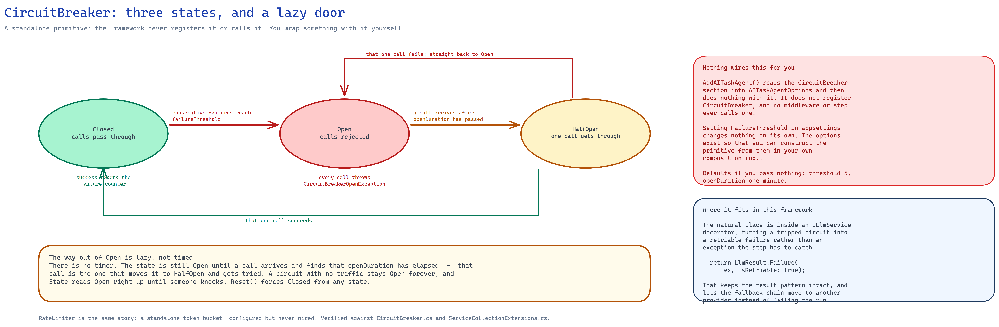
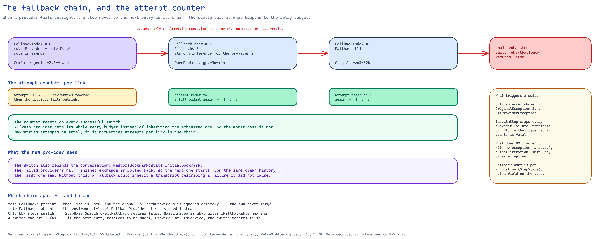

# Resilience

## Overview

AITaskAgent includes built-in resilience patterns to handle transient failures and protect external services.

## Components

| Component | Pattern | Purpose |
|-----------|---------|---------|
| `RetryMiddleware` | Retry | Automatic retries with validation feedback |
| `IFallbackable` | Fallback | Switch a step to its next provider/model |
| `TimeoutMiddleware` | Timeout | Step execution time limits |
| `CircuitBreaker` | Circuit Breaker | Prevent cascading failures |
| `RateLimiter` | Token Bucket | Rate limit API calls |
| `RetryPolicy` | Retry with backoff | Attempt count and delays for the transport-level retry inside `OpenAILlmService` / `GeminiLlmService` (constructor argument) |

> [!NOTE]
> `CircuitBreaker` and `RateLimiter` are standalone classes. `AddAITaskAgent()` does **not**
> register them in DI — instantiate them yourself, or register them in your own composition root.

---

## CircuitBreaker

Prevents cascading failures by tracking consecutive errors.

### States



<!-- Source: docs/assets/diagrams/circuit-breaker-states.excalidraw -->

### Usage

```csharp
using AITaskAgent.Resilience;

var circuitBreaker = new CircuitBreaker(
    failureThreshold: 5,        // Open after 5 failures
    openDuration: TimeSpan.FromMinutes(1)
);

try
{
    var result = await circuitBreaker.ExecuteAsync(async () =>
    {
        return await httpClient.GetAsync("https://api.example.com/data");
    });
}
catch (CircuitBreakerOpenException)
{
    // Circuit is open, use fallback
    return GetCachedData();
}
```

### Properties

| Property | Type | Description |
|----------|------|-------------|
| `State` | `CircuitState` | Current state (Closed, Open, HalfOpen) |

### Methods

| Method | Description |
|--------|-------------|
| `ExecuteAsync<T>()` | Execute action through circuit |
| `Reset()` | Manually reset to Closed |

---

## RateLimiter

Token bucket algorithm for rate limiting.

### How It Works

A bucket holds up to `maxTokens`. Each call consumes one; `tokensPerRefill` are added back every
`refillInterval`. `WaitAsync` blocks until one is available, `TryAcquire` returns false instead.

Like `CircuitBreaker`, it is a standalone class: the framework configures it but never uses it.

### Usage

```csharp
using AITaskAgent.Resilience;

var rateLimiter = new RateLimiter(
    maxTokens: 10,
    refillInterval: TimeSpan.FromSeconds(1),
    tokensPerRefill: 10
);

// Wait until token available
await rateLimiter.WaitAsync(cancellationToken);
await CallExternalApi();

// Or try without waiting
if (rateLimiter.TryAcquire())
{
    await CallExternalApi();
}
else
{
    // No tokens available, return cached or throttle
}
```

### Properties

| Property | Type | Description |
|----------|------|-------------|
| `AvailableTokens` | `int` | Current available tokens |

---

## RetryMiddleware

Built-in middleware for automatic retries with validation.

### Behavior

1. Executes the step (emitting a `StepStartedEvent` for every attempt after the first)
2. If it **throws** → the exception is fatal. No retry: the step is finalized and an error result
   is returned. A fallback switch is attempted first if the step implements `IFallbackable`
3. If the result has an error **carrying an `OriginalException`** → same treatment as an exception
4. If the result has an error **without** an exception → recoverable (invalid JSON, bad option
   name…). Retry so the model can self-correct
5. Runs structural validation (`result.ValidateAsync`) → retry if failed
6. Runs semantic validation (`step.ValidateAsync`, which in `StepBase` runs `step.Validators`) → retry if failed
7. Attempts exhausted → return the last attempt's result, whose `Error` carries the last failure
   message (`Validation failed after N attempts` is only logged)

There is no backoff delay between attempts: the feedback loop, not waiting, is what is expected to
fix the failure.

### Configuration

Retries are configured per step. `MaxRetries` is a plain settable property on `StepBase`
(default `3`), not a virtual member:

```csharp
public class MyStep : StepBase
{
    public MyStep() : base("MyStep", typeof(IStepResult), typeof(IStepResult))
    {
        MaxRetries = 3;
    }
}

// or from the outside
var step = new MyStep { MaxRetries = 1 };
```

---

## IFallbackable

```csharp
public interface IFallbackable
{
    bool SwitchToNextFallback(IStepResult error, PipelineContext context, int attempt);
}
```

`StepBase` implements it (returning `false`), and `BaseLlmStep` gives it meaning: when the error's
`OriginalException` is an `LlmProviderException` it advances through `role.Fallbacks` (or the global
`FallbackProviders` list), so `GetLlmService(context)`, `GetModel(context)`, `GetProvider(context)`
and `GetInference(context)` all point at the next entry. Other failures never switch.



<!-- Source: docs/assets/diagrams/llm-fallback-chain.excalidraw -->

The important detail is in `RetryMiddleware`: **when a fallback switch succeeds, the attempt
counter resets to 1**. A fresh provider therefore gets its full retry budget instead of inheriting
the exhausted one from the provider that just failed.

A second detail is easy to miss: the switch also calls `RestoreBookmark` on the conversation, so
the new provider starts from the same clean history the first one saw rather than inheriting a
transcript of someone else's failure.

```json
"Roles": {
  "default": {
    "Provider": "Gemini",
    "Model": "gemini-2.5-flash",
    "Fallbacks": [
      { "Provider": "OpenRouter", "Model": "openai/gpt-4o-mini" },
      { "Provider": "Groq",       "Model": "qwen/qwen3-32b" }
    ]
  }
}
```

A role with no `Fallbacks` inherits the environment-level `FallbackProviders` list. Both are
validated when `IOptions<LlmEnvironment>` is first built (an unknown provider or a missing model
throws) — see [Configuration](configuration.md).

---

## TimeoutMiddleware

Enforces execution time limits per step. Because Timeout wraps Retry in the chain, the limit is
**global across all retry attempts**, not per attempt.

### Configuration

```csharp
// StepBase.Timeout is a virtual get/set property
var step = new SlowStep { Timeout = TimeSpan.FromSeconds(30) };
```

Resolution order is `step.Timeout ?? IPipeline.DefaultStepTimeout`. A null result would mean no
timeout, but `Pipeline` always resolves a non-null `DefaultStepTimeout` (1 minute through
`AddAITaskAgent()`, 30 minutes when `Pipeline` is constructed directly), so in practice every step
is timed.

When the expiry's `OperationCanceledException` reaches it, the middleware emits a
`StepTimeoutEvent` and returns an error result (`Step X timed out after T`):

```csharp
public sealed record StepTimeoutEvent : ProgressEventBase
{
    public override string EventType => "step.timeout";
    public string? StepPath { get; init; }
    public TimeSpan ConfiguredTimeout { get; init; }
}
```

Because `RetryMiddleware` catches every exception thrown by the step (`OperationCanceledException`
included) and turns it into an error result carrying it, a timeout that fires inside step code
usually surfaces as that error result instead, without a `StepTimeoutEvent`.

Pipeline-level timeout:

```csharp
var pipeline = provider.GetRequiredService<IPipeline>();

await pipeline.ExecuteAsync(
    name: "TimedPipeline",
    steps: [step1, step2],
    input: "start",
    pipelineTimeout: TimeSpan.FromMinutes(5)
);
```

Defaults come from `PipelineOptions` (`DefaultPipelineTimeout`, `DefaultStepTimeout`), seeded from
`AITaskAgent:Timeouts` (defaults 10 minutes and 1 minute).

---

## Integration with LLM

### LLM with Circuit Breaker

```csharp
public class ResilientLlmService : ILlmService
{
    private readonly ILlmService _inner;
    private readonly CircuitBreaker _circuitBreaker;

    public string Name => _inner.Name;

    public async Task<LlmResult> InvokeAsync(LlmRequest request, CancellationToken ct = default)
    {
        try
        {
            return await _circuitBreaker.ExecuteAsync(() => _inner.InvokeAsync(request, ct));
        }
        catch (CircuitBreakerOpenException ex)
        {
            // Result pattern: a retriable failure, not an exception the step has to catch
            return LlmResult.Failure(ex, isRetriable: true);
        }
    }

    // ... InvokeStreamingAsync, EstimateTokenCount, GetMaxContextTokens delegate to _inner
}
```

`CircuitBreaker` only counts **exceptions**. Provider services report failures as
`LlmResult.Failure` instead of throwing, so the circuit above never opens unless the delegate turns
a failed result into an exception (and back into a result outside `ExecuteAsync`).

### LLM with Rate Limiting

```csharp
public class RateLimitedLlmService : ILlmService
{
    private readonly ILlmService _inner;
    private readonly RateLimiter _rateLimiter;

    public string Name => _inner.Name;

    public async Task<LlmResult> InvokeAsync(LlmRequest request, CancellationToken ct = default)
    {
        await _rateLimiter.WaitAsync(ct);
        return await _inner.InvokeAsync(request, ct);
    }
}
```

---

## Wiring the resilience primitives

`AddAITaskAgent()` reads the `CircuitBreaker` and `RateLimit` configuration sections into
`AITaskAgentOptions`, but it does **not** register `CircuitBreaker` or `RateLimiter` as services.
Register them yourself from those options:

```csharp
services.AddSingleton(sp =>
{
    var o = sp.GetRequiredService<IOptions<AITaskAgentOptions>>().Value.CircuitBreaker;
    return new CircuitBreaker(
        failureThreshold: o.FailureThreshold,
        openDuration: TimeSpan.FromSeconds(o.OpenDurationSeconds),
        logger: sp.GetService<ILogger<CircuitBreaker>>());
});

services.AddSingleton(sp =>
{
    var o = sp.GetRequiredService<IOptions<AITaskAgentOptions>>().Value.RateLimit;
    return new RateLimiter(
        maxTokens: o.MaxTokens,
        refillInterval: TimeSpan.FromMilliseconds(o.RefillIntervalMs),
        tokensPerRefill: o.TokensPerRefill,
        logger: sp.GetService<ILogger<RateLimiter>>());
});
```

### appsettings.json

```json
{
  "AITaskAgent": {
    "CircuitBreaker": {
      "FailureThreshold": 5,
      "OpenDurationSeconds": 60
    },
    "RateLimit": {
      "MaxTokens": 100,
      "RefillIntervalMs": 1000,
      "TokensPerRefill": 10
    }
  }
}
```

> [!WARNING]
> The section is `RateLimit`, not `RateLimiter`, and the interval key is `RefillIntervalMs`
> (milliseconds).
