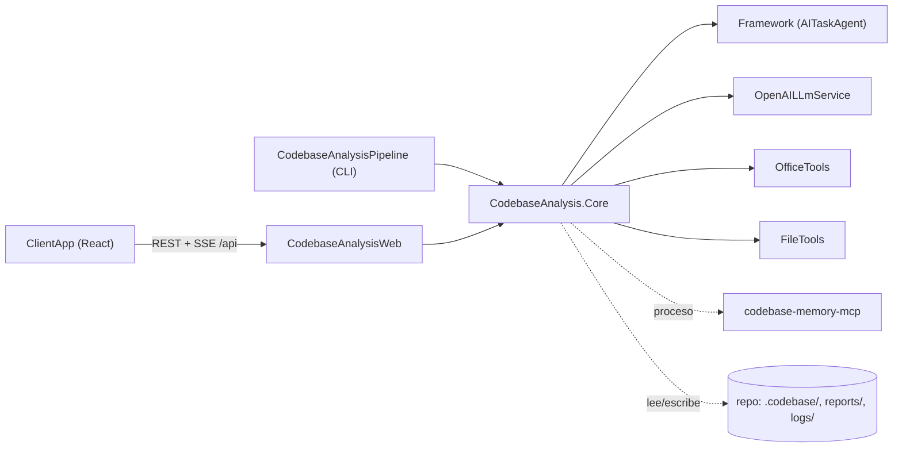

# Plan: aplicación web local para CodebaseAnalysisPipeline

Fecha: 2026-09-27. Rama `consolidation`. Estado: **implementado (F1-F3 y correcciones post-auditoría), sin
commit, y verificado de extremo a extremo**. Las secciones 1-10 son el diseño con el que se empezó y conservan su
redacción en futuro; lo que cambió al implementarlo, las verificaciones reales y lo que sigue sin verificar están en
«Decisiones durante la implementación» (F1, F3, F2), «Correcciones post-auditoría» (frontend, backend), «Integración
final» y «Cierre de F4», al final, que mandan sobre el diseño cuando discrepan. El uso y la API están resumidos en `Samples/CodebaseAnalysisWeb/README.md`, y el estado general, en
`docs/project_notes/codebase-analysis-pipeline-estado.md`.

Convención de evidencia (CLAUDE.md del usuario): `[V]` verificado con `fichero:línea`, `[I]` inferido,
`[?]` no comprobado. Solo se marcan hechos sobre el sistema, no las decisiones.

> **TL;DR.** Se extrae el pipeline a `Samples/CodebaseAnalysis.Core/` (la CLI queda como un `Program.cs`
> fino con la misma salida), se añade `Samples/CodebaseAnalysisWeb/` (ASP.NET Core minimal APIs + SSE +
> React/Vite) y **no hace falta tocar el framework**: el streaming con tools ya existe y los eventos que
> faltan (los mensajes de dominio del pipeline) se emiten con `StepProgressEvent`, que ya es público. La
> restricción que manda en el diseño es que `FileToolsConfiguration` y `AvailableTools` son estáticos de
> proceso: la web trabaja sobre **un único repositorio activo** y el chat se bloquea mientras corre un
> análisis.

---

## 1. Decisiones clave (resumen)

| # | Decisión | Porqué, en una línea |
|---|---|---|
| D1 | Sin cambios en `Framework/` | Streaming con tools, eventos de step/branch/tool/LLM y `StepProgressEvent` ya existen (§3.3). |
| D2 | Un único **workspace** (repositorio activo) por proceso | `FileToolsConfiguration.RootDirectory` y `AvailableTools.Instance` son estáticos (§3.4). |
| D3 | Chat bloqueado (409) mientras hay un análisis en curso | El análisis sobrescribe la BD del grafo y mueve informes a `backups/` (§3.4). |
| D4 | Mensajes de dominio vía `IAnalysisReporter` + `StepProgressEvent` | Sustituye los 44 `Console.WriteLine` sin cambiar la salida de la CLI. |
| D5 | Un `EventChannel` propio por ejecución (análisis o turno de chat) | El pipeline lo vacía y lo cierra al terminar: entrega garantizada antes del `done` (§5.2). |
| D6 | SSE escrito a mano, sobre `fetch` en el cliente | Hace falta POST para el chat, `id:` para replay y comentarios de keep-alive; `EventSource` no hace POST. |
| D7 | Historial de chat en `<carpeta de la BD>/chat/<id>.json` (por defecto `<repo>/.codebase/chat/`) | Sobrevive a `--force-reindex`, queda fuera del grafo y fuera de `reports/` (§4.5). |
| D8 | Formato de historial propio (turnos), no `FileConversationStorage` | Su DTO es `internal` y no guarda metadatos por turno (tools usadas, tokens, estado). |
| D9 | El turno de chat es un `BaseLlmStep` con prompt literal, no un `TemplateLlmStep` | El texto del usuario no debe pasar por el motor de plantillas. |
| D10 | El system prompt del chat = plantilla estática + bloques de contexto concatenados en C# | El renderer resuelve `@[fichero]` **después** de interpolar: un informe con `@[x]` se trataría como include (§6.3). |
| D11 | El estado del análisis (fases, auditores) se deriva **en el cliente** reproduciendo eventos | Un solo reductor puro y testeable; el servidor solo guarda la lista de eventos y el estado final. |
| D12 | Solo `127.0.0.1`, `AllowedHosts` restringido, cuerpos JSON obligatorios, sin CORS | Monousuario sin auth: se cierra la puerta a peticiones de otros orígenes y a DNS rebinding. |
| D13 | Tests: xUnit 2.x + fakes escritos a mano (sin Moq), `WebApplicationFactory`; Vitest + Testing Library + jsdom | Es lo que usan los proyectos de test existentes (§2). |
| D14 | `typescript` 6.0.3 y `mermaid` 11.17.2, no las majors más nuevas | TS 7 es el port nativo y mermaid 12.0.0 tiene 17 días; no aportan nada aquí y añaden riesgo. |

---

## 2. Entorno verificado (2026-09-27)

| Herramienta | Versión | Cómo |
|---|---|---|
| node | v22.23.2 | `node -v` |
| npm | 10.9.8 | `npm -v` |
| dotnet SDK | 10.0.401 | `dotnet --version` |
| Runtimes ASP.NET Core | 10.0.2, 10.0.8, 10.0.11, 10.0.12 | `dotnet --list-runtimes` |
| codebase-memory-mcp | instalado en `%LOCALAPPDATA%\Programs\codebase-memory-mcp\` | `ls` |

Línea base de tests: `dotnet test AITaskAgent.slnx` sale con código 0 [V] (salida de la ejecución: FileTools.Tests 54,
OfficeTools.Tests 29, GeminiLlmService.Tests 12, AITaskAgent.Tests 103; OpenAI y MCP pasaron pero su recuento quedó fuera
del `tail`). El total exacto se anota al empezar F1.

Frameworks de test existentes: xUnit `2.*`, `Microsoft.NET.Test.Sdk 17.*`, `xunit.runner.visualstudio 2.*`
[V] `Tests/AITaskAgent.Tests.csproj:9-11`, `FileTools.Tests/FileTools.Tests.csproj:10-12`. No hay librería de mocks: los
fakes de LLM son clases que implementan `ILlmService` [V] `Tests/UndefinedToolCallTests.cs:48-71` (no streaming),
`Tests/ReasoningChannelTagTests.cs:120-137` (streaming con `IAsyncEnumerable<LlmStreamChunk>`).

Versiones de paquetes resueltas contra los registros el 2026-09-27 (`npm view`, `dotnet package search`):

| Paquete | Versión | Nota |
|---|---|---|
| react, react-dom, @types/react, @types/react-dom | 19.3.0 | |
| vite | 8.3.1 | engines node `^20.19 \|\| >=22.12` |
| @vitejs/plugin-react | 6.1.1 | peer vite `^8` |
| typescript | 6.0.3 | se descarta 7.0.2 (D14) |
| react-markdown | 10.1.0 | |
| remark-gfm | 4.0.1 | |
| mermaid | 11.17.2 | se descarta 12.0.0 (D14) |
| vitest | 5.0.2 | engines node `^22.12` |
| jsdom | 30.1.1 | engines node `^22.22.2` |
| @testing-library/react / dom / jest-dom / user-event | 16.3.3 / 10.4.2 / 7.0.1 / 14.6.7 | peer react `^18 \|\| ^19` |
| @types/node | 22.20.4 | la línea de node instalada |
| Microsoft.AspNetCore.Mvc.Testing | 10.0.12 | coincide con el runtime 10.0.12 instalado |
| Serilog.AspNetCore | 10.0.0 | |
| Serilog.Sinks.Map | 2.0.0 | log por ejecución en `<repo>/logs` (§5.5) |

---

## 3. Arquitectura

### 3.1 Componentes

```text
Samples/
├─ CodebaseAnalysis.Core/            (nuevo, class library)   pipeline, config, roles, progreso, chat
├─ CodebaseAnalysis.Core.Tests/      (nuevo, xUnit)
├─ CodebaseAnalysisPipeline/         (existente, queda como CLI fina: Program.cs + csproj + README)
├─ CodebaseAnalysisWeb/              (nuevo, ASP.NET Core)    HTTP, SSE, estáticos
│  └─ ClientApp/                     (nuevo, React + TS + Vite)
└─ CodebaseAnalysisWeb.Tests/        (nuevo, xUnit + WebApplicationFactory)
```



Reparto de responsabilidades. **Core** contiene todo lo que no es HTTP: los steps, la carga de configuración,
la construcción de roles, el mapeo de eventos del framework a DTOs de progreso y de chat, el agente de chat y su
almacén. **Web** solo expone endpoints, gestiona el ciclo de vida de la ejecución única y serializa SSE. Así la
lógica se prueba en `Core.Tests` sin servidor y la CLI podría ganar un modo chat más adelante sin duplicar código.

### 3.2 Cambios en el sample (ficheros exactos)

**Se mueven** de `Samples/CodebaseAnalysisPipeline/` a `Samples/CodebaseAnalysis.Core/`, con el namespace
`Samples.CodebaseAnalysisPipeline[.X]` renombrado a `CodebaseAnalysis.Core[.X]` (cambio mecánico, el compilador
lo valida; los ficheros son `??` en git, así que no se pierde historia):

- `AnalysisPipelineFactory.cs`
- `Models/` (6 ficheros), `Steps/` (7), `Support/` (9), `Tools/` (6)
- `templates/` (24 `.md`)
- `appsettings.analysis.json`

**Se modifican al moverlos:**

| Fichero | Cambio |
|---|---|
| `Steps/*.cs`, `Support/WorkflowAndMarkdownEnricher.cs` | Los 44 `Console.WriteLine` [V] (`grep -c`: BdpEnricher 11, CustomStateless 6, DetectAndIndex 11, ExecutiveSynthesizer 2, SemanticEnrichment 5, SqlFacetExtractor 4, TolerantReports 1, WorkflowAndMarkdown 4) pasan a `context.Report(level, mensaje)` con **el mismo texto literal**. Los helpers estáticos sin contexto (`BackupPreviousRun`, `RunCodebaseMemoryIndexAsync`, `WorkflowAndMarkdownEnricher.EnrichAsync`) reciben el `PipelineContext` como parámetro. |
| `Steps/CustomStatelessTemplateLlmStep.cs` | Tras escribir el informe (hoy `CustomStatelessTemplateLlmStep.cs:91-95` [V]) emite `analysis.report_written` con fichero, semáforo, críticos y si se cortó por `FinishReason.Length`. |
| `Steps/ExecutiveSynthesizerStep.cs` | Igual tras escribir el `00` (hoy `ExecutiveSynthesizerStep.cs:247` [V]). `TryGetReportType` (hoy privado, `:265-271` [V]) pasa a `AnalysisPipelineFactory.TryParseAuditorStepName`, junto a `AuditorStepName(ReportType)`, que sustituye el literal `$"Auditor_{type}"` de `AnalysisPipelineFactory.cs:124` [V]. |
| `Steps/DetectAndIndexGraphStep.cs` | (a) `EnsureSchemaAsync` (`:390` [V]) se extrae a `Support/GraphSchema.cs` público, para que los tests creen un grafo con el mismo DDL. (b) Cancelación: hoy `WaitForExitAsync(cancellationToken)` (`:267` [V]) no mata el indexador; en `OperationCanceledException` se hace `process.Kill(entireProcessTree: true)` y se relanza. (c) Las líneas de stdout/stderr del indexador (`:246`, `:255` [V]) se emiten como `analysis.log` con `channel=indexer`. |
| `Steps/BdpEnricherStep.cs` | Misma corrección de cancelación en `WaitForExitAsync(ct)` (`BdpEnricherStep.cs:193` [V]). |
| `AnalysisPipelineFactory.cs` | Nuevo parámetro opcional `IPipeline? engine = null` (hoy se resuelve del contenedor o `new Pipeline()`, `:103` [V]). Firma existente compatible. |
| `Tools/CbmGraphDb.cs` | Sin cambios: sus 2 `Console.WriteLine` (`:64`, `:98` [V]) son de error y no tienen contexto. Límite aceptado (§9). |

**Nuevos en Core (F1):**

| Fichero | Contenido (extraído de `Program.cs` salvo indicación) |
|---|---|
| `Hosting/AnalysisConfiguration.cs` | Expansión `${VAR}` del JSON y orden de fuentes: JSON → env → user secrets (`3e60cd17-5eb3-409f-b631-3ab8497c947d`) → línea de comandos (`Program.cs:118-132` [V]). `GetEnvVar` proceso/usuario/máquina (`:118-121` [V]). |
| `Hosting/LlmRoleFactory.cs` | `BuildProviders` (`Program.cs:36-95` [V]) y la construcción de roles (`:227-284` [V]). Resuelve el servicio por **keyed service** `ServiceType` en vez del `switch` de `:49-56`, con el mismo mensaje de error para un tipo desconocido. `isAzure` pasa de `service is AzureOpenAILlmService` (`:57`) a `serviceType == "azure-openai"` (equivalente en producción, y permite un fake en tests). Lee una clave de rol nueva y opcional, `UseStreaming`; hoy no se lee (`:252-258` [V]) y su valor por defecto es `false` (`Framework/LLM/Configuration/LlmInferenceSettings.cs:46-50` [V]), así que los roles existentes no cambian. Imprime por un `Action<string>` (la CLI pasa `Console.WriteLine`, la web un `ILogger`). |
| `Hosting/ServiceCollectionExtensions.cs` | `AddCodebaseAnalysisLlmServices()`: los tres servicios concretos, sus keyed `ILlmService` (`azure-openai`, `openai`, `openrouter`) y el `ILlmService` por defecto de `Program.cs:180-183` [V]. |
| `Hosting/AnalysisRunOptions.cs` | Resolución de `--repo/--db/--output/--force-reindex/--reports/--log-level/--debug/--trace` (`Program.cs:138-158`, `:286-338` [V]). Dos métodos, para respetar el orden actual de la salida: `ResolveRepositoryPath` (se usa antes de Serilog) y `BuildInput` (después de los roles, donde hoy se imprimen los avisos de informes desconocidos, `:314-324` [V]). |
| `Hosting/AnalysisToolRegistration.cs` | Registro de tools y raíz de FileTools (`Program.cs:349-360` [V]) + las dos tools nuevas del chat (F2). |
| `Hosting/AnalysisRunner.cs` | Construcción de pipeline y contexto y ejecución (`Program.cs:364-373` [V]). Recibe `IEventChannel?` y `IAnalysisReporter`. La CLI pasa `null` y `ConsoleAnalysisReporter`, igual que hoy (`new PipelineContext(null, serviceProvider)`, `:367` [V]). |
| `Progress/IAnalysisReporter.cs`, `ConsoleAnalysisReporter.cs`, `LoggerAnalysisReporter.cs` | `Report(AnalysisLogLevel level, string source, string message)`. El de consola escribe `message` tal cual; el de logger usa `ILogger` con el nivel. |
| `Progress/AnalysisProgress.cs` | Extensiones `context.Report(...)` y `context.ReportWritten(...)`: llaman al reporter del contexto (clave `AnalysisContextKeys.Reporter`; consola si falta) y emiten `StepProgressEvent` por `context.SendEventAsync`, que no hace nada si no hay canal (`Framework/Core/Models/PipelineContext.cs:172-178` [V]). |
| `Progress/AnalysisEventTypes.cs`, `AnalysisContextKeys.cs` | Constantes: `analysis.log`, `analysis.report_written`; `PipelineInput`, `CbmDbPath`, `Reporter`, `ReportsPath`. |
| `Models/ReportCatalog.cs` | Tabla tipo → alias principal, fichero, título en español, rol y prefijo, construida sobre los `switch` existentes de `Models/AnalysisPipelineInput.cs:48-110` [V]. La usan `/api/meta` y el chat. |

**Nuevos en Core (F2, chat):** `Chat/ChatSession.cs` (DTOs), `Chat/ChatSessionStore.cs`, `Chat/ChatAgent.cs`,
`Chat/ChatPromptBuilder.cs`, `Progress/AnalysisEventMapper.cs`, `Progress/ChatEventMapper.cs`,
`Tools/ReportTools.cs` (`list_reports`, `read_report`), `templates/chat_system.md`, rol `ChatAssistant` en
`appsettings.analysis.json`.

**CLI tras la extracción.** `Samples/CodebaseAnalysisPipeline/` conserva `Program.cs` (banner, Serilog, MCP opcional,
resumen final y código de salida: `Program.cs:100-105`, `:141-167`, `:190-225`, `:375-421` [V]), su csproj y su README.
El csproj referencia Core y conserva `UserSecretsId` (`Samples.CodebaseAnalysisPipeline.csproj:42` [V]), los paquetes de
Serilog, `Microsoft.Extensions.Hosting` y la referencia a `McpIntegration`. Los `ItemGroup` de copia de
`appsettings.analysis.json` y `templates/` (`:27-34` [V]) se mueven al csproj de Core; los `None` con
`CopyToOutputDirectory` de un proyecto referenciado se copian a la salida de quien lo referencia [I] (se comprueba en el
criterio de aceptación de F1). El README se actualiza en los apartados 4 y 5, que dicen dónde viven configuración y
plantillas.

**Otros ficheros tocados:** `AITaskAgent.slnx` (4 proyectos nuevos), `.gitignore` (`Samples/CodebaseAnalysisWeb/wwwroot/`;
`node_modules` y `dist` ya están ignorados, `.gitignore:13-14` [V]).

**No se tocan:** `Samples/PipelineVisualizer`, `Samples/YamlPipelineDemo`, FileTools, Gemini, OpenAI, McpIntegration,
OfficeTools. `Tests/SampleConfigurationTests.cs` recorre `Samples/*/appsettings.json` y solo valida la sección
`AITaskAgent:LlmProviders` si existe (`Tests/SampleConfigurationTests.cs:53-60`, `:76-79` [V]): el `appsettings.json` de
la web no debe llevar esa sección (la configuración LLM sigue en `LlmConfiguration`, dentro de `appsettings.analysis.json`).

### 3.3 Cambios en el framework: ninguno

Lo que se necesita ya existe:

- **Streaming con tools.** `InvokeLlmAsync`, con `request.UseStreaming`, acumula `ToolCallUpdates` por choice y
  construye los `ToolCall` al final (`Framework/LLM/Steps/BaseLlmStep.LlmInvocation.cs:506-691` [V]).
  `InvokeLlmWithToolsAsync` ejecuta las tools y vuelve a invocar al modelo (`:99-163` [V]) sea cual sea el transporte.
  Cada delta sale como `LlmResponseEvent` con `FinishReason.Streaming` e `IsThinking` (`:544-559` [V]), y al cerrar cada
  iteración sale un `LlmResponseEvent` final con `ToolCalls`, tokens y modelo (`:702-714` [V]). `UseStreaming` sale de la
  inferencia del rol (`BaseLlmStep.cs:427` [V]). El proveedor emite `ToolCallUpdates` en streaming
  (`OpenAILLmService/OpenAILlmService.cs:671` [V]) y Azure hereda de ese servicio
  (`OpenAILLmService/AzureOpenAILlmService.cs:20-21` [V]).
- **Eventos de ejecución.** `PipelineStarted/Completed` (`Framework/Core/Execution/Pipeline.cs:161`, `:191` [V]);
  `StepStarted/Completed` para todo step que pasa por el middleware (`ObservabilityMiddleware.cs:42-51`, `:84-98`,
  `:123-133` [V]), con `AttemptNumber` en los reintentos (`RetryMiddleware.cs:33-44` [V]); `BranchStarted/Completed` por
  auditor (`ParallelStep.cs:59`, `:86`, `:108` [V]); `ToolStarted/Completed` desde `LlmTool` (`LlmTool.cs:72-80`,
  `:130-140` [V]); `StepValidationEvent` y `StepTimeoutEvent`. Los tokens de cada auditor van en
  `StepCompletedEvent.StepResult`, que es el `ILlmStepResult` (`Observability/Events/StepCompletedEvent.cs:32` [V]).
- **Eventos de dominio.** `StepProgressEvent` es público, con `EventType` libre, `Message` y `Metadata`
  (`Observability/Events/StepProgressEvent.cs:6-36` [V]). Es lo que usa `context.Report`.
- **Correlación.** Las ramas paralelas comparten `CorrelationId` y `Metadata` (`PipelineContext.cs:143-154` [V]), así que
  un canal por ejecución recibe todo.

Huecos que se cubren sin tocar el framework:

- `ToolStartedEvent` no lleva argumentos (`Observability/Events/ToolStartedEvent.cs:12-15` [V]). Los argumentos se toman
  del `LlmResponseEvent` final de la iteración, que trae `ToolCalls` (`Observability/Events/LlmResponseEvent.cs:46` [V]).
  Las tools de una iteración se ejecutan en secuencia (`BaseLlmStep.LlmInvocation.cs:326-411` [V]), así que emparejar
  `tool.started` con la llamada por orden dentro del mismo `StepName` es determinista.
- `SemanticEnrichmentStep`, la síntesis y la ingesta Office invocan sus sub-steps directamente, sin middleware
  (`SemanticEnrichmentStep.cs:62`, `ExecutiveSynthesizerStep.cs:234`, `DetectAndIndexGraphStep.cs:91` [V]). No emiten
  `step.*`, aunque los `LlmResponseEvent` sí salen con `StepName` `SemanticEnricherLlm` o `SynthesizerLlm`. Lo cubren los
  mensajes `context.Report` que ya existen alrededor de esas llamadas.
- `MaxToolIterations` vale 5 por defecto (`BaseLlmStep.cs:106` [V]) y es `init`: el chat fija el suyo (12) sin cambiar el
  framework.

### 3.4 Estado global de proceso y su consecuencia

- `FileToolsConfiguration` es `static` (`FileTools/FileToolsConfiguration.cs:10` [V]) y `view_file` resuelve contra
  `RootDirectory`. `SetRootDirectory` **conserva la raíz anterior como permitida** (`:122-128` [V]): usarlo al cambiar de
  repositorio iría ampliando el sandbox. La web usa el setter `RootDirectory = repo` (`:26-36` [V]) seguido de
  `ClearAdditionalAllowedDirectories()` (`:91-92` [V]).
- `AvailableTools.Instance` es un registro global y `Register` reemplaza por nombre (`AvailableTools.cs:10`, `:33` [V]).
  `TemplateLlmStep` resuelve las tools por nombre **en el constructor** (`TemplateLlmStep.cs:39` [V], línea del fichero;
  comentario en `Program.cs:346-348` [V]). Las tools del grafo leen la BD del contexto (`"CbmDbPath"`,
  `Tools/GraphSearchTool.cs:53` [V]) y solo usan el path del constructor como respaldo (`Tools/CbmGraphDb.cs:17-25` [V]).
- La reindexación sobrescribe la BD con `File.Copy(..., overwrite: true)` (`DetectAndIndexGraphStep.cs:291` [V]) y
  `ForceReindex` mueve BD e informes a `backups/` (`:138-178` [V]).

Consecuencia (D2, D3): hay un workspace activo. Abrir otro devuelve 409 mientras corra un análisis o un turno de
chat, y el chat del workspace activo devuelve 409 mientras corra un análisis. Un solo análisis a la vez es además
requisito del usuario.

---

## 4. Contratos

Convenciones: JSON en camelCase, fechas ISO-8601 UTC, enums como string. Los errores responden
`{ "error": "<código>", "message": "<texto>" }` con el código HTTP indicado. Los POST/PUT exigen
`Content-Type: application/json` (los cuerpos tipados de minimal APIs responden 415 si no), lo que obliga a un
preflight CORS que no se concede.

### 4.1 REST

| Método y ruta | Cuerpo | Respuestas |
|---|---|---|
| `GET /api/meta` | — | 200 `MetaDto` |
| `GET /api/workspace` | — | 200 `WorkspaceDto` (con `repositoryPath: null` si no hay) |
| `PUT /api/workspace` | `{ "repositoryPath": "C:\\ruta\\absoluta" }` | 200 `WorkspaceDto` · 400 `invalid_path` / `workspace_not_writable` · 409 `analysis_running` / `chat_turn_running` |
| `POST /api/analysis` | `{ "forceReindex": false, "reports": ["smells","di"] }` | 202 `RunStatusDto` · 409 `no_workspace` / `analysis_running` (con `runId`) / `chat_turn_running` · 400 `unknown_report` |
| `GET /api/analysis/current` | — | 200 `RunStatusDto` (la última ejecución, en curso o terminada) · 204 si no hubo ninguna desde el arranque |
| `GET /api/analysis/{runId}/events?after={seq}` | — | 200 `text/event-stream` (§4.2) · 404 |
| `POST /api/analysis/{runId}/cancel` | `{}` | 202 `RunStatusDto` · 404 · 409 `not_running` |
| `GET /api/reports` | — | 200 `ReportSummaryDto[]` · 409 `no_workspace` |
| `GET /api/reports/{fileName}` | — | 200 `text/markdown; charset=utf-8` · 404 (nombre fuera del catálogo o fichero inexistente) · 503 `report_unavailable` (no se puede leer: bloqueado o sin permiso) |
| `GET /api/chat/sessions` | — | 200 `ChatSessionSummaryDto[]` |
| `POST /api/chat/sessions` | `{ "title": "opcional" }` | 201 `ChatSession` |
| `GET /api/chat/sessions/{id}` | — | 200 `ChatSession` · 404 |
| `DELETE /api/chat/sessions/{id}` | — | 204 · 404 · 409 `chat_turn_running` |
| `POST /api/chat/sessions/{id}/messages` | `{ "message": "texto" }` | 200 `text/event-stream` (§4.4) · 400 `empty_message` / `message_too_long` (> 8000 caracteres) · 404 · 409 `analysis_running` / `chat_turn_running` |

Un cuerpo que no se puede leer (JSON mal formado o con tipos que no casan) es 400 `invalid_request`, y un `Content-Type` que
no es JSON, 415 `invalid_request`; los dos con `{error, message}` (correcciones post-auditoría, D6).

`reports` vacío o ausente equivale a no pasar `--reports`: se usa `CodebaseAnalysis:RequestedReports` y, si está vacío,
todos (`Program.cs:302-329` [V]). Cada nombre se interpreta con `AnalysisPipelineInput.ParseReportType`, que admite alias,
nombre con guiones bajos y nombre del enum (`Models/AnalysisPipelineInput.cs:90-111` [V]). A diferencia de la CLI, que
avisa y descarta un nombre desconocido (`Program.cs:314-324` [V]), la API responde 400: en un formulario, un nombre
desconocido es un bug del cliente.

Payloads:

```json
// MetaDto
{
  "reports": [
    { "type": "AnalisisFuncional", "alias": "funcional", "fileName": "01_analisis_funcional.md", "title": "Análisis funcional" },
    { "type": "CodeSmells", "alias": "smells", "fileName": "02_code_smells.md", "title": "Code smells" }
  ],
  "executiveReportFileName": "00_resumen_ejecutivo.md",
  "defaultReports": ["AnalisisFuncional", "CodeSmells", "..."]
}

// WorkspaceDto
{
  "repositoryPath": "C:\\repos\\miapp",
  "databasePath": "C:\\repos\\miapp\\.codebase\\codebase.db",
  "reportsPath": "C:\\repos\\miapp\\reports",
  "chatPath": "C:\\repos\\miapp\\.codebase\\chat",
  "logsPath": "C:\\repos\\miapp\\logs",
  "hasGraph": true,
  "reportCount": 10,
  "analysisRunning": false
}

// RunStatusDto
{
  "runId": "3f2a9c1b7d4e",
  "repositoryPath": "C:\\repos\\miapp",
  "status": "running",                 // running | succeeded | completed_with_failures | failed | cancelled
  "startedAt": "2026-09-27T10:15:00Z",
  "finishedAt": null,
  "forceReindex": false,
  "requestedReports": ["CodeSmells", "InyeccionDependenciasExtensiones"],
  "lastSeq": 57,
  "failedReports": [],
  "error": null
}

// ReportSummaryDto
{
  "fileName": "05_errores_y_bugs.md",
  "reportType": "ErroresYBugs",        // null para el 00
  "title": "Errores y bugs",
  "health": "Red",                     // Green | Amber | Red | Unknown
  "criticalFindings": 6,               // null si el informe no lo declara
  "sizeBytes": 48211,
  "lastModified": "2026-09-27T10:40:12Z"
}
```

`databasePath` y `reportsPath` se resuelven con la misma regla que la CLI: `CodebaseAnalysis:DatabasePath` y
`OutputReportsPath` relativos al repositorio (`Program.cs:287-291` [V]). La web no permite cambiarlos por petición.
`health` y `criticalFindings` salen de `SingleReportResult.PopulateDerivedMetadata()`, que lee la línea `analysis-meta`
(`Models/SingleReportResult.cs:14-16`, `:50-112` [V]); la web no reimplementa ese parseo. El listado solo incluye
los nombres del catálogo (9 más el `00`): `OutputReportsPath` puede contener Markdown ajeno y el propio pipeline lo
trata así (`DetectAndIndexGraphStep.cs:161-162` [V]).

`PUT /api/workspace` valida que la ruta sea absoluta y que el directorio exista, crea `.codebase/chat/`, fija la raíz
de FileTools como en §3.4 y registra las tools (§6.2).

### 4.2 SSE del análisis

```text
HTTP/1.1 200 OK
Content-Type: text/event-stream
Cache-Control: no-cache
X-Accel-Buffering: no

id: 57
event: analysis
data: {"seq":57,"runId":"3f2a9c1b7d4e","ts":"2026-09-27T10:15:02.123Z","type":"tool.completed","source":"Auditor_CodeSmells","report":"CodeSmells","phase":"reports","level":"info","message":"view_file (120 ms)","data":{"tool":"view_file","success":true,"durationMs":120}}

: keep-alive
```

- Un único nombre de evento SSE (`analysis`); el tipo va en `type`.
- `id` = `seq`, monótono por ejecución y sin huecos (desde 1).
- Replay: el servidor envía todo evento con `seq > after`, donde `after` es el parámetro o, si falta, la cabecera
  `Last-Event-ID`; por defecto 0. Después sigue en vivo.
- El stream termina tras `run.completed`. Si la ejecución ya había terminado, se reproduce entera y se cierra.
- Comentario `: keep-alive` cada 15 s.

### 4.3 Modelo de eventos de progreso

Campos comunes (`AnalysisEventDto`): `seq`, `runId`, `ts`, `type`, `source` (el `StepName` del evento del framework),
`report` (el `ReportType` si `source` es un auditor, según `TryParseAuditorStepName`), `phase`, `level`
(`info|success|warning|error`), `message` (texto listo para mostrar) y `data` (objeto por tipo).

`phase` se deduce del nombre del step de primer nivel, nunca de la ruta: `DetectAndIndexGraphStep` → `detect`,
`BdpEnricherStep` → `enrich`, `SqlFacetExtractorStep` → `facets`, `ParallelReportsExecution` y auditores → `reports`,
`ExecutiveSynthesizerStep` → `synthesis`. Los nombres están en `Steps/*.cs` (`BdpEnricherStep.cs:16`,
`DetectAndIndexGraphStep.cs:17`, `ExecutiveSynthesizerStep.cs:54`, `SqlFacetExtractorStep.cs:13` [V]) y en
`AnalysisPipelineFactory.cs:84` [V]. Se exponen como constantes en Core. El formato exacto de `StepPath` en las ramas no
está verificado [?] (`ParallelStep.cs:58` y `Pipeline.cs:315` añaden los dos una parte de ruta), y por eso no se usa.

| `type` | Origen | `data` |
|---|---|---|
| `run.started` | Runner | `repositoryPath, databasePath, reportsPath, forceReindex, requestedReports[]` |
| `pipeline.started` / `pipeline.completed` | `PipelineStartedEvent` / `PipelineCompletedEvent` | `totalSteps` / `success, durationMs, error` |
| `step.started` | `StepStartedEvent` | `stepPath, attempt` (attempt > 1 = reintento, `level=warning`) |
| `step.completed` | `StepCompletedEvent` | `stepPath, success, durationMs, error, tokens?, costUsd?, finishReason?` (del `ILlmStepResult` de `StepResult`; el objeto no se serializa nunca) |
| `step.validation` | `StepValidationEvent` | `isValid, validationType, error, attempt` |
| `step.timeout` | `StepTimeoutEvent` | `configuredTimeoutMs` |
| `branch.started` / `branch.completed` | `BranchStarted/CompletedEvent` | `branch` / `branch, success, durationMs, error` |
| `llm.response` | `LlmResponseEvent` con `FinishReason != Streaming` | `finishReason, tokens, model, contentLength, toolCalls[{id,name,arguments}]` (argumentos truncados a 500 caracteres; el contenido **no** se reenvía: el informe se lee en su visor) |
| `tool.started` / `tool.completed` | `ToolStarted/CompletedEvent` | `tool` / `tool, success, durationMs, error` |
| `log` | `StepProgressEvent` `analysis.log` | `channel` (`pipeline` \| `indexer`); nivel en `level` |
| `report.written` | `StepProgressEvent` `analysis.report_written` | `fileName, reportType, health, criticalFindings, truncated` |
| `run.completed` | Runner | `status, exitCode, durationMs, failedReports[], executiveReportPath, error` |
| `log.truncated` | Event log | `droppedUpToSeq` (solo si se superó el límite, §5.3) |

Los `LlmResponseEvent` de streaming no se registran en el log del análisis. Los auditores no hacen streaming, pero si
alguien activa `UseStreaming` en un rol, esos eventos inundarían el log.

`status` y `exitCode` siguen la regla de la CLI (`Program.cs:380-421` [V]): `succeeded` (0) si el resultado es
`AnalysisPipelineFinalResult` con `Success` y sin `FailedReports`; `completed_with_failures` (1) si tiene `FailedReports`;
`failed` (1) si hay error; `cancelled` (1) si el token de la ejecución estaba cancelado. La cancelación se decide por el
token y no por el tipo de excepción, porque `RetryMiddleware` convierte las excepciones en `ErrorStepResult`
(`RetryMiddleware.cs:50-65` [V]).

### 4.4 SSE del chat

Respuesta del `POST .../messages`: `event: chat`, un `data:` JSON con `type`, sin `id` (no hay replay: un turno
cortado se da por cancelado).

| `type` | Origen | Campos |
|---|---|---|
| `turn.started` | ChatAgent | `turnId, askedAt` |
| `delta` | `LlmResponseEvent` streaming, `IsThinking=false` | `text` |
| `thinking` | `LlmResponseEvent` streaming, `IsThinking=true` | `text` |
| `tool.calls` | `LlmResponseEvent` final con `ToolCalls` | `calls[{id,name,arguments}]`: cierra un segmento intermedio; lo emitido hasta ahí no es la respuesta final |
| `tool.started` / `tool.completed` | `ToolStarted/CompletedEvent` | `name` / `name, success, durationMs, error` |
| `turn.completed` | ChatAgent | `turn` (el `ChatTurn` persistido, §4.5) |
| `turn.failed` | ChatAgent | `turnId, status (failed\|cancelled), error` |

Si el rol no hace streaming, el `LlmResponseEvent` final trae el contenido completo
(`BaseLlmStep.LlmInvocation.cs:778-792` [V]) y el mapper lo emite como un único `delta`. La UI funciona igual en ambos
modos, y esa es la vía de repliegue si el proveedor falla en streaming (§9).

### 4.5 Historial de chat

**Ubicación:** `<directorio de DatabasePath>/chat/<id>.json`, que por defecto es `<repo>/.codebase/chat/`. Motivos:

1. **Sobrevive a `--force-reindex`.** `BackupPreviousRun` mueve solo los ficheros de la BD, las carpetas
   `access_export` y los informes por nombre (`DetectAndIndexGraphStep.cs:138-178` [V]).
2. **Queda fuera del grafo.** Tras indexar, se retiran los nodos bajo la carpeta de la BD y la de informes (`:302-311` [V]).
   Colgar la carpeta de la BD y no de una ruta fija garantiza que esa limpieza la cubra aunque se configure otro
   `DatabasePath`.
3. **No va en `reports/`**, porque ahí el listado lo trataría como salida del pipeline, y es una carpeta configurable que
   puede contener Markdown ajeno.
4. **Es por repositorio**, como se pidió.

**Formato** (uno por sesión, `schemaVersion` para evolucionar):

```json
{
  "schemaVersion": 1,
  "id": "20260927-101500-k3f9",
  "title": "¿Dónde se valida la entrada de /orders?",
  "repositoryPath": "C:\\repos\\miapp",
  "createdAt": "2026-09-27T10:15:00Z",
  "updatedAt": "2026-09-27T10:16:10Z",
  "turns": [
    {
      "id": "t-0001",
      "askedAt": "2026-09-27T10:15:02Z",
      "question": "¿Dónde se valida la entrada de /orders?",
      "answer": "La validación está en `src/Orders/OrderValidator.cs:12-40` ...",
      "status": "completed",
      "error": null,
      "model": "gpt-5.4",
      "tokens": 18342,
      "costUsd": 0.041,
      "durationMs": 21430,
      "toolCalls": [
        { "name": "graph_search", "arguments": "{\"name_pattern\":\"Order\"}", "success": true, "durationMs": 35 },
        { "name": "view_file", "arguments": "{\"path\":\"src/Orders/OrderValidator.cs\"}", "success": true, "durationMs": 12 }
      ]
    }
  ]
}
```

Reglas:

- `id` = `yyyyMMdd-HHmmss-<4 caracteres [a-z0-9]>`. Se valida con `^[a-z0-9-]{1,64}$` antes de construir la ruta, y se
  comprueba además que la ruta resultante quede dentro de la carpeta (misma técnica que
  `FileConversationStorage.GetFilePath`, `Framework/LLM/Conversation/Storage/FileConversationStorage.cs:126-137` [V]).
- `title`: el que se pase o, si no, los primeros 80 caracteres de la primera pregunta.
- Escritura atómica: fichero temporal en la misma carpeta y `File.Move(tmp, destino, overwrite: true)`.
- Los resultados de las tools no se guardan (tamaño); sí el nombre, los argumentos (truncados a 2000) y el resultado.
- **Contexto del LLM en cada turno:** se reconstruye con los pares `user=question / assistant=answer` de los turnos
  `completed` (los últimos `CodebaseAnalysis:Chat:MaxHistoryTurns`, 20 por defecto). Es exactamente lo que deja
  `FinalizeAsync` tras un turno, que restaura el bookmark y escribe el par canónico (`BaseLlmStep.cs:226-247` [V]). Los
  turnos `failed` o `cancelled` se guardan para la UI pero no entran en el contexto.
- `FileConversationStorage` no se usa: su DTO es `internal` (`FileConversationStorage.cs:144` [V]) y no tiene sitio
  para el estado del turno ni las tools usadas.

---

## 5. Estado de un análisis en curso

### 5.1 `AnalysisRunManager` (singleton, web)

- `StartAsync(request)`: bajo un `lock`, comprueba que haya workspace y ningún `AnalysisRun` en curso (si no, 409).
  Construye el `AnalysisPipelineInput` con `AnalysisRunOptions`, crea `AnalysisRun { RunId, Cts, EventLog, Status }`,
  lanza `Task.Run(() => ExecuteAsync(run))` desacoplado de la petición HTTP y devuelve 202. Cerrar la pestaña no para
  el análisis.
- `ExecuteAsync(run)`:
  1. `AnalysisToolRegistration.Register(input)`: registra tools (idéntico a la CLI) antes de construir el pipeline.
  2. `var channel = new EventChannel(LogLevel.None, logger)`: sin log por evento, porque el nivel por defecto es `Debug`
     (`Framework/Configuration/ObservabilityOptions.cs:11` [V]) y el canal registra cada evento a ese nivel
     (`Observability/EventChannel.cs:210-227` [V], línea del fichero).
     `channel.Subscribe(evt => run.EventLog.Append(AnalysisEventMapper.Map(evt, run)))`.
  3. `using (LogContext.PushProperty("AnalysisLogDir", <repo>/logs))` (§5.5).
  4. `AnalysisRunner.RunAsync(input, roles, sp, channel, new LoggerAnalysisReporter(logger), run.Cts.Token)`, que
     construye el contexto con las mismas claves que la CLI (`PipelineInput`, `CbmDbPath`, `PipelineStartedAt`,
     `Program.cs:367-370` [V]) más `Reporter`.
  5. Calcula `status`/`exitCode` (§4.3), añade `run.completed` y cierra el log (despierta a los lectores).
- Se guarda **la última ejecución** (en curso o terminada) hasta que empiece otra; así un navegador recargado ve el
  último resultado. Tras reiniciar el servidor se pierde. Informes y log siguen en disco.
- `IHostApplicationLifetime.ApplicationStopping` cancela la ejecución en curso, lo que con el cambio de F1 mata el
  indexador.

### 5.2 Entrega de eventos

El canal por ejecución es distinto del singleton de DI, así que `Pipeline.ExecuteAsync` lo cierra al terminar
(`Pipeline.cs:211-218` [V]). `EventChannel.DisposeAsync` espera a que los bucles de los suscriptores vacíen su buffer
(`EventChannel.cs:234-259` [V]). En consecuencia, cuando `ExecuteAsync` devuelve el control, todos los eventos han
pasado ya por el handler y `run.completed` es siempre el último. El buffer de `Subscribe` tiene 1000 posiciones y
descarta el más antiguo si se llena (`EventChannel.cs:124-128` [V]; `EventChannelOptions.cs:21` [V]). El handler solo
añade a una lista bajo `lock`, así que no se espera que se llene [I]. Se registra un aviso si ocurre, porque el propio
canal lo loguea (`EventChannel.cs:77-82` [V]).

No se usa el parámetro `subscribers` de `IPipeline.ExecuteAsync`: se ignora cuando se pasa un contexto
(`context ??= ...`, `Pipeline.cs:109` [V]), y el runner necesita pasar el suyo.

### 5.3 `AnalysisEventLog` (replay)

- `List<AnalysisEventDto>` + `lock` + lista de lectores (`Channel<AnalysisEventDto>` sin límite por conexión SSE).
- `Append` asigna `seq` y, bajo el mismo lock, añade el evento y lo escribe a cada lector.
- `Subscribe(after)` devuelve, **bajo el mismo lock**, la copia de los eventos con `seq > after` y un lector nuevo:
  ni huecos ni duplicados entre replay y vivo.
- Límite: 50 000 eventos. Al superarlo se descartan los más antiguos y el replay empieza con `log.truncated`. El
  volumen esperado es de cientos (9 auditores × 5 iteraciones de tools como máximo, `BaseLlmStep.cs:106` [V]), más las
  líneas del indexador [I].
- Al cerrar el log se completan los lectores y el endpoint SSE termina.

### 5.4 Cancelación

`POST /cancel` → `run.Cts.Cancel()`. El token llega al pipeline, a `Parallel.ForEachAsync`
(`ParallelStep.cs:52` [V]), a las llamadas HTTP del LLM y, con el cambio de F1, a los procesos externos, que se
matan con su árbol. El estado final es `cancelled` y los informes ya escritos se quedan en disco. Una cancelación
durante `BackupPreviousRun` no se interrumpe: es síncrona y rápida [I].

### 5.5 Log en `<repo>/logs`

La CLI escribe `<repo>/logs/analysis-pipeline-<fecha>.log` (`Program.cs:141-165` [V]). La web conserva ese
comportamiento con Serilog: `Enrich.FromLogContext()` y `WriteTo.Map("AnalysisLogDir", ...)`, que abre un sink de
fichero por carpeta (`shared: true`, el mismo patrón de nombre). El runner hace `PushProperty` y la propiedad viaja
por `ExecutionContext` a todo lo que se ejecuta dentro, incluidas las ramas paralelas y los servicios LLM [I]; F2 lo
verifica con un test. Si no funciona, el repliegue es un `Logger` de Serilog propio de la ejecución y un
`SerilogLoggerFactory` pasado a un `new Pipeline(...)` por ejecución (de ahí el parámetro `engine` de la factoría). En
ese caso los logs de los servicios LLM irían solo al log del host.

---

## 6. Chat

### 6.1 Turno en streaming con tools

`ChatAgent.RunTurnAsync(session, question, workspace, onEvent, ct)` en Core:

1. Si hay un turno en curso en la sesión (un `SemaphoreSlim` por id), responde 409.
2. `conversation = new ConversationContext(...)` + los pares de los turnos `completed` (§4.5).
3. `channel = new EventChannel(LogLevel.None)`; `channel.Subscribe(e => onEvent(ChatEventMapper.Map(e)))`.
4. `context = new PipelineContext(channel, sp) { Conversation = conversation }`, con `CbmDbPath` y `ReportsPath`.
5. `systemPrompt = ChatPromptBuilder.Build(...)` (§6.3).
6. `step = new BaseLlmStep<LlmStringStepResult, LlmStringStepResult>("ChatAssistant", role, question, systemPrompt)`
   `{ Tools = AvailableTools.Instance.GetTools("graph_search","view_file","view_code_item","list_reports","read_report"),
   MaxToolIterations = 12 }`. Es el patrón de `Samples/SimpleChatDemo/Program.cs:117-121` [V]. `BaseLlmStep` usa el
   prompt tal cual (`BaseLlmStep.cs:204`, `:207` [V]) y la conversación del contexto (`:375` [V]). Se crea **un step
   por turno**, porque el detector de repeticiones guarda estado en campos de instancia
   (`BaseLlmStep.LlmInvocation.cs:186-192` [V]).
7. `await pipeline.ExecuteAsync("CodebaseChat", [step], question, context, pipelineTimeout: 5 min, ct)`. Debe pasar
   por el pipeline, porque solo `RetryMiddleware` llama a `FinalizeAsync` (`RetryMiddleware.cs:64`, `:80`, `:151`,
   `:164` [V]).
8. Resultado `LlmStringStepResult`: `answer = AssistantMessage`, más tokens, coste, modelo y `FinishReason`. Con error
   → turno `failed`; con `ct` cancelado → `cancelled`. En los tres casos se añade el turno y se persiste; después se
   emite `turn.completed` o `turn.failed`.
9. El endpoint enlaza `ct` con `HttpContext.RequestAborted`: si el cliente pulsa «Parar» o cierra la pestaña, el turno
   se cancela.

### 6.2 Tools del chat

- `graph_search`, `view_file`, `view_code_item`: las mismas instancias que usan los auditores
  (`AnalysisPipelineFactory.cs:131` [V]).
- `list_reports` (sin argumentos): catálogo con fichero, título, semáforo, críticos y fecha.
- `read_report { file_name, heading? }`: devuelve el informe o, si se da `heading`, solo esa sección hasta el siguiente
  encabezado de igual o mayor nivel. Rechaza nombres fuera del catálogo y trunca a 60 000 caracteres avisando. Lee la
  carpeta de `ReportsPath` del contexto.
- Todas son de solo lectura (`IsReadOnly => true`, como `GraphSearchTool.cs:21` [V]).

### 6.3 System prompt

`templates/chat_system.md` es estático y genérico: asistente que responde sobre el repositorio analizado; usa las
tools antes que suponer; cita `fichero:línea`; si un informe y el código discrepan, manda el código y lo dice; no
reproduce el valor de credenciales (como los informes, que las enmascaran); responde en el idioma del usuario; puede
usar mermaid y para ello incluye `@[_mermaid_guidelines.md]`. **No incluye** `@[_common_rules.md]`, que exige la
línea `analysis-meta` de los informes. Nada del caso de prueba.

`ChatPromptBuilder` renderiza esa plantilla (modelo: `repository_path`) y **concatena en C#** los bloques de
contexto: catálogo de informes con semáforo y fecha, estado del grafo (nodos y aristas, o «no existe: ejecuta el
análisis») y el `00_resumen_ejecutivo.md` truncado a 12 000 caracteres. No se interpolan porque el renderer resuelve
`@[ruta]` **después** de interpolar (paso 2 en `Framework/Support/Template/TinyTemplateRendered.cs:66-68`, paso 3 en
`:95-96` [V]): un informe que contuviera `@[algo]` se trataría como include de fichero.

### 6.4 Rol `ChatAssistant`

Se añade a `appsettings.analysis.json`:

```json
"ChatAssistant": {
  "SystemPrompt": "chat_system",
  "Provider": "AzureOpenAI",
  "Model": "gpt-5.4",
  "Temperature": 0.2,
  "MaxOutputTokens": 32768,
  "UseMaxCompletionTokens": true,
  "UseStreaming": true
}
```

y una sección `CodebaseAnalysis:Chat` con `MaxToolIterations: 12`, `MaxHistoryTurns: 20` y `TurnTimeoutMinutes: 5`.
No entra en los roles obligatorios de la CLI (`Program.cs:262-266` [V]). La web, si falta, lo crea desde
`DefaultProvider` con `UseStreaming=true`, como hace la CLI con los suyos (`:267-284` [V]). El `SystemPrompt` del rol
es un nombre de plantilla, como en los demás roles (README §4).

---

## 7. UI

Una sola página con barra de workspace y tres pestañas; la pestaña activa se refleja en `location.hash` (`#analisis`,
`#informes/05_errores_y_bugs.md`, `#chat/<id>`) sin router. Estado con `useReducer` y contexto, sin librería de
estado.

**Barra de workspace:** campo de ruta, botón «Abrir», lista de rutas recientes (en `localStorage`, envuelto en
`try/catch`) y chips de estado: grafo sí/no, número de informes, análisis en curso.

**Pestaña Análisis**

- `AnalysisLauncher`: casilla «Forzar reindexación» (con la advertencia de que mueve la ejecución anterior a
  `backups/`), casillas de los 9 informes con «todos/ninguno» (de `/api/meta`), botones «Lanzar» y «Cancelar».
- `PhaseStepper`: las 5 fases con estado (pendiente, en curso, ok, error, omitida) y duración.
- `AuditorGrid`: una tarjeta por auditor con estado, duración, reintentos, número de tool calls, tokens y semáforo
  cuando llega `report.written` (con aviso si se cortó por `MaxOutputTokens`).
- `ProgressSummary`: tiempo transcurrido, avisos y errores, y progreso = (fases terminadas + auditores terminados) /
  (5 + N).
- `EventLog`: lista con filtros por nivel y por origen, «seguir al final», filas de tool call
  (`Auditor_CodeSmells → view_file src/X.cs`) y líneas del indexador plegadas.
- Todo se deriva de `runReducer(state, event)`, una función pura. Al cargar la página: `GET /current` y, si hay
  ejecución, SSE con `after=0`. Al reconectar, `after=<último seq>`.

**Pestaña Informes**

- `ReportList`: `00` y `01..09` con semáforo, críticos, tamaño y fecha. Se refresca con `report.written` y
  `run.completed`.
- `MarkdownView`: `react-markdown` + `remark-gfm`; los bloques ` ```mermaid ` pasan a `MermaidDiagram`
  (`mermaid.render`, `securityLevel: 'strict'`, con el error de sintaxis visible en lugar del diagrama). HTML crudo
  descartado con `skipHtml`, lo que también oculta el comentario `analysis-meta` (corregido en F3: react-markdown 10 no
  lo descarta por defecto, lo muestra escapado como texto; lo prueba `MarkdownView.test.tsx`). Índice lateral con
  los encabezados `##`.

**Pestaña Chat**

- `ChatSessions`: lista, nueva y borrar.
- `ChatThread`: turnos renderizados con `MarkdownView`. El turno en curso muestra el texto en streaming; los
  segmentos cerrados por `tool.calls` se muestran atenuados como «razonamiento intermedio» y la respuesta final
  reemplaza el conjunto en `turn.completed`. `ToolCallChip` muestra nombre, argumento principal, duración y
  ok/error.
- `ChatComposer`: Enter envía, Shift+Enter hace salto de línea, «Parar» aborta el `fetch`. Se deshabilita, con un
  banner, mientras hay un análisis en curso. Sin grafo, avisa pero deja preguntar por los informes.

**Cliente SSE (`api/sse.ts`):** `fetch` + `ReadableStream` + parser de `id:`/`event:`/`data:`/comentarios, con
reintento exponencial (1 s → 15 s) que reanuda con `after`. Se usa en los dos flujos (el del chat, sin reintento).
Motivo: `EventSource` no hace POST, y jsdom no implementa `EventSource` [I], mientras que un parser sobre `fetch` se
prueba con un `ReadableStream` falso.

**Dirección visual:** consola de operaciones densa. Tipografía del sistema para la interfaz y monoespaciada para el
log y el código. Colores semánticos solo para semáforo y niveles (verde, ámbar, rojo, gris para Unknown). Tema claro
y oscuro con variables CSS y `prefers-color-scheme`. CSS plano con variables, sin framework de estilos. Funciona a
partir de 1024 px; el uso previsto es escritorio.

Estructura de `ClientApp/src/`: `api/{client,sse,types}.ts`, `state/{workspace,runReducer,chatReducer}.ts`,
`hooks/{useAnalysisRun,useChatTurn,useHashTab}.ts`, `components/*.tsx` (los de arriba más `HealthBadge`,
`StatusBanner`), `App.tsx`, `main.tsx`, `styles.css`, `test/setup.ts`.

---

## 8. Fases

Cada fase termina con sus comandos en verde. No se hace commit (regla del usuario); al cerrar cada fase se para y se
informa.

### F1. Extracción de la librería con la CLI intacta

**Tareas**

1. **Línea base de salida, antes de tocar nada.** Copia limpia del sample (la receta de
   `docs/project_notes/codebase-analysis-pipeline-estado.md`, «Segundo repositorio»), ejecución con `--reports di`
   (1 auditor + síntesis: salida determinista en orden) y captura.
   ```powershell
   $base = "$env:TEMP\cli-parity"; New-Item -ItemType Directory -Force $base | Out-Null
   # copia limpia en $env:TEMP\repo_sample (receta del documento de estado)
   dotnet build Samples/CodebaseAnalysisPipeline/Samples.CodebaseAnalysisPipeline.csproj
   dotnet run --project Samples/CodebaseAnalysisPipeline/Samples.CodebaseAnalysisPipeline.csproj --no-build -- `
       --repo "$env:TEMP\repo_sample" --force-reindex true --reports di *> "$base\before.txt"; $LASTEXITCODE
   dotnet test AITaskAgent.slnx *> "$base\tests-before.txt"
   ```
2. Crear `Samples/CodebaseAnalysis.Core/CodebaseAnalysis.Core.csproj` (library, `net10.0`, `Nullable`/`ImplicitUsings`
   como el sample; referencias a Framework, OpenAILLmService, OfficeTools y FileTools; paquetes
   `Microsoft.Data.Sqlite` y `Microsoft.Extensions.Configuration.{Json,EnvironmentVariables,UserSecrets,Binder,CommandLine}`
   y `DependencyInjection` en las versiones del sample, 10.0.1; `InternalsVisibleTo` para `CodebaseAnalysis.Core.Tests`).
3. Mover ficheros y renombrar namespaces (§3.2). Ajustar la CLI para referenciar Core.
4. Reporter y `context.Report` (§3.2), sustituyendo los 44 `Console.WriteLine` con el mismo texto.
5. `Hosting/*` y adelgazar `Program.cs` conservando el orden de salida.
6. `GraphSchema`, `AuditorStepName`/`TryParseAuditorStepName`, cancelación de procesos, `analysis.report_written`.
7. `CodebaseAnalysis.Core.Tests` (xUnit 2.*, fakes a mano):
   - `AnalysisRunOptionsTests`: una fila por argumento del README §2 (`--repo` relativo al directorio actual, `--db` y
     `--output` relativos al repo, `--force-reindex true`, `--reports` con alias, desconocido avisado y descartado, lista
     vacía → config → todos, `--log-level`/`--debug`/`--trace`).
   - `LlmRoleFactoryTests`: prioridad de `Asistente:*` en Azure, proveedor sin BaseUrl, rol con proveedor inexistente
     (mismos mensajes que hoy), relleno de roles obligatorios, `UseStreaming` leído y `false` por defecto.
   - `ConsoleAnalysisReporterTests`: el texto sale sin alterar (`Console.SetOut`).
   - `AnalysisProgressTests`: sin canal no emite; con canal emite `StepProgressEvent` con tipo y nivel.
   - `OfflinePipelineTests`: grafo creado con `GraphSchema` + un nodo `Class` con `properties = {"cyclomatic":3}`
     (así el grafo cuenta como estructural y enriquecido y se omiten indexador y enriquecedor:
     `DetectAndIndexGraphStep.cs:44-64`, `:505-526`; `BdpEnricherStep.cs:50-54` [V]), `ILlmService` falso bajo un
     `ServiceType` de test que devuelve un Markdown con `<!-- analysis-meta: health=Green -->`, repo temporal sin
     Office. Se comprueba: `AnalysisPipelineFinalResult.Success`, 10 ficheros en `reports/`, 9 `branch.started` y 10
     `analysis.report_written` en el canal.
8. `AITaskAgent.slnx`: añadir Core y Core.Tests. Actualizar el README de la CLI (§4 y §5: rutas de configuración y
   plantillas).

**Criterios de aceptación y verificación**

| Criterio | Comando |
|---|---|
| Compila la solución | `dotnet build AITaskAgent.slnx` → 0 errores |
| Tests: los de antes + los nuevos, todos verdes | `dotnet test AITaskAgent.slnx` → código 0; el total = total de `tests-before.txt` + los nuevos |
| Configuración y plantillas llegan a la salida de la CLI | `Test-Path Samples/CodebaseAnalysisPipeline/bin/Debug/net10.0/appsettings.analysis.json, Samples/CodebaseAnalysisPipeline/bin/Debug/net10.0/templates/report_di_prompt.md` → `True True` |
| No quedan escrituras a consola en Core salvo las previstas | `rg -l "Console\." Samples/CodebaseAnalysis.Core -g "*.cs"` → solo `ConsoleAnalysisReporter.cs`, `CbmGraphDb.cs` |
| Salida de la CLI equivalente | repetir la tarea 1 sobre una copia limpia nueva en `after.txt` y comparar normalizando: `$n = { param($f) Get-Content $f \| Where-Object { $_ -notmatch '^\[\d{2}:\d{2}:\d{2} ' } \| ForEach-Object { $_ -replace '\d+([.,]\d+)?', 'N' } }; Compare-Object (& $n "$base\before.txt") (& $n "$base\after.txt")` → vacío; mismo `$LASTEXITCODE` |
| Artefactos iguales | en la copia: `reports\09_inyeccion_dependencias.md`, `reports\00_resumen_ejecutivo.md` y `logs\analysis-pipeline-*.log` existen |
| Genericidad | `rg -n -i "TestAgenteAnalisis\|MMapNetWorkDrive\|Consulta2" Samples/CodebaseAnalysis.Core Samples/CodebaseAnalysisPipeline` → sin resultados |

La comparación normalizada quita las líneas de Serilog (empiezan por `[hh:mm:ss`) y sustituye los números (tiempos,
KB, nodos, tokens). Lo que se compara es el texto y el orden de los mensajes. Exige proveedor LLM con clave e
indexador instalado.

### F2. Backend: API, SSE, chat en streaming y tests

**Tareas**

1. `Samples/CodebaseAnalysisWeb/CodebaseAnalysisWeb.csproj` (`Microsoft.NET.Sdk.Web`, `net10.0`, referencia a Core,
   `UserSecretsId` `3e60cd17-5eb3-409f-b631-3ab8497c947d` para compartir la clave con la CLI; paquetes
   `Serilog.AspNetCore 10.0.0`, `Serilog.Sinks.Map 2.0.0`, `Serilog.Sinks.File 7.0.0`, `Serilog.Sinks.Console 6.1.1`).
2. `Program.cs`:
   - `WebApplication.CreateBuilder(args)`, y después: JSON expandido de `appsettings.analysis.json` (desde
     `AppContext.BaseDirectory`), variables de entorno, user secrets y línea de comandos, **en ese orden y otra vez**,
     para que se impongan al JSON como en la CLI.
   - `appsettings.json` propio: `Urls: http://127.0.0.1:5180`, `AllowedHosts: localhost;127.0.0.1`, niveles de log. Sin
     `AITaskAgent:LlmProviders`. (Corregido después en P3-10 de las correcciones post-auditoría del backend: `AllowedHosts`
     incluye también `[::1]`.)
   - DI: `AddCodebaseAnalysisLlmServices()`, `AddAITaskAgent()`, singletons `WorkspaceState`, `AnalysisRunManager`,
     `ChatService`. Tras `Build()`: `app.Services.UseAITaskAgent()` (`ServiceCollectionExtensions.cs:100-114` [V]) y los
     roles con `LlmRoleFactory`. Un fallo de configuración aborta el arranque con el mismo mensaje que la CLI.
   - `UseDefaultFiles`, `UseStaticFiles`, endpoints, `MapFallbackToFile("index.html")`,
     `public partial class Program {}`.
3. `Api/WorkspaceEndpoints.cs`, `Api/AnalysisEndpoints.cs`, `Api/ReportsEndpoints.cs`, `Api/ChatEndpoints.cs`,
   `Api/MetaEndpoints.cs`; `Sse/SseWriter.cs` (cabeceras, `DisableBuffering`, `id`/`event`/`data`, keep-alive, flush por
   evento); `Analysis/AnalysisRunManager.cs`, `Analysis/AnalysisRun.cs`, `Analysis/AnalysisEventLog.cs`,
   `Analysis/IAnalysisWorkflow.cs` + `PipelineAnalysisWorkflow.cs` (llama a `AnalysisRunner`; la interfaz existe para
   que los tests de la web inyecten una ejecución falsa sin indexador); `Workspace/WorkspaceState.cs`.
4. En Core: chat (§6), `ReportTools`, `AnalysisEventMapper`, `ChatEventMapper`, `chat_system.md`, rol y sección `Chat`.
5. Tests en `Samples/CodebaseAnalysis.Core.Tests/` (lo que no es HTTP):
   - `AnalysisEventMapperTests`: un caso por tipo de la tabla §4.3, incluidos reintento, fases y `StepResult` no
     serializado.
   - `ChatEventMapperTests`, `ChatSessionStoreTests` (CRUD, escritura atómica, id inválido o traversal, contexto
     reconstruido sin turnos fallidos), `ReportToolsTests` (catálogo, sección, nombre rechazado, truncado),
     `ChatPromptBuilderTests` (un `@[x]` dentro del `00` no se resuelve como include).
   - `ChatAgentTests` con fake en streaming: iteración 1 con deltas + `ToolCallUpdates` de `list_reports` e iteración 2
     con la respuesta. Se comprueba la secuencia de eventos, el turno persistido con `toolCalls` y que el segundo turno
     envía `[user, assistant, user]` (el fake captura `request.Conversation`).
6. `Samples/CodebaseAnalysisWeb.Tests/` (xUnit 2.*, `Microsoft.AspNetCore.Mvc.Testing 10.0.12`,
   `WebApplicationFactory<Program>` con config en memoria: proveedor `ServiceType: "fake"` con `BaseUrl`, keyed
   `ILlmService` falso y `IAnalysisWorkflow` falso que emite eventos del framework por el canal del contexto):
   - Workspace: ruta relativa o inexistente → 400; directorio temporal → 200 y crea `.codebase/chat`; 409 con
     análisis en curso.
   - Análisis: POST → 202; segundo POST → 409 con `runId`; SSE desde 0 reproduce en orden y acaba en `run.completed`;
     `after=N` y `Last-Event-ID` devuelven solo `seq > N`; un cliente que conecta a mitad no ve huecos ni duplicados;
     cancelar → `cancelled`; informe desconocido → 400; cuerpo `text/plain` → 415.
   - Informes: listado con semáforo leído de `analysis-meta`; nombre fuera del catálogo o `..%2F` → 404.
   - Chat: secuencia SSE completa; 409 con análisis en curso; cliente que aborta → turno `cancelled` persistido.
   - Host: petición con `Host: evil.example` → 400 (host filtering).
   - Log por ejecución: con la ejecución falsa se escribe en `<repo temporal>/logs/analysis-pipeline-*.log` una
     línea de un logger usado dentro de `Parallel.ForEachAsync` (valida §5.5).
7. `AITaskAgent.slnx`: añadir Web y Web.Tests.

**Criterios de aceptación y verificación**

| Criterio | Comando |
|---|---|
| Tests verdes | `dotnet test AITaskAgent.slnx` → código 0 |
| Arranca y sirve la API | `dotnet run --project Samples/CodebaseAnalysisWeb` y, en otra consola, `curl -s http://127.0.0.1:5180/api/meta` → JSON con 9 informes |
| Workspace | `curl -s -X PUT http://127.0.0.1:5180/api/workspace -H "Content-Type: application/json" -d "{\"repositoryPath\":\"C:\\\\Users\\\\...\\\\repo_sample\"}"` → 200 |
| Análisis real con eventos en vivo | `curl -s -X POST .../api/analysis -H "Content-Type: application/json" -d "{\"reports\":[\"di\"]}"` y `curl -N ".../api/analysis/<runId>/events?after=0"` → eventos `step.*`, `branch.*`, `tool.*`, `report.written` y `run.completed` con `status: succeeded` |
| Chat en streaming con tools contra el proveedor real | `curl -N -X POST .../api/chat/sessions/<id>/messages -H "Content-Type: application/json" -d "{\"message\":\"¿Qué informes hay y cuál es el peor?\"}"` → `delta` progresivos, `tool.calls` con `list_reports` y `turn.completed`; y existe `<repo>\.codebase\chat\<id>.json` |

Si el último criterio falla solo en streaming, se activa el repliegue de §9 (R5) y se documenta.

### F3. Frontend y tests

**Tareas**

1. `ClientApp/package.json` a mano con las versiones de §2 fijadas exactas (sin `^`) y `package-lock.json` con
   `npm install`. Scripts: `dev`, `build` (`tsc -b && vite build`), `typecheck` (`tsc -b --noEmit`), `test`
   (`vitest`).
2. `vite.config.ts`: `server.proxy['/api'] = { target: 'http://127.0.0.1:5180', changeOrigin: false }`,
   `build.outDir = '../wwwroot'`, `emptyOutDir: true`, y el bloque `test` (`environment: 'jsdom'`,
   `setupFiles: './src/test/setup.ts'`).
3. Componentes, reducers, cliente SSE (§7). `mermaid` con import dinámico (pesa y solo hace falta en el visor).
4. MSBuild en `CodebaseAnalysisWeb.csproj`: target `BuildClientApp` (`npm ci` + `npm run build` en `ClientApp/`) antes
   de `Publish`, y también antes de `Build` si se pasa `-p:BuildClientApp=true`. En desarrollo, `npm run dev` y
   `dotnet run` por separado. `wwwroot/` va a `.gitignore`.
5. Tests Vitest + Testing Library:
   - `sse.test.ts`: parser con eventos partidos entre chunks, comentarios, `id`, reconexión con `after`.
   - `runReducer.test.ts`: con una secuencia de eventos de ejemplo (la misma que emite el workflow falso de F2), fases
     y auditores acaban en el estado esperado; un reintento cuenta; `run.completed` fija el estado final.
   - `chatReducer.test.ts`: segmentos intermedios, respuesta final, `turn.failed`.
   - `MarkdownView.test.tsx`: GFM (tablas), el comentario `analysis-meta` no se ve, un bloque mermaid llama a
     `mermaid.render` (con `vi.mock('mermaid')`, porque jsdom no tiene layout SVG).
   - `AnalysisLauncher.test.tsx`: la selección de informes produce el cuerpo esperado del POST (`fetch` falso).
   - `ChatThread.test.tsx`: un stream falso pinta deltas y chips de tools; «Parar» aborta el `fetch`.

**Criterios de aceptación y verificación**

| Criterio | Comando (en `Samples/CodebaseAnalysisWeb/ClientApp`) |
|---|---|
| Instalación reproducible | `npm ci` → código 0 |
| Tipos | `npm run typecheck` → 0 errores |
| Tests | `npx vitest run` → todos verdes |
| Build | `npm run build` → existe `../wwwroot/index.html` |
| Publicación incluye la SPA | `dotnet publish Samples/CodebaseAnalysisWeb -c Release -o $env:TEMP\cawpub` → existen `$env:TEMP\cawpub\wwwroot\index.html`, `appsettings.analysis.json` y `templates\chat_system.md` |
| Proxy de desarrollo con SSE | `npm run dev` + backend: en `http://localhost:5173` el log del análisis avanza evento a evento, sin llegar en bloque al final |

La primera tarea de F3 es un test humo que confirme que en el entorno `jsdom` de Vitest existen `fetch`, `Response`
y `ReadableStream` de Node [I]. Si faltan, se añade un polyfill en `setup.ts`.

### F4. Verificación de extremo a extremo

Sobre el build de Release publicado en `$env:TEMP\cawpub` (`CodebaseAnalysisWeb.exe`):

1. **Análisis completo en la web** sobre una copia limpia del sample (C#): abrir workspace, lanzar los 9 con
   `forceReindex`. Esperado: fases y 9 tarjetas avanzan en vivo; `run.completed` con `succeeded`; 10 informes en la
   pestaña Informes con semáforo y mermaid renderizado; en el log del repo, «Retirados del grafo N nodos» en una
   segunda pasada con `forceReindex` (criterio del documento de estado).
2. **Replay:** recargar la página a mitad de un análisis → el estado se reconstruye igual y sigue en vivo; abrir una
   segunda pestaña → mismo estado.
3. **Cancelación:** lanzar con `forceReindex` y cancelar durante la indexación →
   `Get-Process codebase-memory-mcp -ErrorAction SilentlyContinue` vacío en menos de 5 s; estado `cancelled`.
4. **Chat:** tres preguntas en una sesión, una que obligue a usar `view_file` y otra a `read_report`; la respuesta
   aparece en streaming con chips de tools; reiniciar el servidor → la sesión sigue en la lista con sus turnos; un
   segundo turno recuerda el primero.
5. **Bloqueos:** con un análisis en curso, el chat muestra el banner y `PUT /api/workspace` a otra ruta da 409.
6. **Genericidad:** los informes de la copia C# no mencionan VBA ni Access salvo al describir la ingesta Office del
   propio código (criterio del documento de estado).
7. **CLI sin regresión en el caso principal:** `dotnet run --project Samples/CodebaseAnalysisPipeline/... -- --repo
   "C:\Users\juan.rozano\Desktop\TestAgenteAnalisis" --force-reindex true` → 262 nodos, 9 informes y el `00`, código
   0, `05` clasifica la credencial de `MMapNetWorkDrive.bas:6` como P0 sin reproducir su valor (los valores esperados
   son los del documento de estado, sin reverificar [I]).
8. `dotnet test AITaskAgent.slnx` y `npx vitest run` en verde una última vez.

Criterio de cierre de F4: los 8 puntos cumplidos, con las desviaciones anotadas en este documento.

---

## 9. Riesgos y decisiones

| # | Riesgo | Mitigación / decisión |
|---|---|---|
| R1 | Estado estático (FileTools, registro de tools) mezcla repositorios | Workspace único y bloqueos 409 (D2, D3). Se descarta refactorizar FileTools a instancias: queda fuera de alcance y FileTools tiene cambios ajenos sin commitear. |
| R2 | `SetRootDirectory` amplía el sandbox en cada cambio de repositorio | Setter + `ClearAdditionalAllowedDirectories()` (§3.4). Test de F2: tras abrir A y luego B, `IsAllowed(A)` es `false`. |
| R3 | La salida de la CLI cambia sin querer al extraer | Línea base capturada **antes** de tocar nada y diff normalizado (F1). Los textos se mueven literales. |
| R4 | La copia transitiva de `templates/` y del JSON desde Core no funciona como se espera [I] | Criterio `Test-Path` en F1 y F3 (publish). Repliegue: `<None Include="..\CodebaseAnalysis.Core\templates\**" LinkBase="templates" CopyToOutputDirectory="PreserveNewest"/>` en cada ejecutable. |
| R5 | Streaming con tools contra Azure y gpt-5.4 no probado en este repo [?] | Criterio explícito en F2. Repliegue: `UseStreaming: false` en `ChatAssistant`; el mapper emite el contenido final como un `delta` y la UI no cambia (§4.4). |
| R6 | Proxy de Vite que agrupa el SSE [I] | `Cache-Control: no-cache`, `X-Accel-Buffering: no`, flush por evento y criterio en F3. En release no hay proxy. |
| R7 | `Serilog.Sinks.Map` con `LogContext` no llega a las ramas o a los servicios LLM [I] | Test de F2 y repliegue descrito en §5.5. |
| R8 | La salida de OfficeTools (21 `Console.Write`, `grep`) no llega a la UI | Se acepta: va a la consola del servidor, y los `context.Report` de antes y después de la ingesta dan el progreso. No se toca OfficeTools. |
| R9 | Contenido de informes interpretado como include `@[...]` en el prompt del chat | Concatenación en C# (D10) y test de F2. El mismo riesgo existe en las facetas de los auditores, pero no se toca aquí: se anota. |
| R10 | Peticiones de otras webs contra la API local | `127.0.0.1`, `AllowedHosts`, JSON obligatorio (preflight) y sin CORS (D12). Test de host filtering en F2. |
| R11 | Volumen de eventos | Tope de 50 000 con `log.truncated`; los chunks de streaming no se guardan en el análisis. |
| R12 | `mermaid` y `typescript` de major reciente | Se fijan 11.17.2 y 6.0.3 (D14). |
| R13 | Un proceso externo huérfano al cancelar | `Kill(entireProcessTree: true)` en F1 y verificación en F4. |
| R14 | Chat con respuestas largas que agotan `MaxOutputTokens` | `finishReason` en el turno; la UI avisa como hace la CLI con los informes (`CustomStatelessTemplateLlmStep.cs:62-65` [V]). |

Otras decisiones con su porqué:

- **SSE y no SignalR:** el tráfico va en un solo sentido salvo el chat, que es petición y respuesta; SSE no añade
  dependencias en el cliente y se prueba con `curl -N`.
- **Estado derivado en el cliente (D11):** el servidor ya guarda la lista completa para el replay; duplicar el
  agregado en C# y en TS obligaría a mantener dos implementaciones iguales.
- **Sin MCP en la web:** la CLI conserva la conexión opcional (`ConnectMcp`, por defecto `false`,
  `appsettings.analysis.json:21` [V]); ni auditores ni chat usan esas tools (README §6). La web ignora `ConnectMcp`
  y lo documenta.
- **Proyectos de test en `Samples/`:** son del sample y así se quedan junto a él. El `SampleConfigurationTests`
  existente no los recoge porque no tienen `appsettings.json`.
- **Nombres de informe desconocidos → 400 en la API** (§4.1).

## 10. Fuera de alcance

Varios análisis simultáneos, autenticación, varios workspaces a la vez, persistir el log de eventos entre
reinicios, navegar el grafo o un visor de código en la UI, comparar con `backups/`, cambiar `DatabasePath` u
`OutputReportsPath` desde la UI, modo chat en la CLI y cualquier cambio en `Framework/`, FileTools, OfficeTools,
`PipelineVisualizer` o `YamlPipelineDemo`.

---

## Decisiones durante la implementación (F1)

F1 implementada el 2026-09-27, sin commit. Lo que el plan no fijaba o fijaba distinto, con su porqué:

**Verificación**

- **Línea base y copias de prueba.** Las copias se hacen en el scratchpad de la sesión y no en `$env:TEMP\cli-parity`.
  Antes y después usan la misma ruta (`<scratchpad>\run\repo_sample`), para que el texto con rutas sea comparable, y
  las dos salen de una copia de seguridad del sample tomada antes de mover nada: tras F1 la carpeta
  `Samples/CodebaseAnalysisPipeline/` ya no contiene el pipeline, y copiarla daría otro repositorio.
- **La receta «Segundo repositorio» del documento de estado queda desfasada.** Copiar solo
  `Samples/CodebaseAnalysisPipeline/` copia ahora una CLI de un fichero. Para F4 hay que copiar también
  `Samples/CodebaseAnalysis.Core/` (sin `bin`/`obj`). No se ha tocado ese documento, que está fuera del alcance de F1.
- **Línea base de tests:** 258 superados y 0 omitidos (AITaskAgent 103, Gemini 12, OpenAI 40, FileTools 54, MCP 20,
  OfficeTools 29).
- **Comparación de la CLI.** Con la normalización del plan, todas las líneas del pipeline coinciden en texto y orden, y
  el código de salida es 0 en las dos. Solo difieren las líneas `[indexador-err]`: en la segunda pasada el indexador
  encontró su caché para la misma ruta e hizo una pasada incremental sin cambios (`incremental.noop`), con el mismo
  resultado (435 nodos y 778 aristas). Son la salida de un proceso externo reenviada tal cual, con el mismo prefijo, y
  su orden varía de por sí, porque stdout y stderr se leen en paralelo; un diff estrictamente vacío de esas líneas no es
  alcanzable en ningún caso.

**Progreso**

- **`context.Report(source, level, message[, channel])`, con `source` explícito**, en lugar de `context.Report(level,
  mensaje)`. Los helpers estáticos no conocen el nombre del step, y deducirlo de `CurrentStepPath` dependería del
  formato de ruta en las ramas, que §4.3 da por no verificado. Los steps pasan `Name` o su constante `StepName`,
  `WorkflowAndMarkdownEnricher` su nombre de clase y el runner `AnalysisRunner`.
- **`Report` es síncrono** y descarta la tarea de `SendEventAsync`, porque también se llama desde los manejadores de
  salida de los procesos externos. `EventChannel.SendAsync` escribe con `TryWrite` y devuelve `Task.CompletedTask`, así
  que el orden se conserva.
- **Niveles:** ✅ → `success`, ⚠️ → `warning`, ❌ → `error`, el resto `info`. Las líneas de stderr del indexador van
  como `info` (su log normal sale por stderr con `level=info`), en `channel=indexer`.
- **El mensaje «🚀 Ejecutando AnalysisPipeline completo…» pasa de `Program.cs` a `AnalysisRunner`**, por
  `context.Report`, para que la web también lo reciba. Sale en la misma posición.
- **`analysis.report_written`** lleva también `filePath`, además de lo que dice §4.3. No escribe nada en consola. Para
  el `00`, semáforo y críticos se leen del Markdown con `SingleReportResult.PopulateDerivedMetadata()`, y `truncated`
  sale del `FinishReason` de la síntesis.
- **Clave del reporter en el contexto:** `"AnalysisReporter"`. `AnalysisRunner.CreateContext` fija también
  `ReportsPath` y `PipelineStartedAt`. `ExecutiveSynthesizerStep.PipelineStartedAtKey` se conserva como alias de
  `AnalysisContextKeys.PipelineStartedAt`.
- **Los literales `"PipelineInput"` y `"CbmDbPath"`** de steps y tools pasan a las constantes de `AnalysisContextKeys`,
  con el mismo valor, para que no convivan constante y literal.

**Hosting**

- **`AnalysisConfiguration`** ofrece `Build(...)` para la CLI y `AddAnalysisConfiguration(...)` sobre un
  `IConfigurationBuilder`, que es lo que necesitará la web para añadir las fuentes a `WebApplicationBuilder`. La línea
  «📄 Cargando configuración desde» se emite por un `Action<string>`.
- **`LlmRoleFactory`** separa `BuildProviders` y `BuildRoles(..., requiredRoles = RequiredRoles)`, para que la web pueda
  pedir `ChatAssistant`. `UseStreaming` solo se fija si el rol declara la clave (con `with`), de modo que sin ella las
  `Options` de inferencia quedan idénticas a las de antes; hay un test que lo comprueba. Las claves de DI están en
  `LlmServiceTypes`, y cada `ILlmService` con clave resuelve el mismo singleton concreto que antes.
- **`AnalysisRunOptions.ResolveLogLevel`** devuelve el `LogLevel` de Microsoft, y la CLI lo traduce a Serilog: Core no
  depende de Serilog. `ResolveRequestedReports` es público y lo usa `BuildInput`.
- **`ProcessCancellation.WaitForExitOrKillAsync`** (`Support/`) es el cambio de cancelación, compartido por
  `DetectAndIndexGraphStep` y `BdpEnricherStep`. Mata el árbol y relanza la `OperationCanceledException`. No está
  cubierto por tests (exige lanzar un proceso real); se verifica en F4, punto 3.
- **Constantes `StepName`** en `DetectAndIndexGraphStep`, `BdpEnricherStep`, `SqlFacetExtractorStep` y
  `ExecutiveSynthesizerStep`, y `AnalysisPipelineFactory.ParallelReportsStepName`, que son los nombres de fase de §4.3.
- **`ReportCatalog`:** el alias principal es el primero de la tabla del README §5 (`deadcode` para `CodigoMuerto`,
  `flujos`, `errores`, `apis`, `deuda`), y los títulos en español son los de este documento más los que faltaban. Cada
  entrada es un `ReportDescriptor`.
- **CLI:** el csproj ya no referencia directamente los paquetes que llegan desde Core (Sqlite, DI,
  `Configuration.*`); conserva `UserSecretsId`, Hosting, `Logging.Console`, los de Serilog y McpIntegration. El R4 no se
  materializa: tras `dotnet clean`, `templates/` quedó vacía en la salida de la CLI y el build la volvió a llenar con los
  24 ficheros, y `appsettings.analysis.json` también se copia.
- **Recuento:** `Support/` tenía 8 ficheros y no 9 como dice §3.2. Ahora tiene 10, con `GraphSchema.cs` y
  `ProcessCancellation.cs`.

**Tests**

- `Samples/CodebaseAnalysis.Core.Tests/` va en la carpeta `/Tests/` de la solución, y Core en `/Samples/`. Usa xUnit
  `2.*`, runner `2.*` y `<Using Include="Xunit" />`. Los tests que tocan la consola, incluido el del pipeline sin red,
  van en una colección sin paralelismo, porque `Console.Out` es global.
- Además de los cinco ficheros del plan hay `CatalogAndNamingTests`: ida y vuelta de `AuditorStepName` y
  `TryParseAuditorStepName`, y coherencia del catálogo con los `switch` de `AnalysisPipelineInput`.
- `OfflinePipelineTests` comprueba también que cada mensaje del reporter sale como evento `analysis.log` y que el LLM
  falso recibe exactamente 10 llamadas (9 auditores y la síntesis; el enriquecedor no se invoca).

---

## Decisiones durante la implementación (F3)

Estado: F3 implementada en `Samples/CodebaseAnalysisWeb/ClientApp/` (sin commit). `npm ci`, `npm run typecheck`,
`npm test -- --run` (7 ficheros, 59 tests) y `npm run build` en verde el 2026-09-27. El build se verificó con
`--outDir` hacia una carpeta temporal para no crear `../wwwroot` antes de que exista su entrada en `.gitignore` (F2).

| # | Decisión o desviación | Porqué |
|---|---|---|
| F3-1 | `react-markdown` con `skipHtml` (corrige §7) | Sin él, react-markdown 10 renderiza el HTML crudo **como texto escapado** y el comentario `analysis-meta` se veía. |
| F3-2 | `ChatSessionSummaryDto` = `{ id, title, updatedAt, createdAt?, turnCount? }` | §4.1 no fijaba sus campos. El cliente exige los tres primeros y usa los otros si llegan. **F2 debe devolver al menos `id`, `title` (puede ser null) y `updatedAt`.** |
| F3-3 | La sesión de chat se crea al enviar la primera pregunta (`POST /api/chat/sessions` con `{}`) | «Nueva conversación» no crea nada en disco hasta que se pregunta: no quedan sesiones vacías. El título lo pone el servidor (§4.5). |
| F3-4 | `ChatTurn.finishReason` opcional | §6/R14 lo piden pero el ejemplo de §4.5 no lo trae. Si llega `Length` (sin distinguir mayúsculas), la UI avisa del corte. |
| F3-5 | Estados extra en el reductor: fase `cancelled`; auditor `skipped` («No ejecutado») | Sin ellos una ejecución cancelada o fallida antes de los auditores no llegaba al 100 % de progreso ni tenía etiqueta honesta. |
| F3-6 | El auditor se identifica por `report`; si falta, por `Auditor_<Tipo>` en `source` o en `data.branch` | `branch.*` puede traer como `source` el `ParallelReportsExecution`; el formato real no está verificado [?]. |
| F3-7 | Las fases se abren con cualquier evento que traiga ese `phase` y se cierran con el `step.completed` del step de primer nivel (§4.3); una fase anterior que no llegó a abrirse queda «omitida» | Fases secuenciales; no depende de `stepPath`. |
| F3-8 | Reconexión: la URL lleva `after=<último id>` y además la cabecera `Last-Event-ID`; un 4xx (p. ej. 404) es definitivo, 5xx/red/cierre prematuro reintentan 1 s → 15 s | El servidor usa `after` si viene (§4.2); enviar las dos es inocuo. El reductor descarta `seq <= lastSeq`, así que un solape no duplica nada. |
| F3-9 | Proxy de Vite: `configure` que (a) corta la petición al backend si el navegador cierra la suya y (b) fuerza `cache-control: no-cache` / `x-accel-buffering: no` y `flushHeaders` en `text/event-stream` | (a) Para que «Parar» llegue al backend como `RequestAborted` (§6.1.9). Medido con un backend falso: los eventos en vivo llegan de uno en uno a través del proxy (~700 ms entre chunks, igual que los emite el servidor). |
| F3-10 | `ESLint` no configurado; no hay `npm run lint` | El plan no lo pide ni fija versiones; `npm run typecheck` (strict + `noUnused*`) cubre el mínimo. |
| F3-11 | Ficheros añadidos a la estructura de §7: `state/workspace.tsx` (contexto, por eso `.tsx`), `state/theme.tsx`, `hooks/useNow.ts`, `format.ts`, `components/{AnalysisTab,ReportsTab,ChatTab,ReportList,ChatSessions,ChatComposer,MermaidDiagram,WorkspaceBar}.tsx`, `test/{fixtures.ts,renderWithWorkspace.tsx}` | Reparto por pestaña y contextos de workspace/tema. |
| F3-12 | Tema claro/oscuro con `prefers-color-scheme` **y** selector Auto/Claro/Oscuro (en `localStorage`, con `try/catch`); mermaid se redibuja con el tema | Pedido explícito de la tarea. |
| F3-13 | `AuditorGrid` se dibuja como carriles (una fila por auditor sobre una escala de tiempo común, una marca por tool call) en vez de tarjetas | Muestra el paralelismo real; la fila lleva los mismos datos que pedía §7 (estado, duración, reintentos, tools, tokens, semáforo, aviso de corte). |
| F3-14 | Los auditores se muestran con el `title` de `/api/meta`; sin meta, con el nombre del enum | — |
| F3-15 | La secuencia de ejemplo del test del reductor vive en `ClientApp/src/test/fixtures.ts` (`successfulRun`) | §8 F3 pedía «la misma que emite el workflow falso de F2», que aún no existe: **F2 debe emitir ese mismo orden de tipos** (o actualizar el fixture si cambia el contrato). |

**Lo que F2 debe respetar para que el cliente funcione:**

- Rutas y cuerpos exactamente como §4.1; errores `{ error, message }` y, en el 409 `analysis_running` de `POST /api/analysis`, el campo `runId`.
- SSE del análisis: `event: analysis`, `id: <seq>`, `data: <AnalysisEventDto>` (§4.2/4.3), cierre del stream tras `run.completed`. El cliente reconecta si el stream se cierra sin `run.completed`.
- SSE del chat: `event: chat` con `type` en el JSON y los campos de §4.4 **al nivel raíz** del objeto (`{"type":"delta","text":"…"}`, `{"type":"turn.completed","turn":{…}}`), sin `id`.
- `GET /api/reports/{fileName}` con el nombre codificado por `encodeURIComponent`.
- Build de release (§8 F3 tarea 4, pendiente en el csproj; corregido después en F2, «SPA en release»: los targets
  `BuildClientApp` y `PublishClientApp` están en el csproj y `wwwroot/` en el `.gitignore`): `npm ci` + `npm run build` en `ClientApp/` antes de `Publish` (y de `Build` con `-p:BuildClientApp=true`); la salida va a `Samples/CodebaseAnalysisWeb/wwwroot/` (`vite.config.ts`, `outDir: '../wwwroot'`, `emptyOutDir: true`), que hay que añadir al `.gitignore` raíz. `MapFallbackToFile("index.html")` para el hash-routing no hace falta en rigor (todo va tras `#`), pero no estorba.
- Requisito de entorno: node `>=22.22.2` (`engines` de `package.json`, por jsdom 30).

## Decisiones durante la implementación (F2)

F2 implementada el 2026-09-27, sin commit: `Samples/CodebaseAnalysisWeb/` (minimal APIs) y
`Samples/CodebaseAnalysisWeb.Tests/`, los dos en `AITaskAgent.slnx`. `dotnet build AITaskAgent.slnx` sin errores ni avisos y
`dotnet test AITaskAgent.slnx` en verde: **418 tests** (AITaskAgent 104, OpenAI 40, Gemini 12, FileTools 54, MCP 20,
OfficeTools 29, Core 120, Web 39). AITaskAgent pasa de 103 a 104 porque `SampleConfigurationTests` recoge el
`appsettings.json` nuevo de la web; Core pasa de 55 a 120.

> **CONTRATOS: nada de §4 se ha cambiado.** Solo hay añadidos compatibles, marcados con **(añadido)** abajo. El frontend
> (F3) los consume tal cual; `successfulRun` de `ClientApp/src/test/fixtures.ts` no se ha tocado: el workflow falso de
> los tests emite exactamente sus 35 tipos en el mismo orden (comprobado por script).

**Contratos: añadidos y comportamientos que §4 no fijaba**

| # | Qué | Porqué |
|---|---|---|
| F2-1 | **(añadido)** `ChatSessionSummaryDto` = `{ id, title, createdAt, updatedAt, turnCount }` y `ChatTurn.finishReason` | Lo piden F3-2 y F3-4. |
| F2-2 | Sin workspace: `GET /api/chat/sessions` → 200 `[]`; `POST /api/chat/sessions` y `.../messages` → **409 `no_workspace`**; `GET/DELETE /api/chat/sessions/{id}` → 404; `GET /api/reports/{fileName}` → **409 `no_workspace`** | §4.1 no preveía el caso; sin workspace no existe la carpeta de sesiones ni la de informes. Mismo código que `/api/analysis` y `/api/reports`. |
| F2-3 | **(añadido)** `runId` también en el 409 `analysis_running` de `PUT /api/workspace` y de `.../messages`, y en el 409 `not_running` del cancel | Mismo cuerpo de error en todos los `analysis_running`. |
| F2-4 | `pipeline.started/completed` llevan `source = "CodebaseAnalysisPipeline"` (el `StepName` real del evento); `run.*` llevan `source` y `phase` null | El fixture usa null en `pipeline.*`; el reductor no mira `source` en esos tipos. |
| F2-5 | `phase` de un origen que no es step de primer nivel ni auditor (`WorkflowAndMarkdownEnricher`, `SemanticEnrichmentStep`…) = la del último step de primer nivel que empezó; `SemanticEnricherLlm` → `enrich`, `SynthesizerLlm` → `synthesis` | §4.3 solo enumeraba los cinco pasos; los cinco van en secuencia, así que la fase en curso es inequívoca. Sigue sin usarse `stepPath`. |
| F2-6 | Tipos de evento del framework no enumerados en §4.3 (routing, caché, tags) pasan con su propio `type`, `level=info` y `data` null | No se pierde información y el reductor ignora tipos desconocidos. |
| F2-7 | `log.truncated` lleva `seq = droppedUpToSeq` (el último descartado) | Mantiene el `seq` monótono del replay; con `after >= droppedUpToSeq` no se reenvía. |
| F2-8 | Keep-alive `: keep-alive` cada 15 s también en el SSE del chat (`CodebaseAnalysis:Web:SseKeepAliveSeconds`) | Un turno con tools largas puede pasar mucho tiempo sin eventos. |
| F2-9 | `turn.failed` por una excepción fuera del agente (no esperada) lleva `turnId: null` | El turno no llegó a construirse. |
| F2-10 | Ruta `/api/*` desconocida → 404 `{ error: "not_found" }`; el 415 sale sin cuerpo (el del framework). Corregido después en D6 de las correcciones post-auditoría del backend: el 415 lleva `{ error: "invalid_request", message }` | Un comodín `/api/{**rest}` o un fallback sin restricción se quedaban la petición `text/plain` y tapaban el 415: la política de content-type descarta el endpoint tipado y gana el comodín. Se resolvió con un middleware para el 404 y la restricción `notapi` en `MapFallbackToFile`. |
| F2-11 | En `reports`, un número (`"99"`) es 400 `unknown_report` | `Enum.TryParse` acepta números y `ParseReportType` devolvía un tipo inexistente. |

**Diseño**

- **Cambios en Core (sin efecto en la CLI):** `AnalysisRunOptions.ResolveDatabasePath` y `ResolveReportsPath`
  (`Hosting/AnalysisRunOptions.cs:81`, `:91`) extraídos de `BuildInput` (`:105`), que los usa con la misma regla; la web
  necesita las rutas sin crear carpetas al abrir un workspace. `AnalysisToolRegistration.Register` registra además
  `list_reports` y `read_report` (`Hosting/AnalysisToolRegistration.cs:34-35`): la CLI las registra y ningún auditor las
  pide. Constantes `SemanticEnricherStepName` y `SynthesizerStepName` (`AnalysisPipelineFactory.cs:21`, `:24`, usadas en
  `:76` y `:115`) con el mismo literal. Rol `ChatAssistant` y sección `CodebaseAnalysis:Chat` en
  `appsettings.analysis.json` (`:18`, `:146`): la CLI construye ese rol y no lo usa; `BuildRoles` no imprime roles, así
  que la salida no cambia [I] (no se ha repetido la comparación de salida de F1).
- **Nuevos en Core:** `Chat/{ChatSession,ChatSessionStore,ChatAgent,ChatPromptBuilder}.cs`,
  `Progress/{AnalysisEventDto,AnalysisEventMapper,ChatEventMapper}.cs`, `Tools/ReportTools.cs`,
  `Support/ReportFiles.cs` (catálogo en disco: lo comparten `/api/reports`, `list_reports` y el prompt, y es el único
  sitio que valida nombres), `Support/GraphStats.cs` (recuento de nodos y aristas **sin pool** de SQLite, porque una
  conexión agrupada mantendría abierto el fichero que la indexación sobrescribe) y `templates/chat_system.md`.
- **`AnalysisEventMapper`** es una instancia por ejecución (guarda la fase en curso) y **`ChatEventMapper`** es
  estático. `ChatStreamEvent(Type, Fields)` se serializa plano con `ToPayload()`.
- **`ChatAgent.EnsureRole`**: la web pide `ChatAssistant` en `requiredRoles`; si la configuración no lo declara, el
  creado por defecto pasa a `UseStreaming=true` (§6.4).
- **Un único cerrojo** (`WorkspaceState.Gate`) para abrir workspace, lanzar análisis y reservar turno: la comprobación de
  lo que está en curso y el cambio de estado van juntos. Los turnos se reservan por sesión en `ChatService` con un
  diccionario concurrente en lugar de un `SemaphoreSlim` por id, porque basta con ocupado o libre. `PUT /api/workspace`
  da 409 si hay cualquier turno en curso.
- **Chat: cola sin límite entre el canal y el SSE.** El suscriptor del `EventChannel` tiene un buffer de 1000 con
  `DropOldest`; si escribiera directamente en la respuesta, un cliente lento haría perder deltas. El turno corre con
  `RequestAborted`, y el endpoint no suelta la sesión hasta que el turno está persistido.
- **Antes de cada análisis, `SqliteConnection.ClearAllPools()`** (`PipelineAnalysisWorkflow`): las tools del grafo,
  también las del chat, abren la BD con pool.
- **Solo loopback:** `WebSecurity.EnsureLoopbackUrls` aborta el arranque si `urls` (appsettings, `ASPNETCORE_URLS`,
  `--urls`) tiene una dirección que no es loopback o si solo hay `HTTP_PORTS`. Además, `AllowedHosts: localhost;127.0.0.1`
  (test: `Host: evil.example` → 400) y sin CORS. (Corregido después en P3-10: se añadió `[::1]` a `AllowedHosts` y la guarda
  valida también `Kestrel:Endpoints:*:Url`.)
- **Configuración:** `builder.Configuration.AddAnalysisConfiguration(...)` tras `CreateBuilder` (JSON expandido, env,
  user secrets, línea de comandos). Roles y plantillas se construyen en `AnalysisHost`, que se resuelve justo después de
  `Build()` para que un error de configuración aborte el arranque. La web ignora `ConnectMcp`.
- **Log por ejecución:** `Serilog.AspNetCore` con `WriteTo.Map("AnalysisLogDir", ...)` y fichero `shared`; el manager hace
  `LogContext.PushProperty`. R7 no se materializa: el test escribe desde `Parallel.ForEachAsync` y la línea aparece en
  `<repo>/logs/analysis-pipeline-*.log`; en la ejecución real el fichero recibió 148 líneas.
- **SPA en release (F3, tarea 4):** targets `BuildClientApp` en el csproj (`npm ci` + `npm run build` antes de
  `ComputeFilesToPublish`, y antes de `BeforeBuild` con `-p:BuildClientApp=true`; `-p:SkipClientApp=true` lo desactiva) y
  `PublishClientApp`, que añade `wwwroot/**` a la publicación. `ClientApp/**` queda fuera de todos los globs
  (`DefaultItemExcludes` y `Remove` explícitos): `dotnet build` no copia `node_modules`, `src` ni los `package*.json`, y
  no depende de que exista `wwwroot`. `Samples/CodebaseAnalysisWeb/wwwroot/` añadido al `.gitignore`.
- **Tests:** el proyecto de la web desactiva el paralelismo del ensamblado, porque el registro de tools y el sandbox de
  FileTools son estáticos; `ChatAgentTests` va en la colección sin paralelismo de Core. El workflow falso emite eventos
  del framework por el canal y escribe tres informes; el LLM falso hace streaming con `ToolCallUpdates`.

**Verificación real (2026-09-27)** sobre una copia de `Samples/CodebaseAnalysisPipeline/` y `Samples/CodebaseAnalysis.Core/`
(sin `bin`, `obj`, `.codebase`, `reports` ni `logs`) en el scratchpad, con el build publicado (`dotnet publish -c Release`,
que ejecutó `npm ci` + `npm run build`) en el puerto 5191:

- `GET /` sirve `index.html`, `assets/index-*.js` responde 200 `text/javascript` y una ruta de cliente sirve
  `index.html`. La publicación contiene `wwwroot/`, `appsettings.analysis.json` y `templates/chat_system.md`, y nada de
  `ClientApp`.
- `PUT /api/workspace` 200; `POST /api/analysis {"reports":["di"]}` 202; un segundo POST, 409 con `runId`. El SSE seguido
  con `curl -N` desde `after=0` recibió 170 eventos con `seq` 1..170 sin huecos (`step.*`, `branch.*`, `llm.response`,
  `tool.*` ×6, `log` ×134, `report.written` ×2) y terminó en `run.completed` con `status: succeeded` y `exitCode: 0`
  (102 s). `GET /api/reports` listó el `00` y el `09` (Amber); `GET /api/reports/09_...` 200 `text/markdown`; `..%2F...` 404.
- **Chat en streaming contra Azure (gpt-5.4), sin plan B:** en el turno 1 el modelo pidió `list_reports`, `read_report` y
  `view_file` en un único `tool.calls`, y llegaron 464 `delta` y `turn.completed`. En el turno 2 de la misma sesión usó el
  contexto del primero y `view_file`, con 1957 `delta`. Todo quedó en `<repo>\.codebase\chat\<id>.json` con los dos turnos
  `completed`.
- **Ritmo de los deltas:** llegan en ráfagas de 150-400 ms tras varios segundos de silencio, y no es la web: la misma
  petición en streaming directa a Azure, sin pasar por la web, entrega 611 chunks de contenido en 0,23 s tras 7,6 s. El
  servidor reenvía cada chunk como un `delta` con flush por evento; el tiempo muerto es el razonamiento de gpt-5.4 y el
  troceado del propio Azure.

**No verificado:** la cancelación de un análisis real con el indexador en marcha (F4, punto 3); `Last-Event-ID` y el
replay a mitad de un análisis real (cubiertos solo por tests con el workflow falso); la paridad de la salida de la CLI
tras F2 [I]; el proxy de Vite en desarrollo (F3). (Verificados después los cuatro en «Cierre de F4», puntos 3, 4, 7 y 8.)

## Correcciones post-auditoría (frontend)

Aplicadas el 2026-09-27 en `Samples/CodebaseAnalysisWeb/ClientApp/` (sin commit). `npm run typecheck` sin errores,
`npm test -- --run` con 10 ficheros y 86 tests (antes 7 y 59) y `npm run build` en verde. Contratos de §4 sin cambios:
solo se ensancha un tipo del cliente (P3-6) para aceptar lo que F2 ya emite.

| # | Hallazgo | Corrección y decisión | Test |
|---|---|---|---|
| P2-3 | Cambiar de sesión (hash, «atrás») con un turno en curso pintaba el turno de A en B | El turno no se aborta: `LiveTurn.sessionId` lo liga a su sesión, `session/select` ya no lo borra y las acciones del turno llevan `sessionId` y se ignoran si no coinciden (`state/chatReducer.ts`, `belongsToLive`). Si termina mientras se ve otra sesión, se guarda en `detached` y se funde al cargar la suya, porque la lectura de A puede haber salido antes de que el servidor lo persistiera. En otra sesión el compositor queda bloqueado con un aviso y «Ir a ella» (`ChatTab.tsx`); la lista ya no impide cambiar de conversación y solo bloquea borrar la que tiene el turno (`ChatSessions.tsx`, prop `liveId`). **Porqué no abortar:** abortar lo guarda como `cancelled` y se pierde la respuesta. Un solo turno a la vez en todo el cliente, como antes. | `chatReducer.test.ts` (6) y `ChatThread.test.tsx` (flujo completo A→B→A por hash) |
| P3-6 | `turn.failed` de respaldo con `turnId: null` (F2-9) tipado `string` | `ChatStreamEvent` acepta `string \| null` (`api/types.ts`); el cierre local ya caía al `turnId` del `turn.started` o a un id `local-*`. El respaldo por stream cortado usa `null` en vez de `''`. | `chatReducer.test.ts` (2); sin el cambio de tipo, `typecheck` fallaba |
| P3-12 | Replay cuadrático (`log` copiado por evento) | El reductor junta las filas de un lote y hace un único `concat` (`applyEvents`); el hook acumula los eventos de un mismo trozo del stream y los despacha en una acción `events` en una microtarea (`useAnalysisRun.ts`). El estado anterior no se muta. | 50 000 eventos: reductor 12,6 s → 0,5 s (`runReducer.test.ts`); hook 50 001 → ~150 acciones (`useAnalysisRun.test.tsx`) |
| D3 | Etiquetas mermaid cortadas y cabeceras partidas letra a letra | Causa confirmada en Chrome: mermaid mide las etiquetas en un nodo de `<body>` y dentro de `.md` heredaban `overflow-wrap: anywhere`, se partían en dos líneas y la segunda quedaba fuera del `foreignObject` (6 etiquetas cortadas en el 09, 3 en el 05, 1 en el 00; después 0). `.mermaid` vuelve a la tipografía de `<body>`; `th` con `overflow-wrap: normal`, `td` con `break-word`, `min-width: 4em`, y solo el `code` de las celdas puede partirse; la tabla se desplaza en su contenedor. Los diagramas se muestran a tamaño natural (`viewBox`) con scroll horizontal, con «Ajustar al ancho» y «Pantalla completa» (capa fija, Escape, foco de vuelta; el SVG se mueve y no se duplica, porque sus estilos y marcadores dependen de su `id`). | `MermaidDiagram.test.tsx` (3); el CSS, con capturas y medidas por CDP |
| D4 | Run cancelado con fase «Con error» y «Errores 2» | Secuencia real (`f4/cancel-events.json`): `step.completed` y `pipeline.completed` con `level=error` y «A task was canceled.», y después `run.completed` `cancelled`. Al llegar `run.completed` `cancelled`, las fases y auditores `failed` cuyo error es de cancelación (`isCancellationError`: *canceled/cancelled*, *cancelado*, `OperationCanceled`, `TaskCanceled`) pasan a `cancelled`, y los errores de cancelación se descuentan del contador. **Porqué por texto y solo al final:** fuera de un run cancelado el mismo texto puede ser un timeout HTTP y es un fallo real; un auditor que ya había fallado por otra causa sigue fallido. Mientras no llega `run.completed`, se ve como error. | `runReducer.test.ts` (4), con los fixtures nuevos `cancelledRun` (real, resumido) y `cancelledDuringReports` (construido sobre §4.3) |
| D8 | «0,000 $» en el chat | Coste 0 o desconocido no se muestra (`ChatThread.tsx`); un coste positivo menor de una milésima sale «< 0,001 $» (`format.ts`). | `ChatThread.test.tsx` (4) |
| — | «Seguir al final» desactivado tras cambiar de pestaña (observado) | **No reproducido** en Chrome headless (cambio de pestaña con eventos cada 7-250 ms y filas de varias líneas). Sí se vio que el navegador emite `scroll` al ocultar el panel y que el `scroll` de nuestro autoscroll llega asíncrono, cuando ya puede haber filas nuevas debajo: se midió un hueco de 23 px con el umbral en 24, así que una fila más alta o dos en el mismo frame bastaban para desactivarlo [I]. Endurecido: solo desactiva un scroll atribuible al usuario (rueda, toque, tecla, arrastre), se ignora con el panel oculto, volver al final a mano lo reactiva y al reaparecer el panel baja al final (`EventLog.tsx`). | `EventLog.test.tsx` (3) |


## Correcciones post-auditoría (backend)

Alcance: `Samples/CodebaseAnalysis.Core`, `CodebaseAnalysisPipeline`, `CodebaseAnalysisWeb` (sin `ClientApp/`) y sus tests. Framework,
FileTools y los servicios LLM no se han tocado. Todos los hallazgos se reprodujeron leyendo el código antes de corregirlos;
ninguno resultó falso. Donde se indica «falla sin la corrección», el test se ejecutó contra el código con la corrección
revertida y falló.

| Id | Corrección | Test |
|---|---|---|
| P1 | Los turnos en curso pasan de `ChatService` a `WorkspaceState` (`TryReserveChatTurn`/`ReleaseChatTurn`, bajo `Gate`). `AnalysisRunManager.Start` responde 409 `chat_turn_running`. | `PostAuditTests.Starting_an_analysis_while_a_chat_turn_runs_is_409_chat_turn_running` (falla sin la corrección) |
| P2 | `AnalysisRunManager.StartAsync` registra `CancelRunning` en `IHostApplicationLifetime.ApplicationStopping`, que llega antes de que Kestrel espere a las peticiones abiertas: el pipeline mata el indexador y los SSE se cierran con `run.completed`. `StopAsync` queda como respaldo. El turno de chat corre con `RequestAborted` enlazado con `ApplicationStopping`. | `Application_stopping_cancels_the_running_analysis_and_closes_its_stream` (falla sin la corrección: el run no está cancelado al volver de `StopApplication`) |
| P3-4 | `CompleteRun`: `Finish` → `run.completed` → `EventLog.Complete()`, en un `finally` que cubre también excepciones fuera del pipeline; si falla el `Append`, el run se cierra como `failed` y el log se completa igual. | `Run_completed_is_stamped_after_the_run_is_finished` (reloj que anota el estado en cada `GetUtcNow`; falla sin la corrección) y `A_workflow_that_throws_ends_the_run_as_failed_with_run_completed` |
| P3-5 | `ChatAgent` acumula el texto de los `delta` desde el último `tool.calls` (el mismo segmento abierto que muestra el cliente) y lo guarda como `Answer` de un turno `cancelled` o `failed`. `BuildHistory` sigue sin usarlos. | `ChatAgentTests.A_cancelled_turn_...` ahora comprueba `Answer` (falla sin la corrección) |
| P3-7 | `DELETE /api/chat/sessions/{id}` comprueba existencia y turno y borra bajo `Gate`. Comprueba el fichero con `ChatSessionStore.Exists`, así que una sesión dañada también se puede borrar. | `Deleting_a_session_while_its_turn_runs_is_409` |
| P3-8 | `ChatSessionStore.TryGet(id, out corrupt)` captura `JsonException` (y el literal `null`). **Decisión: 404** con mensaje «El fichero de la sesión … está dañado», coherente con `List`, que la omite; el cliente no necesita otro código. | `A_corrupt_session_file_is_404_...`, `ChatSessionCorruptionTests` |
| P3-9 | `GET /api/reports/{f}`: `FileNotFound`/`DirectoryNotFound` → 404; `IOException`/`UnauthorizedAccessException` → **503 `report_unavailable`** (transitorio: lo tiene bloqueado quien lo escribe; el cliente puede reintentar). | `A_report_that_cannot_be_read_is_503_...` |
| P3-10 | `[::1]` añadido a `AllowedHosts` (la guarda ya lo aceptaba y Kestrel lo usa con `localhost`). `EnsureLoopbackUrls` valida también `Kestrel:Endpoints:*:Url`; con endpoints de Kestrel, `HTTP_PORTS` deja de ser error porque Kestrel los antepone. | `The_ipv6_loopback_host_is_allowed`, `Kestrel_endpoints_must_be_loopback` (6), `Loopback_kestrel_endpoints_make_http_ports_irrelevant` |
| P3-11 | `WriteTo.Map(..., sinkMapCountLimit: 1)` dentro de un sublogger filtrado por la propiedad `AnalysisLogDir`: sin el filtro, la clave por defecto (`""`) ocuparía la única plaza y cada línea de fuera de un análisis cerraría y reabriría el fichero. | `Analysing_another_repository_releases_the_previous_run_log` (falla sin la corrección: el fichero del primer repo sigue abierto) |
| P3-13 | CLI: el primer Ctrl+C cancela un CTS pasado a `AnalysisRunner.RunAsync` (el pipeline mata el árbol del indexador con `ProcessCancellation`), avisa y sale con 130; el segundo termina el proceso. La salida normal no cambia. README, apartado 2. | Sin test automático; **no verificado con un Ctrl+C real** [I] |
| — | Comentario con el usuario de la máquina en `DetectAndIndexGraphStep.cs` genericizado. | — |
| D1 | `HardcodedSecretScanner.NamesAReference`: se descarta el literal si el último segmento del identificador (PascalCase, camelCase o snake_case) es de referencia: `Id`, `Name`, `Path`, `File`, `Dir`, `Url`, `Uri`, `Endpoint`, `Provider`, `Type`, `Kind`, `Mode`, `Format`, `Length`, `Count`, `Size`, `Policy`, `Label`, `Field`, `Column`, `Header`, `Param`, `Variable`, `Env`, `Prompt`, `Hint`, `Placeholder`, `Pattern`, `Regex`, `Timeout`, `Expiry`, `Expiration`, `Lifetime`, `Version` (y plurales habituales). **Porqué el último segmento:** nombran qué es el valor (un GUID, una ruta, un nombre, una cifra); `Key`, `Secret`, `Token`, `Value` o `Hash` no están, así que `ApiKey`, `ClientSecret`, `access_token` o `authTokenValue` siguen contando, y `PWD=` en cadenas de conexión va por otra expresión. `report_errores_prompt.md` y `report_apis_prompt.md` permiten descartar un falso positivo evidente dejando constancia de fichero, línea y motivo; ante la duda, secreto real. | `HardcodedSecretScannerTests`: 9 positivos, 10 negativos, 10 de segmentación |
| D2 | Rúbrica P0-P3 explícita en `report_errores_prompt.md` (solo ese informe usa P0-P3): un secreto real en claro en código o configuración versionada es P0 siempre. Matriz con columnas mínimas `ID | Severidad | Tipo | Evidencia`. `critical` se calcula de forma determinista: `ReportMarkdown.CountCriticalFindings` cuenta los P0/P1 de las tablas con columna de severidad (una vez por ID, normalizando `SEC-01`/`SEC-001`; ignora tablas dentro de bloques de código) y `CustomStatelessTemplateLlmStep` corrige la línea `analysis-meta` si discrepa, con aviso en el log. Aplica al informe de errores y a cualquiera que declare `critical`. | `ReportMarkdownTests` (5) |
| D5 | `WorkspaceState.Activate` crea `.codebase/chat` y escribe y borra un fichero de prueba antes de cambiar ningún estado; si falla, `WorkspaceNotWritableException` → 400 `workspace_not_writable` y el workspace anterior sigue activo. | `Opening_a_directory_without_write_permission_is_400_...` (ACL de denegación real) |
| D6 | `RouteHandlerOptions.ThrowOnBadRequest = true` y un middleware que convierte `BadHttpRequestException` en 400 `invalid_request` con `{error, message}`; el 415 (que el enlace fija sin excepción) recibe el mismo cuerpo desde el middleware de errores de `/api`. | `A_body_that_is_not_valid_json_is_400_...` (3), `A_non_json_content_type_keeps_415_...` |
| D7 | `_mermaid_guidelines.md`: ids seguros, lista de palabras reservadas con prefijo obligatorio (`st_off["OFF"]`), sin comillas dobles dentro de etiquetas (ni `""` ni `\"`: `'` o `#quot;`), reglas por tipo de diagrama. | Sin test (plantilla) |
| D8 | H1 duplicado: regla «un solo título» en `_common_rules.md` y `report_sintesis_prompt.md`, y `ReportMarkdown.RemoveFileNameHeading` quita un H1 inicial que solo es un nombre `.md` si detrás hay otro H1 (en el `00` y en los informes). LOC = 0 en C#: codebase-memory no da `loc_total` en C# (verificado en el grafo de la copia del sample: 0 nodos con `loc_total`, `Module` con el rango de líneas del fichero); `SqlFacetExtractorStep.ComputeTotalLocAsync` usa, por fichero, `loc_total` del contenedor, la suma de `loc_total` de los tipos o, si el fichero tiene símbolos de código, el rango de líneas del contenedor o la última línea de sus símbolos (Markdown y JSON no cuentan). IDs: regla `PREFIJO-NNN` en `_common_rules.md`. | `TotalLocTests` (2), `A_leading_file_name_heading_...` (4) |
| Nuevo | `WorkspaceSettingsStore`: el último repositorio abierto se guarda en `%LOCALAPPDATA%/CodebaseAnalysisWeb/settings.json` (**porqué ahí:** es por usuario, sobrevive a recompilar y republicar, que vacían la carpeta del ejecutable, y esa carpeta puede ser de solo lectura). `CodebaseAnalysis:Web:SettingsPath` lo cambia. Al arrancar se reabre si la ruta existe; si no existe, el fichero está dañado o falla la apertura, la web arranca sin workspace con un aviso. Un fallo al guardar solo se registra. | `The_last_workspace_is_reopened_after_a_restart`, `A_missing_or_unreadable_last_workspace_starts_without_workspace` (2) |

**Contrato (§4.1):** códigos nuevos `chat_turn_running` en `POST /api/analysis`, `workspace_not_writable`, `report_unavailable`
(503) e `invalid_request` (400/415). El cliente los recibe con el mismo formato `{error, message}`; si los trata de forma
específica es cosa del frontend.

**Tests de la web:** `WebTestFactory` fija `SettingsPath` a un fichero temporal propio; sin eso, los tests leerían y
escribirían los ajustes reales de `%LOCALAPPDATA%`.

**Verificación real (2026-09-27, Azure gpt-5.4):**

- `--repo TestAgenteAnalisis --force-reindex true --reports errores`, dos veces. Las dos clasifican `MMapNetWorkDrive.bas:6` como
  **P0** (`SEC-001`) sin reproducir el valor ni su prefijo enmascarado, y `critical` cuadra con la matriz: 6 P0/P1 en la
  primera y 5 en la segunda; el `00` de la segunda dice «5 defectos críticos P0/P1». En ninguna hizo falta la corrección
  automática de `critical` (el modelo ya cuadró). El `00` tiene un solo H1.
- Copia limpia de `CodebaseAnalysisPipeline/` + `CodebaseAnalysis.Core/` en el scratchpad, `--force-reindex true --reports errores`:
  ningún informe menciona `UserSecretsId` ni el GUID, el `00` da **7526 LOC** y tiene un solo H1.

**No verificado:** Ctrl+C real en la CLI; el aviso de reconciliación de `critical` con un modelo que discrepe (solo por test).

## Integración final

Aplicada el 2026-09-27 (sin commit): el cliente trata los códigos nuevos del backend y se verificó todo junto en real
contra Azure (gpt-5.4). Contratos de §4 sin cambios; en el cliente solo se tipan los códigos que el backend ya emite.

**Decisiones del cliente:**

| Decisión | Porqué |
|---|---|
| `ApiErrorCode` (los 12 códigos de §4.1 y las correcciones) y `LocalErrorCode` en `api/types.ts`; `ApiErrorBody.error` admite además cualquier texto | Los textos de respaldo son un `Record<ApiErrorCode \| LocalErrorCode, string>`, así que un código nuevo sin texto no compila; un código desconocido que llegue del servidor no rompe el cliente. |
| `apiErrorText` (`api/client.ts`): para `no_workspace` y `chat_turn_running` se muestra el texto del cliente; para `workspace_not_writable`, `report_unavailable` e `invalid_request`, el del cliente con el del servidor entre paréntesis; el resto, el del servidor | Los textos del servidor de esos códigos nombran rutas de la API («ábrelo con PUT /api/workspace»), no dicen qué hacer («Hay un turno de chat en curso.») o traen el texto en inglés de una `IOException`; el detalle se conserva porque es lo que permite diagnosticar el permiso o el bloqueo. |
| Con un turno de chat en curso en este cliente, «Lanzar análisis» queda deshabilitado con el motivo (`AnalysisTab`, prop `chatBusy` desde `App` con `chat.busy`) | Es el espejo del chat en pausa durante un análisis. Un turno de otra pestaña o ventana no se ve (el `WorkspaceDto` no lo expone); ahí manda el 409, que se muestra como aviso «El chat está respondiendo» y no engancha ninguna ejecución. **No se añade `chatTurnRunning` al `WorkspaceDto`:** sería cambiar el contrato por un caso (dos pestañas a la vez) que el 409 ya cubre. |
| `report_unavailable` en el visor: aviso (no error) con «Reintentar», que vuelve a pedir el fichero | El backend lo define como transitorio (el fichero lo tiene bloqueado quien lo escribe). |
| `invalid_request` se muestra como error «Petición rechazada por el servidor» con el detalle | Es un fallo del cliente; no hay nada que el usuario pueda corregir salvo recargar. |

Tests: `api/client.test.ts` (7), `components/WorkspaceBar.test.tsx` (3), `App.test.tsx` (1, bloqueo cruzado con el hook real
del chat), 3 más en `AnalysisLauncher.test.tsx` y 1 en `ReportsTab.test.tsx`; `ChatThread.test.tsx` espera ahora el texto del
cliente para `chat_turn_running`. `npm run typecheck` sin errores, `npm test -- --run` 13 ficheros y 101 tests (antes 10 y 86),
`npm run build` en verde.

**Smoke integrado (build publicado con `dotnet publish -c Release`, puerto 5291, copia limpia de `CodebaseAnalysisPipeline/` +
`CodebaseAnalysis.Core/`, Chrome headless por CDP, ajustes en un fichero propio con `CodebaseAnalysis:Web:SettingsPath`):**

- `dotnet build AITaskAgent.slnx`: 0 avisos, 0 errores. `dotnet test`: 482 tests, 0 fallos (Core 160, Web 63, Framework 104,
  FileTools 54, OpenAI 40, OfficeTools 29, MCP 20, Gemini 12).
- Análisis completo desde la UI (9 informes, forzar reindexación): `succeeded` en 2 min 15 s, 14/14, 0 errores, 1 aviso (sin
  `.sln` para Roslyn, esperado en la copia); 10 informes, 22 diagramas mermaid renderizados en los 10 y ninguno con error.
- 409 cruzados en real: mensaje de chat con el análisis en curso → 409 `analysis_running` (con `runId`) y el compositor
  deshabilitado; `POST /api/analysis` con un turno en curso → 409 `chat_turn_running`, y en la misma pestaña el lanzador
  deshabilitado con el motivo, que se rehabilita al terminar el turno.
- Chat: dos preguntas desde la UI (informe 05 con `read_report`; `AnalysisRunner` con `graph_search` y `view_file`), respuestas
  con `fichero:línea`. El SSE llega en ráfaga: 602 `delta` en 30 ms tras 6,2 s de silencio, lo mismo que ya se midió en F2
  directamente contra Azure; no es la web.
- 503 `report_unavailable` en real (informe abierto en exclusiva por otro proceso): aviso con el detalle y «Reintentar», que
  lo muestra al soltarse el bloqueo. 400 y 415 `invalid_request` con `curl`.
- Reinicio: el servidor registra «Reabierto el último repositorio», `GET /api/workspace` lo devuelve con grafo y 10 informes, y
  la sesión de chat aparece con sus 4 turnos.

**Observado, no corregido:** mientras un informe está bloqueado, `GET /api/reports` lo lista con `health` `Unknown` (no puede
leer la línea `analysis-meta`), y el semáforo no se actualiza tras «Reintentar» hasta el siguiente refresco del listado;
es transitorio y no merece otra petición. El detalle de `report_unavailable` repite «No se puede leer el informe … ahora»
porque el texto del servidor empieza igual.

## Cierre de F4

La verificación de extremo a extremo se hizo el 2026-09-27 sobre el build publicado en Release y una copia limpia del
sample en C#, con Azure (gpt-5.4), antes de las correcciones post-auditoría, que resolvieron los defectos que encontró (D3,
D4 y el punto 9), y su numeración no coincide con la de §8 F4 porque sigue la de esa verificación. La evidencia citada
está en la carpeta `f4/` del scratchpad de la sesión, y con ella queda verificado lo que F2 daba por no verificado:
cancelación real, replay con `Last-Event-ID`, proxy de Vite y paridad de la CLI.

| # | Comprobación | Resultado |
|---|---|---|
| 1 | `dotnet publish -c Release` con `npm ci` y el build de Vite | Pasa |
| 2 | Análisis completo de la copia C# desde la web | Pasa: 436 eventos con `seq` 1..436 sin huecos, `exitCode` 0 en 152 s, 752 nodos con el Core nuevo y 10 informes |
| 3 | Replay | Pasa: con `after=100` llegan 101..436 y con `Last-Event-ID: 110`, 111..436, sin huecos ni duplicados (`f4/sse_*.jsonl`) |
| 4 | Cancelación real con el indexador vivo | Pasa: el proceso desaparece en 320 ms como máximo, el run queda `cancelled` y el análisis siguiente termina bien (`f4/cancel-events.json`) |
| 5 | Chat | Pasa: 7 turnos con tools, persistencia tras reiniciar el servidor, turno abortado y 409 |
| 6 | Interfaz | Pasa con los defectos visuales D3 y D4, corregidos en las correcciones post-auditoría del frontend |
| 7 | Proxy de Vite en desarrollo | Pasa: los eventos no se agrupan y el desfase máximo frente al backend directo es de 4 ms (`f4/dev_*.jsonl`) |
| 8 | Paridad de la salida de la CLI | Pasa |
| 9 | Credencial de `MMapNetWorkDrive.bas:6` como P0 en el informe de errores | Fallaba (P1); corregido con la rúbrica D2 de las correcciones post-auditoría del backend, con dos ejecuciones en P0 |

**Sigue sin verificar:** el Ctrl+C real de la CLI (P3-13) y la desactivación de «Seguir al final», que no se reprodujo.
Quedan abiertas además tres observaciones menores del smoke integrado, que no afectan a los datos porque solo tocan a lo
que muestra la interfaz mientras un informe está bloqueado: el semáforo de un
informe bloqueado no se actualiza tras «Reintentar» hasta el siguiente refresco del listado; el detalle de
`report_unavailable` repite «No se puede leer el informe … ahora»; y abrir por enlace directo un informe bloqueado
produjo tres 503.
